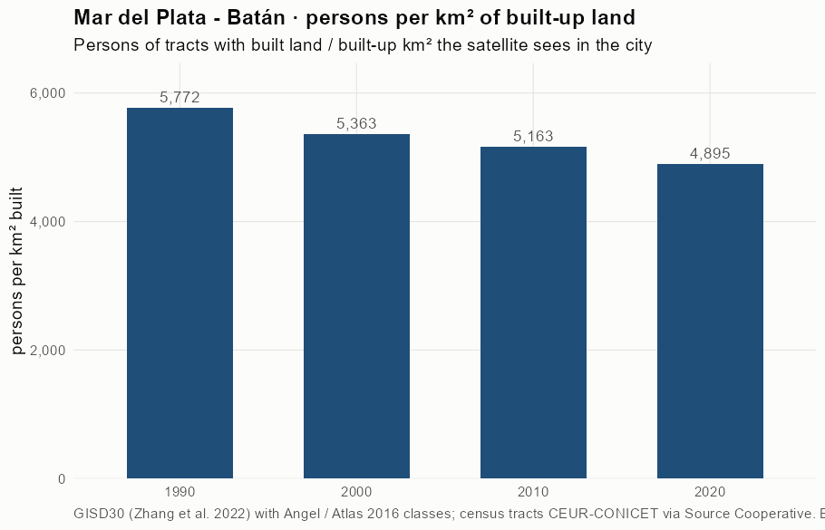
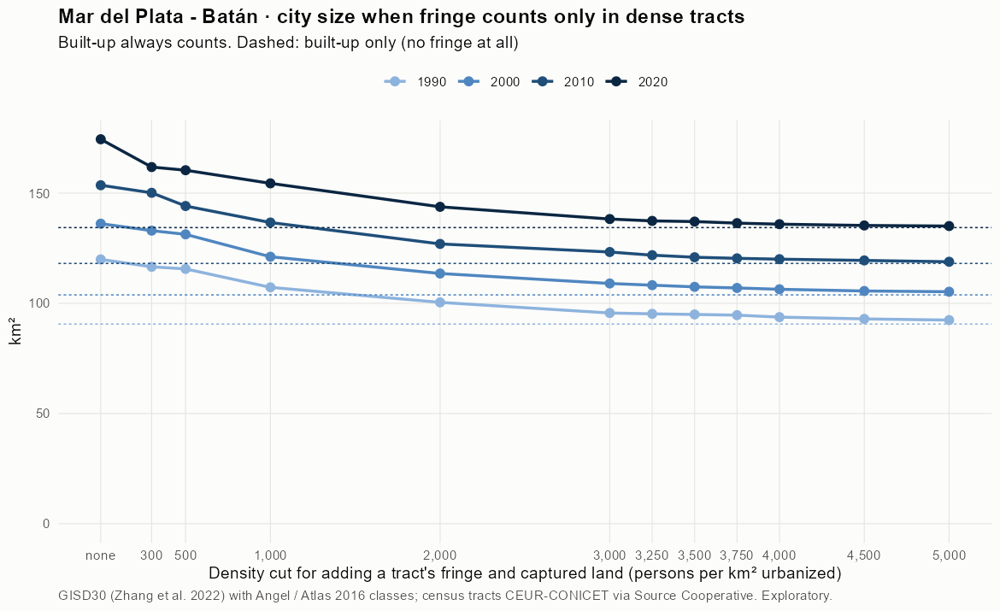
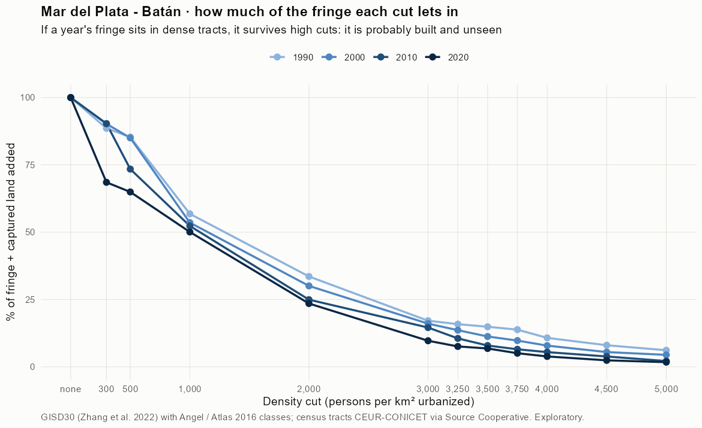
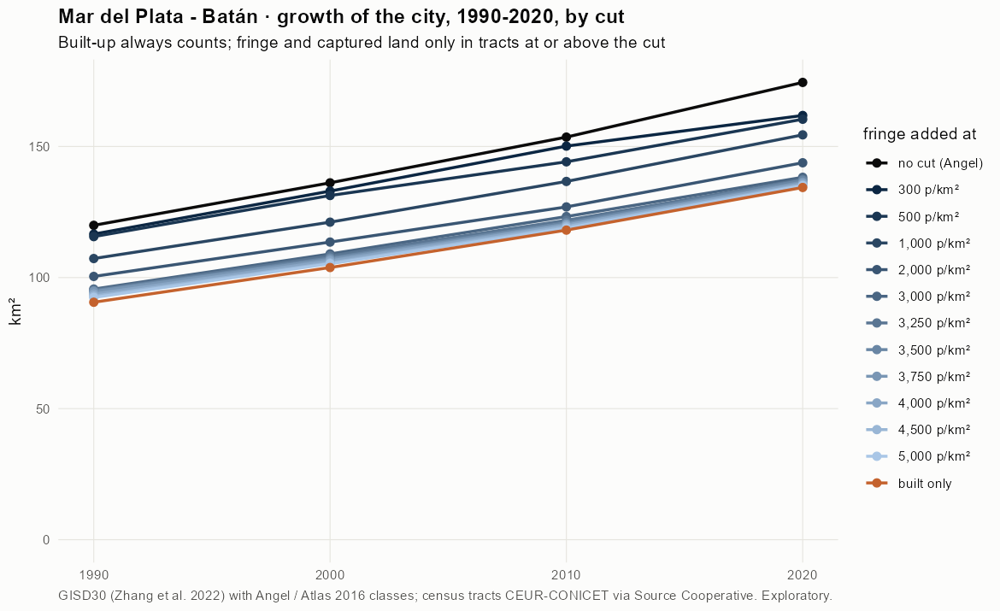
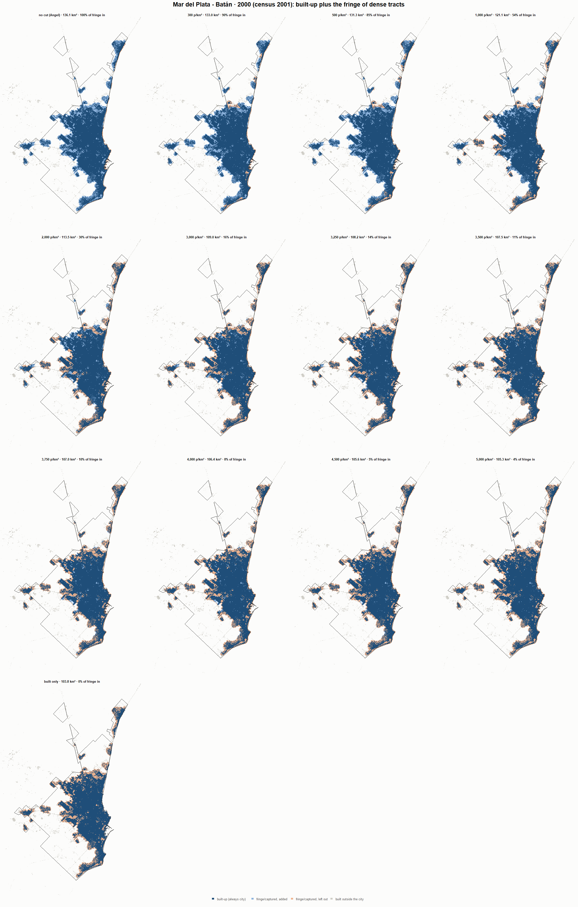
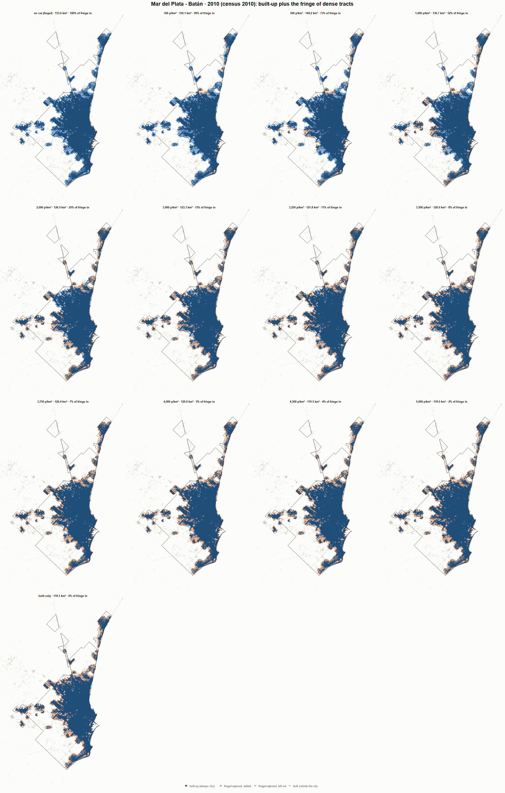
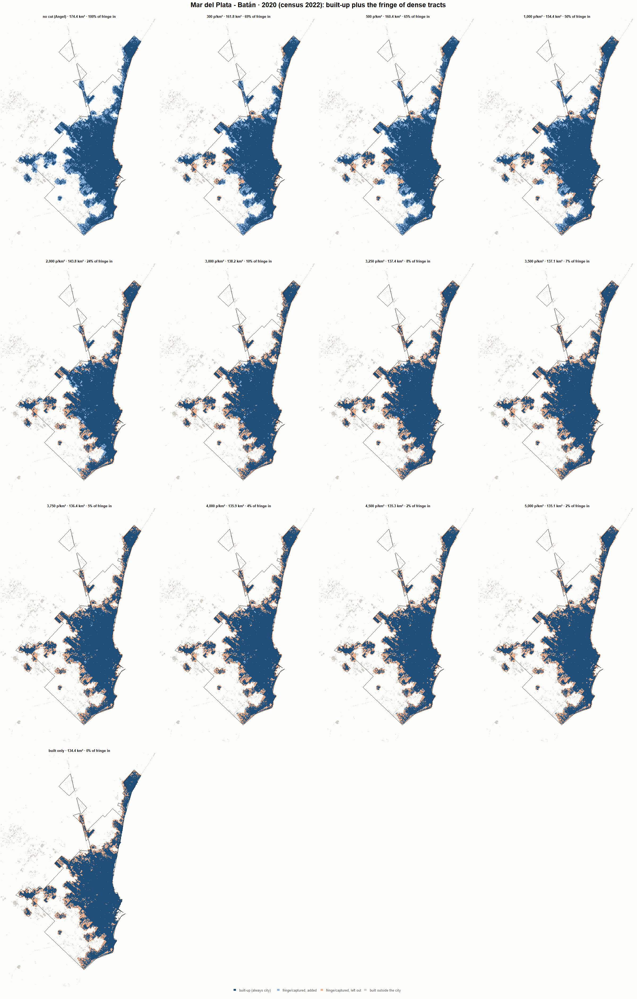

# Mar del Plata - Batán · when does the fringe count as city? 1990-2020

Exploratory test 2. None of these numbers are project figures (they are not in `CIFRAS_CANONICAS.json`). Generated by `Rpipe/scripts/13_prueba_franja.R` from the tract tables of step 11. Run of 2026-11-08. [All agglomerations](../REPORTE.md).

**Idea.** Built-up land is always city. Fringe and captured open space join the city **only in dense tracts**, where they are probably built and unseen by the older imagery. No cut gives the full Angel extent; an infinite cut, built-up only. Method in the [index](../REPORTE.md#method).

## Is the early imagery under-detecting?

If the older imagery misses buildings, persons per km² of *built* land should come out higher in the early years.

| Year | Persons (tracts with built land) | Built km² | Persons / km² built | Median tract, persons / km² built | Fringe + captured, % of extent |
|---|---|---|---|---|---|
| 1990 (census 1991) | 522,809 | 90.6 | 5,772 | 5,359 | 24.5 |
| 2000 (census 2001) | 556,823 | 103.8 | 5,363 | 4,957 | 23.7 |
| 2010 (census 2010) | 609,739 | 118.1 | 5,163 | 4,743 | 23.1 |
| 2020 (census 2022) | 657,645 | 134.4 | 4,895 | 4,408 | 23.0 |

## Results

**1990 (census 1991).** Built-up 90.6 km²; fringe + captured 29.3 km²; 522,904 persons in the city's tracts.

| Fringe added at | City km² | Fringe added km² | % of fringe added | Fringe % of city | Tracts adding fringe | Persons / km² city |
|---|---|---|---|---|---|---|
| no cut (Angel) | 119.9 | 29.3 | 100.0 | 24.5 | 287 | 4,360 |
| 300 p/km² | 116.6 | 26.0 | 88.6 | 22.3 | 277 | 4,486 |
| 500 p/km² | 115.6 | 25.0 | 85.3 | 21.7 | 273 | 4,523 |
| 1,000 p/km² | 107.3 | 16.7 | 56.8 | 15.5 | 245 | 4,875 |
| 2,000 p/km² | 100.4 | 9.8 | 33.6 | 9.8 | 216 | 5,207 |
| 3,000 p/km² | 95.6 | 5.0 | 17.1 | 5.3 | 188 | 5,470 |
| 3,250 p/km² | 95.2 | 4.7 | 15.9 | 4.9 | 180 | 5,491 |
| 3,500 p/km² | 94.9 | 4.4 | 14.9 | 4.6 | 175 | 5,507 |
| 3,750 p/km² | 94.6 | 4.1 | 13.8 | 4.3 | 166 | 5,526 |
| 4,000 p/km² | 93.7 | 3.2 | 10.8 | 3.4 | 155 | 5,579 |
| 4,500 p/km² | 92.9 | 2.4 | 8.0 | 2.5 | 139 | 5,627 |
| 5,000 p/km² | 92.4 | 1.8 | 6.2 | 2.0 | 125 | 5,660 |
| built only | 90.6 | 0.0 | 0.0 | 0.0 | 0 | 5,773 |

**2000 (census 2001).** Built-up 103.8 km²; fringe + captured 32.3 km²; 557,580 persons in the city's tracts.

| Fringe added at | City km² | Fringe added km² | % of fringe added | Fringe % of city | Tracts adding fringe | Persons / km² city |
|---|---|---|---|---|---|---|
| no cut (Angel) | 136.1 | 32.3 | 100.0 | 23.7 | 379 | 4,096 |
| 300 p/km² | 133.0 | 29.2 | 90.2 | 21.9 | 372 | 4,193 |
| 500 p/km² | 131.3 | 27.5 | 85.0 | 20.9 | 363 | 4,247 |
| 1,000 p/km² | 121.1 | 17.3 | 53.6 | 14.3 | 339 | 4,603 |
| 2,000 p/km² | 113.5 | 9.7 | 30.1 | 8.6 | 294 | 4,911 |
| 3,000 p/km² | 109.0 | 5.2 | 16.0 | 4.8 | 248 | 5,115 |
| 3,250 p/km² | 108.2 | 4.4 | 13.6 | 4.1 | 234 | 5,152 |
| 3,500 p/km² | 107.5 | 3.6 | 11.3 | 3.4 | 223 | 5,188 |
| 3,750 p/km² | 107.0 | 3.2 | 9.8 | 2.9 | 211 | 5,212 |
| 4,000 p/km² | 106.4 | 2.5 | 7.9 | 2.4 | 189 | 5,242 |
| 4,500 p/km² | 105.6 | 1.8 | 5.5 | 1.7 | 159 | 5,280 |
| 5,000 p/km² | 105.3 | 1.4 | 4.4 | 1.4 | 138 | 5,297 |
| built only | 103.8 | 0.0 | 0.0 | 0.0 | 0 | 5,371 |

**2010 (census 2010).** Built-up 118.1 km²; fringe + captured 35.5 km²; 611,123 persons in the city's tracts.

| Fringe added at | City km² | Fringe added km² | % of fringe added | Fringe % of city | Tracts adding fringe | Persons / km² city |
|---|---|---|---|---|---|---|
| no cut (Angel) | 153.6 | 35.5 | 100.0 | 23.1 | 335 | 3,979 |
| 300 p/km² | 150.1 | 32.1 | 90.3 | 21.3 | 326 | 4,070 |
| 500 p/km² | 144.2 | 26.1 | 73.4 | 18.1 | 312 | 4,239 |
| 1,000 p/km² | 136.7 | 18.6 | 52.3 | 13.6 | 281 | 4,472 |
| 2,000 p/km² | 126.9 | 8.9 | 24.9 | 7.0 | 226 | 4,814 |
| 3,000 p/km² | 123.3 | 5.2 | 14.6 | 4.2 | 180 | 4,957 |
| 3,250 p/km² | 121.8 | 3.7 | 10.6 | 3.1 | 163 | 5,016 |
| 3,500 p/km² | 120.9 | 2.8 | 7.9 | 2.3 | 151 | 5,055 |
| 3,750 p/km² | 120.4 | 2.3 | 6.5 | 1.9 | 142 | 5,075 |
| 4,000 p/km² | 120.0 | 1.9 | 5.5 | 1.6 | 128 | 5,091 |
| 4,500 p/km² | 119.5 | 1.4 | 3.9 | 1.1 | 102 | 5,116 |
| 5,000 p/km² | 118.9 | 0.8 | 2.2 | 0.6 | 81 | 5,141 |
| built only | 118.1 | 0.0 | 0.0 | 0.0 | 0 | 5,175 |

**2020 (census 2022).** Built-up 134.4 km²; fringe + captured 40.1 km²; 657,932 persons in the city's tracts.

| Fringe added at | City km² | Fringe added km² | % of fringe added | Fringe % of city | Tracts adding fringe | Persons / km² city |
|---|---|---|---|---|---|---|
| no cut (Angel) | 174.4 | 40.1 | 100.0 | 23.0 | 377 | 3,772 |
| 300 p/km² | 161.8 | 27.5 | 68.5 | 17.0 | 357 | 4,066 |
| 500 p/km² | 160.4 | 26.0 | 64.9 | 16.2 | 352 | 4,102 |
| 1,000 p/km² | 154.4 | 20.1 | 50.1 | 13.0 | 328 | 4,260 |
| 2,000 p/km² | 143.8 | 9.4 | 23.5 | 6.6 | 255 | 4,576 |
| 3,000 p/km² | 138.2 | 3.9 | 9.7 | 2.8 | 186 | 4,759 |
| 3,250 p/km² | 137.4 | 3.0 | 7.6 | 2.2 | 167 | 4,788 |
| 3,500 p/km² | 137.1 | 2.7 | 6.8 | 2.0 | 156 | 4,799 |
| 3,750 p/km² | 136.4 | 2.0 | 5.1 | 1.5 | 136 | 4,824 |
| 4,000 p/km² | 135.9 | 1.5 | 3.9 | 1.1 | 118 | 4,841 |
| 4,500 p/km² | 135.3 | 1.0 | 2.4 | 0.7 | 95 | 4,862 |
| 5,000 p/km² | 135.1 | 0.7 | 1.7 | 0.5 | 68 | 4,871 |
| built only | 134.4 | 0.0 | 0.0 | 0.0 | 0 | 4,897 |

### Growth by cut

| Fringe added at | 1990 km² | 2000 km² | 2010 km² | 2020 km² | 1990-2000 %/yr | 2000-2010 %/yr | 2010-2020 %/yr | 1990-2020 %/yr |
|---|---|---|---|---|---|---|---|---|
| no cut (Angel) | 119.9 | 136.1 | 153.6 | 174.4 | 1.28 | 1.21 | 1.28 | 1.26 |
| 300 p/km² | 116.6 | 133.0 | 150.1 | 161.8 | 1.33 | 1.22 | 0.75 | 1.10 |
| 500 p/km² | 115.6 | 131.3 | 144.2 | 160.4 | 1.28 | 0.94 | 1.07 | 1.10 |
| 1,000 p/km² | 107.3 | 121.1 | 136.7 | 154.4 | 1.22 | 1.21 | 1.23 | 1.22 |
| 2,000 p/km² | 100.4 | 113.5 | 126.9 | 143.8 | 1.23 | 1.12 | 1.25 | 1.20 |
| 3,000 p/km² | 95.6 | 109.0 | 123.3 | 138.2 | 1.32 | 1.24 | 1.15 | 1.24 |
| 3,250 p/km² | 95.2 | 108.2 | 121.8 | 137.4 | 1.29 | 1.19 | 1.21 | 1.23 |
| 3,500 p/km² | 94.9 | 107.5 | 120.9 | 137.1 | 1.25 | 1.19 | 1.26 | 1.23 |
| 3,750 p/km² | 94.6 | 107.0 | 120.4 | 136.4 | 1.23 | 1.19 | 1.25 | 1.23 |
| 4,000 p/km² | 93.7 | 106.4 | 120.0 | 135.9 | 1.27 | 1.22 | 1.25 | 1.25 |
| 4,500 p/km² | 92.9 | 105.6 | 119.5 | 135.3 | 1.29 | 1.24 | 1.26 | 1.26 |
| 5,000 p/km² | 92.4 | 105.3 | 118.9 | 135.1 | 1.31 | 1.22 | 1.29 | 1.27 |
| built only | 90.6 | 103.8 | 118.1 | 134.4 | 1.37 | 1.30 | 1.30 | 1.32 |

## Maps

Same frame in the four years: the 2020 city plus 3 km. Dark blue is built-up, always city; light blue is fringe or captured land added because its tract is dense; light orange is fringe left out. Black line: the analysis perimeter.

### 1990

### 2000

### 2010

### 2020

## Reading

- **The premise.** Persons per km² of built land: 5,772 in 1990, 5,363 in 2000, 5,163 in 2010, 4,895 in 2020. 1990 is not clearly higher than 2010: the census does not point to much built land missed in 1990.
- **At 500 p/km²** the fringe that joins the city is 85.3 % of all fringe in 1990 and 64.9 % in 2020.
- **Growth 1990-2020**: 1.26 %/yr with the full Angel extent, 1.10 %/yr at 500, 1.32 %/yr built-up only.

