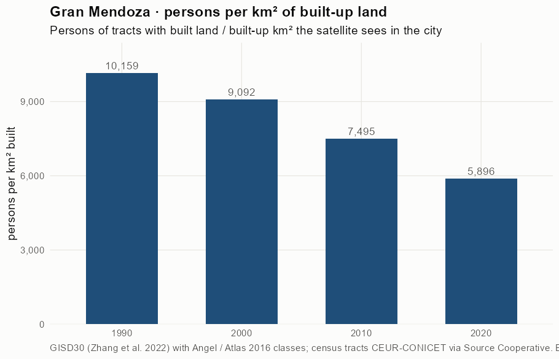
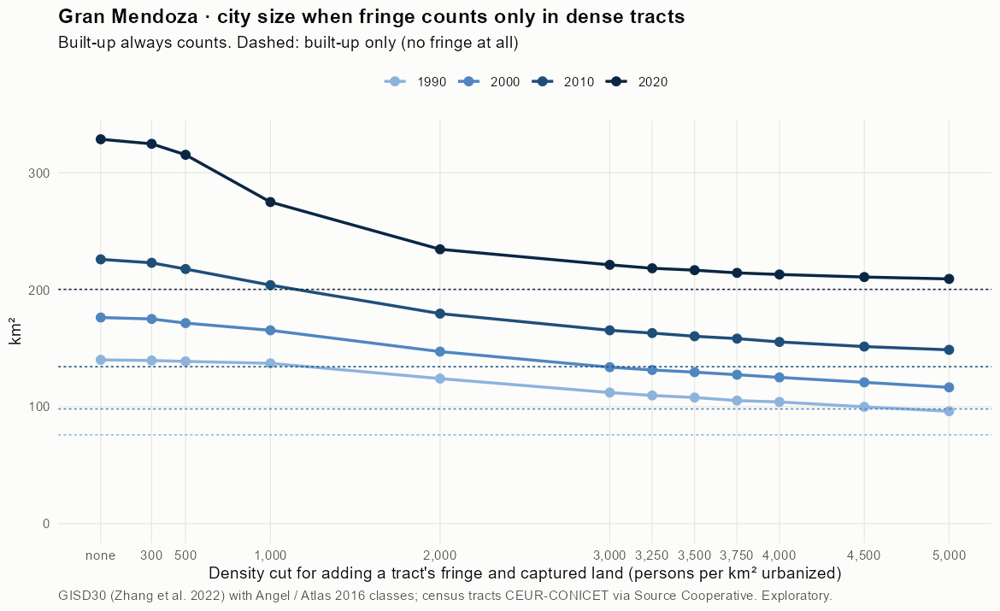
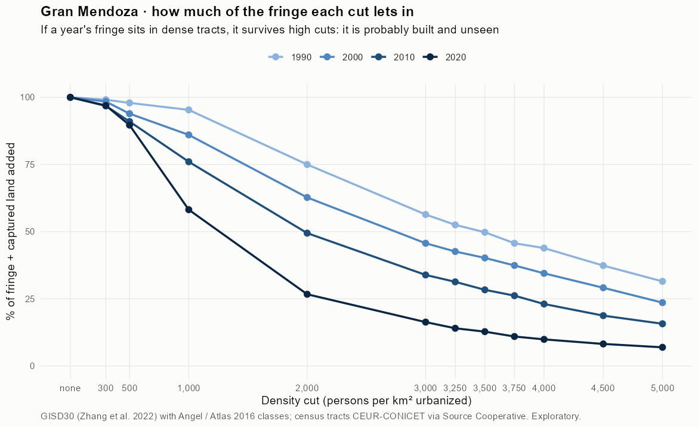
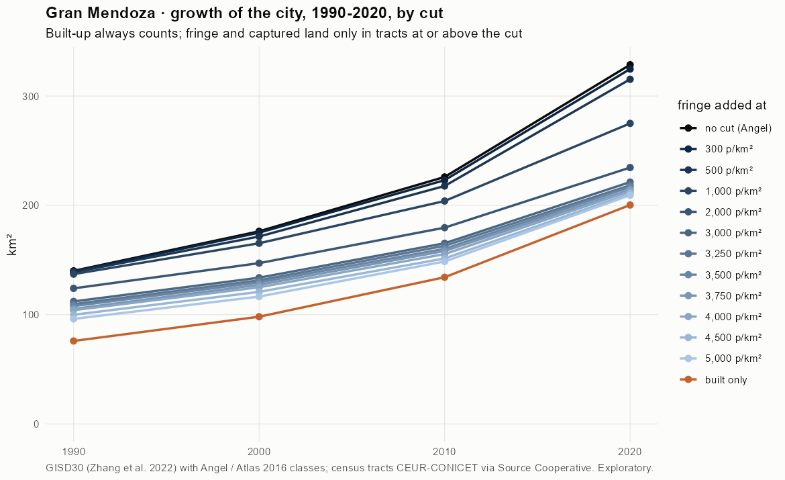
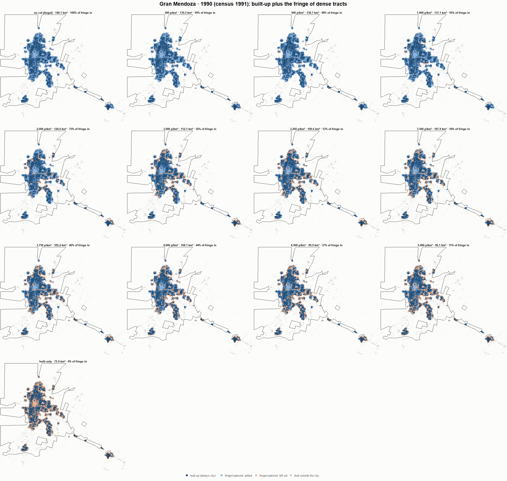
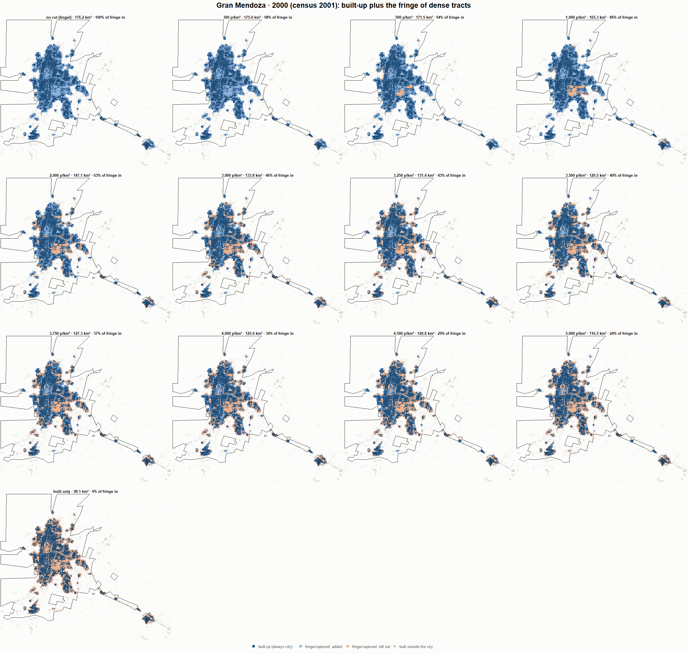
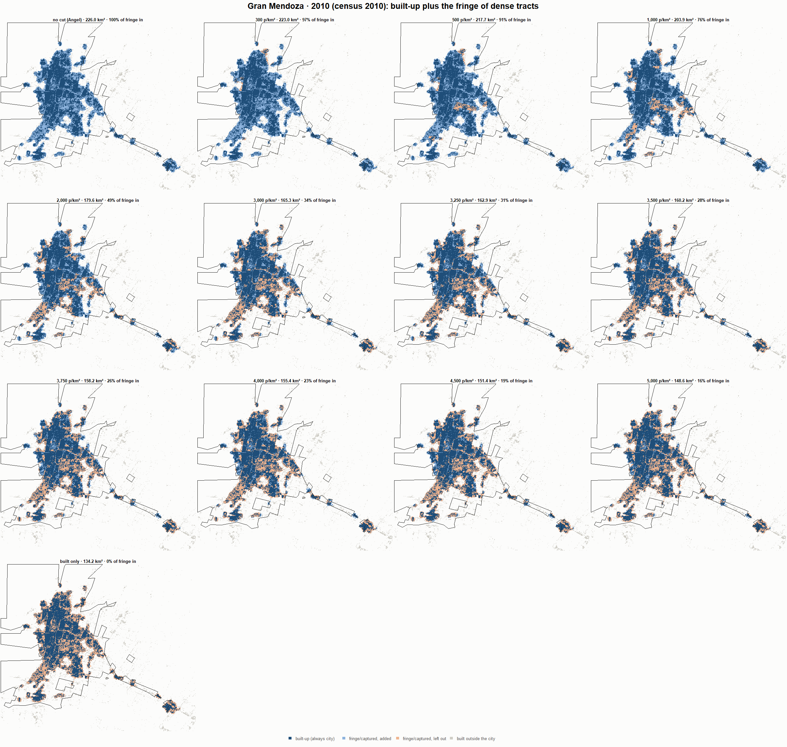
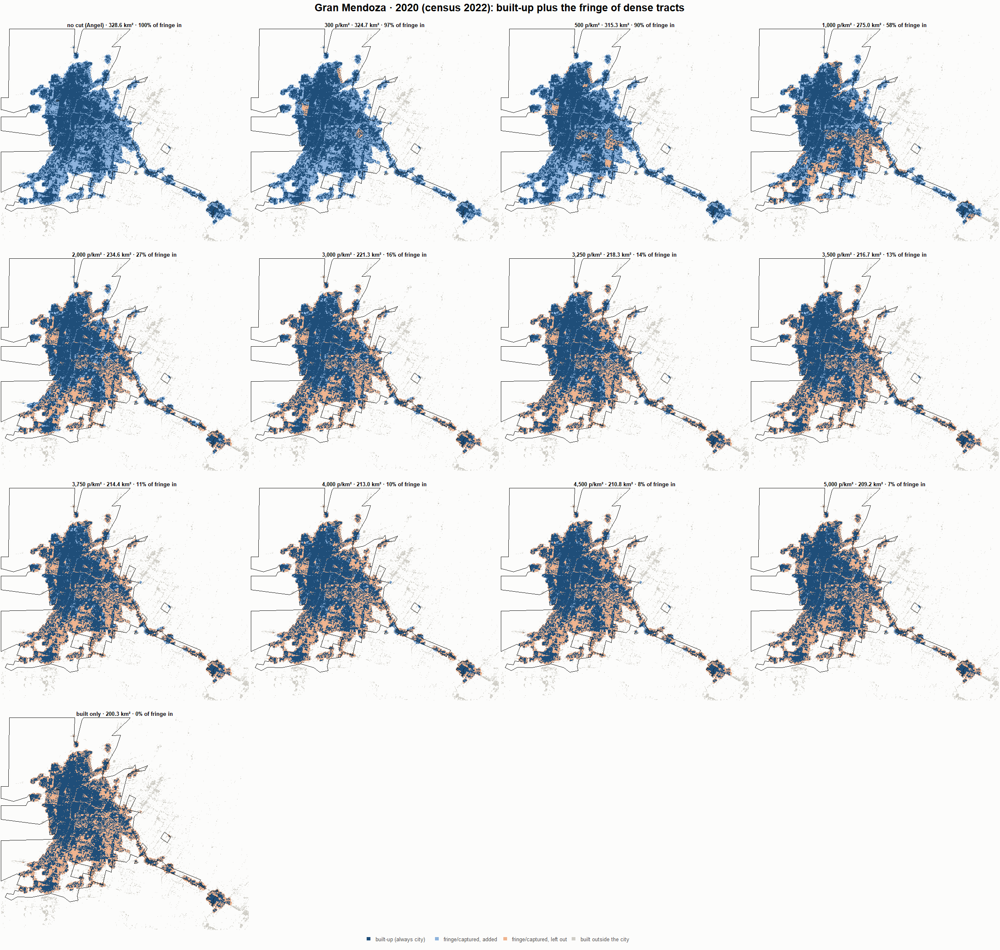

# Gran Mendoza · when does the fringe count as city? 1990-2020

Exploratory test 2. None of these numbers are project figures (they are not in `CIFRAS_CANONICAS.json`). Generated by `Rpipe/scripts/13_prueba_franja.R` from the tract tables of step 11. Run of 2026-11-08. [All agglomerations](../REPORTE.md).

**Idea.** Built-up land is always city. Fringe and captured open space join the city **only in dense tracts**, where they are probably built and unseen by the older imagery. No cut gives the full Angel extent; an infinite cut, built-up only. Method in the [index](../REPORTE.md#method).

## Is the early imagery under-detecting?

If the older imagery misses buildings, persons per km² of *built* land should come out higher in the early years.

| Year | Persons (tracts with built land) | Built km² | Persons / km² built | Median tract, persons / km² built | Fringe + captured, % of extent |
|---|---|---|---|---|---|
| 1990 (census 1991) | 771,356 | 75.9 | 10,159 | 8,689 | 45.4 |
| 2000 (census 2001) | 892,013 | 98.1 | 9,092 | 7,897 | 44.2 |
| 2010 (census 2010) | 1,005,940 | 134.2 | 7,495 | 6,940 | 40.6 |
| 2020 (census 2022) | 1,181,133 | 200.3 | 5,896 | 5,455 | 39.0 |

## Results

**1990 (census 1991).** Built-up 75.9 km²; fringe + captured 64.2 km²; 796,411 persons in the city's tracts.

| Fringe added at | City km² | Fringe added km² | % of fringe added | Fringe % of city | Tracts adding fringe | Persons / km² city |
|---|---|---|---|---|---|---|
| no cut (Angel) | 140.1 | 64.2 | 100.0 | 45.8 | 748 | 5,685 |
| 300 p/km² | 139.5 | 63.6 | 99.1 | 45.6 | 746 | 5,709 |
| 500 p/km² | 138.7 | 62.8 | 97.9 | 45.3 | 745 | 5,740 |
| 1,000 p/km² | 137.1 | 61.2 | 95.3 | 44.6 | 742 | 5,810 |
| 2,000 p/km² | 124.0 | 48.1 | 75.0 | 38.8 | 709 | 6,421 |
| 3,000 p/km² | 112.1 | 36.2 | 56.4 | 32.3 | 661 | 7,105 |
| 3,250 p/km² | 109.6 | 33.7 | 52.5 | 30.7 | 652 | 7,265 |
| 3,500 p/km² | 107.9 | 31.9 | 49.8 | 29.6 | 643 | 7,384 |
| 3,750 p/km² | 105.2 | 29.3 | 45.7 | 27.9 | 624 | 7,568 |
| 4,000 p/km² | 104.1 | 28.2 | 43.9 | 27.0 | 615 | 7,652 |
| 4,500 p/km² | 99.9 | 24.0 | 37.4 | 24.0 | 581 | 7,972 |
| 5,000 p/km² | 96.1 | 20.2 | 31.5 | 21.0 | 546 | 8,285 |
| built only | 75.9 | 0.0 | 0.0 | 0.0 | 0 | 10,489 |

**2000 (census 2001).** Built-up 98.1 km²; fringe + captured 78.1 km²; 902,816 persons in the city's tracts.

| Fringe added at | City km² | Fringe added km² | % of fringe added | Fringe % of city | Tracts adding fringe | Persons / km² city |
|---|---|---|---|---|---|---|
| no cut (Angel) | 176.2 | 78.1 | 100.0 | 44.3 | 894 | 5,123 |
| 300 p/km² | 175.0 | 76.9 | 98.4 | 43.9 | 891 | 5,159 |
| 500 p/km² | 171.5 | 73.4 | 93.9 | 42.8 | 888 | 5,265 |
| 1,000 p/km² | 165.3 | 67.2 | 86.0 | 40.7 | 881 | 5,461 |
| 2,000 p/km² | 147.1 | 49.0 | 62.7 | 33.3 | 838 | 6,137 |
| 3,000 p/km² | 133.8 | 35.7 | 45.7 | 26.7 | 779 | 6,748 |
| 3,250 p/km² | 131.4 | 33.3 | 42.6 | 25.3 | 766 | 6,871 |
| 3,500 p/km² | 129.5 | 31.4 | 40.2 | 24.3 | 753 | 6,970 |
| 3,750 p/km² | 127.3 | 29.2 | 37.4 | 23.0 | 736 | 7,090 |
| 4,000 p/km² | 125.0 | 26.9 | 34.5 | 21.5 | 719 | 7,220 |
| 4,500 p/km² | 120.8 | 22.7 | 29.1 | 18.8 | 678 | 7,471 |
| 5,000 p/km² | 116.5 | 18.4 | 23.6 | 15.8 | 630 | 7,748 |
| built only | 98.1 | 0.0 | 0.0 | 0.0 | 0 | 9,202 |

**2010 (census 2010).** Built-up 134.2 km²; fringe + captured 91.7 km²; 1,008,397 persons in the city's tracts.

| Fringe added at | City km² | Fringe added km² | % of fringe added | Fringe % of city | Tracts adding fringe | Persons / km² city |
|---|---|---|---|---|---|---|
| no cut (Angel) | 226.0 | 91.7 | 100.0 | 40.6 | 952 | 4,463 |
| 300 p/km² | 223.0 | 88.8 | 96.8 | 39.8 | 947 | 4,522 |
| 500 p/km² | 217.7 | 83.5 | 91.0 | 38.3 | 943 | 4,632 |
| 1,000 p/km² | 203.9 | 69.7 | 76.0 | 34.2 | 922 | 4,944 |
| 2,000 p/km² | 179.6 | 45.4 | 49.5 | 25.3 | 862 | 5,615 |
| 3,000 p/km² | 165.3 | 31.1 | 33.9 | 18.8 | 789 | 6,100 |
| 3,250 p/km² | 162.9 | 28.7 | 31.3 | 17.6 | 772 | 6,189 |
| 3,500 p/km² | 160.2 | 26.0 | 28.4 | 16.2 | 751 | 6,294 |
| 3,750 p/km² | 158.2 | 24.0 | 26.2 | 15.2 | 732 | 6,373 |
| 4,000 p/km² | 155.4 | 21.2 | 23.1 | 13.6 | 707 | 6,490 |
| 4,500 p/km² | 151.4 | 17.2 | 18.7 | 11.4 | 665 | 6,660 |
| 5,000 p/km² | 148.6 | 14.4 | 15.7 | 9.7 | 621 | 6,785 |
| built only | 134.2 | 0.0 | 0.0 | 0.0 | 0 | 7,514 |

**2020 (census 2022).** Built-up 200.3 km²; fringe + captured 128.3 km²; 1,184,290 persons in the city's tracts.

| Fringe added at | City km² | Fringe added km² | % of fringe added | Fringe % of city | Tracts adding fringe | Persons / km² city |
|---|---|---|---|---|---|---|
| no cut (Angel) | 328.6 | 128.3 | 100.0 | 39.0 | 1,072 | 3,604 |
| 300 p/km² | 324.7 | 124.4 | 96.9 | 38.3 | 1,066 | 3,647 |
| 500 p/km² | 315.3 | 115.0 | 89.6 | 36.5 | 1,055 | 3,756 |
| 1,000 p/km² | 275.0 | 74.6 | 58.2 | 27.1 | 1,004 | 4,307 |
| 2,000 p/km² | 234.6 | 34.2 | 26.7 | 14.6 | 892 | 5,049 |
| 3,000 p/km² | 221.3 | 21.0 | 16.3 | 9.5 | 810 | 5,352 |
| 3,250 p/km² | 218.3 | 18.0 | 14.0 | 8.3 | 775 | 5,424 |
| 3,500 p/km² | 216.7 | 16.4 | 12.8 | 7.6 | 755 | 5,465 |
| 3,750 p/km² | 214.4 | 14.1 | 11.0 | 6.6 | 725 | 5,524 |
| 4,000 p/km² | 213.0 | 12.7 | 9.9 | 6.0 | 701 | 5,559 |
| 4,500 p/km² | 210.8 | 10.5 | 8.2 | 5.0 | 653 | 5,617 |
| 5,000 p/km² | 209.2 | 8.9 | 7.0 | 4.3 | 616 | 5,660 |
| built only | 200.3 | 0.0 | 0.0 | 0.0 | 0 | 5,912 |

### Growth by cut

| Fringe added at | 1990 km² | 2000 km² | 2010 km² | 2020 km² | 1990-2000 %/yr | 2000-2010 %/yr | 2010-2020 %/yr | 1990-2020 %/yr |
|---|---|---|---|---|---|---|---|---|
| no cut (Angel) | 140.1 | 176.2 | 226.0 | 328.6 | 2.32 | 2.52 | 3.82 | 2.88 |
| 300 p/km² | 139.5 | 175.0 | 223.0 | 324.7 | 2.29 | 2.45 | 3.83 | 2.86 |
| 500 p/km² | 138.7 | 171.5 | 217.7 | 315.3 | 2.14 | 2.41 | 3.78 | 2.77 |
| 1,000 p/km² | 137.1 | 165.3 | 203.9 | 275.0 | 1.89 | 2.12 | 3.03 | 2.35 |
| 2,000 p/km² | 124.0 | 147.1 | 179.6 | 234.6 | 1.72 | 2.01 | 2.71 | 2.15 |
| 3,000 p/km² | 112.1 | 133.8 | 165.3 | 221.3 | 1.79 | 2.14 | 2.96 | 2.29 |
| 3,250 p/km² | 109.6 | 131.4 | 162.9 | 218.3 | 1.83 | 2.17 | 2.97 | 2.32 |
| 3,500 p/km² | 107.9 | 129.5 | 160.2 | 216.7 | 1.85 | 2.15 | 3.07 | 2.35 |
| 3,750 p/km² | 105.2 | 127.3 | 158.2 | 214.4 | 1.92 | 2.20 | 3.08 | 2.40 |
| 4,000 p/km² | 104.1 | 125.0 | 155.4 | 213.0 | 1.85 | 2.20 | 3.21 | 2.42 |
| 4,500 p/km² | 99.9 | 120.8 | 151.4 | 210.8 | 1.92 | 2.28 | 3.37 | 2.52 |
| 5,000 p/km² | 96.1 | 116.5 | 148.6 | 209.2 | 1.94 | 2.46 | 3.48 | 2.63 |
| built only | 75.9 | 98.1 | 134.2 | 200.3 | 2.60 | 3.18 | 4.09 | 3.29 |

## Maps

Same frame in the four years: the 2020 city plus 3 km. Dark blue is built-up, always city; light blue is fringe or captured land added because its tract is dense; light orange is fringe left out. Black line: the analysis perimeter.

### 1990

### 2000

### 2010

### 2020

## Reading

- **The premise.** Persons per km² of built land: 10,159 in 1990, 9,092 in 2000, 7,495 in 2010, 5,896 in 2020. 1990 is clearly higher than 2010: consistent with built land missed in 1990, though it also fits a denser city that later spread out.
- **At 500 p/km²** the fringe that joins the city is 97.9 % of all fringe in 1990 and 89.6 % in 2020.
- **Growth 1990-2020**: 2.88 %/yr with the full Angel extent, 2.77 %/yr at 500, 3.29 %/yr built-up only.

