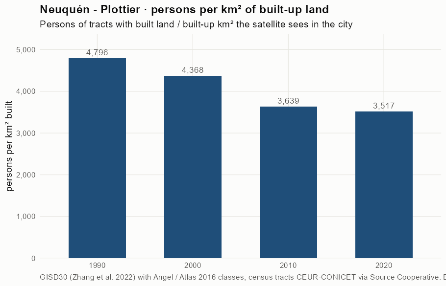
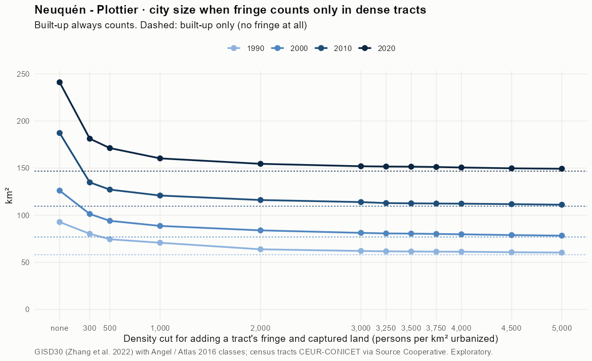
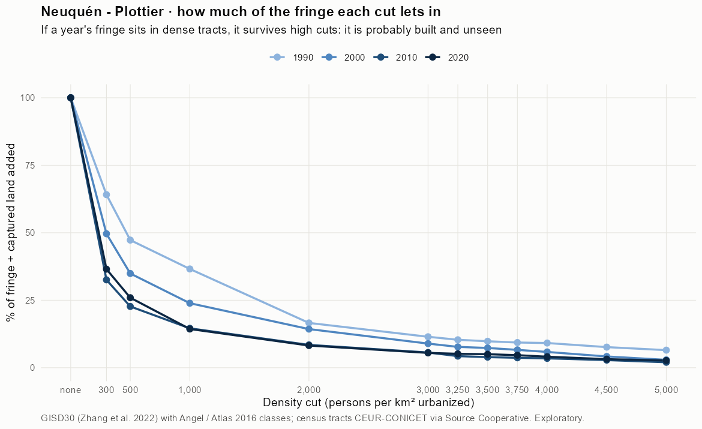
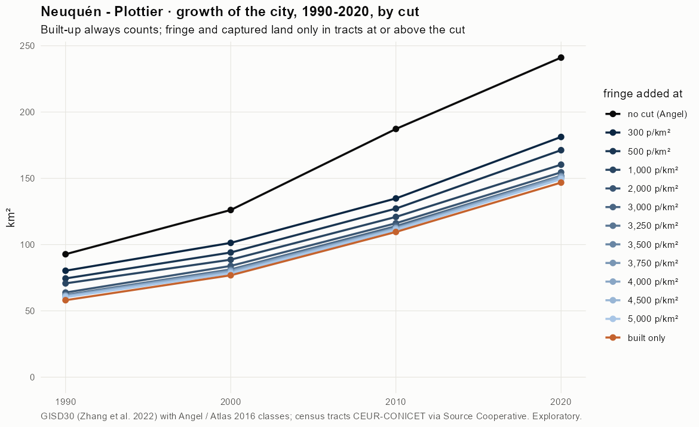
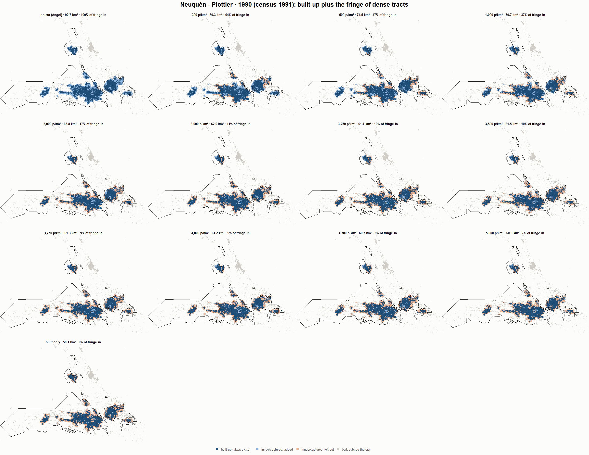
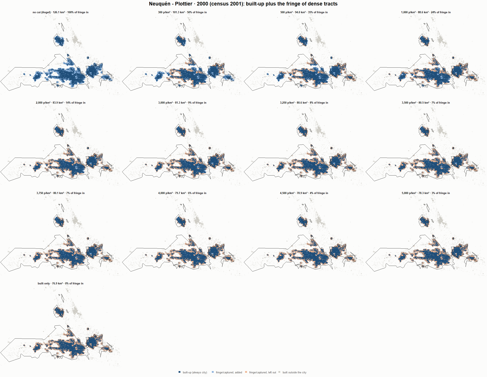
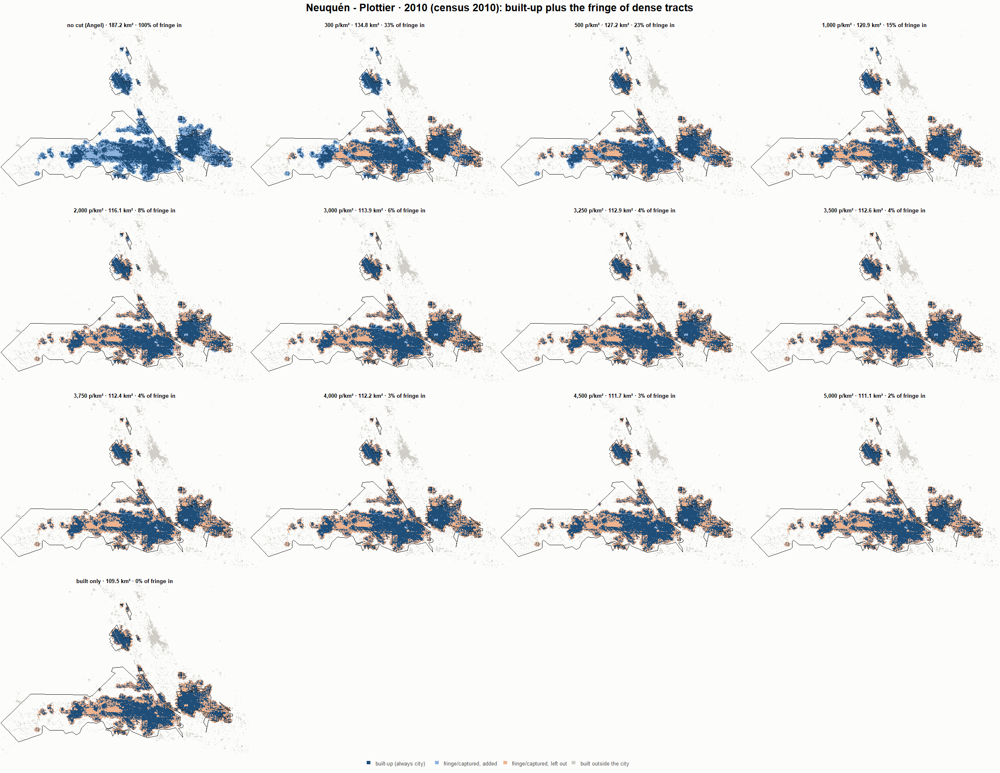
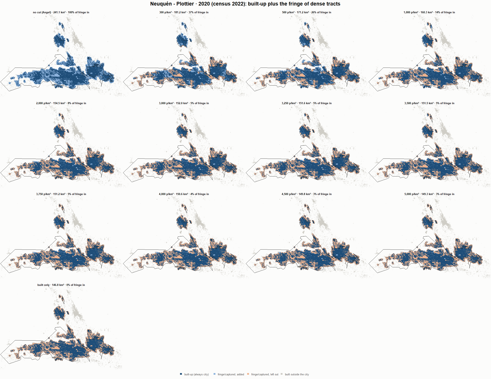

# Neuquén - Plottier · when does the fringe count as city? 1990-2020

Exploratory test 2. None of these numbers are project figures (they are not in `CIFRAS_CANONICAS.json`). Generated by `Rpipe/scripts/13_prueba_franja.R` from the tract tables of step 11. Run of 2026-11-08. [All agglomerations](../REPORTE.md).

**Idea.** Built-up land is always city. Fringe and captured open space join the city **only in dense tracts**, where they are probably built and unseen by the older imagery. No cut gives the full Angel extent; an infinite cut, built-up only. Method in the [index](../REPORTE.md#method).

## Is the early imagery under-detecting?

If the older imagery misses buildings, persons per km² of *built* land should come out higher in the early years.

| Year | Persons (tracts with built land) | Built km² | Persons / km² built | Median tract, persons / km² built | Fringe + captured, % of extent |
|---|---|---|---|---|---|
| 1990 (census 1991) | 278,457 | 58.1 | 4,796 | 3,698 | 37.3 |
| 2000 (census 2001) | 335,652 | 76.9 | 4,368 | 3,516 | 39.0 |
| 2010 (census 2010) | 398,576 | 109.5 | 3,639 | 2,611 | 41.5 |
| 2020 (census 2022) | 516,215 | 146.8 | 3,517 | 2,119 | 39.1 |

## Results

**1990 (census 1991).** Built-up 58.1 km²; fringe + captured 34.7 km²; 279,108 persons in the city's tracts.

| Fringe added at | City km² | Fringe added km² | % of fringe added | Fringe % of city | Tracts adding fringe | Persons / km² city |
|---|---|---|---|---|---|---|
| no cut (Angel) | 92.7 | 34.7 | 100.0 | 37.4 | 266 | 3,010 |
| 300 p/km² | 80.3 | 22.2 | 64.1 | 27.7 | 252 | 3,476 |
| 500 p/km² | 74.5 | 16.4 | 47.3 | 22.0 | 246 | 3,749 |
| 1,000 p/km² | 70.7 | 12.7 | 36.6 | 17.9 | 238 | 3,945 |
| 2,000 p/km² | 63.8 | 5.8 | 16.6 | 9.0 | 214 | 4,374 |
| 3,000 p/km² | 62.0 | 4.0 | 11.5 | 6.4 | 190 | 4,499 |
| 3,250 p/km² | 61.7 | 3.6 | 10.3 | 5.8 | 182 | 4,527 |
| 3,500 p/km² | 61.5 | 3.4 | 9.8 | 5.5 | 174 | 4,541 |
| 3,750 p/km² | 61.3 | 3.2 | 9.3 | 5.3 | 172 | 4,553 |
| 4,000 p/km² | 61.2 | 3.2 | 9.1 | 5.2 | 168 | 4,558 |
| 4,500 p/km² | 60.7 | 2.6 | 7.6 | 4.4 | 149 | 4,598 |
| 5,000 p/km² | 60.3 | 2.3 | 6.5 | 3.7 | 138 | 4,627 |
| built only | 58.1 | 0.0 | 0.0 | 0.0 | 0 | 4,807 |

**2000 (census 2001).** Built-up 76.9 km²; fringe + captured 49.3 km²; 336,436 persons in the city's tracts.

| Fringe added at | City km² | Fringe added km² | % of fringe added | Fringe % of city | Tracts adding fringe | Persons / km² city |
|---|---|---|---|---|---|---|
| no cut (Angel) | 126.1 | 49.3 | 100.0 | 39.1 | 301 | 2,668 |
| 300 p/km² | 101.3 | 24.4 | 49.6 | 24.1 | 286 | 3,321 |
| 500 p/km² | 94.0 | 17.2 | 34.9 | 18.3 | 281 | 3,577 |
| 1,000 p/km² | 88.6 | 11.8 | 23.9 | 13.3 | 272 | 3,796 |
| 2,000 p/km² | 83.9 | 7.0 | 14.3 | 8.4 | 252 | 4,010 |
| 3,000 p/km² | 81.3 | 4.4 | 8.9 | 5.4 | 218 | 4,141 |
| 3,250 p/km² | 80.6 | 3.8 | 7.7 | 4.7 | 210 | 4,172 |
| 3,500 p/km² | 80.5 | 3.6 | 7.3 | 4.5 | 202 | 4,182 |
| 3,750 p/km² | 80.1 | 3.3 | 6.6 | 4.1 | 193 | 4,200 |
| 4,000 p/km² | 79.7 | 2.9 | 5.8 | 3.6 | 182 | 4,220 |
| 4,500 p/km² | 78.9 | 2.1 | 4.2 | 2.6 | 161 | 4,264 |
| 5,000 p/km² | 78.3 | 1.4 | 2.9 | 1.8 | 134 | 4,298 |
| built only | 76.9 | 0.0 | 0.0 | 0.0 | 0 | 4,378 |

**2010 (census 2010).** Built-up 109.5 km²; fringe + captured 77.7 km²; 399,040 persons in the city's tracts.

| Fringe added at | City km² | Fringe added km² | % of fringe added | Fringe % of city | Tracts adding fringe | Persons / km² city |
|---|---|---|---|---|---|---|
| no cut (Angel) | 187.2 | 77.7 | 100.0 | 41.5 | 350 | 2,131 |
| 300 p/km² | 134.8 | 25.3 | 32.5 | 18.8 | 325 | 2,960 |
| 500 p/km² | 127.2 | 17.6 | 22.7 | 13.9 | 316 | 3,138 |
| 1,000 p/km² | 120.9 | 11.3 | 14.6 | 9.4 | 302 | 3,301 |
| 2,000 p/km² | 116.1 | 6.6 | 8.4 | 5.7 | 275 | 3,437 |
| 3,000 p/km² | 113.9 | 4.4 | 5.6 | 3.8 | 245 | 3,503 |
| 3,250 p/km² | 112.9 | 3.3 | 4.3 | 3.0 | 226 | 3,535 |
| 3,500 p/km² | 112.6 | 3.0 | 3.9 | 2.7 | 214 | 3,544 |
| 3,750 p/km² | 112.4 | 2.9 | 3.7 | 2.5 | 200 | 3,550 |
| 4,000 p/km² | 112.2 | 2.7 | 3.5 | 2.4 | 193 | 3,556 |
| 4,500 p/km² | 111.7 | 2.2 | 2.8 | 2.0 | 172 | 3,571 |
| 5,000 p/km² | 111.1 | 1.6 | 2.0 | 1.4 | 153 | 3,592 |
| built only | 109.5 | 0.0 | 0.0 | 0.0 | 0 | 3,643 |

**2020 (census 2022).** Built-up 146.8 km²; fringe + captured 94.3 km²; 516,670 persons in the city's tracts.

| Fringe added at | City km² | Fringe added km² | % of fringe added | Fringe % of city | Tracts adding fringe | Persons / km² city |
|---|---|---|---|---|---|---|
| no cut (Angel) | 241.1 | 94.3 | 100.0 | 39.1 | 482 | 2,143 |
| 300 p/km² | 181.2 | 34.4 | 36.5 | 19.0 | 454 | 2,851 |
| 500 p/km² | 171.2 | 24.5 | 25.9 | 14.3 | 441 | 3,017 |
| 1,000 p/km² | 160.3 | 13.5 | 14.3 | 8.4 | 409 | 3,223 |
| 2,000 p/km² | 154.5 | 7.7 | 8.2 | 5.0 | 363 | 3,344 |
| 3,000 p/km² | 152.0 | 5.2 | 5.5 | 3.4 | 317 | 3,400 |
| 3,250 p/km² | 151.6 | 4.9 | 5.1 | 3.2 | 309 | 3,407 |
| 3,500 p/km² | 151.5 | 4.7 | 5.0 | 3.1 | 299 | 3,410 |
| 3,750 p/km² | 151.2 | 4.4 | 4.6 | 2.9 | 289 | 3,418 |
| 4,000 p/km² | 150.6 | 3.8 | 4.1 | 2.5 | 270 | 3,430 |
| 4,500 p/km² | 149.8 | 3.0 | 3.2 | 2.0 | 237 | 3,450 |
| 5,000 p/km² | 149.3 | 2.5 | 2.7 | 1.7 | 219 | 3,461 |
| built only | 146.8 | 0.0 | 0.0 | 0.0 | 0 | 3,520 |

### Growth by cut

| Fringe added at | 1990 km² | 2000 km² | 2010 km² | 2020 km² | 1990-2000 %/yr | 2000-2010 %/yr | 2010-2020 %/yr | 1990-2020 %/yr |
|---|---|---|---|---|---|---|---|---|
| no cut (Angel) | 92.7 | 126.1 | 187.2 | 241.1 | 3.12 | 4.03 | 2.56 | 3.24 |
| 300 p/km² | 80.3 | 101.3 | 134.8 | 181.2 | 2.35 | 2.90 | 3.00 | 2.75 |
| 500 p/km² | 74.5 | 94.0 | 127.2 | 171.2 | 2.36 | 3.06 | 3.02 | 2.81 |
| 1,000 p/km² | 70.7 | 88.6 | 120.9 | 160.3 | 2.28 | 3.15 | 2.86 | 2.76 |
| 2,000 p/km² | 63.8 | 83.9 | 116.1 | 154.5 | 2.77 | 3.30 | 2.90 | 2.99 |
| 3,000 p/km² | 62.0 | 81.3 | 113.9 | 152.0 | 2.73 | 3.44 | 2.92 | 3.03 |
| 3,250 p/km² | 61.7 | 80.6 | 112.9 | 151.6 | 2.72 | 3.42 | 3.00 | 3.05 |
| 3,500 p/km² | 61.5 | 80.5 | 112.6 | 151.5 | 2.73 | 3.42 | 3.01 | 3.05 |
| 3,750 p/km² | 61.3 | 80.1 | 112.4 | 151.2 | 2.71 | 3.44 | 3.01 | 3.05 |
| 4,000 p/km² | 61.2 | 79.7 | 112.2 | 150.6 | 2.67 | 3.48 | 2.99 | 3.05 |
| 4,500 p/km² | 60.7 | 78.9 | 111.7 | 149.8 | 2.66 | 3.54 | 2.97 | 3.06 |
| 5,000 p/km² | 60.3 | 78.3 | 111.1 | 149.3 | 2.64 | 3.56 | 3.00 | 3.07 |
| built only | 58.1 | 76.9 | 109.5 | 146.8 | 2.84 | 3.61 | 2.97 | 3.14 |

## Maps

Same frame in the four years: the 2020 city plus 3 km. Dark blue is built-up, always city; light blue is fringe or captured land added because its tract is dense; light orange is fringe left out. Black line: the analysis perimeter.

### 1990

### 2000

### 2010

### 2020

## Reading

- **The premise.** Persons per km² of built land: 4,796 in 1990, 4,368 in 2000, 3,639 in 2010, 3,517 in 2020. 1990 is clearly higher than 2010: consistent with built land missed in 1990, though it also fits a denser city that later spread out.
- **At 500 p/km²** the fringe that joins the city is 47.3 % of all fringe in 1990 and 25.9 % in 2020.
- **Growth 1990-2020**: 3.24 %/yr with the full Angel extent, 2.81 %/yr at 500, 3.14 %/yr built-up only.

