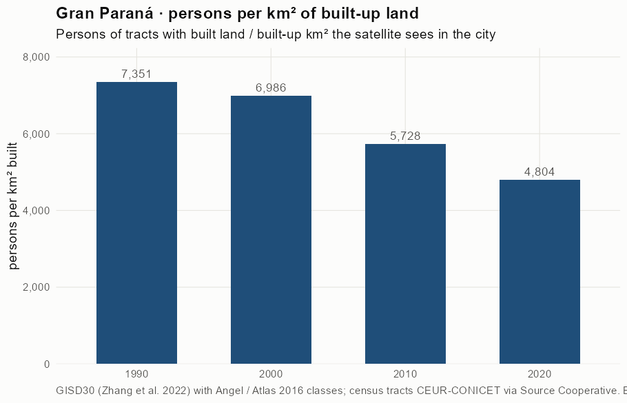
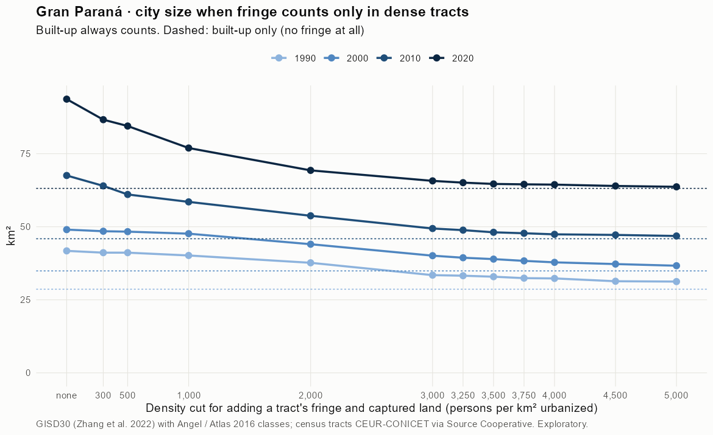
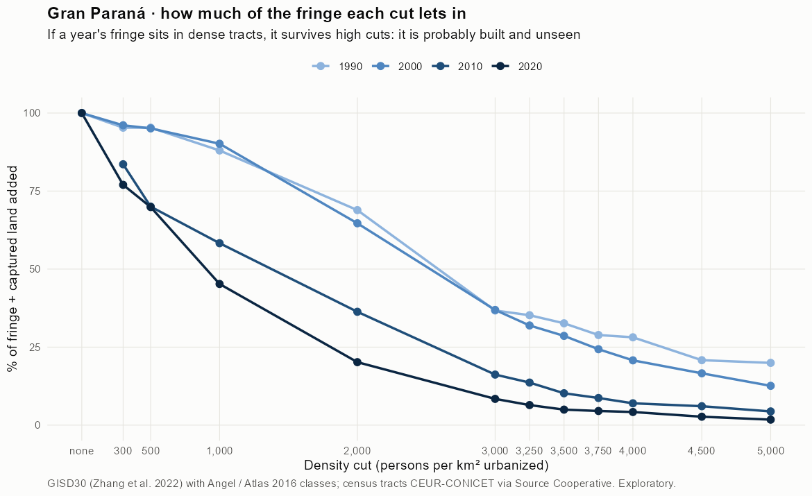
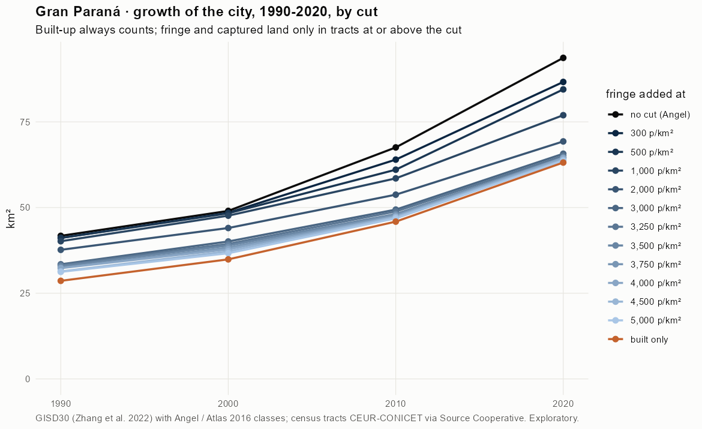
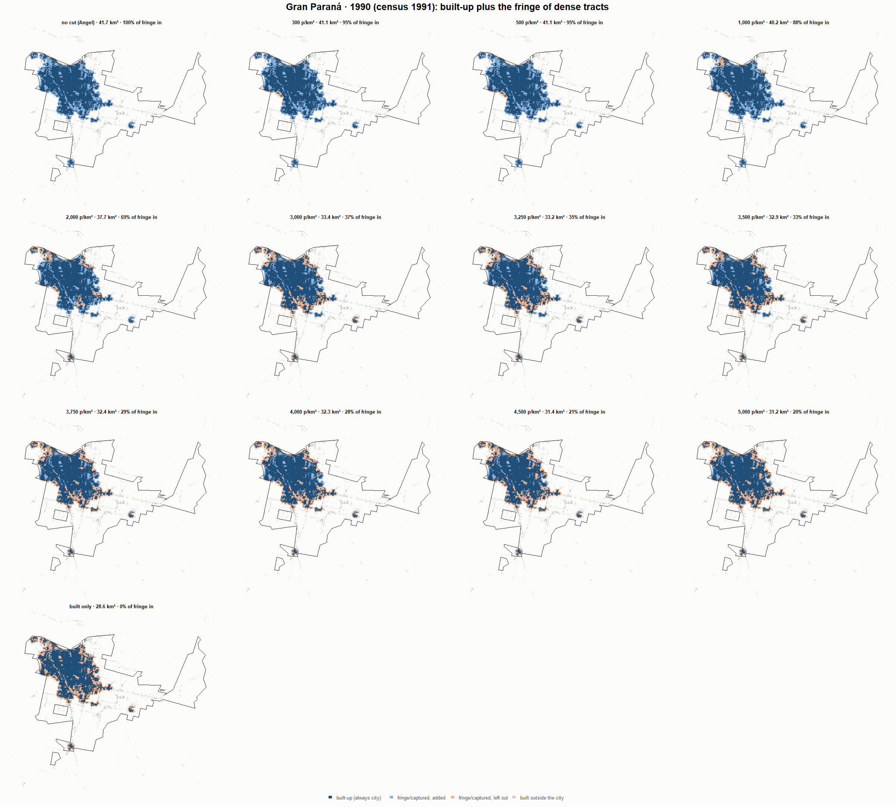
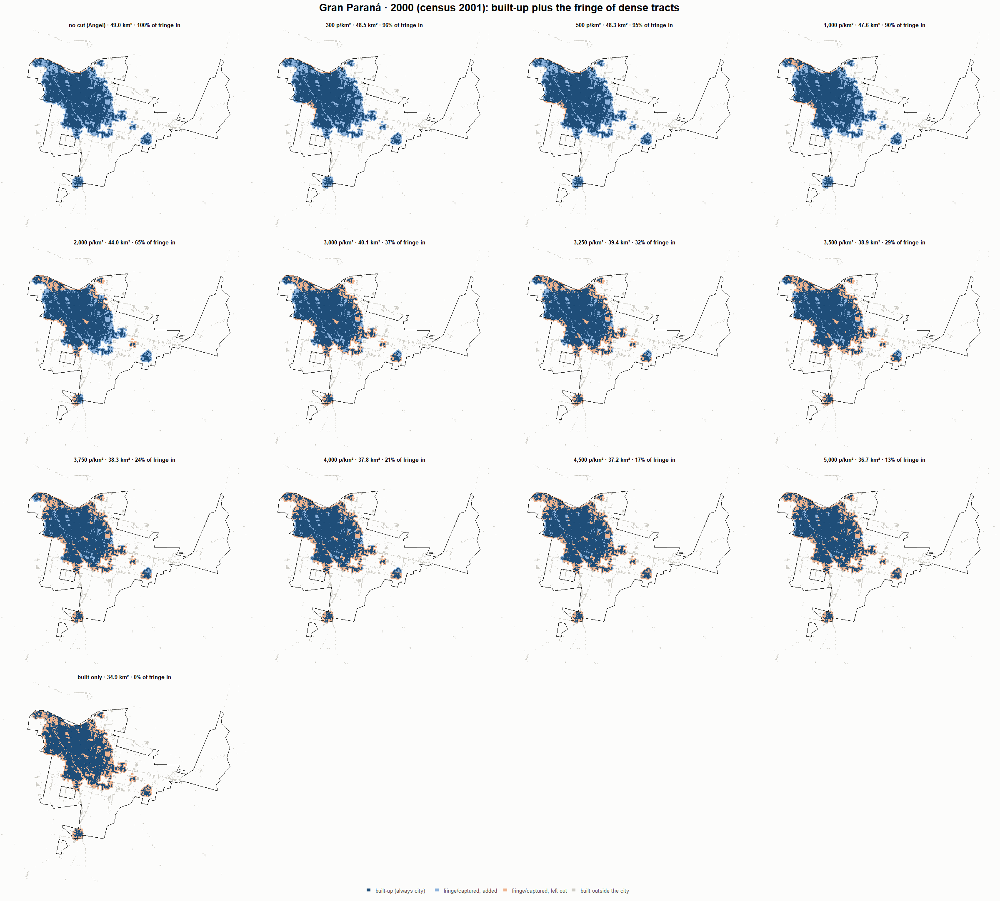
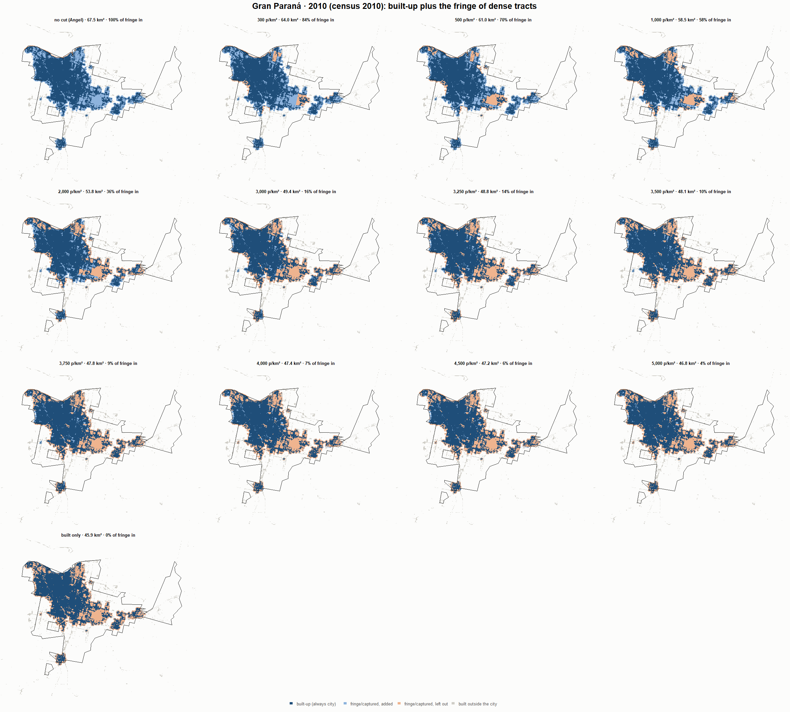
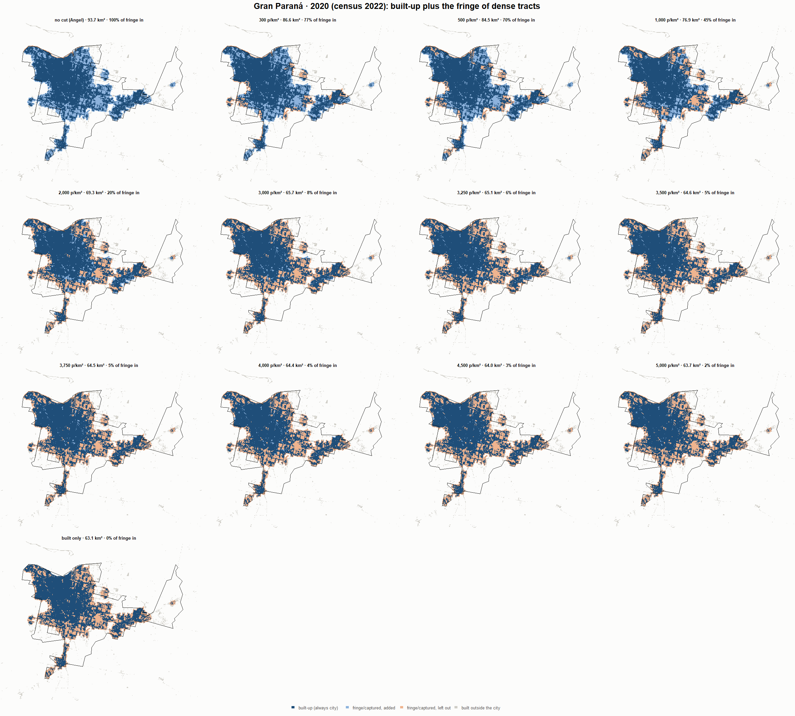

# Gran Paraná · when does the fringe count as city? 1990-2020

Exploratory test 2. None of these numbers are project figures (they are not in `CIFRAS_CANONICAS.json`). Generated by `Rpipe/scripts/13_prueba_franja.R` from the tract tables of step 11. Run of 2026-11-08. [All agglomerations](../REPORTE.md).

**Idea.** Built-up land is always city. Fringe and captured open space join the city **only in dense tracts**, where they are probably built and unseen by the older imagery. No cut gives the full Angel extent; an infinite cut, built-up only. Method in the [index](../REPORTE.md#method).

## Is the early imagery under-detecting?

If the older imagery misses buildings, persons per km² of *built* land should come out higher in the early years.

| Year | Persons (tracts with built land) | Built km² | Persons / km² built | Median tract, persons / km² built | Fringe + captured, % of extent |
|---|---|---|---|---|---|
| 1990 (census 1991) | 210,395 | 28.6 | 7,351 | 6,852 | 31.3 |
| 2000 (census 2001) | 243,709 | 34.9 | 6,986 | 6,497 | 28.8 |
| 2010 (census 2010) | 262,836 | 45.9 | 5,728 | 5,556 | 31.9 |
| 2020 (census 2022) | 303,307 | 63.1 | 4,804 | 4,385 | 32.6 |

## Results

**1990 (census 1991).** Built-up 28.6 km²; fringe + captured 13.1 km²; 212,059 persons in the city's tracts.

| Fringe added at | City km² | Fringe added km² | % of fringe added | Fringe % of city | Tracts adding fringe | Persons / km² city |
|---|---|---|---|---|---|---|
| no cut (Angel) | 41.7 | 13.1 | 100.0 | 31.4 | 157 | 5,080 |
| 300 p/km² | 41.1 | 12.5 | 95.3 | 30.4 | 155 | 5,156 |
| 500 p/km² | 41.1 | 12.5 | 95.3 | 30.4 | 155 | 5,156 |
| 1,000 p/km² | 40.2 | 11.6 | 88.0 | 28.8 | 153 | 5,279 |
| 2,000 p/km² | 37.7 | 9.0 | 68.9 | 24.0 | 147 | 5,630 |
| 3,000 p/km² | 33.4 | 4.8 | 36.7 | 14.4 | 132 | 6,341 |
| 3,250 p/km² | 33.2 | 4.6 | 35.2 | 13.9 | 130 | 6,379 |
| 3,500 p/km² | 32.9 | 4.3 | 32.6 | 13.0 | 127 | 6,445 |
| 3,750 p/km² | 32.4 | 3.8 | 28.9 | 11.7 | 124 | 6,543 |
| 4,000 p/km² | 32.3 | 3.7 | 28.1 | 11.4 | 121 | 6,562 |
| 4,500 p/km² | 31.4 | 2.7 | 20.8 | 8.7 | 111 | 6,764 |
| 5,000 p/km² | 31.2 | 2.6 | 19.9 | 8.4 | 106 | 6,788 |
| built only | 28.6 | 0.0 | 0.0 | 0.0 | 0 | 7,409 |

**2000 (census 2001).** Built-up 34.9 km²; fringe + captured 14.1 km²; 245,048 persons in the city's tracts.

| Fringe added at | City km² | Fringe added km² | % of fringe added | Fringe % of city | Tracts adding fringe | Persons / km² city |
|---|---|---|---|---|---|---|
| no cut (Angel) | 49.0 | 14.1 | 100.0 | 28.8 | 197 | 4,999 |
| 300 p/km² | 48.5 | 13.6 | 96.1 | 28.0 | 196 | 5,056 |
| 500 p/km² | 48.3 | 13.4 | 95.1 | 27.8 | 195 | 5,071 |
| 1,000 p/km² | 47.6 | 12.7 | 90.2 | 26.8 | 193 | 5,145 |
| 2,000 p/km² | 44.0 | 9.1 | 64.7 | 20.8 | 182 | 5,566 |
| 3,000 p/km² | 40.1 | 5.2 | 36.9 | 13.0 | 161 | 6,111 |
| 3,250 p/km² | 39.4 | 4.5 | 31.9 | 11.5 | 156 | 6,220 |
| 3,500 p/km² | 38.9 | 4.0 | 28.6 | 10.4 | 153 | 6,295 |
| 3,750 p/km² | 38.3 | 3.4 | 24.3 | 9.0 | 146 | 6,394 |
| 4,000 p/km² | 37.8 | 2.9 | 20.8 | 7.8 | 141 | 6,480 |
| 4,500 p/km² | 37.2 | 2.3 | 16.6 | 6.3 | 130 | 6,582 |
| 5,000 p/km² | 36.7 | 1.8 | 12.6 | 4.9 | 118 | 6,684 |
| built only | 34.9 | 0.0 | 0.0 | 0.0 | 0 | 7,025 |

**2010 (census 2010).** Built-up 45.9 km²; fringe + captured 21.7 km²; 263,266 persons in the city's tracts.

| Fringe added at | City km² | Fringe added km² | % of fringe added | Fringe % of city | Tracts adding fringe | Persons / km² city |
|---|---|---|---|---|---|---|
| no cut (Angel) | 67.5 | 21.7 | 100.0 | 32.1 | 211 | 3,898 |
| 300 p/km² | 64.0 | 18.1 | 83.6 | 28.3 | 205 | 4,114 |
| 500 p/km² | 61.0 | 15.2 | 70.0 | 24.8 | 199 | 4,312 |
| 1,000 p/km² | 58.5 | 12.6 | 58.3 | 21.6 | 190 | 4,499 |
| 2,000 p/km² | 53.8 | 7.9 | 36.3 | 14.6 | 166 | 4,898 |
| 3,000 p/km² | 49.4 | 3.5 | 16.2 | 7.1 | 129 | 5,330 |
| 3,250 p/km² | 48.8 | 3.0 | 13.6 | 6.0 | 125 | 5,390 |
| 3,500 p/km² | 48.1 | 2.2 | 10.2 | 4.6 | 118 | 5,473 |
| 3,750 p/km² | 47.8 | 1.9 | 8.7 | 3.9 | 112 | 5,511 |
| 4,000 p/km² | 47.4 | 1.5 | 7.0 | 3.2 | 105 | 5,554 |
| 4,500 p/km² | 47.2 | 1.3 | 6.1 | 2.8 | 95 | 5,577 |
| 5,000 p/km² | 46.8 | 1.0 | 4.4 | 2.0 | 87 | 5,620 |
| built only | 45.9 | 0.0 | 0.0 | 0.0 | 0 | 5,737 |

**2020 (census 2022).** Built-up 63.1 km²; fringe + captured 30.5 km²; 303,498 persons in the city's tracts.

| Fringe added at | City km² | Fringe added km² | % of fringe added | Fringe % of city | Tracts adding fringe | Persons / km² city |
|---|---|---|---|---|---|---|
| no cut (Angel) | 93.7 | 30.5 | 100.0 | 32.6 | 296 | 3,240 |
| 300 p/km² | 86.6 | 23.5 | 77.0 | 27.1 | 281 | 3,503 |
| 500 p/km² | 84.5 | 21.3 | 69.9 | 25.3 | 274 | 3,593 |
| 1,000 p/km² | 76.9 | 13.8 | 45.2 | 18.0 | 247 | 3,944 |
| 2,000 p/km² | 69.3 | 6.2 | 20.2 | 8.9 | 198 | 4,380 |
| 3,000 p/km² | 65.7 | 2.6 | 8.4 | 3.9 | 156 | 4,619 |
| 3,250 p/km² | 65.1 | 2.0 | 6.4 | 3.0 | 146 | 4,662 |
| 3,500 p/km² | 64.6 | 1.5 | 5.0 | 2.3 | 133 | 4,694 |
| 3,750 p/km² | 64.5 | 1.4 | 4.5 | 2.1 | 130 | 4,704 |
| 4,000 p/km² | 64.4 | 1.3 | 4.2 | 2.0 | 122 | 4,711 |
| 4,500 p/km² | 64.0 | 0.8 | 2.7 | 1.3 | 105 | 4,745 |
| 5,000 p/km² | 63.7 | 0.5 | 1.8 | 0.8 | 90 | 4,767 |
| built only | 63.1 | 0.0 | 0.0 | 0.0 | 0 | 4,807 |

### Growth by cut

| Fringe added at | 1990 km² | 2000 km² | 2010 km² | 2020 km² | 1990-2000 %/yr | 2000-2010 %/yr | 2010-2020 %/yr | 1990-2020 %/yr |
|---|---|---|---|---|---|---|---|---|
| no cut (Angel) | 41.7 | 49.0 | 67.5 | 93.7 | 1.62 | 3.26 | 3.32 | 2.73 |
| 300 p/km² | 41.1 | 48.5 | 64.0 | 86.6 | 1.65 | 2.82 | 3.08 | 2.51 |
| 500 p/km² | 41.1 | 48.3 | 61.0 | 84.5 | 1.63 | 2.36 | 3.30 | 2.43 |
| 1,000 p/km² | 40.2 | 47.6 | 58.5 | 76.9 | 1.72 | 2.08 | 2.78 | 2.19 |
| 2,000 p/km² | 37.7 | 44.0 | 53.8 | 69.3 | 1.57 | 2.02 | 2.57 | 2.05 |
| 3,000 p/km² | 33.4 | 40.1 | 49.4 | 65.7 | 1.83 | 2.11 | 2.89 | 2.28 |
| 3,250 p/km² | 33.2 | 39.4 | 48.8 | 65.1 | 1.71 | 2.17 | 2.91 | 2.27 |
| 3,500 p/km² | 32.9 | 38.9 | 48.1 | 64.6 | 1.70 | 2.14 | 3.00 | 2.28 |
| 3,750 p/km² | 32.4 | 38.3 | 47.8 | 64.5 | 1.69 | 2.23 | 3.05 | 2.32 |
| 4,000 p/km² | 32.3 | 37.8 | 47.4 | 64.4 | 1.59 | 2.29 | 3.11 | 2.33 |
| 4,500 p/km² | 31.4 | 37.2 | 47.2 | 64.0 | 1.73 | 2.40 | 3.08 | 2.40 |
| 5,000 p/km² | 31.2 | 36.7 | 46.8 | 63.7 | 1.61 | 2.48 | 3.12 | 2.40 |
| built only | 28.6 | 34.9 | 45.9 | 63.1 | 2.00 | 2.78 | 3.24 | 2.67 |

## Maps

Same frame in the four years: the 2020 city plus 3 km. Dark blue is built-up, always city; light blue is fringe or captured land added because its tract is dense; light orange is fringe left out. Black line: the analysis perimeter.

### 1990

### 2000

### 2010

### 2020

## Reading

- **The premise.** Persons per km² of built land: 7,351 in 1990, 6,986 in 2000, 5,728 in 2010, 4,804 in 2020. 1990 is clearly higher than 2010: consistent with built land missed in 1990, though it also fits a denser city that later spread out.
- **At 500 p/km²** the fringe that joins the city is 95.3 % of all fringe in 1990 and 69.9 % in 2020.
- **Growth 1990-2020**: 2.73 %/yr with the full Angel extent, 2.43 %/yr at 500, 2.67 %/yr built-up only.

