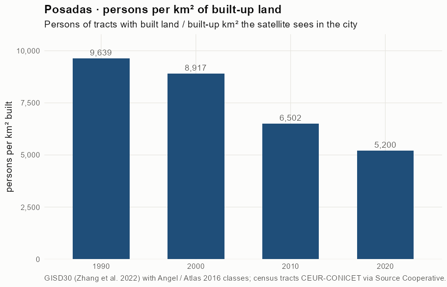
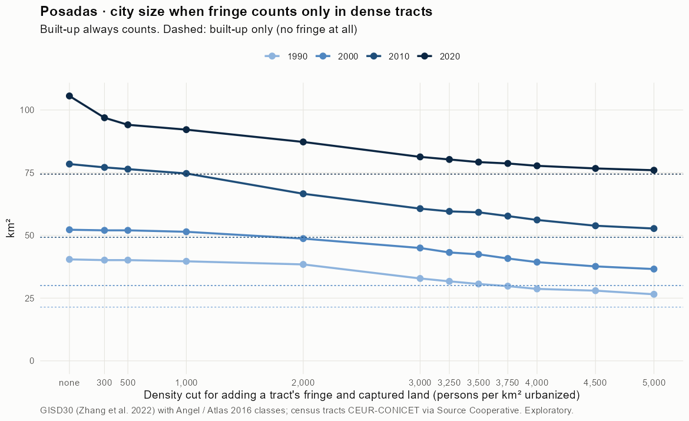
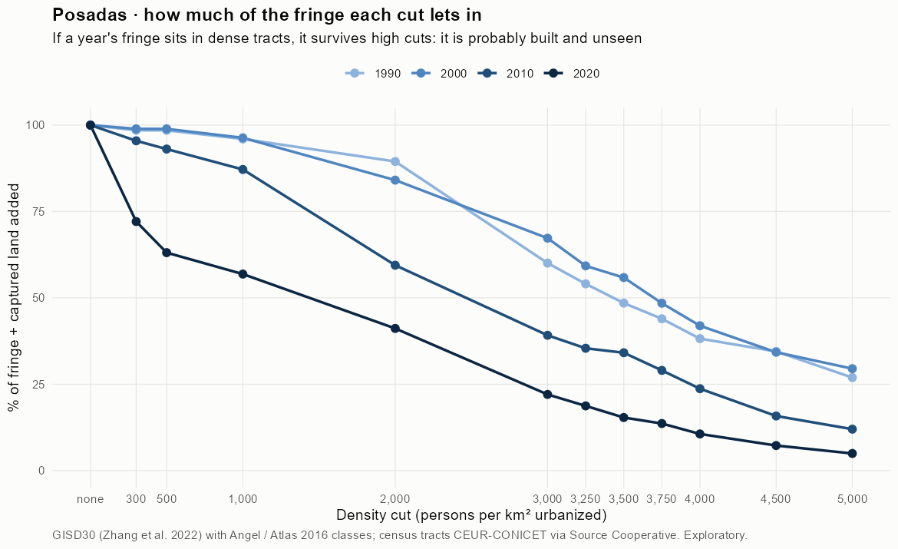
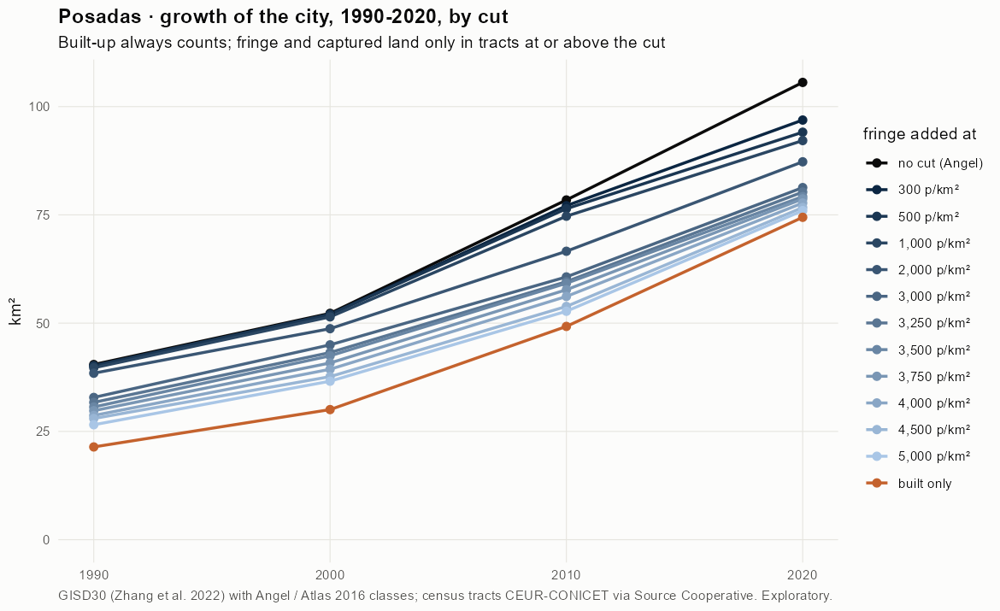
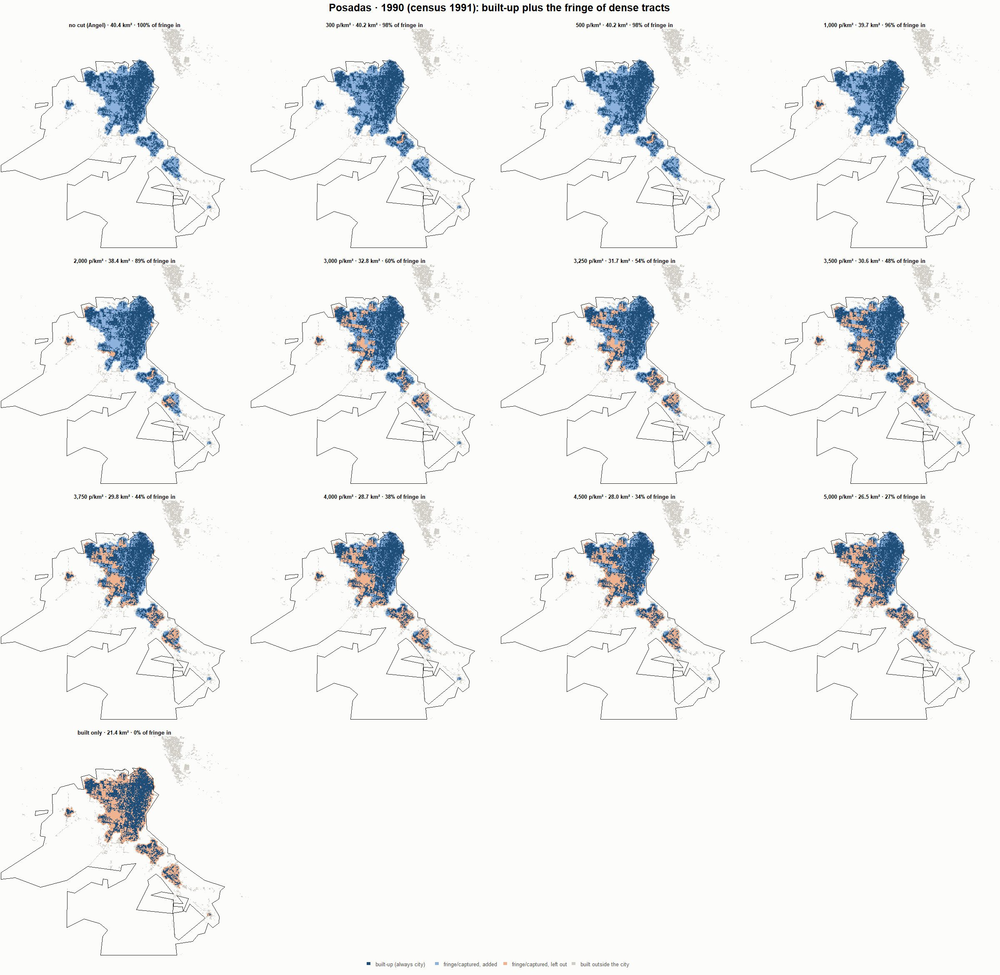
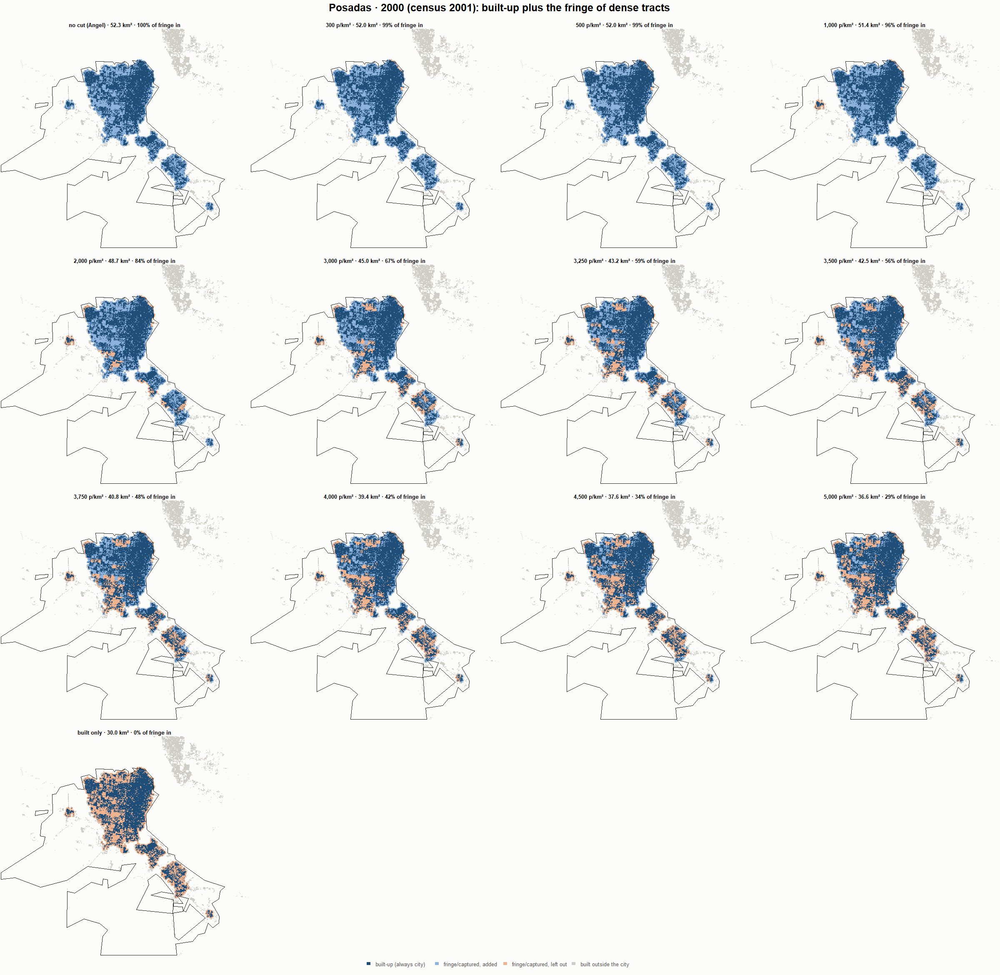
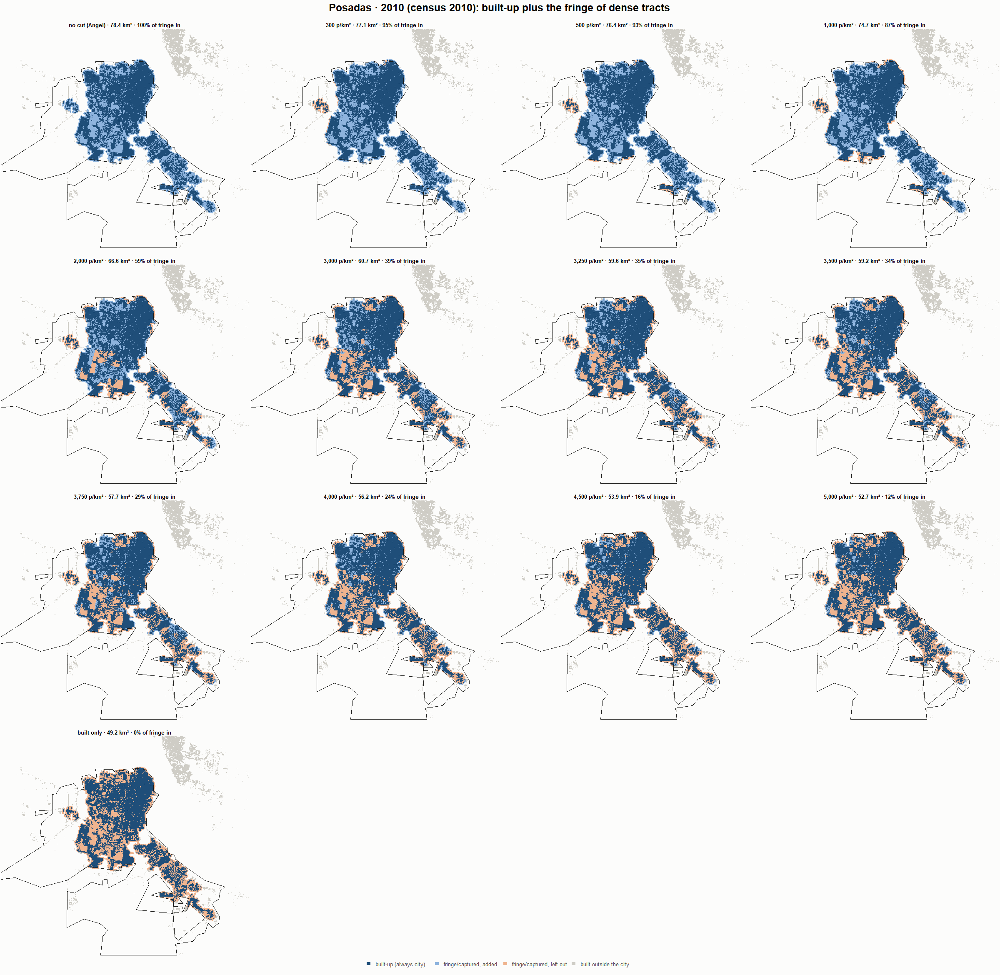
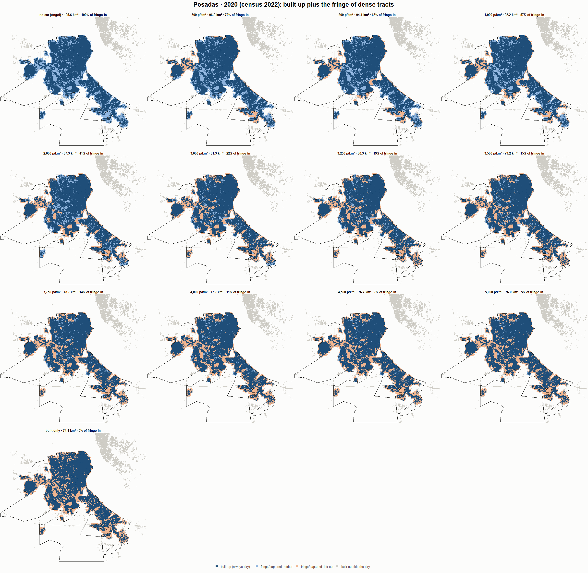

# Posadas · when does the fringe count as city? 1990-2020

Exploratory test 2. None of these numbers are project figures (they are not in `CIFRAS_CANONICAS.json`). Generated by `Rpipe/scripts/13_prueba_franja.R` from the tract tables of step 11. Run of 2026-11-08. [All agglomerations](../REPORTE.md).

**Idea.** Built-up land is always city. Fringe and captured open space join the city **only in dense tracts**, where they are probably built and unseen by the older imagery. No cut gives the full Angel extent; an infinite cut, built-up only. Method in the [index](../REPORTE.md#method).

## Is the early imagery under-detecting?

If the older imagery misses buildings, persons per km² of *built* land should come out higher in the early years.

| Year | Persons (tracts with built land) | Built km² | Persons / km² built | Median tract, persons / km² built | Fringe + captured, % of extent |
|---|---|---|---|---|---|
| 1990 (census 1991) | 206,407 | 21.4 | 9,639 | 7,644 | 47.0 |
| 2000 (census 2001) | 267,830 | 30.0 | 8,917 | 7,194 | 42.5 |
| 2010 (census 2010) | 320,192 | 49.2 | 6,502 | 5,845 | 37.2 |
| 2020 (census 2022) | 387,060 | 74.4 | 5,200 | 4,929 | 29.5 |

## Results

**1990 (census 1991).** Built-up 21.4 km²; fringe + captured 19.0 km²; 211,173 persons in the city's tracts.

| Fringe added at | City km² | Fringe added km² | % of fringe added | Fringe % of city | Tracts adding fringe | Persons / km² city |
|---|---|---|---|---|---|---|
| no cut (Angel) | 40.4 | 19.0 | 100.0 | 47.1 | 197 | 5,222 |
| 300 p/km² | 40.2 | 18.7 | 98.5 | 46.7 | 194 | 5,259 |
| 500 p/km² | 40.2 | 18.7 | 98.5 | 46.7 | 194 | 5,259 |
| 1,000 p/km² | 39.7 | 18.3 | 96.0 | 46.0 | 192 | 5,322 |
| 2,000 p/km² | 38.4 | 17.0 | 89.5 | 44.3 | 187 | 5,494 |
| 3,000 p/km² | 32.8 | 11.4 | 60.1 | 34.8 | 169 | 6,430 |
| 3,250 p/km² | 31.7 | 10.3 | 54.1 | 32.4 | 164 | 6,662 |
| 3,500 p/km² | 30.6 | 9.2 | 48.5 | 30.1 | 159 | 6,893 |
| 3,750 p/km² | 29.8 | 8.4 | 43.9 | 28.1 | 152 | 7,092 |
| 4,000 p/km² | 28.7 | 7.3 | 38.2 | 25.3 | 145 | 7,363 |
| 4,500 p/km² | 28.0 | 6.6 | 34.5 | 23.5 | 136 | 7,549 |
| 5,000 p/km² | 26.5 | 5.1 | 26.9 | 19.3 | 122 | 7,958 |
| built only | 21.4 | 0.0 | 0.0 | 0.0 | 0 | 9,862 |

**2000 (census 2001).** Built-up 30.0 km²; fringe + captured 22.2 km²; 267,851 persons in the city's tracts.

| Fringe added at | City km² | Fringe added km² | % of fringe added | Fringe % of city | Tracts adding fringe | Persons / km² city |
|---|---|---|---|---|---|---|
| no cut (Angel) | 52.3 | 22.2 | 100.0 | 42.5 | 245 | 5,125 |
| 300 p/km² | 52.0 | 22.0 | 98.9 | 42.3 | 243 | 5,149 |
| 500 p/km² | 52.0 | 22.0 | 98.9 | 42.3 | 243 | 5,149 |
| 1,000 p/km² | 51.4 | 21.4 | 96.3 | 41.6 | 240 | 5,207 |
| 2,000 p/km² | 48.7 | 18.7 | 84.1 | 38.4 | 232 | 5,498 |
| 3,000 p/km² | 45.0 | 14.9 | 67.3 | 33.2 | 217 | 5,954 |
| 3,250 p/km² | 43.2 | 13.2 | 59.3 | 30.5 | 209 | 6,199 |
| 3,500 p/km² | 42.5 | 12.4 | 55.9 | 29.2 | 202 | 6,309 |
| 3,750 p/km² | 40.8 | 10.8 | 48.5 | 26.4 | 188 | 6,564 |
| 4,000 p/km² | 39.4 | 9.3 | 41.9 | 23.7 | 178 | 6,806 |
| 4,500 p/km² | 37.6 | 7.6 | 34.3 | 20.2 | 159 | 7,114 |
| 5,000 p/km² | 36.6 | 6.6 | 29.5 | 17.9 | 144 | 7,320 |
| built only | 30.0 | 0.0 | 0.0 | 0.0 | 0 | 8,917 |

**2010 (census 2010).** Built-up 49.2 km²; fringe + captured 29.2 km²; 320,403 persons in the city's tracts.

| Fringe added at | City km² | Fringe added km² | % of fringe added | Fringe % of city | Tracts adding fringe | Persons / km² city |
|---|---|---|---|---|---|---|
| no cut (Angel) | 78.4 | 29.2 | 100.0 | 37.2 | 286 | 4,085 |
| 300 p/km² | 77.1 | 27.9 | 95.5 | 36.1 | 284 | 4,155 |
| 500 p/km² | 76.4 | 27.2 | 93.1 | 35.6 | 282 | 4,193 |
| 1,000 p/km² | 74.7 | 25.5 | 87.2 | 34.1 | 277 | 4,290 |
| 2,000 p/km² | 66.6 | 17.4 | 59.4 | 26.1 | 257 | 4,811 |
| 3,000 p/km² | 60.7 | 11.4 | 39.2 | 18.8 | 224 | 5,280 |
| 3,250 p/km² | 59.6 | 10.3 | 35.4 | 17.3 | 213 | 5,378 |
| 3,500 p/km² | 59.2 | 10.0 | 34.1 | 16.8 | 207 | 5,412 |
| 3,750 p/km² | 57.7 | 8.5 | 29.0 | 14.7 | 191 | 5,552 |
| 4,000 p/km² | 56.2 | 6.9 | 23.7 | 12.3 | 172 | 5,705 |
| 4,500 p/km² | 53.9 | 4.6 | 15.8 | 8.6 | 144 | 5,949 |
| 5,000 p/km² | 52.7 | 3.5 | 12.0 | 6.6 | 125 | 6,075 |
| built only | 49.2 | 0.0 | 0.0 | 0.0 | 0 | 6,507 |

**2020 (census 2022).** Built-up 74.4 km²; fringe + captured 31.1 km²; 387,073 persons in the city's tracts.

| Fringe added at | City km² | Fringe added km² | % of fringe added | Fringe % of city | Tracts adding fringe | Persons / km² city |
|---|---|---|---|---|---|---|
| no cut (Angel) | 105.6 | 31.1 | 100.0 | 29.5 | 383 | 3,666 |
| 300 p/km² | 96.9 | 22.5 | 72.1 | 23.2 | 375 | 3,995 |
| 500 p/km² | 94.1 | 19.6 | 63.1 | 20.9 | 372 | 4,114 |
| 1,000 p/km² | 92.2 | 17.7 | 56.9 | 19.2 | 367 | 4,200 |
| 2,000 p/km² | 87.3 | 12.8 | 41.1 | 14.7 | 345 | 4,436 |
| 3,000 p/km² | 81.3 | 6.9 | 22.0 | 8.4 | 294 | 4,761 |
| 3,250 p/km² | 80.3 | 5.8 | 18.7 | 7.3 | 282 | 4,822 |
| 3,500 p/km² | 79.2 | 4.8 | 15.4 | 6.0 | 261 | 4,886 |
| 3,750 p/km² | 78.7 | 4.2 | 13.6 | 5.4 | 243 | 4,920 |
| 4,000 p/km² | 77.7 | 3.3 | 10.6 | 4.2 | 226 | 4,979 |
| 4,500 p/km² | 76.7 | 2.3 | 7.2 | 2.9 | 195 | 5,047 |
| 5,000 p/km² | 76.0 | 1.5 | 4.9 | 2.0 | 160 | 5,094 |
| built only | 74.4 | 0.0 | 0.0 | 0.0 | 0 | 5,200 |

### Growth by cut

| Fringe added at | 1990 km² | 2000 km² | 2010 km² | 2020 km² | 1990-2000 %/yr | 2000-2010 %/yr | 2010-2020 %/yr | 1990-2020 %/yr |
|---|---|---|---|---|---|---|---|---|
| no cut (Angel) | 40.4 | 52.3 | 78.4 | 105.6 | 2.60 | 4.14 | 3.02 | 3.25 |
| 300 p/km² | 40.2 | 52.0 | 77.1 | 96.9 | 2.62 | 4.02 | 2.31 | 2.98 |
| 500 p/km² | 40.2 | 52.0 | 76.4 | 94.1 | 2.62 | 3.92 | 2.10 | 2.88 |
| 1,000 p/km² | 39.7 | 51.4 | 74.7 | 92.2 | 2.63 | 3.80 | 2.12 | 2.85 |
| 2,000 p/km² | 38.4 | 48.7 | 66.6 | 87.3 | 2.40 | 3.18 | 2.74 | 2.77 |
| 3,000 p/km² | 32.8 | 45.0 | 60.7 | 81.3 | 3.20 | 3.04 | 2.97 | 3.07 |
| 3,250 p/km² | 31.7 | 43.2 | 59.6 | 80.3 | 3.15 | 3.27 | 3.03 | 3.15 |
| 3,500 p/km² | 30.6 | 42.5 | 59.2 | 79.2 | 3.32 | 3.38 | 2.96 | 3.22 |
| 3,750 p/km² | 29.8 | 40.8 | 57.7 | 78.7 | 3.20 | 3.53 | 3.15 | 3.29 |
| 4,000 p/km² | 28.7 | 39.4 | 56.2 | 77.7 | 3.21 | 3.62 | 3.30 | 3.38 |
| 4,500 p/km² | 28.0 | 37.6 | 53.9 | 76.7 | 3.01 | 3.64 | 3.60 | 3.42 |
| 5,000 p/km² | 26.5 | 36.6 | 52.7 | 76.0 | 3.27 | 3.72 | 3.72 | 3.57 |
| built only | 21.4 | 30.0 | 49.2 | 74.4 | 3.44 | 5.07 | 4.22 | 4.24 |

## Maps

Same frame in the four years: the 2020 city plus 3 km. Dark blue is built-up, always city; light blue is fringe or captured land added because its tract is dense; light orange is fringe left out. Black line: the analysis perimeter.

### 1990

### 2000

### 2010

### 2020

## Reading

- **The premise.** Persons per km² of built land: 9,639 in 1990, 8,917 in 2000, 6,502 in 2010, 5,200 in 2020. 1990 is clearly higher than 2010: consistent with built land missed in 1990, though it also fits a denser city that later spread out.
- **At 500 p/km²** the fringe that joins the city is 98.5 % of all fringe in 1990 and 63.1 % in 2020.
- **Growth 1990-2020**: 3.25 %/yr with the full Angel extent, 2.88 %/yr at 500, 4.24 %/yr built-up only.

