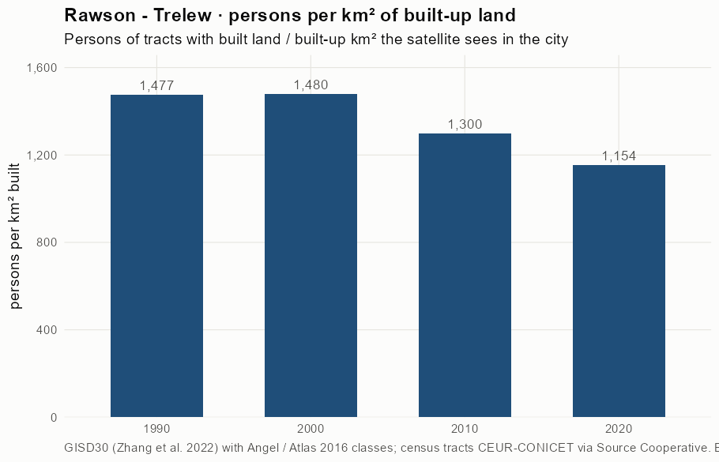
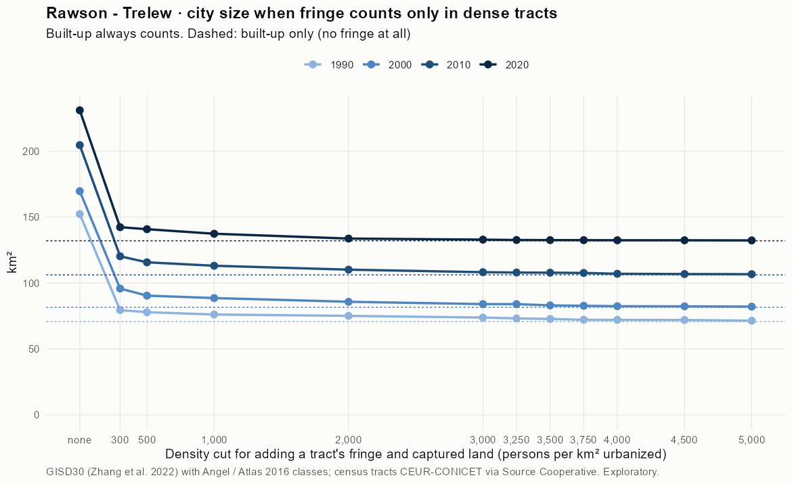
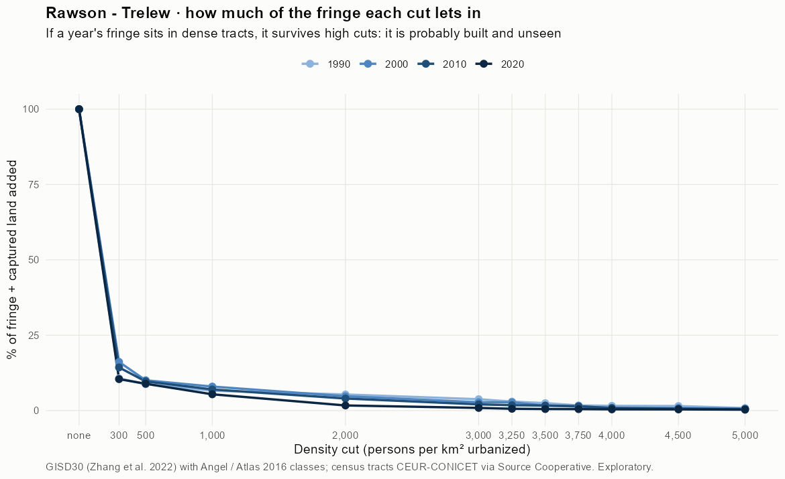
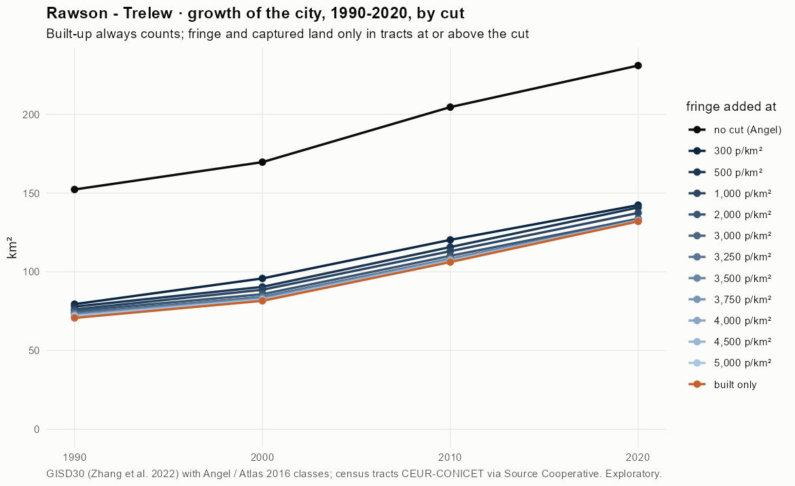
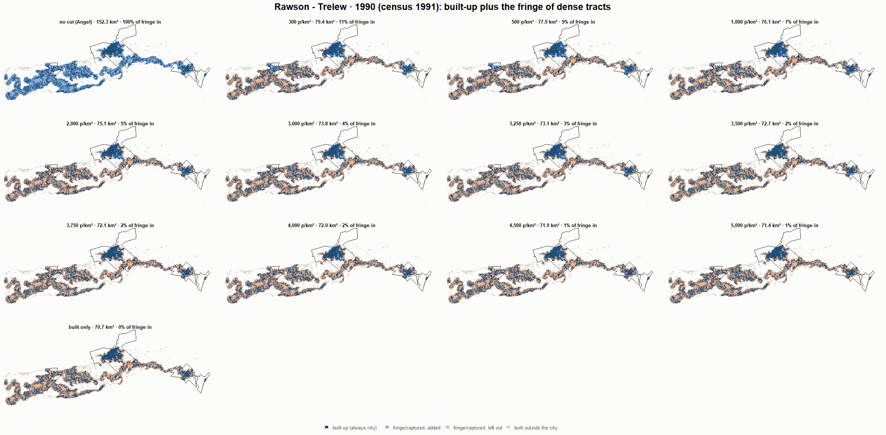
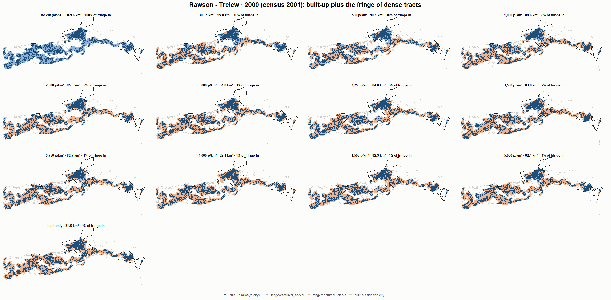
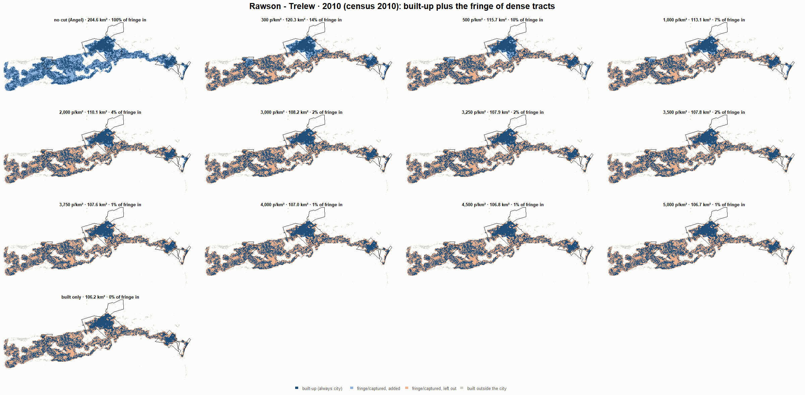
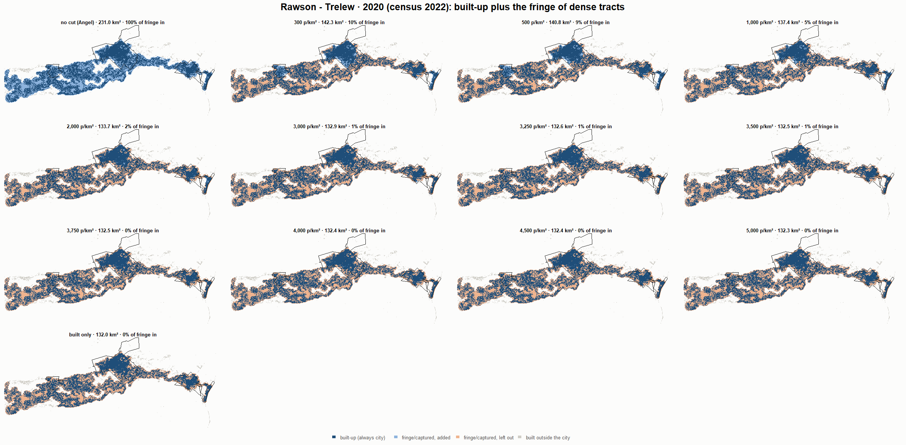

# Rawson - Trelew · when does the fringe count as city? 1990-2020

Exploratory test 2. None of these numbers are project figures (they are not in `CIFRAS_CANONICAS.json`). Generated by `Rpipe/scripts/13_prueba_franja.R` from the tract tables of step 11. Run of 2026-11-08. [All agglomerations](../REPORTE.md).

**Idea.** Built-up land is always city. Fringe and captured open space join the city **only in dense tracts**, where they are probably built and unseen by the older imagery. No cut gives the full Angel extent; an infinite cut, built-up only. Method in the [index](../REPORTE.md#method).

## Is the early imagery under-detecting?

If the older imagery misses buildings, persons per km² of *built* land should come out higher in the early years.

| Year | Persons (tracts with built land) | Built km² | Persons / km² built | Median tract, persons / km² built | Fringe + captured, % of extent |
|---|---|---|---|---|---|
| 1990 (census 1991) | 104,462 | 70.7 | 1,477 | 65 | 53.5 |
| 2000 (census 2001) | 120,711 | 81.6 | 1,480 | 107 | 51.9 |
| 2010 (census 2010) | 138,021 | 106.2 | 1,300 | 73 | 48.1 |
| 2020 (census 2022) | 152,323 | 132.0 | 1,154 | 81 | 42.8 |

## Results

**1990 (census 1991).** Built-up 70.7 km²; fringe + captured 81.6 km²; 104,622 persons in the city's tracts.

| Fringe added at | City km² | Fringe added km² | % of fringe added | Fringe % of city | Tracts adding fringe | Persons / km² city |
|---|---|---|---|---|---|---|
| no cut (Angel) | 152.3 | 81.6 | 100.0 | 53.6 | 96 | 687 |
| 300 p/km² | 79.4 | 8.7 | 10.7 | 11.0 | 77 | 1,317 |
| 500 p/km² | 77.9 | 7.1 | 8.8 | 9.2 | 75 | 1,344 |
| 1,000 p/km² | 76.1 | 5.4 | 6.6 | 7.1 | 72 | 1,375 |
| 2,000 p/km² | 75.1 | 4.4 | 5.3 | 5.8 | 68 | 1,394 |
| 3,000 p/km² | 73.8 | 3.1 | 3.8 | 4.2 | 60 | 1,418 |
| 3,250 p/km² | 73.1 | 2.4 | 3.0 | 3.3 | 55 | 1,430 |
| 3,500 p/km² | 72.7 | 2.0 | 2.5 | 2.8 | 51 | 1,438 |
| 3,750 p/km² | 72.1 | 1.4 | 1.7 | 1.9 | 46 | 1,451 |
| 4,000 p/km² | 72.0 | 1.3 | 1.6 | 1.8 | 42 | 1,453 |
| 4,500 p/km² | 71.9 | 1.2 | 1.5 | 1.7 | 40 | 1,454 |
| 5,000 p/km² | 71.4 | 0.7 | 0.8 | 0.9 | 33 | 1,465 |
| built only | 70.7 | 0.0 | 0.0 | 0.0 | 0 | 1,479 |

**2000 (census 2001).** Built-up 81.6 km²; fringe + captured 88.1 km²; 120,920 persons in the city's tracts.

| Fringe added at | City km² | Fringe added km² | % of fringe added | Fringe % of city | Tracts adding fringe | Persons / km² city |
|---|---|---|---|---|---|---|
| no cut (Angel) | 169.6 | 88.1 | 100.0 | 51.9 | 118 | 713 |
| 300 p/km² | 95.8 | 14.2 | 16.1 | 14.8 | 103 | 1,262 |
| 500 p/km² | 90.4 | 8.8 | 10.0 | 9.8 | 98 | 1,337 |
| 1,000 p/km² | 88.6 | 7.0 | 8.0 | 7.9 | 94 | 1,365 |
| 2,000 p/km² | 85.8 | 4.2 | 4.8 | 4.9 | 83 | 1,410 |
| 3,000 p/km² | 84.0 | 2.4 | 2.8 | 2.9 | 65 | 1,439 |
| 3,250 p/km² | 84.0 | 2.4 | 2.7 | 2.9 | 64 | 1,440 |
| 3,500 p/km² | 83.0 | 1.4 | 1.6 | 1.7 | 57 | 1,457 |
| 3,750 p/km² | 82.7 | 1.2 | 1.3 | 1.4 | 51 | 1,462 |
| 4,000 p/km² | 82.4 | 0.8 | 0.9 | 1.0 | 47 | 1,468 |
| 4,500 p/km² | 82.3 | 0.7 | 0.8 | 0.9 | 40 | 1,470 |
| 5,000 p/km² | 82.1 | 0.5 | 0.6 | 0.6 | 33 | 1,473 |
| built only | 81.6 | 0.0 | 0.0 | 0.0 | 0 | 1,482 |

**2010 (census 2010).** Built-up 106.2 km²; fringe + captured 98.4 km²; 138,083 persons in the city's tracts.

| Fringe added at | City km² | Fringe added km² | % of fringe added | Fringe % of city | Tracts adding fringe | Persons / km² city |
|---|---|---|---|---|---|---|
| no cut (Angel) | 204.6 | 98.4 | 100.0 | 48.1 | 120 | 675 |
| 300 p/km² | 120.3 | 14.1 | 14.3 | 11.7 | 104 | 1,148 |
| 500 p/km² | 115.7 | 9.5 | 9.7 | 8.2 | 100 | 1,193 |
| 1,000 p/km² | 113.1 | 6.9 | 7.0 | 6.1 | 95 | 1,221 |
| 2,000 p/km² | 110.1 | 3.9 | 4.0 | 3.6 | 81 | 1,254 |
| 3,000 p/km² | 108.2 | 2.0 | 2.1 | 1.9 | 60 | 1,276 |
| 3,250 p/km² | 107.9 | 1.8 | 1.8 | 1.6 | 56 | 1,279 |
| 3,500 p/km² | 107.8 | 1.6 | 1.7 | 1.5 | 52 | 1,281 |
| 3,750 p/km² | 107.6 | 1.4 | 1.5 | 1.3 | 49 | 1,283 |
| 4,000 p/km² | 107.0 | 0.8 | 0.8 | 0.7 | 44 | 1,291 |
| 4,500 p/km² | 106.8 | 0.6 | 0.6 | 0.6 | 35 | 1,293 |
| 5,000 p/km² | 106.7 | 0.5 | 0.5 | 0.5 | 28 | 1,294 |
| built only | 106.2 | 0.0 | 0.0 | 0.0 | 0 | 1,300 |

**2020 (census 2022).** Built-up 132.0 km²; fringe + captured 99.0 km²; 152,338 persons in the city's tracts.

| Fringe added at | City km² | Fringe added km² | % of fringe added | Fringe % of city | Tracts adding fringe | Persons / km² city |
|---|---|---|---|---|---|---|
| no cut (Angel) | 231.0 | 99.0 | 100.0 | 42.8 | 150 | 660 |
| 300 p/km² | 142.3 | 10.3 | 10.4 | 7.3 | 130 | 1,070 |
| 500 p/km² | 140.8 | 8.8 | 8.9 | 6.3 | 128 | 1,082 |
| 1,000 p/km² | 137.4 | 5.3 | 5.4 | 3.9 | 119 | 1,109 |
| 2,000 p/km² | 133.7 | 1.7 | 1.7 | 1.3 | 97 | 1,139 |
| 3,000 p/km² | 132.9 | 0.9 | 0.9 | 0.7 | 79 | 1,146 |
| 3,250 p/km² | 132.6 | 0.6 | 0.6 | 0.4 | 69 | 1,149 |
| 3,500 p/km² | 132.5 | 0.5 | 0.5 | 0.4 | 64 | 1,150 |
| 3,750 p/km² | 132.5 | 0.5 | 0.5 | 0.4 | 60 | 1,150 |
| 4,000 p/km² | 132.4 | 0.4 | 0.4 | 0.3 | 54 | 1,150 |
| 4,500 p/km² | 132.4 | 0.4 | 0.4 | 0.3 | 52 | 1,151 |
| 5,000 p/km² | 132.3 | 0.3 | 0.3 | 0.2 | 42 | 1,151 |
| built only | 132.0 | 0.0 | 0.0 | 0.0 | 0 | 1,154 |

### Growth by cut

| Fringe added at | 1990 km² | 2000 km² | 2010 km² | 2020 km² | 1990-2000 %/yr | 2000-2010 %/yr | 2010-2020 %/yr | 1990-2020 %/yr |
|---|---|---|---|---|---|---|---|---|
| no cut (Angel) | 152.3 | 169.6 | 204.6 | 231.0 | 1.09 | 1.89 | 1.22 | 1.40 |
| 300 p/km² | 79.4 | 95.8 | 120.3 | 142.3 | 1.89 | 2.30 | 1.70 | 1.96 |
| 500 p/km² | 77.9 | 90.4 | 115.7 | 140.8 | 1.51 | 2.50 | 1.98 | 1.99 |
| 1,000 p/km² | 76.1 | 88.6 | 113.1 | 137.4 | 1.53 | 2.47 | 1.96 | 1.99 |
| 2,000 p/km² | 75.1 | 85.8 | 110.1 | 133.7 | 1.34 | 2.53 | 1.96 | 1.94 |
| 3,000 p/km² | 73.8 | 84.0 | 108.2 | 132.9 | 1.30 | 2.56 | 2.08 | 1.98 |
| 3,250 p/km² | 73.1 | 84.0 | 107.9 | 132.6 | 1.39 | 2.54 | 2.08 | 2.00 |
| 3,500 p/km² | 72.7 | 83.0 | 107.8 | 132.5 | 1.33 | 2.65 | 2.08 | 2.02 |
| 3,750 p/km² | 72.1 | 82.7 | 107.6 | 132.5 | 1.38 | 2.66 | 2.10 | 2.05 |
| 4,000 p/km² | 72.0 | 82.4 | 107.0 | 132.4 | 1.36 | 2.65 | 2.16 | 2.05 |
| 4,500 p/km² | 71.9 | 82.3 | 106.8 | 132.4 | 1.35 | 2.64 | 2.17 | 2.05 |
| 5,000 p/km² | 71.4 | 82.1 | 106.7 | 132.3 | 1.40 | 2.66 | 2.18 | 2.08 |
| built only | 70.7 | 81.6 | 106.2 | 132.0 | 1.44 | 2.67 | 2.20 | 2.10 |

## Maps

Same frame in the four years: the 2020 city plus 3 km. Dark blue is built-up, always city; light blue is fringe or captured land added because its tract is dense; light orange is fringe left out. Black line: the analysis perimeter.

### 1990

### 2000

### 2010

### 2020

## Reading

- **The premise.** Persons per km² of built land: 1,477 in 1990, 1,480 in 2000, 1,300 in 2010, 1,154 in 2020. 1990 is not clearly higher than 2010: the census does not point to much built land missed in 1990.
- **At 500 p/km²** the fringe that joins the city is 8.8 % of all fringe in 1990 and 8.9 % in 2020.
- **Growth 1990-2020**: 1.40 %/yr with the full Angel extent, 1.99 %/yr at 500, 2.10 %/yr built-up only.

