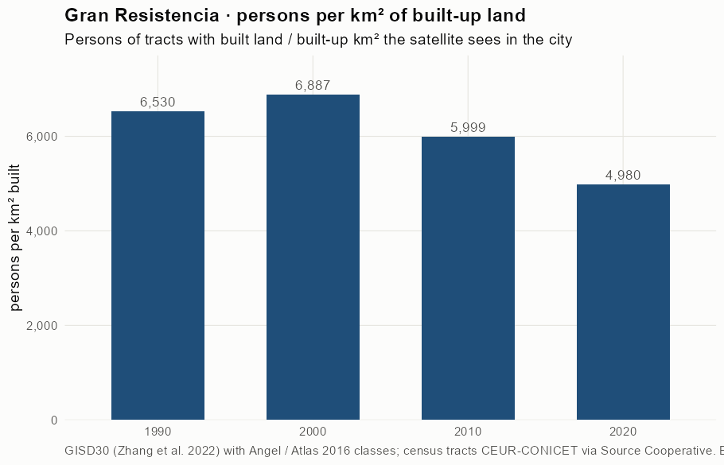
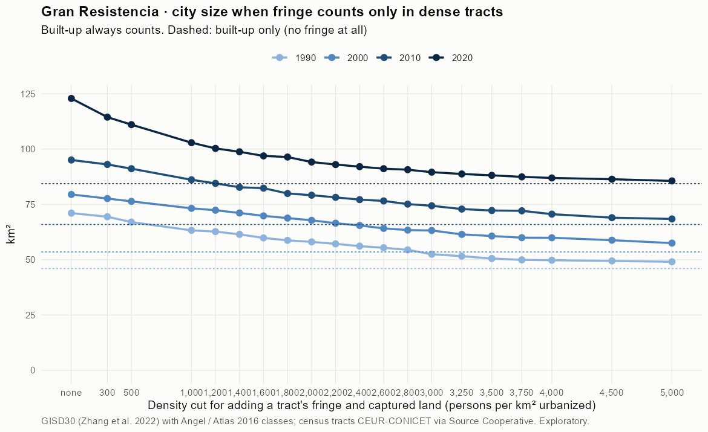
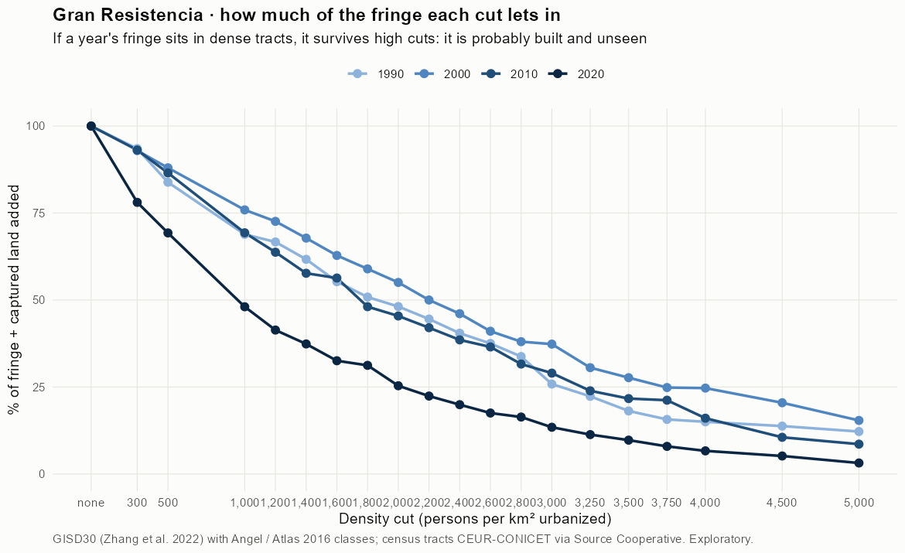
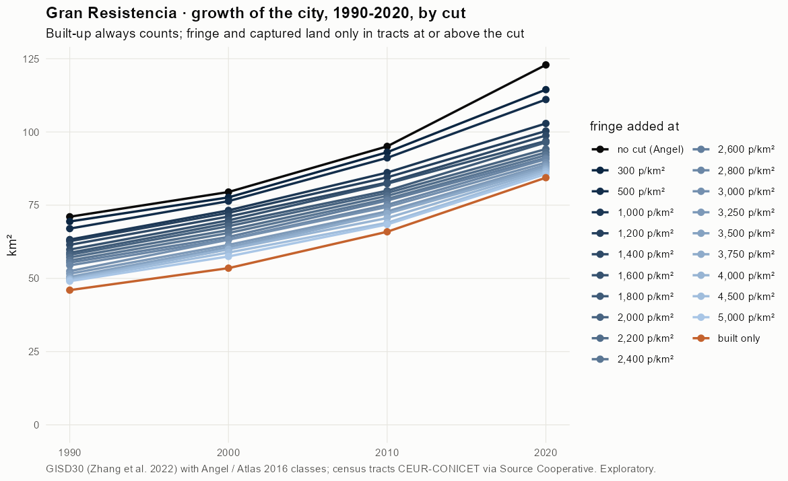
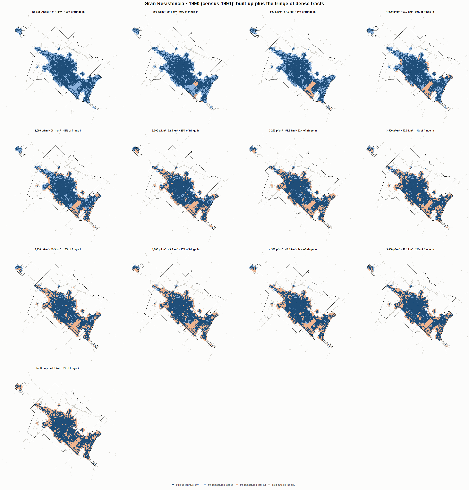
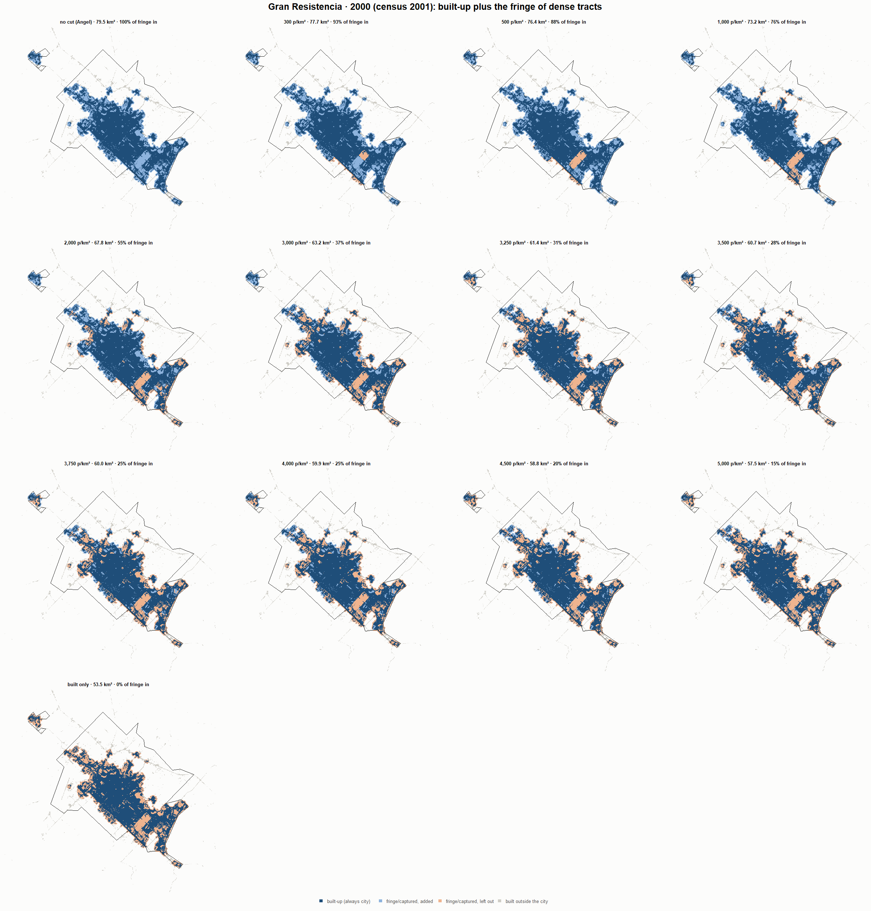
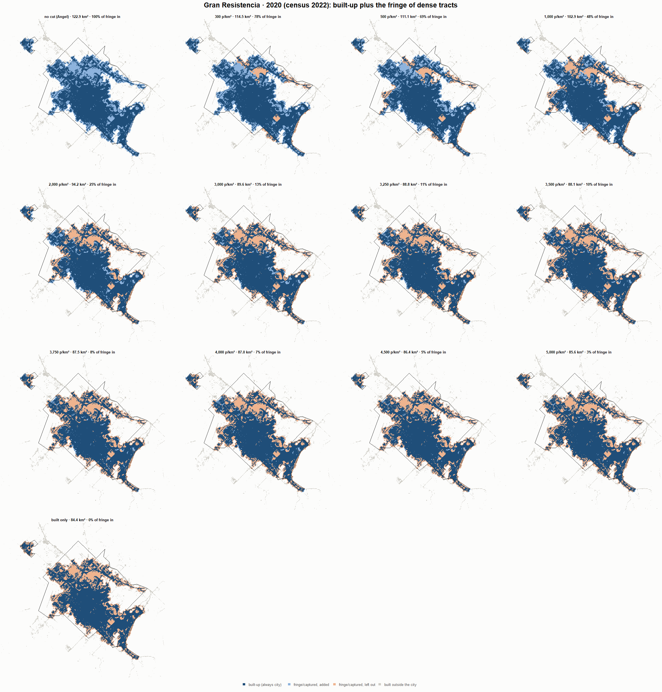

# Gran Resistencia · when does the fringe count as city? 1990-2020

Exploratory test 2. None of these numbers are project figures (they are not in `CIFRAS_CANONICAS.json`). Generated by `Rpipe/scripts/13_prueba_franja.R` from the tract tables of step 11. Run of 2026-11-15. [All agglomerations](../REPORTE.md).

**Idea.** Built-up land is always city. Fringe and captured open space join the city **only in dense tracts**, where they are probably built and unseen by the older imagery. No cut gives the full Angel extent; an infinite cut, built-up only. Method in the [index](../REPORTE.md#method).

## Is the early imagery under-detecting?

If the older imagery misses buildings, persons per km² of *built* land should come out higher in the early years.

| Year | Persons (tracts with built land) | Built km² | Persons / km² built | Median tract, persons / km² built | Fringe + captured, % of extent |
|---|---|---|---|---|---|
| 1990 (census 1991) | 300,350 | 46.0 | 6,530 | 6,225 | 35.2 |
| 2000 (census 2001) | 368,431 | 53.5 | 6,887 | 6,376 | 32.7 |
| 2010 (census 2010) | 395,464 | 65.9 | 5,999 | 5,790 | 30.6 |
| 2020 (census 2022) | 420,268 | 84.4 | 4,980 | 4,967 | 31.3 |

## Results

**1990 (census 1991).** Built-up 46.0 km²; fringe + captured 25.1 km²; 300,897 persons in the city's tracts.

| Fringe added at | City km² | Fringe added km² | % of fringe added | Fringe % of city | Tracts adding fringe | Persons / km² city |
|---|---|---|---|---|---|---|
| no cut (Angel) | 71.1 | 25.1 | 100.0 | 35.3 | 230 | 4,235 |
| 300 p/km² | 69.4 | 23.4 | 93.5 | 33.7 | 227 | 4,334 |
| 500 p/km² | 67.0 | 21.0 | 83.8 | 31.4 | 226 | 4,491 |
| 1,000 p/km² | 63.3 | 17.3 | 68.9 | 27.3 | 219 | 4,757 |
| 1,200 p/km² | 62.7 | 16.7 | 66.7 | 26.6 | 217 | 4,799 |
| 1,400 p/km² | 61.5 | 15.5 | 61.7 | 25.2 | 214 | 4,896 |
| 1,600 p/km² | 59.8 | 13.8 | 55.3 | 23.1 | 208 | 5,028 |
| 1,800 p/km² | 58.7 | 12.7 | 50.8 | 21.7 | 204 | 5,123 |
| 2,000 p/km² | 58.1 | 12.1 | 48.1 | 20.8 | 200 | 5,183 |
| 2,200 p/km² | 57.2 | 11.2 | 44.5 | 19.5 | 196 | 5,265 |
| 2,400 p/km² | 56.1 | 10.1 | 40.5 | 18.1 | 191 | 5,361 |
| 2,600 p/km² | 55.4 | 9.4 | 37.5 | 17.0 | 186 | 5,432 |
| 2,800 p/km² | 54.5 | 8.5 | 33.8 | 15.5 | 181 | 5,526 |
| 3,000 p/km² | 52.5 | 6.5 | 25.8 | 12.3 | 172 | 5,735 |
| 3,250 p/km² | 51.6 | 5.6 | 22.3 | 10.8 | 164 | 5,833 |
| 3,500 p/km² | 50.5 | 4.5 | 18.1 | 9.0 | 156 | 5,954 |
| 3,750 p/km² | 49.9 | 3.9 | 15.7 | 7.9 | 151 | 6,027 |
| 4,000 p/km² | 49.8 | 3.8 | 15.0 | 7.6 | 148 | 6,048 |
| 4,500 p/km² | 49.4 | 3.4 | 13.8 | 7.0 | 136 | 6,085 |
| 5,000 p/km² | 49.1 | 3.1 | 12.2 | 6.2 | 130 | 6,134 |
| built only | 46.0 | 0.0 | 0.0 | 0.0 | 0 | 6,542 |

**2000 (census 2001).** Built-up 53.5 km²; fringe + captured 26.0 km²; 368,834 persons in the city's tracts.

| Fringe added at | City km² | Fringe added km² | % of fringe added | Fringe % of city | Tracts adding fringe | Persons / km² city |
|---|---|---|---|---|---|---|
| no cut (Angel) | 79.5 | 26.0 | 100.0 | 32.7 | 259 | 4,640 |
| 300 p/km² | 77.7 | 24.2 | 92.9 | 31.1 | 256 | 4,750 |
| 500 p/km² | 76.4 | 22.9 | 88.0 | 29.9 | 255 | 4,830 |
| 1,000 p/km² | 73.2 | 19.7 | 75.9 | 26.9 | 249 | 5,037 |
| 1,200 p/km² | 72.4 | 18.9 | 72.6 | 26.1 | 246 | 5,097 |
| 1,400 p/km² | 71.1 | 17.6 | 67.8 | 24.8 | 242 | 5,186 |
| 1,600 p/km² | 69.8 | 16.3 | 62.8 | 23.4 | 238 | 5,282 |
| 1,800 p/km² | 68.8 | 15.3 | 58.9 | 22.3 | 235 | 5,359 |
| 2,000 p/km² | 67.8 | 14.3 | 55.0 | 21.1 | 230 | 5,440 |
| 2,200 p/km² | 66.5 | 13.0 | 50.0 | 19.5 | 224 | 5,547 |
| 2,400 p/km² | 65.5 | 12.0 | 46.1 | 18.3 | 219 | 5,633 |
| 2,600 p/km² | 64.2 | 10.7 | 41.0 | 16.6 | 211 | 5,748 |
| 2,800 p/km² | 63.4 | 9.9 | 38.0 | 15.6 | 206 | 5,819 |
| 3,000 p/km² | 63.2 | 9.7 | 37.3 | 15.4 | 203 | 5,836 |
| 3,250 p/km² | 61.4 | 7.9 | 30.6 | 12.9 | 191 | 6,003 |
| 3,500 p/km² | 60.7 | 7.2 | 27.7 | 11.9 | 186 | 6,077 |
| 3,750 p/km² | 60.0 | 6.5 | 24.8 | 10.8 | 180 | 6,152 |
| 4,000 p/km² | 59.9 | 6.4 | 24.7 | 10.7 | 177 | 6,156 |
| 4,500 p/km² | 58.8 | 5.3 | 20.5 | 9.0 | 164 | 6,271 |
| 5,000 p/km² | 57.5 | 4.0 | 15.4 | 7.0 | 144 | 6,415 |
| built only | 53.5 | 0.0 | 0.0 | 0.0 | 0 | 6,894 |

**2010 (census 2010).** Built-up 65.9 km²; fringe + captured 29.2 km²; 395,963 persons in the city's tracts.

| Fringe added at | City km² | Fringe added km² | % of fringe added | Fringe % of city | Tracts adding fringe | Persons / km² city |
|---|---|---|---|---|---|---|
| no cut (Angel) | 95.1 | 29.2 | 100.0 | 30.7 | 256 | 4,165 |
| 300 p/km² | 93.1 | 27.1 | 93.1 | 29.2 | 253 | 4,255 |
| 500 p/km² | 91.1 | 25.2 | 86.5 | 27.7 | 249 | 4,344 |
| 1,000 p/km² | 86.1 | 20.2 | 69.3 | 23.5 | 239 | 4,597 |
| 1,200 p/km² | 84.5 | 18.6 | 63.7 | 22.0 | 234 | 4,686 |
| 1,400 p/km² | 82.7 | 16.8 | 57.7 | 20.3 | 227 | 4,786 |
| 1,600 p/km² | 82.3 | 16.4 | 56.3 | 19.9 | 226 | 4,809 |
| 1,800 p/km² | 79.9 | 14.0 | 48.1 | 17.5 | 218 | 4,953 |
| 2,000 p/km² | 79.2 | 13.2 | 45.4 | 16.7 | 213 | 5,002 |
| 2,200 p/km² | 78.2 | 12.3 | 42.0 | 15.7 | 208 | 5,065 |
| 2,400 p/km² | 77.2 | 11.2 | 38.5 | 14.6 | 202 | 5,132 |
| 2,600 p/km² | 76.6 | 10.6 | 36.5 | 13.9 | 197 | 5,172 |
| 2,800 p/km² | 75.1 | 9.2 | 31.6 | 12.3 | 187 | 5,270 |
| 3,000 p/km² | 74.4 | 8.5 | 29.0 | 11.4 | 179 | 5,324 |
| 3,250 p/km² | 72.9 | 7.0 | 23.9 | 9.6 | 168 | 5,432 |
| 3,500 p/km² | 72.2 | 6.3 | 21.7 | 8.7 | 162 | 5,481 |
| 3,750 p/km² | 72.1 | 6.2 | 21.2 | 8.6 | 159 | 5,492 |
| 4,000 p/km² | 70.6 | 4.7 | 16.0 | 6.6 | 147 | 5,609 |
| 4,500 p/km² | 69.0 | 3.1 | 10.5 | 4.5 | 124 | 5,739 |
| 5,000 p/km² | 68.4 | 2.5 | 8.6 | 3.7 | 111 | 5,787 |
| built only | 65.9 | 0.0 | 0.0 | 0.0 | 0 | 6,007 |

**2020 (census 2022).** Built-up 84.4 km²; fringe + captured 38.5 km²; 420,268 persons in the city's tracts.

| Fringe added at | City km² | Fringe added km² | % of fringe added | Fringe % of city | Tracts adding fringe | Persons / km² city |
|---|---|---|---|---|---|---|
| no cut (Angel) | 122.9 | 38.5 | 100.0 | 31.3 | 287 | 3,420 |
| 300 p/km² | 114.5 | 30.1 | 78.1 | 26.3 | 279 | 3,672 |
| 500 p/km² | 111.1 | 26.7 | 69.3 | 24.0 | 275 | 3,784 |
| 1,000 p/km² | 102.9 | 18.5 | 48.1 | 18.0 | 259 | 4,084 |
| 1,200 p/km² | 100.3 | 15.9 | 41.4 | 15.9 | 251 | 4,189 |
| 1,400 p/km² | 98.8 | 14.4 | 37.4 | 14.6 | 245 | 4,254 |
| 1,600 p/km² | 96.9 | 12.5 | 32.5 | 12.9 | 237 | 4,336 |
| 1,800 p/km² | 96.4 | 12.0 | 31.2 | 12.5 | 233 | 4,359 |
| 2,000 p/km² | 94.2 | 9.8 | 25.4 | 10.4 | 223 | 4,463 |
| 2,200 p/km² | 93.0 | 8.6 | 22.4 | 9.3 | 216 | 4,518 |
| 2,400 p/km² | 92.1 | 7.7 | 19.9 | 8.3 | 207 | 4,565 |
| 2,600 p/km² | 91.1 | 6.7 | 17.5 | 7.4 | 200 | 4,611 |
| 2,800 p/km² | 90.7 | 6.3 | 16.4 | 6.9 | 195 | 4,634 |
| 3,000 p/km² | 89.6 | 5.2 | 13.4 | 5.8 | 182 | 4,692 |
| 3,250 p/km² | 88.8 | 4.4 | 11.3 | 4.9 | 172 | 4,735 |
| 3,500 p/km² | 88.1 | 3.7 | 9.7 | 4.2 | 163 | 4,768 |
| 3,750 p/km² | 87.5 | 3.1 | 7.9 | 3.5 | 152 | 4,806 |
| 4,000 p/km² | 87.0 | 2.6 | 6.6 | 2.9 | 138 | 4,833 |
| 4,500 p/km² | 86.4 | 2.0 | 5.2 | 2.3 | 113 | 4,865 |
| 5,000 p/km² | 85.6 | 1.2 | 3.2 | 1.4 | 92 | 4,909 |
| built only | 84.4 | 0.0 | 0.0 | 0.0 | 0 | 4,980 |

### Growth by cut

| Fringe added at | 1990 km² | 2000 km² | 2010 km² | 2020 km² | 1990-2000 %/yr | 2000-2010 %/yr | 2010-2020 %/yr | 1990-2020 %/yr |
|---|---|---|---|---|---|---|---|---|
| no cut (Angel) | 71.1 | 79.5 | 95.1 | 122.9 | 1.13 | 1.81 | 2.60 | 1.84 |
| 300 p/km² | 69.4 | 77.7 | 93.1 | 114.5 | 1.13 | 1.83 | 2.09 | 1.68 |
| 500 p/km² | 67.0 | 76.4 | 91.1 | 111.1 | 1.32 | 1.79 | 2.00 | 1.70 |
| 1,000 p/km² | 63.3 | 73.2 | 86.1 | 102.9 | 1.47 | 1.64 | 1.79 | 1.64 |
| 1,200 p/km² | 62.7 | 72.4 | 84.5 | 100.3 | 1.44 | 1.56 | 1.73 | 1.58 |
| 1,400 p/km² | 61.5 | 71.1 | 82.7 | 98.8 | 1.47 | 1.53 | 1.79 | 1.59 |
| 1,600 p/km² | 59.8 | 69.8 | 82.3 | 96.9 | 1.55 | 1.66 | 1.64 | 1.62 |
| 1,800 p/km² | 58.7 | 68.8 | 79.9 | 96.4 | 1.60 | 1.51 | 1.89 | 1.67 |
| 2,000 p/km² | 58.1 | 67.8 | 79.2 | 94.2 | 1.56 | 1.56 | 1.75 | 1.63 |
| 2,200 p/km² | 57.2 | 66.5 | 78.2 | 93.0 | 1.53 | 1.63 | 1.75 | 1.64 |
| 2,400 p/km² | 56.1 | 65.5 | 77.2 | 92.1 | 1.55 | 1.66 | 1.78 | 1.66 |
| 2,600 p/km² | 55.4 | 64.2 | 76.6 | 91.1 | 1.48 | 1.78 | 1.76 | 1.67 |
| 2,800 p/km² | 54.5 | 63.4 | 75.1 | 90.7 | 1.53 | 1.72 | 1.90 | 1.72 |
| 3,000 p/km² | 52.5 | 63.2 | 74.4 | 89.6 | 1.88 | 1.64 | 1.88 | 1.80 |
| 3,250 p/km² | 51.6 | 61.4 | 72.9 | 88.8 | 1.76 | 1.72 | 1.99 | 1.83 |
| 3,500 p/km² | 50.5 | 60.7 | 72.2 | 88.1 | 1.85 | 1.76 | 2.01 | 1.87 |
| 3,750 p/km² | 49.9 | 60.0 | 72.1 | 87.5 | 1.85 | 1.86 | 1.95 | 1.89 |
| 4,000 p/km² | 49.8 | 59.9 | 70.6 | 87.0 | 1.88 | 1.65 | 2.11 | 1.88 |
| 4,500 p/km² | 49.4 | 58.8 | 69.0 | 86.4 | 1.75 | 1.61 | 2.27 | 1.88 |
| 5,000 p/km² | 49.1 | 57.5 | 68.4 | 85.6 | 1.60 | 1.75 | 2.27 | 1.87 |
| built only | 46.0 | 53.5 | 65.9 | 84.4 | 1.52 | 2.11 | 2.50 | 2.04 |

## Maps

Same frame in the four years: the 2020 city plus 3 km. Dark blue is built-up, always city; light blue is fringe or captured land added because its tract is dense; light orange is fringe left out. Black line: the analysis perimeter.

### 1990

### 2000

### 2010

### 2020

## Reading

- **The premise.** Persons per km² of built land: 6,530 in 1990, 6,887 in 2000, 5,999 in 2010, 4,980 in 2020. 1990 is not clearly higher than 2010: the census does not point to much built land missed in 1990.
- **At 500 p/km²** the fringe that joins the city is 83.8 % of all fringe in 1990 and 69.3 % in 2020.
- **Growth 1990-2020**: 1.84 %/yr with the full Angel extent, 1.70 %/yr at 500, 2.04 %/yr built-up only.

