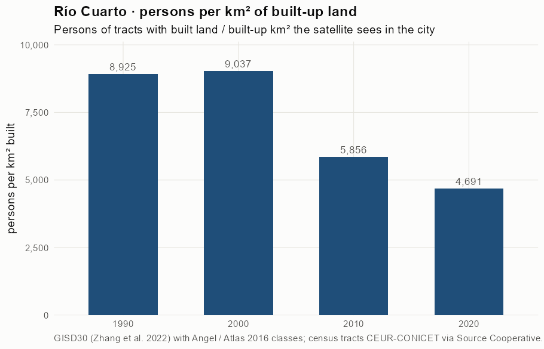
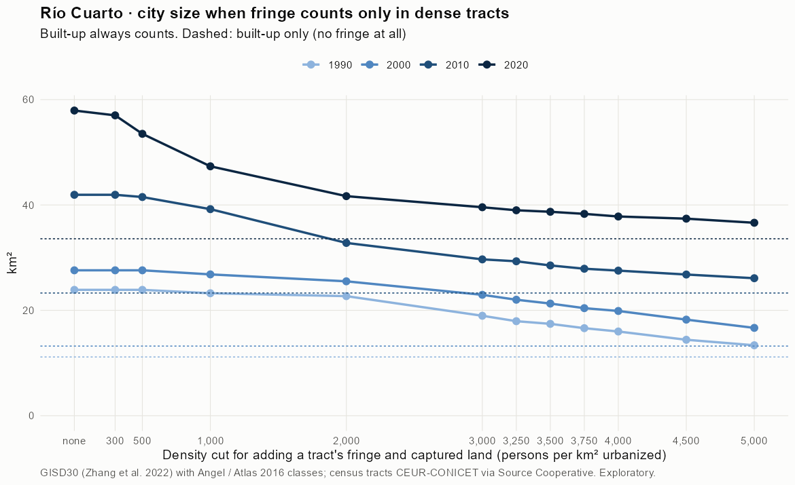
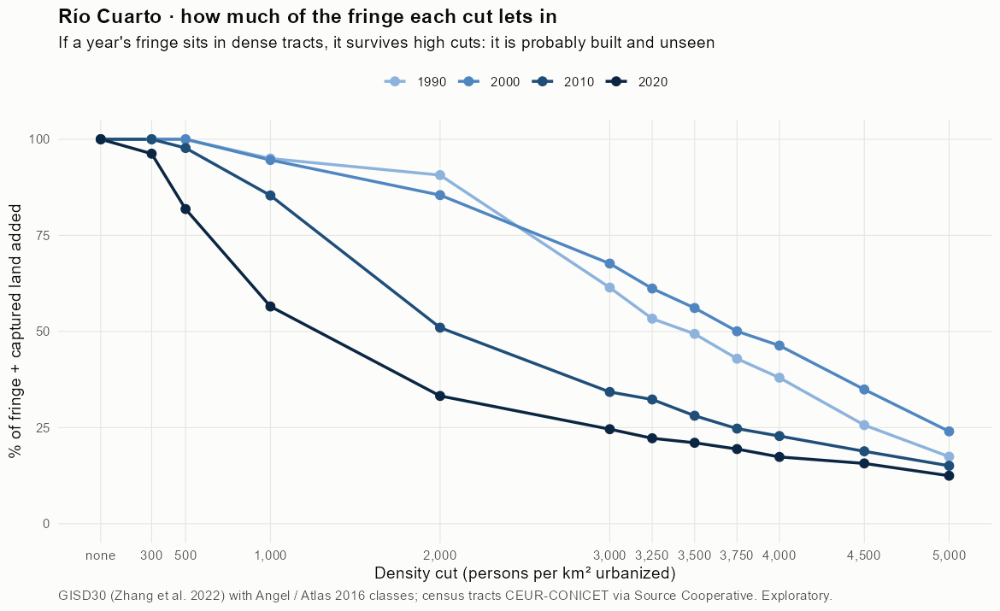
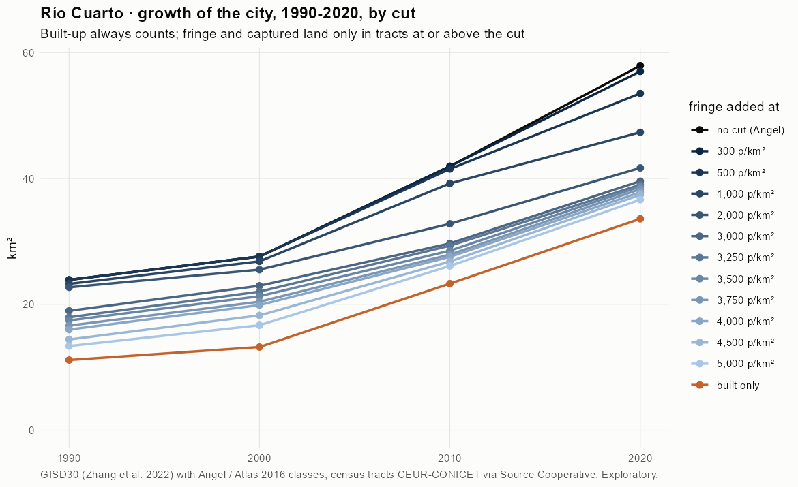
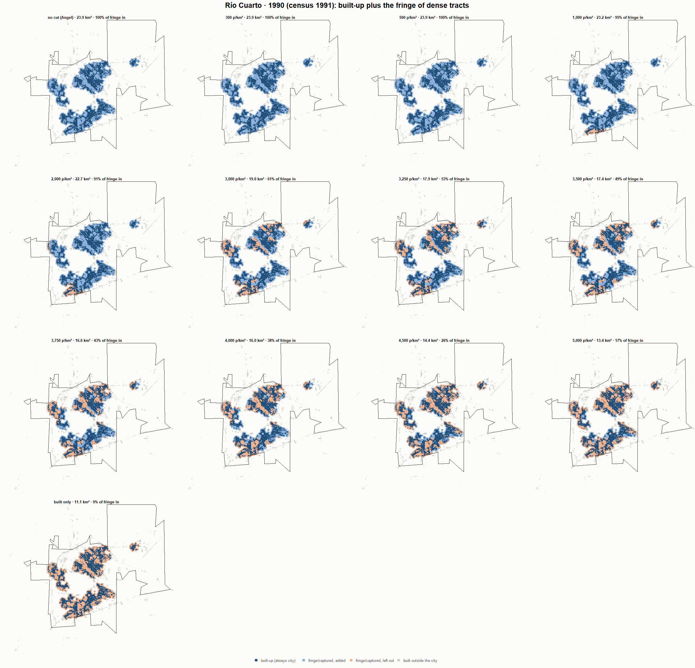
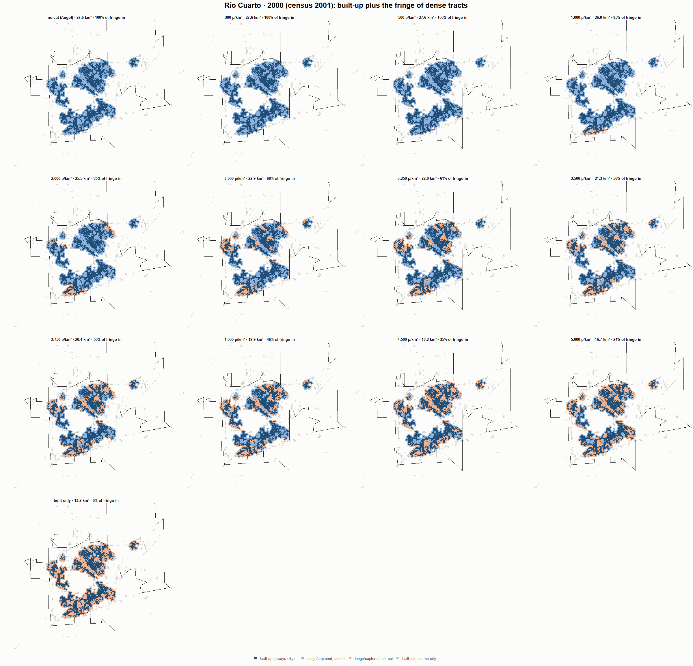
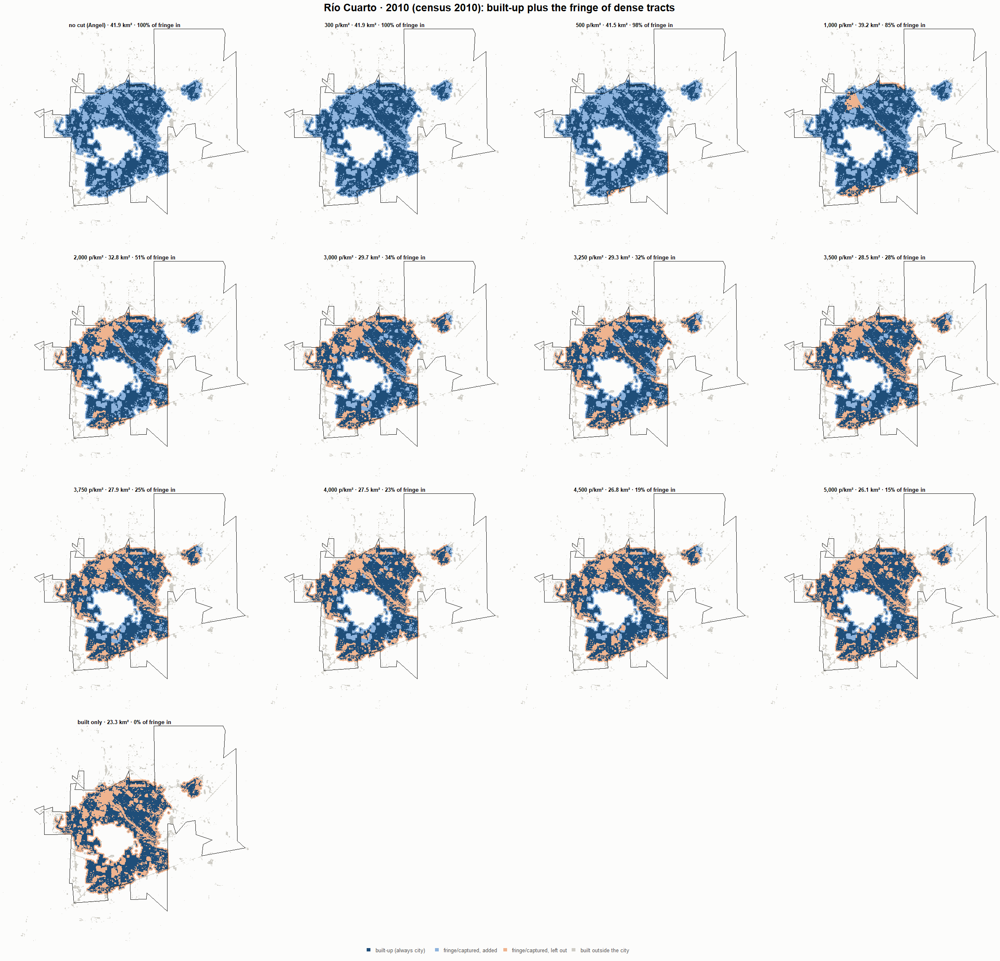
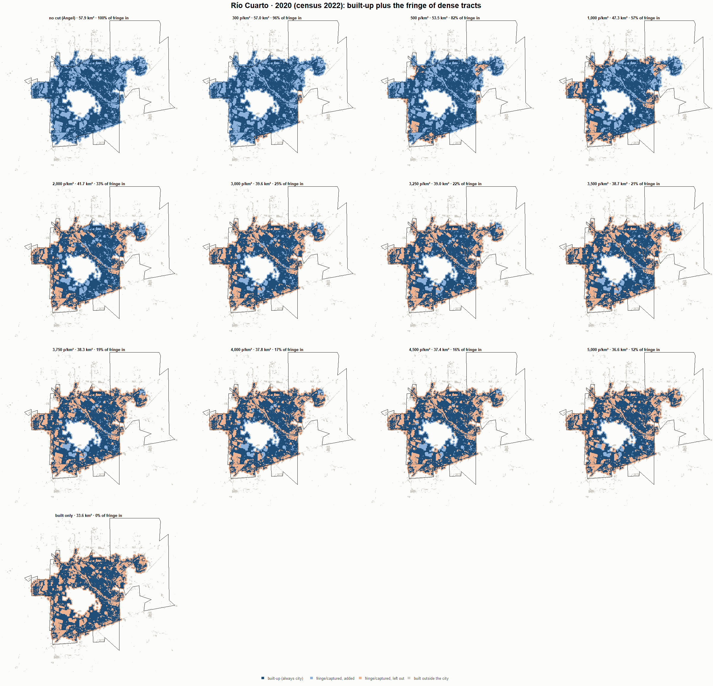

# Río Cuarto · when does the fringe count as city? 1990-2020

Exploratory test 2. None of these numbers are project figures (they are not in `CIFRAS_CANONICAS.json`). Generated by `Rpipe/scripts/13_prueba_franja.R` from the tract tables of step 11. Run of 2026-11-08. [All agglomerations](../REPORTE.md).

**Idea.** Built-up land is always city. Fringe and captured open space join the city **only in dense tracts**, where they are probably built and unseen by the older imagery. No cut gives the full Angel extent; an infinite cut, built-up only. Method in the [index](../REPORTE.md#method).

## Is the early imagery under-detecting?

If the older imagery misses buildings, persons per km² of *built* land should come out higher in the early years.

| Year | Persons (tracts with built land) | Built km² | Persons / km² built | Median tract, persons / km² built | Fringe + captured, % of extent |
|---|---|---|---|---|---|
| 1990 (census 1991) | 99,495 | 11.1 | 8,925 | 6,960 | 53.2 |
| 2000 (census 2001) | 119,423 | 13.2 | 9,037 | 7,323 | 52.0 |
| 2010 (census 2010) | 136,362 | 23.3 | 5,856 | 4,848 | 44.3 |
| 2020 (census 2022) | 157,552 | 33.6 | 4,691 | 4,025 | 41.8 |

## Results

**1990 (census 1991).** Built-up 11.1 km²; fringe + captured 12.7 km²; 107,546 persons in the city's tracts.

| Fringe added at | City km² | Fringe added km² | % of fringe added | Fringe % of city | Tracts adding fringe | Persons / km² city |
|---|---|---|---|---|---|---|
| no cut (Angel) | 23.9 | 12.7 | 100.0 | 53.3 | 103 | 4,503 |
| 300 p/km² | 23.9 | 12.7 | 100.0 | 53.3 | 103 | 4,503 |
| 500 p/km² | 23.9 | 12.7 | 100.0 | 53.3 | 103 | 4,503 |
| 1,000 p/km² | 23.2 | 12.1 | 95.0 | 52.0 | 102 | 4,627 |
| 2,000 p/km² | 22.7 | 11.5 | 90.7 | 50.9 | 100 | 4,738 |
| 3,000 p/km² | 19.0 | 7.8 | 61.4 | 41.2 | 83 | 5,669 |
| 3,250 p/km² | 17.9 | 6.8 | 53.3 | 37.9 | 78 | 5,995 |
| 3,500 p/km² | 17.4 | 6.3 | 49.4 | 36.1 | 76 | 6,168 |
| 3,750 p/km² | 16.6 | 5.5 | 42.9 | 32.9 | 71 | 6,473 |
| 4,000 p/km² | 16.0 | 4.8 | 38.0 | 30.3 | 67 | 6,728 |
| 4,500 p/km² | 14.4 | 3.3 | 25.7 | 22.7 | 55 | 7,461 |
| 5,000 p/km² | 13.4 | 2.2 | 17.4 | 16.6 | 45 | 8,044 |
| built only | 11.1 | 0.0 | 0.0 | 0.0 | 0 | 9,647 |

**2000 (census 2001).** Built-up 13.2 km²; fringe + captured 14.4 km²; 125,661 persons in the city's tracts.

| Fringe added at | City km² | Fringe added km² | % of fringe added | Fringe % of city | Tracts adding fringe | Persons / km² city |
|---|---|---|---|---|---|---|
| no cut (Angel) | 27.6 | 14.4 | 100.0 | 52.1 | 127 | 4,553 |
| 300 p/km² | 27.6 | 14.4 | 100.0 | 52.1 | 127 | 4,553 |
| 500 p/km² | 27.6 | 14.4 | 100.0 | 52.1 | 127 | 4,553 |
| 1,000 p/km² | 26.8 | 13.6 | 94.6 | 50.7 | 126 | 4,685 |
| 2,000 p/km² | 25.5 | 12.3 | 85.5 | 48.2 | 122 | 4,926 |
| 3,000 p/km² | 22.9 | 9.7 | 67.7 | 42.4 | 110 | 5,476 |
| 3,250 p/km² | 22.0 | 8.8 | 61.2 | 40.0 | 104 | 5,708 |
| 3,500 p/km² | 21.3 | 8.1 | 56.1 | 37.9 | 100 | 5,903 |
| 3,750 p/km² | 20.4 | 7.2 | 50.1 | 35.3 | 94 | 6,155 |
| 4,000 p/km² | 19.9 | 6.7 | 46.3 | 33.5 | 91 | 6,321 |
| 4,500 p/km² | 18.2 | 5.0 | 34.9 | 27.5 | 78 | 6,890 |
| 5,000 p/km² | 16.7 | 3.5 | 24.0 | 20.7 | 63 | 7,538 |
| built only | 13.2 | 0.0 | 0.0 | 0.0 | 0 | 9,509 |

**2010 (census 2010).** Built-up 23.3 km²; fringe + captured 18.6 km²; 142,267 persons in the city's tracts.

| Fringe added at | City km² | Fringe added km² | % of fringe added | Fringe % of city | Tracts adding fringe | Persons / km² city |
|---|---|---|---|---|---|---|
| no cut (Angel) | 41.9 | 18.6 | 100.0 | 44.5 | 148 | 3,393 |
| 300 p/km² | 41.9 | 18.6 | 100.0 | 44.5 | 148 | 3,393 |
| 500 p/km² | 41.5 | 18.2 | 97.7 | 43.9 | 147 | 3,427 |
| 1,000 p/km² | 39.2 | 15.9 | 85.4 | 40.6 | 142 | 3,629 |
| 2,000 p/km² | 32.8 | 9.5 | 51.0 | 29.0 | 125 | 4,338 |
| 3,000 p/km² | 29.7 | 6.4 | 34.3 | 21.5 | 106 | 4,794 |
| 3,250 p/km² | 29.3 | 6.0 | 32.3 | 20.6 | 102 | 4,854 |
| 3,500 p/km² | 28.5 | 5.2 | 28.1 | 18.4 | 96 | 4,988 |
| 3,750 p/km² | 27.9 | 4.6 | 24.7 | 16.5 | 89 | 5,099 |
| 4,000 p/km² | 27.5 | 4.3 | 22.8 | 15.4 | 85 | 5,166 |
| 4,500 p/km² | 26.8 | 3.5 | 18.8 | 13.1 | 73 | 5,309 |
| 5,000 p/km² | 26.1 | 2.8 | 15.1 | 10.8 | 63 | 5,452 |
| built only | 23.3 | 0.0 | 0.0 | 0.0 | 0 | 6,109 |

**2020 (census 2022).** Built-up 33.6 km²; fringe + captured 24.3 km²; 163,361 persons in the city's tracts.

| Fringe added at | City km² | Fringe added km² | % of fringe added | Fringe % of city | Tracts adding fringe | Persons / km² city |
|---|---|---|---|---|---|---|
| no cut (Angel) | 57.9 | 24.3 | 100.0 | 42.0 | 265 | 2,820 |
| 300 p/km² | 57.0 | 23.4 | 96.2 | 41.1 | 264 | 2,865 |
| 500 p/km² | 53.5 | 19.9 | 81.8 | 37.2 | 259 | 3,053 |
| 1,000 p/km² | 47.3 | 13.8 | 56.5 | 29.1 | 245 | 3,451 |
| 2,000 p/km² | 41.7 | 8.1 | 33.2 | 19.4 | 218 | 3,920 |
| 3,000 p/km² | 39.6 | 6.0 | 24.6 | 15.1 | 194 | 4,128 |
| 3,250 p/km² | 39.0 | 5.4 | 22.2 | 13.9 | 187 | 4,189 |
| 3,500 p/km² | 38.7 | 5.1 | 21.0 | 13.2 | 181 | 4,220 |
| 3,750 p/km² | 38.3 | 4.7 | 19.4 | 12.3 | 172 | 4,264 |
| 4,000 p/km² | 37.8 | 4.2 | 17.4 | 11.2 | 154 | 4,320 |
| 4,500 p/km² | 37.4 | 3.8 | 15.7 | 10.2 | 139 | 4,368 |
| 5,000 p/km² | 36.6 | 3.0 | 12.5 | 8.3 | 115 | 4,461 |
| built only | 33.6 | 0.0 | 0.0 | 0.0 | 0 | 4,864 |

### Growth by cut

| Fringe added at | 1990 km² | 2000 km² | 2010 km² | 2020 km² | 1990-2000 %/yr | 2000-2010 %/yr | 2010-2020 %/yr | 1990-2020 %/yr |
|---|---|---|---|---|---|---|---|---|
| no cut (Angel) | 23.9 | 27.6 | 41.9 | 57.9 | 1.46 | 4.27 | 3.28 | 3.00 |
| 300 p/km² | 23.9 | 27.6 | 41.9 | 57.0 | 1.46 | 4.27 | 3.12 | 2.94 |
| 500 p/km² | 23.9 | 27.6 | 41.5 | 53.5 | 1.46 | 4.17 | 2.57 | 2.72 |
| 1,000 p/km² | 23.2 | 26.8 | 39.2 | 47.3 | 1.44 | 3.87 | 1.90 | 2.40 |
| 2,000 p/km² | 22.7 | 25.5 | 32.8 | 41.7 | 1.18 | 2.54 | 2.43 | 2.05 |
| 3,000 p/km² | 19.0 | 22.9 | 29.7 | 39.6 | 1.92 | 2.60 | 2.92 | 2.48 |
| 3,250 p/km² | 17.9 | 22.0 | 29.3 | 39.0 | 2.07 | 2.90 | 2.90 | 2.62 |
| 3,500 p/km² | 17.4 | 21.3 | 28.5 | 38.7 | 2.01 | 2.97 | 3.10 | 2.69 |
| 3,750 p/km² | 16.6 | 20.4 | 27.9 | 38.3 | 2.08 | 3.17 | 3.22 | 2.82 |
| 4,000 p/km² | 16.0 | 19.9 | 27.5 | 37.8 | 2.20 | 3.31 | 3.22 | 2.91 |
| 4,500 p/km² | 14.4 | 18.2 | 26.8 | 37.4 | 2.38 | 3.92 | 3.39 | 3.23 |
| 5,000 p/km² | 13.4 | 16.7 | 26.1 | 36.6 | 2.23 | 4.58 | 3.45 | 3.42 |
| built only | 11.1 | 13.2 | 23.3 | 33.6 | 1.72 | 5.83 | 3.73 | 3.74 |

## Maps

Same frame in the four years: the 2020 city plus 3 km. Dark blue is built-up, always city; light blue is fringe or captured land added because its tract is dense; light orange is fringe left out. Black line: the analysis perimeter.

### 1990

### 2000

### 2010

### 2020

## Reading

- **The premise.** Persons per km² of built land: 8,925 in 1990, 9,037 in 2000, 5,856 in 2010, 4,691 in 2020. 1990 is clearly higher than 2010: consistent with built land missed in 1990, though it also fits a denser city that later spread out.
- **At 500 p/km²** the fringe that joins the city is 100.0 % of all fringe in 1990 and 81.8 % in 2020.
- **Growth 1990-2020**: 3.00 %/yr with the full Angel extent, 2.72 %/yr at 500, 3.74 %/yr built-up only.

