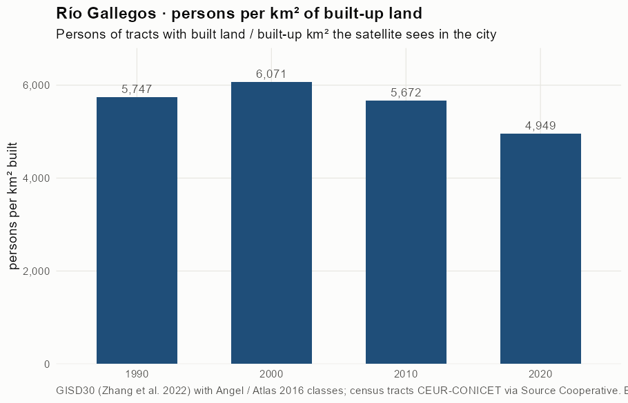
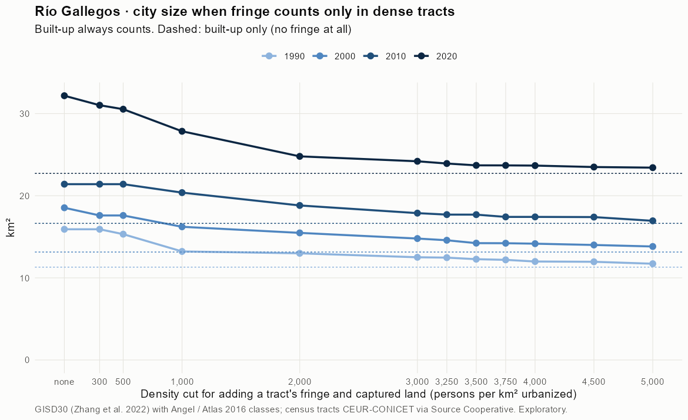
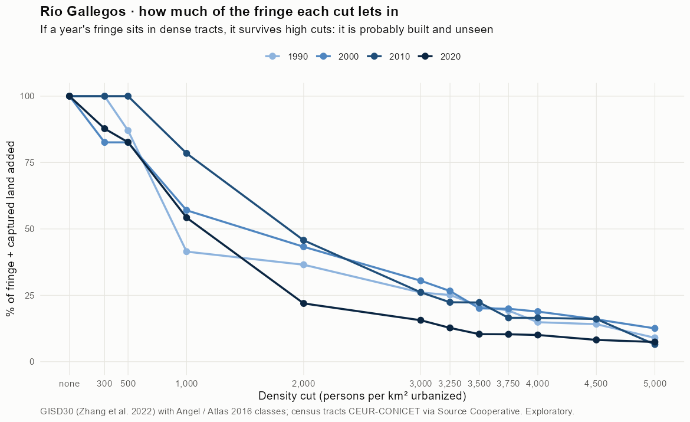
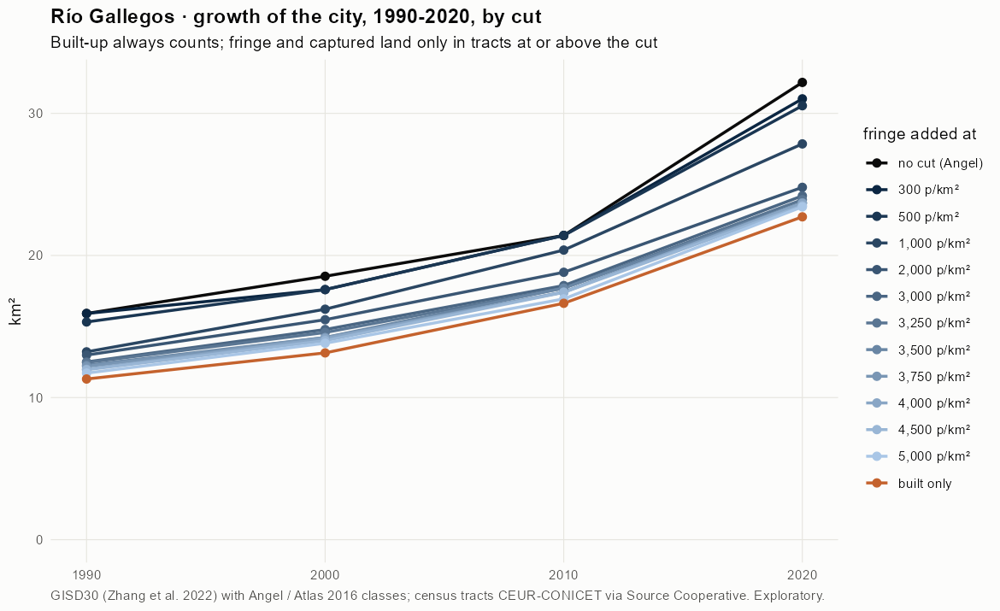
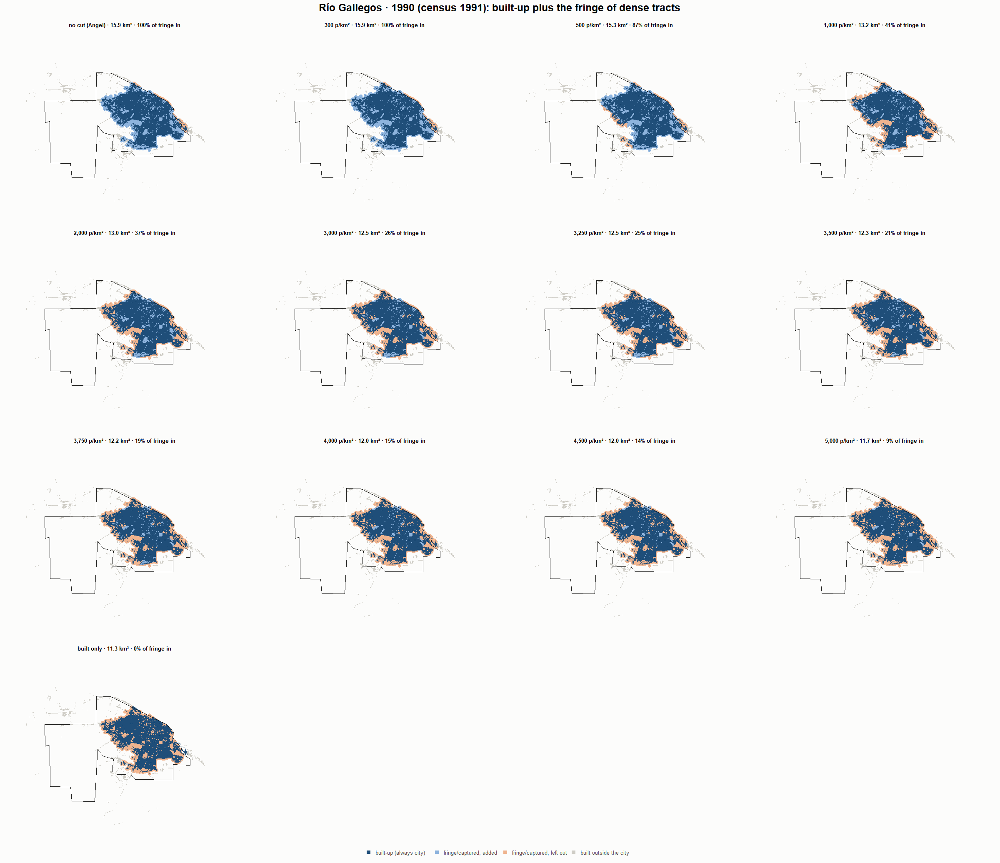
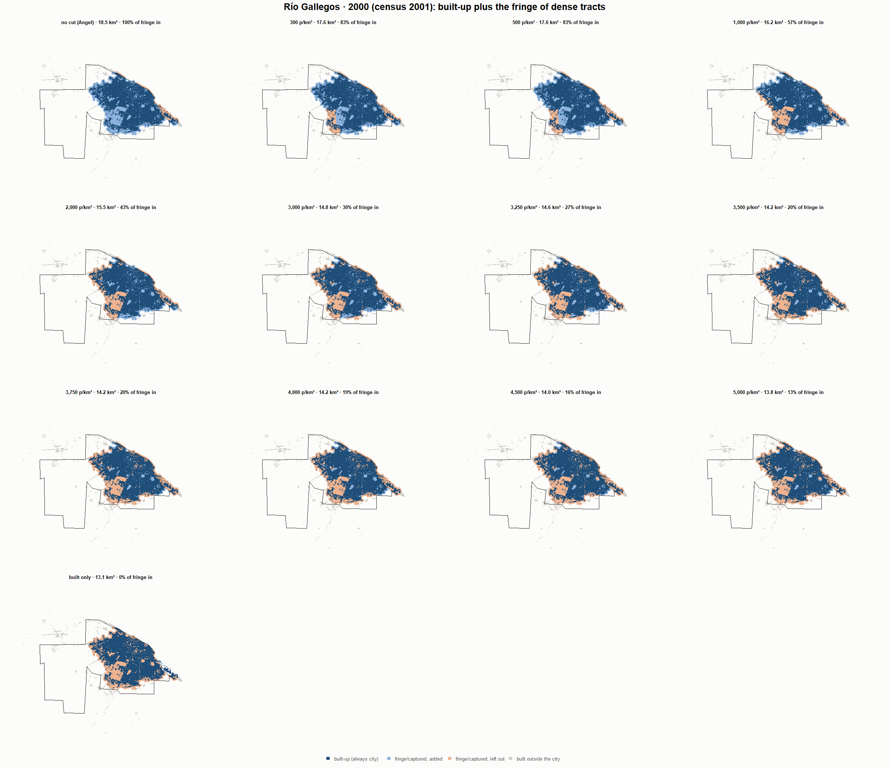
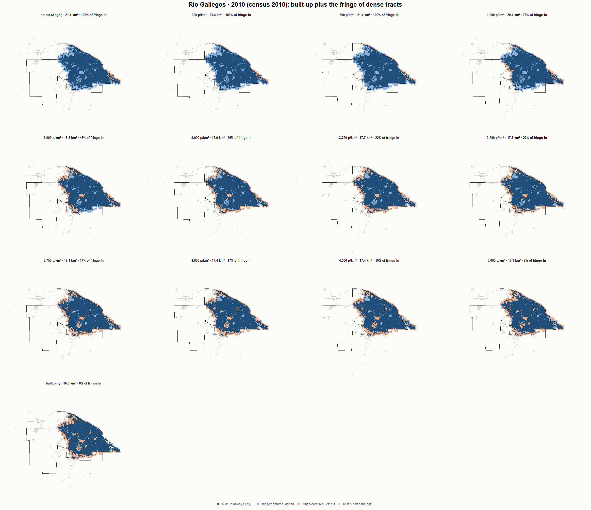
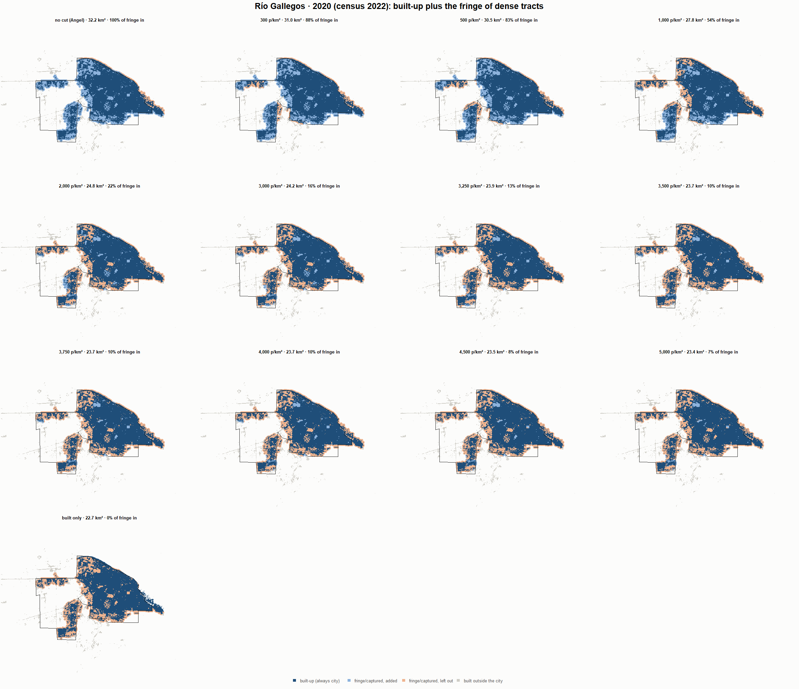

# Río Gallegos · when does the fringe count as city? 1990-2020

Exploratory test 2. None of these numbers are project figures (they are not in `CIFRAS_CANONICAS.json`). Generated by `Rpipe/scripts/13_prueba_franja.R` from the tract tables of step 11. Run of 2026-11-08. [All agglomerations](../REPORTE.md).

**Idea.** Built-up land is always city. Fringe and captured open space join the city **only in dense tracts**, where they are probably built and unseen by the older imagery. No cut gives the full Angel extent; an infinite cut, built-up only. Method in the [index](../REPORTE.md#method).

## Is the early imagery under-detecting?

If the older imagery misses buildings, persons per km² of *built* land should come out higher in the early years.

| Year | Persons (tracts with built land) | Built km² | Persons / km² built | Median tract, persons / km² built | Fringe + captured, % of extent |
|---|---|---|---|---|---|
| 1990 (census 1991) | 64,976 | 11.3 | 5,747 | 5,313 | 29.0 |
| 2000 (census 2001) | 79,790 | 13.1 | 6,071 | 5,265 | 29.1 |
| 2010 (census 2010) | 94,351 | 16.6 | 5,672 | 4,380 | 22.3 |
| 2020 (census 2022) | 112,430 | 22.7 | 4,949 | 3,931 | 29.2 |

## Results

**1990 (census 1991).** Built-up 11.3 km²; fringe + captured 4.6 km²; 64,976 persons in the city's tracts.

| Fringe added at | City km² | Fringe added km² | % of fringe added | Fringe % of city | Tracts adding fringe | Persons / km² city |
|---|---|---|---|---|---|---|
| no cut (Angel) | 15.9 | 4.6 | 100.0 | 29.0 | 50 | 4,082 |
| 300 p/km² | 15.9 | 4.6 | 100.0 | 29.0 | 50 | 4,082 |
| 500 p/km² | 15.3 | 4.0 | 87.1 | 26.2 | 49 | 4,241 |
| 1,000 p/km² | 13.2 | 1.9 | 41.5 | 14.5 | 46 | 4,916 |
| 2,000 p/km² | 13.0 | 1.7 | 36.5 | 13.0 | 45 | 5,002 |
| 3,000 p/km² | 12.5 | 1.2 | 26.1 | 9.6 | 40 | 5,195 |
| 3,250 p/km² | 12.5 | 1.2 | 25.1 | 9.3 | 39 | 5,213 |
| 3,500 p/km² | 12.3 | 1.0 | 21.0 | 7.9 | 37 | 5,294 |
| 3,750 p/km² | 12.2 | 0.9 | 19.2 | 7.3 | 36 | 5,329 |
| 4,000 p/km² | 12.0 | 0.7 | 14.9 | 5.7 | 32 | 5,418 |
| 4,500 p/km² | 12.0 | 0.7 | 14.1 | 5.4 | 31 | 5,434 |
| 5,000 p/km² | 11.7 | 0.4 | 9.0 | 3.5 | 25 | 5,544 |
| built only | 11.3 | 0.0 | 0.0 | 0.0 | 0 | 5,747 |

**2000 (census 2001).** Built-up 13.1 km²; fringe + captured 5.4 km²; 79,790 persons in the city's tracts.

| Fringe added at | City km² | Fringe added km² | % of fringe added | Fringe % of city | Tracts adding fringe | Persons / km² city |
|---|---|---|---|---|---|---|
| no cut (Angel) | 18.5 | 5.4 | 100.0 | 29.1 | 76 | 4,305 |
| 300 p/km² | 17.6 | 4.5 | 82.6 | 25.3 | 75 | 4,534 |
| 500 p/km² | 17.6 | 4.5 | 82.6 | 25.3 | 75 | 4,534 |
| 1,000 p/km² | 16.2 | 3.1 | 57.0 | 19.0 | 72 | 4,920 |
| 2,000 p/km² | 15.5 | 2.3 | 43.3 | 15.1 | 68 | 5,155 |
| 3,000 p/km² | 14.8 | 1.6 | 30.5 | 11.1 | 60 | 5,396 |
| 3,250 p/km² | 14.6 | 1.4 | 26.6 | 9.8 | 58 | 5,473 |
| 3,500 p/km² | 14.2 | 1.1 | 20.1 | 7.6 | 54 | 5,608 |
| 3,750 p/km² | 14.2 | 1.1 | 19.9 | 7.6 | 52 | 5,612 |
| 4,000 p/km² | 14.2 | 1.0 | 18.9 | 7.2 | 49 | 5,634 |
| 4,500 p/km² | 14.0 | 0.9 | 16.0 | 6.1 | 45 | 5,698 |
| 5,000 p/km² | 13.8 | 0.7 | 12.6 | 4.9 | 41 | 5,773 |
| built only | 13.1 | 0.0 | 0.0 | 0.0 | 0 | 6,071 |

**2010 (census 2010).** Built-up 16.6 km²; fringe + captured 4.8 km²; 94,351 persons in the city's tracts.

| Fringe added at | City km² | Fringe added km² | % of fringe added | Fringe % of city | Tracts adding fringe | Persons / km² city |
|---|---|---|---|---|---|---|
| no cut (Angel) | 21.4 | 4.8 | 100.0 | 22.3 | 71 | 4,407 |
| 300 p/km² | 21.4 | 4.8 | 100.0 | 22.3 | 71 | 4,407 |
| 500 p/km² | 21.4 | 4.8 | 100.0 | 22.3 | 71 | 4,407 |
| 1,000 p/km² | 20.4 | 3.7 | 78.5 | 18.4 | 68 | 4,630 |
| 2,000 p/km² | 18.8 | 2.2 | 45.7 | 11.6 | 62 | 5,014 |
| 3,000 p/km² | 17.9 | 1.2 | 26.1 | 7.0 | 53 | 5,277 |
| 3,250 p/km² | 17.7 | 1.1 | 22.4 | 6.0 | 47 | 5,330 |
| 3,500 p/km² | 17.7 | 1.1 | 22.3 | 6.0 | 45 | 5,331 |
| 3,750 p/km² | 17.4 | 0.8 | 16.5 | 4.5 | 37 | 5,416 |
| 4,000 p/km² | 17.4 | 0.8 | 16.5 | 4.5 | 37 | 5,416 |
| 4,500 p/km² | 17.4 | 0.8 | 16.1 | 4.4 | 34 | 5,422 |
| 5,000 p/km² | 16.9 | 0.3 | 6.5 | 1.8 | 27 | 5,568 |
| built only | 16.6 | 0.0 | 0.0 | 0.0 | 0 | 5,672 |

**2020 (census 2022).** Built-up 22.7 km²; fringe + captured 9.5 km²; 113,645 persons in the city's tracts.

| Fringe added at | City km² | Fringe added km² | % of fringe added | Fringe % of city | Tracts adding fringe | Persons / km² city |
|---|---|---|---|---|---|---|
| no cut (Angel) | 32.2 | 9.5 | 100.0 | 29.4 | 107 | 3,532 |
| 300 p/km² | 31.0 | 8.3 | 87.8 | 26.8 | 105 | 3,664 |
| 500 p/km² | 30.5 | 7.8 | 82.7 | 25.6 | 102 | 3,722 |
| 1,000 p/km² | 27.8 | 5.1 | 54.3 | 18.4 | 95 | 4,081 |
| 2,000 p/km² | 24.8 | 2.1 | 22.0 | 8.4 | 76 | 4,584 |
| 3,000 p/km² | 24.2 | 1.5 | 15.6 | 6.1 | 64 | 4,697 |
| 3,250 p/km² | 23.9 | 1.2 | 12.7 | 5.0 | 59 | 4,751 |
| 3,500 p/km² | 23.7 | 1.0 | 10.4 | 4.1 | 54 | 4,795 |
| 3,750 p/km² | 23.7 | 1.0 | 10.3 | 4.1 | 52 | 4,796 |
| 4,000 p/km² | 23.7 | 1.0 | 10.1 | 4.0 | 49 | 4,801 |
| 4,500 p/km² | 23.5 | 0.8 | 8.2 | 3.3 | 43 | 4,837 |
| 5,000 p/km² | 23.4 | 0.7 | 7.4 | 3.0 | 39 | 4,853 |
| built only | 22.7 | 0.0 | 0.0 | 0.0 | 0 | 5,002 |

### Growth by cut

| Fringe added at | 1990 km² | 2000 km² | 2010 km² | 2020 km² | 1990-2000 %/yr | 2000-2010 %/yr | 2010-2020 %/yr | 1990-2020 %/yr |
|---|---|---|---|---|---|---|---|---|
| no cut (Angel) | 15.9 | 18.5 | 21.4 | 32.2 | 1.53 | 1.45 | 4.16 | 2.37 |
| 300 p/km² | 15.9 | 17.6 | 21.4 | 31.0 | 1.01 | 1.98 | 3.78 | 2.25 |
| 500 p/km² | 15.3 | 17.6 | 21.4 | 30.5 | 1.40 | 1.98 | 3.62 | 2.33 |
| 1,000 p/km² | 13.2 | 16.2 | 20.4 | 27.8 | 2.07 | 2.31 | 3.17 | 2.52 |
| 2,000 p/km² | 13.0 | 15.5 | 18.8 | 24.8 | 1.77 | 1.97 | 2.80 | 2.18 |
| 3,000 p/km² | 12.5 | 14.8 | 17.9 | 24.2 | 1.69 | 1.92 | 3.07 | 2.22 |
| 3,250 p/km² | 12.5 | 14.6 | 17.7 | 23.9 | 1.58 | 1.96 | 3.06 | 2.20 |
| 3,500 p/km² | 12.3 | 14.2 | 17.7 | 23.7 | 1.49 | 2.21 | 2.96 | 2.22 |
| 3,750 p/km² | 12.2 | 14.2 | 17.4 | 23.7 | 1.55 | 2.05 | 3.12 | 2.24 |
| 4,000 p/km² | 12.0 | 14.2 | 17.4 | 23.7 | 1.68 | 2.09 | 3.11 | 2.29 |
| 4,500 p/km² | 12.0 | 14.0 | 17.4 | 23.5 | 1.59 | 2.20 | 3.05 | 2.28 |
| 5,000 p/km² | 11.7 | 13.8 | 16.9 | 23.4 | 1.66 | 2.06 | 3.29 | 2.33 |
| built only | 11.3 | 13.1 | 16.6 | 22.7 | 1.52 | 2.38 | 3.17 | 2.35 |

## Maps

Same frame in the four years: the 2020 city plus 3 km. Dark blue is built-up, always city; light blue is fringe or captured land added because its tract is dense; light orange is fringe left out. Black line: the analysis perimeter.

### 1990

### 2000

### 2010

### 2020

## Reading

- **The premise.** Persons per km² of built land: 5,747 in 1990, 6,071 in 2000, 5,672 in 2010, 4,949 in 2020. 1990 is not clearly higher than 2010: the census does not point to much built land missed in 1990.
- **At 500 p/km²** the fringe that joins the city is 87.1 % of all fringe in 1990 and 82.7 % in 2020.
- **Growth 1990-2020**: 2.37 %/yr with the full Angel extent, 2.33 %/yr at 500, 2.35 %/yr built-up only.

