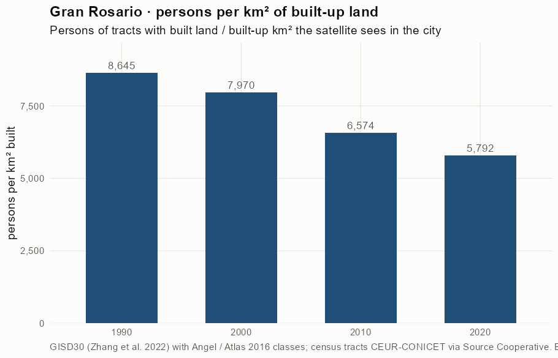
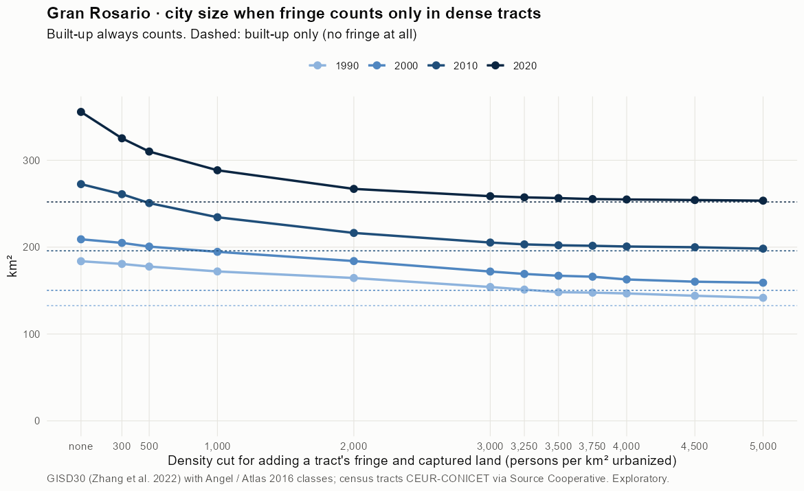
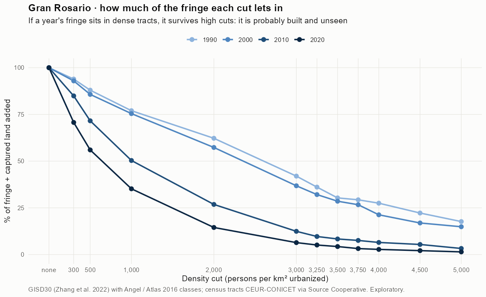
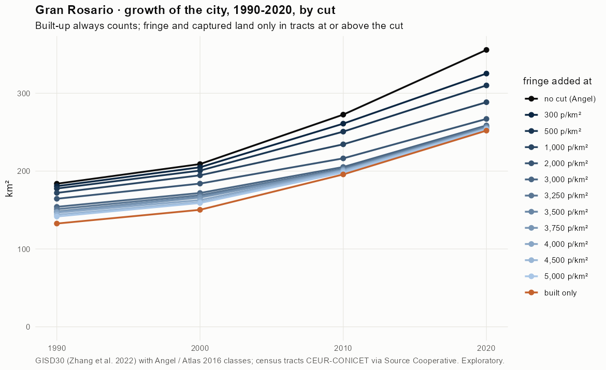
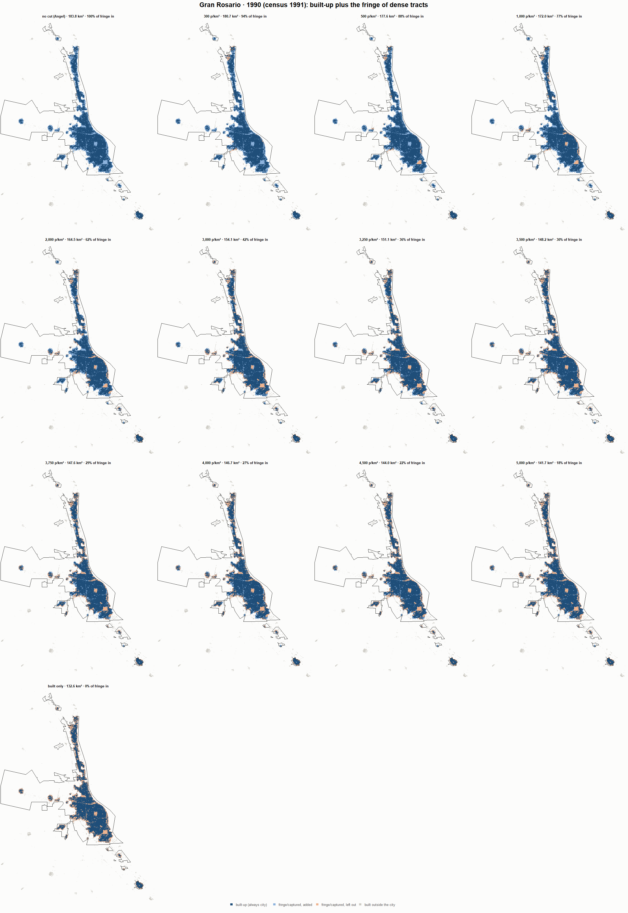
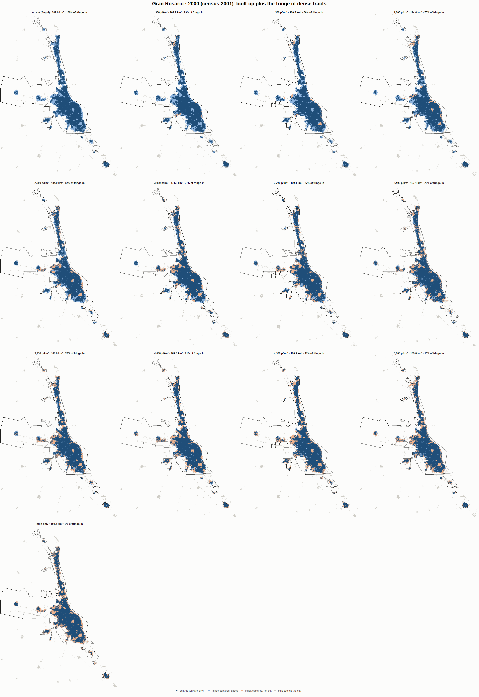
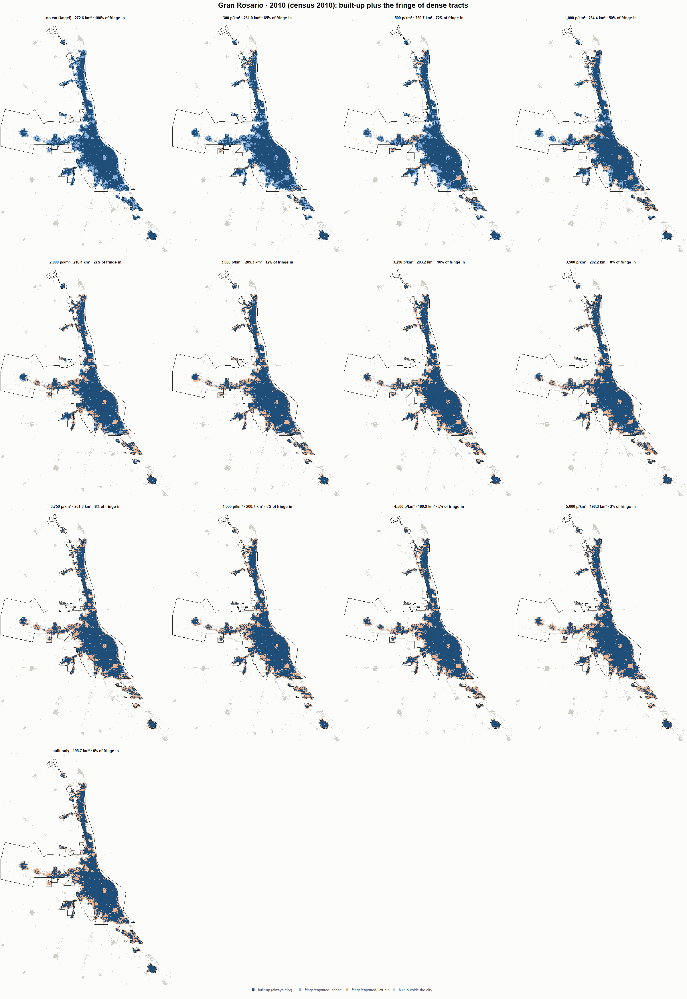
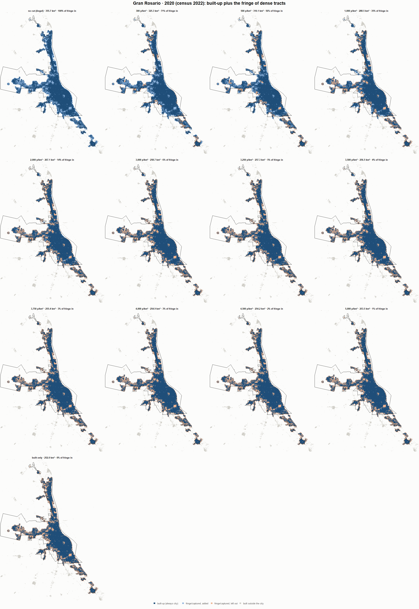

# Gran Rosario · when does the fringe count as city? 1990-2020

Exploratory test 2. None of these numbers are project figures (they are not in `CIFRAS_CANONICAS.json`). Generated by `Rpipe/scripts/13_prueba_franja.R` from the tract tables of step 11. Run of 2026-11-08. [All agglomerations](../REPORTE.md).

**Idea.** Built-up land is always city. Fringe and captured open space join the city **only in dense tracts**, where they are probably built and unseen by the older imagery. No cut gives the full Angel extent; an infinite cut, built-up only. Method in the [index](../REPORTE.md#method).

## Is the early imagery under-detecting?

If the older imagery misses buildings, persons per km² of *built* land should come out higher in the early years.

| Year | Persons (tracts with built land) | Built km² | Persons / km² built | Median tract, persons / km² built | Fringe + captured, % of extent |
|---|---|---|---|---|---|
| 1990 (census 1991) | 1,146,736 | 132.6 | 8,645 | 7,743 | 27.7 |
| 2000 (census 2001) | 1,197,807 | 150.3 | 7,970 | 7,303 | 28.0 |
| 2010 (census 2010) | 1,286,822 | 195.7 | 6,574 | 5,582 | 28.2 |
| 2020 (census 2022) | 1,459,599 | 252.0 | 5,792 | 4,451 | 29.1 |

## Results

**1990 (census 1991).** Built-up 132.6 km²; fringe + captured 51.1 km²; 1,149,402 persons in the city's tracts.

| Fringe added at | City km² | Fringe added km² | % of fringe added | Fringe % of city | Tracts adding fringe | Persons / km² city |
|---|---|---|---|---|---|---|
| no cut (Angel) | 183.8 | 51.1 | 100.0 | 27.8 | 676 | 6,254 |
| 300 p/km² | 180.7 | 48.0 | 93.9 | 26.6 | 670 | 6,362 |
| 500 p/km² | 177.6 | 45.0 | 88.0 | 25.3 | 664 | 6,470 |
| 1,000 p/km² | 172.0 | 39.4 | 77.0 | 22.9 | 652 | 6,682 |
| 2,000 p/km² | 164.5 | 31.8 | 62.2 | 19.4 | 632 | 6,989 |
| 3,000 p/km² | 154.1 | 21.5 | 42.0 | 13.9 | 585 | 7,458 |
| 3,250 p/km² | 151.1 | 18.5 | 36.1 | 12.2 | 571 | 7,607 |
| 3,500 p/km² | 148.2 | 15.5 | 30.3 | 10.5 | 548 | 7,758 |
| 3,750 p/km² | 147.6 | 15.0 | 29.3 | 10.2 | 542 | 7,786 |
| 4,000 p/km² | 146.7 | 14.1 | 27.5 | 9.6 | 530 | 7,835 |
| 4,500 p/km² | 144.0 | 11.4 | 22.2 | 7.9 | 499 | 7,981 |
| 5,000 p/km² | 141.7 | 9.0 | 17.7 | 6.4 | 460 | 8,113 |
| built only | 132.6 | 0.0 | 0.0 | 0.0 | 0 | 8,665 |

**2000 (census 2001).** Built-up 150.3 km²; fringe + captured 58.8 km²; 1,198,489 persons in the city's tracts.

| Fringe added at | City km² | Fringe added km² | % of fringe added | Fringe % of city | Tracts adding fringe | Persons / km² city |
|---|---|---|---|---|---|---|
| no cut (Angel) | 209.0 | 58.8 | 100.0 | 28.1 | 568 | 5,733 |
| 300 p/km² | 204.9 | 54.6 | 92.9 | 26.7 | 562 | 5,849 |
| 500 p/km² | 200.6 | 50.4 | 85.7 | 25.1 | 557 | 5,973 |
| 1,000 p/km² | 194.6 | 44.3 | 75.4 | 22.8 | 543 | 6,159 |
| 2,000 p/km² | 184.0 | 33.7 | 57.3 | 18.3 | 519 | 6,515 |
| 3,000 p/km² | 171.9 | 21.6 | 36.8 | 12.6 | 471 | 6,972 |
| 3,250 p/km² | 169.1 | 18.9 | 32.1 | 11.2 | 459 | 7,086 |
| 3,500 p/km² | 167.1 | 16.8 | 28.6 | 10.0 | 443 | 7,174 |
| 3,750 p/km² | 166.0 | 15.7 | 26.7 | 9.4 | 432 | 7,222 |
| 4,000 p/km² | 162.8 | 12.5 | 21.3 | 7.7 | 411 | 7,362 |
| 4,500 p/km² | 160.2 | 9.9 | 16.9 | 6.2 | 382 | 7,480 |
| 5,000 p/km² | 159.0 | 8.7 | 14.9 | 5.5 | 352 | 7,536 |
| built only | 150.3 | 0.0 | 0.0 | 0.0 | 0 | 7,975 |

**2010 (census 2010).** Built-up 195.7 km²; fringe + captured 76.8 km²; 1,286,822 persons in the city's tracts.

| Fringe added at | City km² | Fringe added km² | % of fringe added | Fringe % of city | Tracts adding fringe | Persons / km² city |
|---|---|---|---|---|---|---|
| no cut (Angel) | 272.6 | 76.8 | 100.0 | 28.2 | 528 | 4,721 |
| 300 p/km² | 261.0 | 65.2 | 84.9 | 25.0 | 512 | 4,931 |
| 500 p/km² | 250.7 | 55.0 | 71.6 | 21.9 | 499 | 5,132 |
| 1,000 p/km² | 234.4 | 38.7 | 50.3 | 16.5 | 475 | 5,490 |
| 2,000 p/km² | 216.4 | 20.6 | 26.8 | 9.5 | 421 | 5,948 |
| 3,000 p/km² | 205.3 | 9.6 | 12.4 | 4.7 | 366 | 6,268 |
| 3,250 p/km² | 203.2 | 7.4 | 9.7 | 3.7 | 345 | 6,334 |
| 3,500 p/km² | 202.2 | 6.4 | 8.3 | 3.2 | 332 | 6,365 |
| 3,750 p/km² | 201.6 | 5.8 | 7.6 | 2.9 | 317 | 6,384 |
| 4,000 p/km² | 200.7 | 5.0 | 6.5 | 2.5 | 300 | 6,411 |
| 4,500 p/km² | 199.9 | 4.2 | 5.4 | 2.1 | 277 | 6,437 |
| 5,000 p/km² | 198.3 | 2.5 | 3.3 | 1.3 | 237 | 6,491 |
| built only | 195.7 | 0.0 | 0.0 | 0.0 | 0 | 6,574 |

**2020 (census 2022).** Built-up 252.0 km²; fringe + captured 103.7 km²; 1,459,847 persons in the city's tracts.

| Fringe added at | City km² | Fringe added km² | % of fringe added | Fringe % of city | Tracts adding fringe | Persons / km² city |
|---|---|---|---|---|---|---|
| no cut (Angel) | 355.7 | 103.7 | 100.0 | 29.1 | 729 | 4,104 |
| 300 p/km² | 325.3 | 73.3 | 70.7 | 22.5 | 695 | 4,487 |
| 500 p/km² | 310.1 | 58.1 | 56.0 | 18.7 | 671 | 4,708 |
| 1,000 p/km² | 288.5 | 36.5 | 35.2 | 12.6 | 612 | 5,060 |
| 2,000 p/km² | 267.1 | 15.0 | 14.5 | 5.6 | 502 | 5,466 |
| 3,000 p/km² | 258.7 | 6.6 | 6.4 | 2.6 | 414 | 5,644 |
| 3,250 p/km² | 257.3 | 5.3 | 5.1 | 2.1 | 385 | 5,673 |
| 3,500 p/km² | 256.5 | 4.5 | 4.3 | 1.7 | 364 | 5,692 |
| 3,750 p/km² | 255.4 | 3.3 | 3.2 | 1.3 | 343 | 5,717 |
| 4,000 p/km² | 254.9 | 2.9 | 2.8 | 1.1 | 317 | 5,727 |
| 4,500 p/km² | 254.2 | 2.2 | 2.1 | 0.9 | 286 | 5,743 |
| 5,000 p/km² | 253.5 | 1.5 | 1.4 | 0.6 | 250 | 5,759 |
| built only | 252.0 | 0.0 | 0.0 | 0.0 | 0 | 5,793 |

### Growth by cut

| Fringe added at | 1990 km² | 2000 km² | 2010 km² | 2020 km² | 1990-2000 %/yr | 2000-2010 %/yr | 2010-2020 %/yr | 1990-2020 %/yr |
|---|---|---|---|---|---|---|---|---|
| no cut (Angel) | 183.8 | 209.0 | 272.6 | 355.7 | 1.30 | 2.69 | 2.70 | 2.23 |
| 300 p/km² | 180.7 | 204.9 | 261.0 | 325.3 | 1.27 | 2.45 | 2.23 | 1.98 |
| 500 p/km² | 177.6 | 200.6 | 250.7 | 310.1 | 1.23 | 2.25 | 2.15 | 1.87 |
| 1,000 p/km² | 172.0 | 194.6 | 234.4 | 288.5 | 1.24 | 1.88 | 2.10 | 1.74 |
| 2,000 p/km² | 164.5 | 184.0 | 216.4 | 267.1 | 1.13 | 1.64 | 2.13 | 1.63 |
| 3,000 p/km² | 154.1 | 171.9 | 205.3 | 258.7 | 1.10 | 1.79 | 2.34 | 1.74 |
| 3,250 p/km² | 151.1 | 169.1 | 203.2 | 257.3 | 1.13 | 1.85 | 2.39 | 1.79 |
| 3,500 p/km² | 148.2 | 167.1 | 202.2 | 256.5 | 1.21 | 1.93 | 2.41 | 1.85 |
| 3,750 p/km² | 147.6 | 166.0 | 201.6 | 255.4 | 1.18 | 1.96 | 2.39 | 1.84 |
| 4,000 p/km² | 146.7 | 162.8 | 200.7 | 254.9 | 1.05 | 2.12 | 2.42 | 1.86 |
| 4,500 p/km² | 144.0 | 160.2 | 199.9 | 254.2 | 1.07 | 2.24 | 2.43 | 1.91 |
| 5,000 p/km² | 141.7 | 159.0 | 198.3 | 253.5 | 1.16 | 2.23 | 2.49 | 1.96 |
| built only | 132.6 | 150.3 | 195.7 | 252.0 | 1.26 | 2.68 | 2.56 | 2.16 |

## Maps

Same frame in the four years: the 2020 city plus 3 km. Dark blue is built-up, always city; light blue is fringe or captured land added because its tract is dense; light orange is fringe left out. Black line: the analysis perimeter.

### 1990

### 2000

### 2010

### 2020

## Reading

- **The premise.** Persons per km² of built land: 8,645 in 1990, 7,970 in 2000, 6,574 in 2010, 5,792 in 2020. 1990 is clearly higher than 2010: consistent with built land missed in 1990, though it also fits a denser city that later spread out.
- **At 500 p/km²** the fringe that joins the city is 88.0 % of all fringe in 1990 and 56.0 % in 2020.
- **Growth 1990-2020**: 2.23 %/yr with the full Angel extent, 1.87 %/yr at 500, 2.16 %/yr built-up only.

