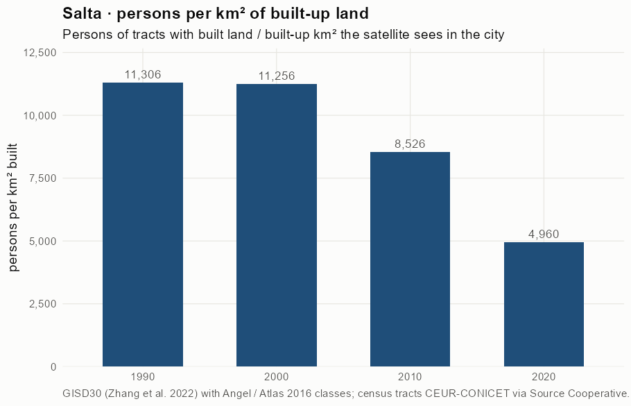
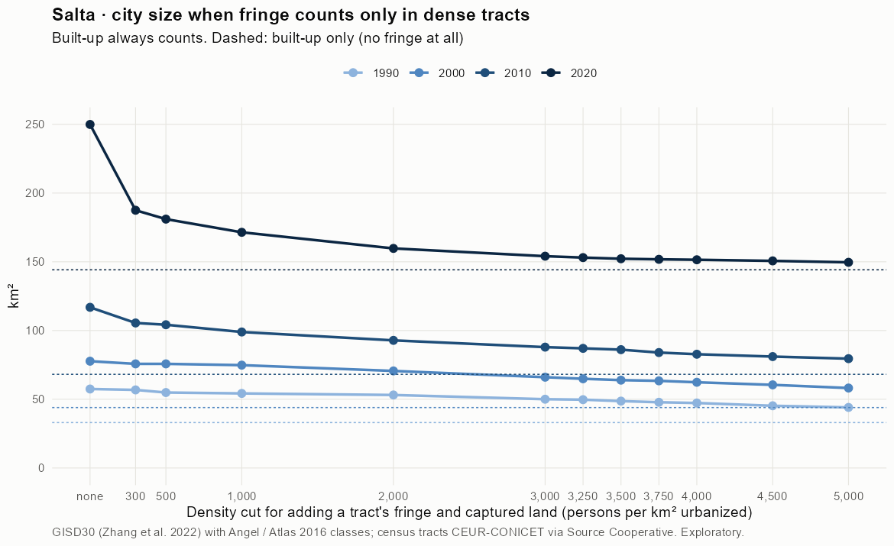
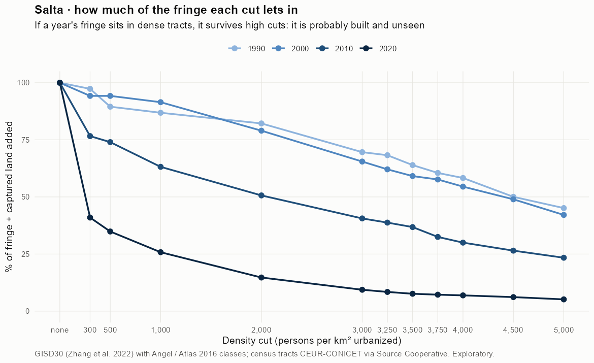
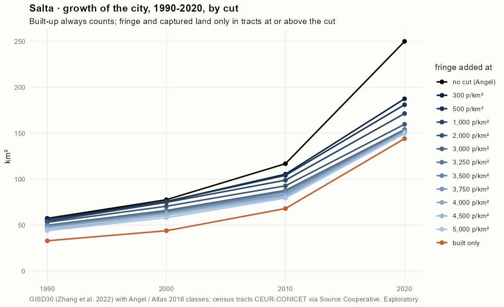
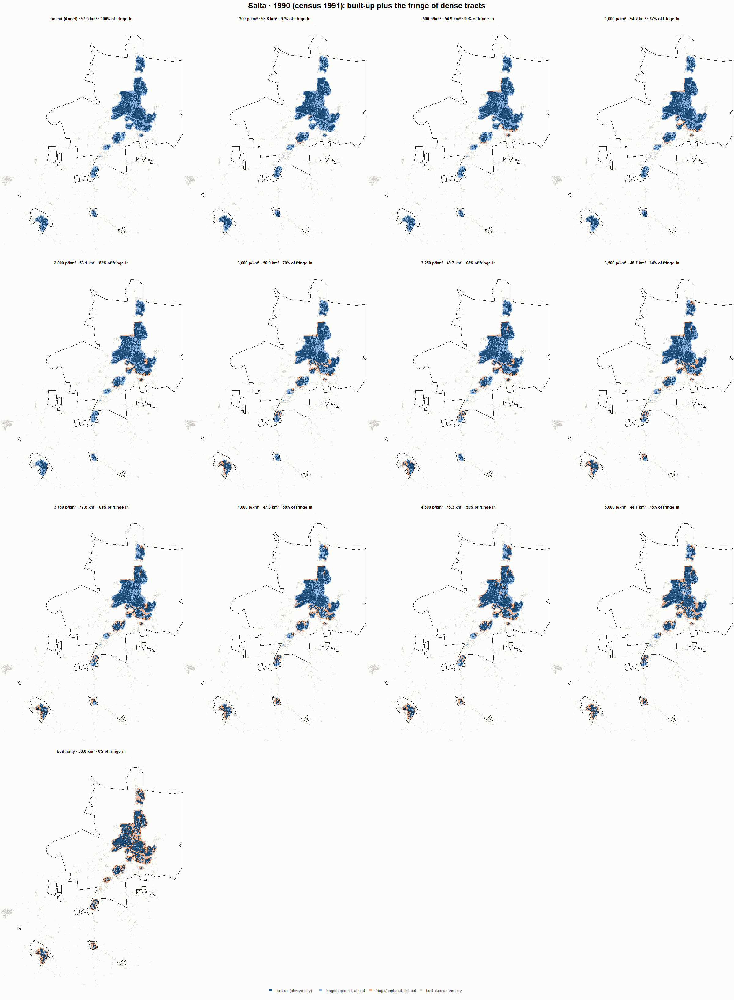
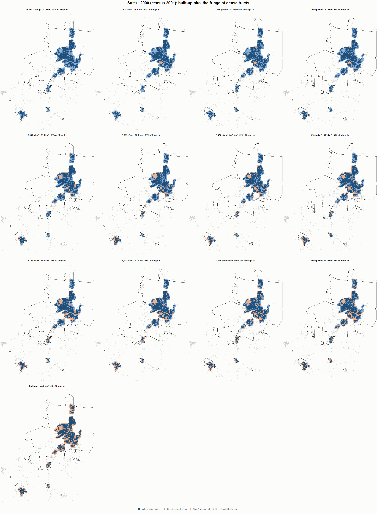
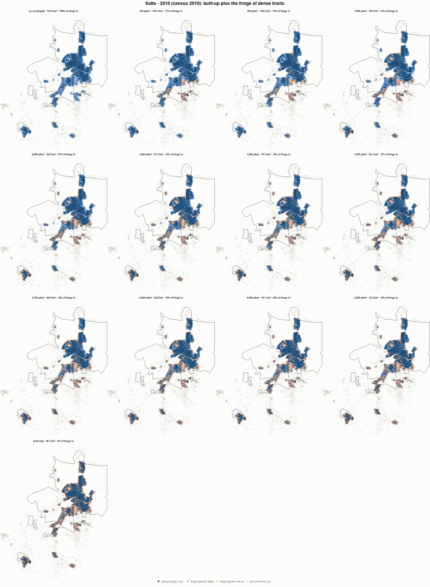
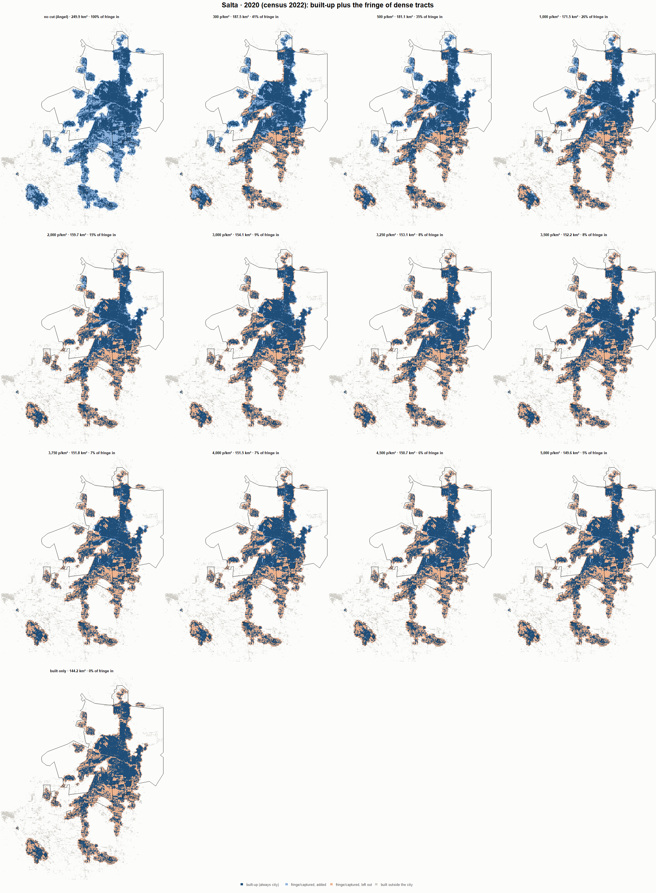

# Salta · when does the fringe count as city? 1990-2020

Exploratory test 2. None of these numbers are project figures (they are not in `CIFRAS_CANONICAS.json`). Generated by `Rpipe/scripts/13_prueba_franja.R` from the tract tables of step 11. Run of 2026-11-08. [All agglomerations](../REPORTE.md).

**Idea.** Built-up land is always city. Fringe and captured open space join the city **only in dense tracts**, where they are probably built and unseen by the older imagery. No cut gives the full Angel extent; an infinite cut, built-up only. Method in the [index](../REPORTE.md#method).

## Is the early imagery under-detecting?

If the older imagery misses buildings, persons per km² of *built* land should come out higher in the early years.

| Year | Persons (tracts with built land) | Built km² | Persons / km² built | Median tract, persons / km² built | Fringe + captured, % of extent |
|---|---|---|---|---|---|
| 1990 (census 1991) | 373,647 | 33.0 | 11,306 | 10,377 | 42.4 |
| 2000 (census 2001) | 494,873 | 44.0 | 11,256 | 9,877 | 43.2 |
| 2010 (census 2010) | 580,954 | 68.1 | 8,526 | 8,393 | 41.7 |
| 2020 (census 2022) | 715,144 | 144.2 | 4,960 | 4,057 | 42.3 |

## Results

**1990 (census 1991).** Built-up 33.0 km²; fringe + captured 24.4 km²; 385,124 persons in the city's tracts.

| Fringe added at | City km² | Fringe added km² | % of fringe added | Fringe % of city | Tracts adding fringe | Persons / km² city |
|---|---|---|---|---|---|---|
| no cut (Angel) | 57.5 | 24.4 | 100.0 | 42.5 | 299 | 6,703 |
| 300 p/km² | 56.8 | 23.8 | 97.3 | 41.8 | 295 | 6,780 |
| 500 p/km² | 54.9 | 21.8 | 89.5 | 39.8 | 292 | 7,015 |
| 1,000 p/km² | 54.2 | 21.2 | 86.9 | 39.1 | 291 | 7,099 |
| 2,000 p/km² | 53.1 | 20.1 | 82.2 | 37.8 | 287 | 7,252 |
| 3,000 p/km² | 50.0 | 17.0 | 69.6 | 34.0 | 274 | 7,697 |
| 3,250 p/km² | 49.7 | 16.7 | 68.3 | 33.5 | 272 | 7,747 |
| 3,500 p/km² | 48.7 | 15.6 | 63.9 | 32.1 | 267 | 7,915 |
| 3,750 p/km² | 47.8 | 14.8 | 60.5 | 30.9 | 263 | 8,054 |
| 4,000 p/km² | 47.3 | 14.2 | 58.3 | 30.1 | 260 | 8,146 |
| 4,500 p/km² | 45.3 | 12.2 | 50.1 | 27.0 | 248 | 8,508 |
| 5,000 p/km² | 44.1 | 11.0 | 45.1 | 25.0 | 240 | 8,740 |
| built only | 33.0 | 0.0 | 0.0 | 0.0 | 0 | 11,653 |

**2000 (census 2001).** Built-up 44.0 km²; fringe + captured 33.7 km²; 502,515 persons in the city's tracts.

| Fringe added at | City km² | Fringe added km² | % of fringe added | Fringe % of city | Tracts adding fringe | Persons / km² city |
|---|---|---|---|---|---|---|
| no cut (Angel) | 77.7 | 33.7 | 100.0 | 43.4 | 414 | 6,468 |
| 300 p/km² | 75.7 | 31.8 | 94.2 | 42.0 | 410 | 6,634 |
| 500 p/km² | 75.7 | 31.8 | 94.2 | 42.0 | 410 | 6,634 |
| 1,000 p/km² | 74.8 | 30.9 | 91.5 | 41.2 | 408 | 6,717 |
| 2,000 p/km² | 70.6 | 26.6 | 79.0 | 37.7 | 399 | 7,117 |
| 3,000 p/km² | 66.1 | 22.1 | 65.5 | 33.4 | 381 | 7,608 |
| 3,250 p/km² | 64.9 | 20.9 | 62.1 | 32.3 | 375 | 7,743 |
| 3,500 p/km² | 63.9 | 19.9 | 59.1 | 31.2 | 368 | 7,863 |
| 3,750 p/km² | 63.4 | 19.4 | 57.6 | 30.7 | 365 | 7,925 |
| 4,000 p/km² | 62.4 | 18.4 | 54.5 | 29.5 | 358 | 8,059 |
| 4,500 p/km² | 60.5 | 16.5 | 49.0 | 27.3 | 341 | 8,309 |
| 5,000 p/km² | 58.2 | 14.2 | 42.1 | 24.4 | 322 | 8,639 |
| built only | 44.0 | 0.0 | 0.0 | 0.0 | 0 | 11,430 |

**2010 (census 2010).** Built-up 68.1 km²; fringe + captured 48.8 km²; 584,186 persons in the city's tracts.

| Fringe added at | City km² | Fringe added km² | % of fringe added | Fringe % of city | Tracts adding fringe | Persons / km² city |
|---|---|---|---|---|---|---|
| no cut (Angel) | 116.9 | 48.8 | 100.0 | 41.7 | 456 | 4,998 |
| 300 p/km² | 105.5 | 37.4 | 76.6 | 35.4 | 451 | 5,537 |
| 500 p/km² | 104.2 | 36.1 | 74.0 | 34.6 | 449 | 5,606 |
| 1,000 p/km² | 98.9 | 30.8 | 63.2 | 31.1 | 442 | 5,905 |
| 2,000 p/km² | 92.8 | 24.7 | 50.7 | 26.6 | 427 | 6,293 |
| 3,000 p/km² | 87.9 | 19.8 | 40.6 | 22.5 | 404 | 6,644 |
| 3,250 p/km² | 87.0 | 18.9 | 38.8 | 21.7 | 400 | 6,712 |
| 3,500 p/km² | 86.1 | 17.9 | 36.8 | 20.8 | 393 | 6,786 |
| 3,750 p/km² | 84.0 | 15.8 | 32.5 | 18.9 | 382 | 6,956 |
| 4,000 p/km² | 82.8 | 14.6 | 30.0 | 17.7 | 372 | 7,059 |
| 4,500 p/km² | 81.1 | 12.9 | 26.5 | 15.9 | 352 | 7,208 |
| 5,000 p/km² | 79.5 | 11.4 | 23.4 | 14.3 | 334 | 7,345 |
| built only | 68.1 | 0.0 | 0.0 | 0.0 | 0 | 8,574 |

**2020 (census 2022).** Built-up 144.2 km²; fringe + captured 105.7 km²; 718,248 persons in the city's tracts.

| Fringe added at | City km² | Fringe added km² | % of fringe added | Fringe % of city | Tracts adding fringe | Persons / km² city |
|---|---|---|---|---|---|---|
| no cut (Angel) | 249.9 | 105.7 | 100.0 | 42.3 | 552 | 2,874 |
| 300 p/km² | 187.5 | 43.3 | 41.0 | 23.1 | 530 | 3,830 |
| 500 p/km² | 181.1 | 36.9 | 34.9 | 20.4 | 522 | 3,967 |
| 1,000 p/km² | 171.5 | 27.3 | 25.8 | 15.9 | 500 | 4,189 |
| 2,000 p/km² | 159.7 | 15.6 | 14.7 | 9.7 | 458 | 4,496 |
| 3,000 p/km² | 154.1 | 9.9 | 9.4 | 6.4 | 418 | 4,662 |
| 3,250 p/km² | 153.1 | 8.9 | 8.4 | 5.8 | 407 | 4,692 |
| 3,500 p/km² | 152.2 | 8.0 | 7.6 | 5.3 | 395 | 4,718 |
| 3,750 p/km² | 151.8 | 7.6 | 7.2 | 5.0 | 388 | 4,732 |
| 4,000 p/km² | 151.5 | 7.3 | 6.9 | 4.8 | 380 | 4,742 |
| 4,500 p/km² | 150.7 | 6.5 | 6.1 | 4.3 | 363 | 4,767 |
| 5,000 p/km² | 149.6 | 5.4 | 5.1 | 3.6 | 340 | 4,800 |
| built only | 144.2 | 0.0 | 0.0 | 0.0 | 0 | 4,982 |

### Growth by cut

| Fringe added at | 1990 km² | 2000 km² | 2010 km² | 2020 km² | 1990-2000 %/yr | 2000-2010 %/yr | 2010-2020 %/yr | 1990-2020 %/yr |
|---|---|---|---|---|---|---|---|---|
| no cut (Angel) | 57.5 | 77.7 | 116.9 | 249.9 | 3.06 | 4.17 | 7.90 | 5.02 |
| 300 p/km² | 56.8 | 75.7 | 105.5 | 187.5 | 2.92 | 3.37 | 5.92 | 4.06 |
| 500 p/km² | 54.9 | 75.7 | 104.2 | 181.1 | 3.27 | 3.24 | 5.68 | 4.06 |
| 1,000 p/km² | 54.2 | 74.8 | 98.9 | 171.5 | 3.27 | 2.83 | 5.65 | 3.91 |
| 2,000 p/km² | 53.1 | 70.6 | 92.8 | 159.7 | 2.89 | 2.77 | 5.58 | 3.74 |
| 3,000 p/km² | 50.0 | 66.1 | 87.9 | 154.1 | 2.82 | 2.90 | 5.77 | 3.82 |
| 3,250 p/km² | 49.7 | 64.9 | 87.0 | 153.1 | 2.70 | 2.98 | 5.81 | 3.82 |
| 3,500 p/km² | 48.7 | 63.9 | 86.1 | 152.2 | 2.76 | 3.02 | 5.87 | 3.88 |
| 3,750 p/km² | 47.8 | 63.4 | 84.0 | 151.8 | 2.86 | 2.85 | 6.10 | 3.93 |
| 4,000 p/km² | 47.3 | 62.4 | 82.8 | 151.5 | 2.81 | 2.87 | 6.23 | 3.96 |
| 4,500 p/km² | 45.3 | 60.5 | 81.1 | 150.7 | 2.94 | 2.97 | 6.40 | 4.09 |
| 5,000 p/km² | 44.1 | 58.2 | 79.5 | 149.6 | 2.82 | 3.18 | 6.52 | 4.16 |
| built only | 33.0 | 44.0 | 68.1 | 144.2 | 2.90 | 4.48 | 7.78 | 5.03 |

## Maps

Same frame in the four years: the 2020 city plus 3 km. Dark blue is built-up, always city; light blue is fringe or captured land added because its tract is dense; light orange is fringe left out. Black line: the analysis perimeter.

### 1990

### 2000

### 2010

### 2020

## Reading

- **The premise.** Persons per km² of built land: 11,306 in 1990, 11,256 in 2000, 8,526 in 2010, 4,960 in 2020. 1990 is clearly higher than 2010: consistent with built land missed in 1990, though it also fits a denser city that later spread out.
- **At 500 p/km²** the fringe that joins the city is 89.5 % of all fringe in 1990 and 34.9 % in 2020.
- **Growth 1990-2020**: 5.02 %/yr with the full Angel extent, 4.06 %/yr at 500, 5.03 %/yr built-up only.

