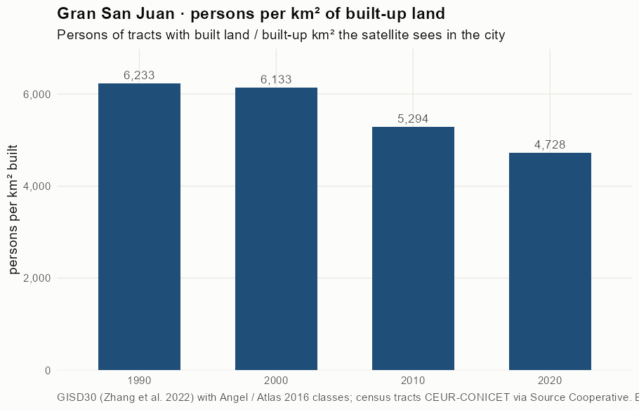
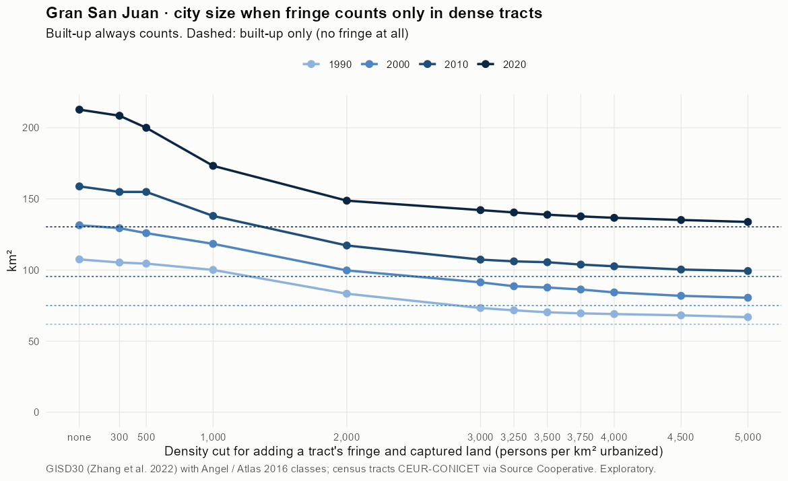
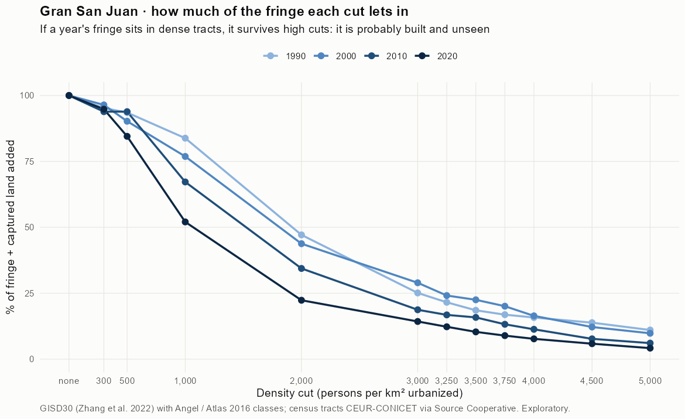
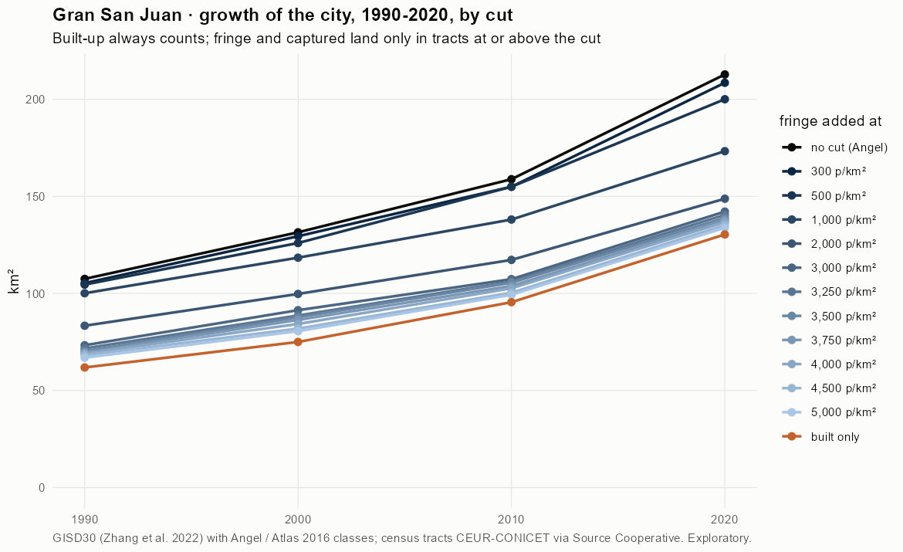
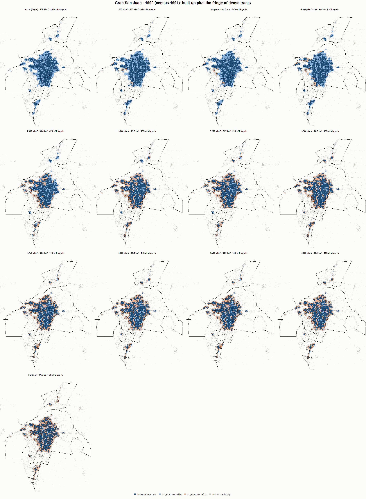
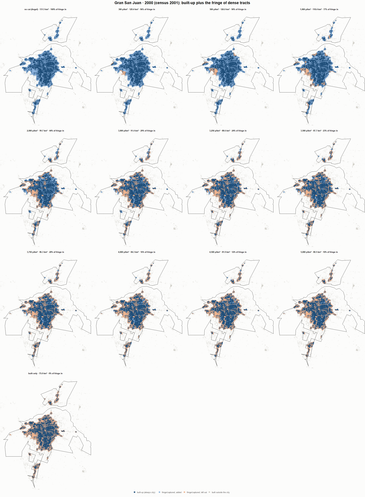
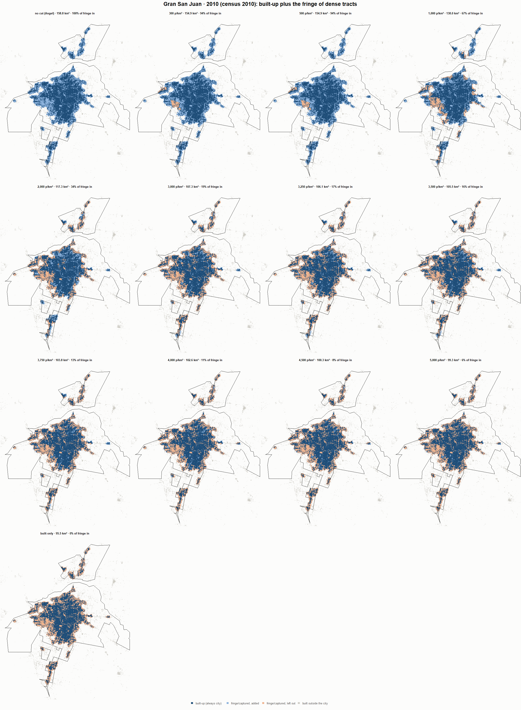
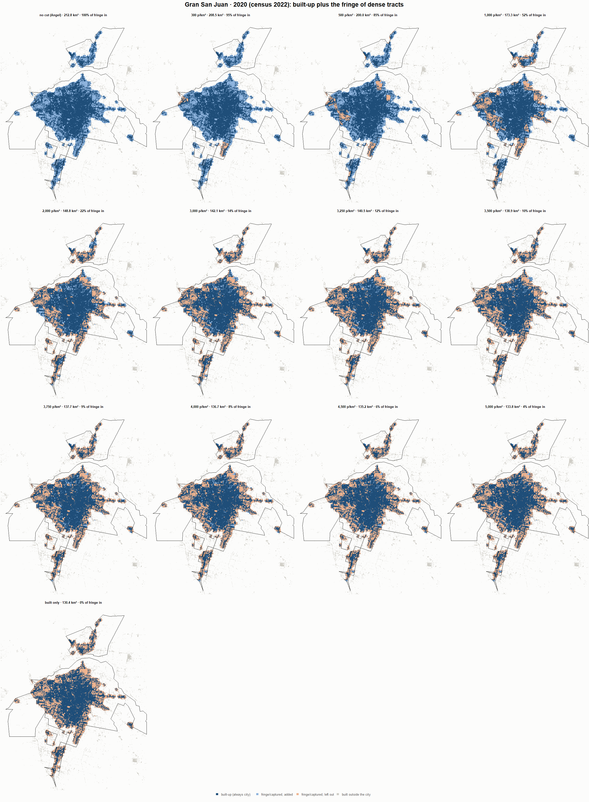

# Gran San Juan · when does the fringe count as city? 1990-2020

Exploratory test 2. None of these numbers are project figures (they are not in `CIFRAS_CANONICAS.json`). Generated by `Rpipe/scripts/13_prueba_franja.R` from the tract tables of step 11. Run of 2026-11-08. [All agglomerations](../REPORTE.md).

**Idea.** Built-up land is always city. Fringe and captured open space join the city **only in dense tracts**, where they are probably built and unseen by the older imagery. No cut gives the full Angel extent; an infinite cut, built-up only. Method in the [index](../REPORTE.md#method).

## Is the early imagery under-detecting?

If the older imagery misses buildings, persons per km² of *built* land should come out higher in the early years.

| Year | Persons (tracts with built land) | Built km² | Persons / km² built | Median tract, persons / km² built | Fringe + captured, % of extent |
|---|---|---|---|---|---|
| 1990 (census 1991) | 385,524 | 61.8 | 6,233 | 5,556 | 42.4 |
| 2000 (census 2001) | 459,965 | 75.0 | 6,133 | 5,527 | 42.9 |
| 2010 (census 2010) | 505,409 | 95.5 | 5,294 | 4,895 | 39.9 |
| 2020 (census 2022) | 616,360 | 130.4 | 4,728 | 4,410 | 38.7 |

## Results

**1990 (census 1991).** Built-up 61.8 km²; fringe + captured 45.6 km²; 387,675 persons in the city's tracts.

| Fringe added at | City km² | Fringe added km² | % of fringe added | Fringe % of city | Tracts adding fringe | Persons / km² city |
|---|---|---|---|---|---|---|
| no cut (Angel) | 107.5 | 45.6 | 100.0 | 42.5 | 331 | 3,607 |
| 300 p/km² | 105.3 | 43.5 | 95.2 | 41.3 | 328 | 3,682 |
| 500 p/km² | 104.5 | 42.7 | 93.5 | 40.8 | 326 | 3,709 |
| 1,000 p/km² | 100.1 | 38.2 | 83.8 | 38.2 | 320 | 3,873 |
| 2,000 p/km² | 83.4 | 21.5 | 47.1 | 25.8 | 285 | 4,651 |
| 3,000 p/km² | 73.3 | 11.5 | 25.1 | 15.6 | 246 | 5,289 |
| 3,250 p/km² | 71.7 | 9.8 | 21.6 | 13.7 | 235 | 5,408 |
| 3,500 p/km² | 70.3 | 8.5 | 18.5 | 12.0 | 226 | 5,515 |
| 3,750 p/km² | 69.5 | 7.7 | 16.9 | 11.1 | 219 | 5,575 |
| 4,000 p/km² | 69.1 | 7.2 | 15.8 | 10.4 | 214 | 5,614 |
| 4,500 p/km² | 68.2 | 6.3 | 13.8 | 9.3 | 199 | 5,688 |
| 5,000 p/km² | 66.9 | 5.0 | 11.0 | 7.5 | 179 | 5,796 |
| built only | 61.8 | 0.0 | 0.0 | 0.0 | 0 | 6,268 |

**2000 (census 2001).** Built-up 75.0 km²; fringe + captured 56.5 km²; 463,086 persons in the city's tracts.

| Fringe added at | City km² | Fringe added km² | % of fringe added | Fringe % of city | Tracts adding fringe | Persons / km² city |
|---|---|---|---|---|---|---|
| no cut (Angel) | 131.5 | 56.5 | 100.0 | 43.0 | 435 | 3,523 |
| 300 p/km² | 129.4 | 54.4 | 96.4 | 42.1 | 433 | 3,577 |
| 500 p/km² | 126.0 | 51.0 | 90.2 | 40.5 | 430 | 3,677 |
| 1,000 p/km² | 118.4 | 43.4 | 76.9 | 36.7 | 420 | 3,911 |
| 2,000 p/km² | 99.7 | 24.7 | 43.8 | 24.8 | 380 | 4,644 |
| 3,000 p/km² | 91.4 | 16.4 | 29.0 | 17.9 | 335 | 5,069 |
| 3,250 p/km² | 88.6 | 13.6 | 24.1 | 15.4 | 317 | 5,225 |
| 3,500 p/km² | 87.7 | 12.7 | 22.5 | 14.5 | 305 | 5,280 |
| 3,750 p/km² | 86.3 | 11.3 | 20.1 | 13.1 | 294 | 5,364 |
| 4,000 p/km² | 84.3 | 9.3 | 16.4 | 11.0 | 273 | 5,496 |
| 4,500 p/km² | 81.9 | 6.9 | 12.2 | 8.4 | 245 | 5,656 |
| 5,000 p/km² | 80.5 | 5.5 | 9.8 | 6.9 | 220 | 5,750 |
| built only | 75.0 | 0.0 | 0.0 | 0.0 | 0 | 6,175 |

**2010 (census 2010).** Built-up 95.5 km²; fringe + captured 63.3 km²; 506,609 persons in the city's tracts.

| Fringe added at | City km² | Fringe added km² | % of fringe added | Fringe % of city | Tracts adding fringe | Persons / km² city |
|---|---|---|---|---|---|---|
| no cut (Angel) | 158.8 | 63.3 | 100.0 | 39.9 | 458 | 3,190 |
| 300 p/km² | 154.9 | 59.5 | 93.9 | 38.4 | 454 | 3,270 |
| 500 p/km² | 154.9 | 59.5 | 93.9 | 38.4 | 454 | 3,270 |
| 1,000 p/km² | 138.0 | 42.6 | 67.2 | 30.8 | 435 | 3,670 |
| 2,000 p/km² | 117.3 | 21.8 | 34.4 | 18.6 | 387 | 4,321 |
| 3,000 p/km² | 107.3 | 11.9 | 18.7 | 11.1 | 329 | 4,720 |
| 3,250 p/km² | 106.1 | 10.6 | 16.8 | 10.0 | 315 | 4,775 |
| 3,500 p/km² | 105.5 | 10.0 | 15.8 | 9.5 | 304 | 4,802 |
| 3,750 p/km² | 103.8 | 8.4 | 13.2 | 8.1 | 286 | 4,879 |
| 4,000 p/km² | 102.6 | 7.2 | 11.3 | 7.0 | 273 | 4,936 |
| 4,500 p/km² | 100.3 | 4.9 | 7.7 | 4.9 | 226 | 5,049 |
| 5,000 p/km² | 99.3 | 3.8 | 6.1 | 3.9 | 196 | 5,101 |
| built only | 95.5 | 0.0 | 0.0 | 0.0 | 0 | 5,307 |

**2020 (census 2022).** Built-up 130.4 km²; fringe + captured 82.4 km²; 616,383 persons in the city's tracts.

| Fringe added at | City km² | Fringe added km² | % of fringe added | Fringe % of city | Tracts adding fringe | Persons / km² city |
|---|---|---|---|---|---|---|
| no cut (Angel) | 212.8 | 82.4 | 100.0 | 38.7 | 516 | 2,897 |
| 300 p/km² | 208.5 | 78.1 | 94.8 | 37.5 | 513 | 2,956 |
| 500 p/km² | 200.0 | 69.6 | 84.5 | 34.8 | 505 | 3,082 |
| 1,000 p/km² | 173.3 | 42.9 | 52.0 | 24.8 | 467 | 3,558 |
| 2,000 p/km² | 148.8 | 18.4 | 22.3 | 12.4 | 405 | 4,143 |
| 3,000 p/km² | 142.1 | 11.8 | 14.3 | 8.3 | 351 | 4,336 |
| 3,250 p/km² | 140.5 | 10.1 | 12.3 | 7.2 | 333 | 4,388 |
| 3,500 p/km² | 138.9 | 8.5 | 10.3 | 6.1 | 316 | 4,438 |
| 3,750 p/km² | 137.7 | 7.4 | 8.9 | 5.3 | 299 | 4,476 |
| 4,000 p/km² | 136.7 | 6.3 | 7.7 | 4.6 | 284 | 4,509 |
| 4,500 p/km² | 135.2 | 4.8 | 5.9 | 3.6 | 245 | 4,559 |
| 5,000 p/km² | 133.8 | 3.4 | 4.2 | 2.6 | 206 | 4,606 |
| built only | 130.4 | 0.0 | 0.0 | 0.0 | 0 | 4,728 |

### Growth by cut

| Fringe added at | 1990 km² | 2000 km² | 2010 km² | 2020 km² | 1990-2000 %/yr | 2000-2010 %/yr | 2010-2020 %/yr | 1990-2020 %/yr |
|---|---|---|---|---|---|---|---|---|
| no cut (Angel) | 107.5 | 131.5 | 158.8 | 212.8 | 2.04 | 1.91 | 2.97 | 2.30 |
| 300 p/km² | 105.3 | 129.4 | 154.9 | 208.5 | 2.09 | 1.81 | 3.01 | 2.30 |
| 500 p/km² | 104.5 | 126.0 | 154.9 | 200.0 | 1.88 | 2.09 | 2.59 | 2.19 |
| 1,000 p/km² | 100.1 | 118.4 | 138.0 | 173.3 | 1.69 | 1.55 | 2.30 | 1.85 |
| 2,000 p/km² | 83.4 | 99.7 | 117.3 | 148.8 | 1.81 | 1.63 | 2.41 | 1.95 |
| 3,000 p/km² | 73.3 | 91.4 | 107.3 | 142.1 | 2.23 | 1.62 | 2.85 | 2.23 |
| 3,250 p/km² | 71.7 | 88.6 | 106.1 | 140.5 | 2.14 | 1.82 | 2.85 | 2.27 |
| 3,500 p/km² | 70.3 | 87.7 | 105.5 | 138.9 | 2.24 | 1.86 | 2.79 | 2.30 |
| 3,750 p/km² | 69.5 | 86.3 | 103.8 | 137.7 | 2.19 | 1.86 | 2.86 | 2.30 |
| 4,000 p/km² | 69.1 | 84.3 | 102.6 | 136.7 | 2.01 | 1.99 | 2.91 | 2.30 |
| 4,500 p/km² | 68.2 | 81.9 | 100.3 | 135.2 | 1.85 | 2.05 | 3.03 | 2.31 |
| 5,000 p/km² | 66.9 | 80.5 | 99.3 | 133.8 | 1.87 | 2.12 | 3.03 | 2.34 |
| built only | 61.8 | 75.0 | 95.5 | 130.4 | 1.95 | 2.44 | 3.16 | 2.52 |

## Maps

Same frame in the four years: the 2020 city plus 3 km. Dark blue is built-up, always city; light blue is fringe or captured land added because its tract is dense; light orange is fringe left out. Black line: the analysis perimeter.

### 1990

### 2000

### 2010

### 2020

## Reading

- **The premise.** Persons per km² of built land: 6,233 in 1990, 6,133 in 2000, 5,294 in 2010, 4,728 in 2020. 1990 is clearly higher than 2010: consistent with built land missed in 1990, though it also fits a denser city that later spread out.
- **At 500 p/km²** the fringe that joins the city is 93.5 % of all fringe in 1990 and 84.5 % in 2020.
- **Growth 1990-2020**: 2.30 %/yr with the full Angel extent, 2.19 %/yr at 500, 2.52 %/yr built-up only.

