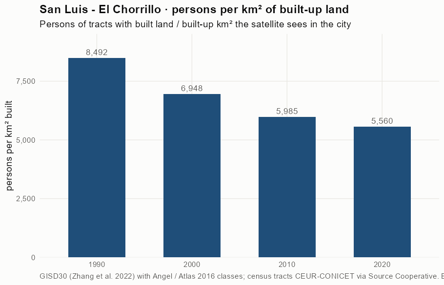
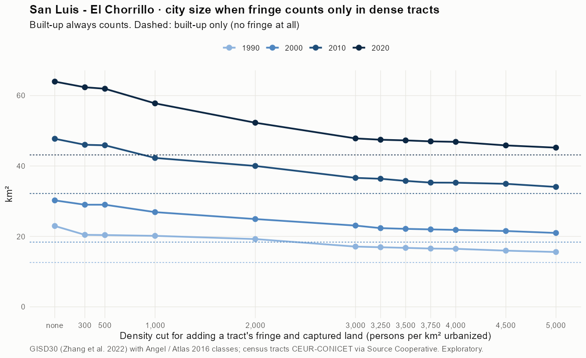
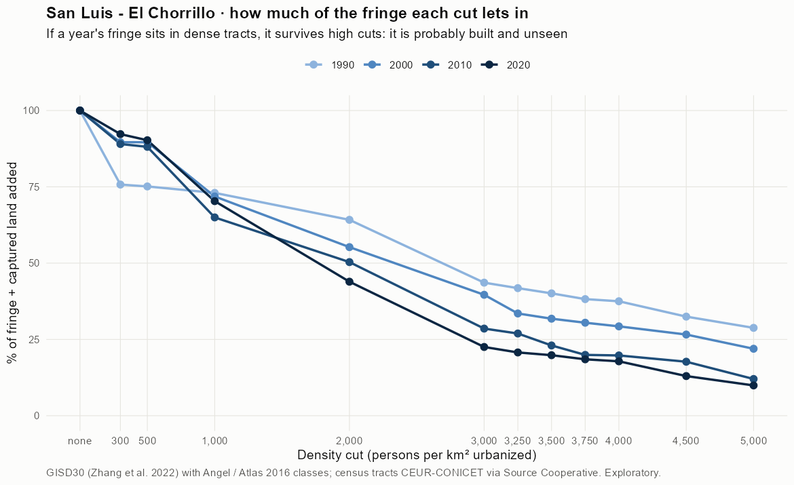
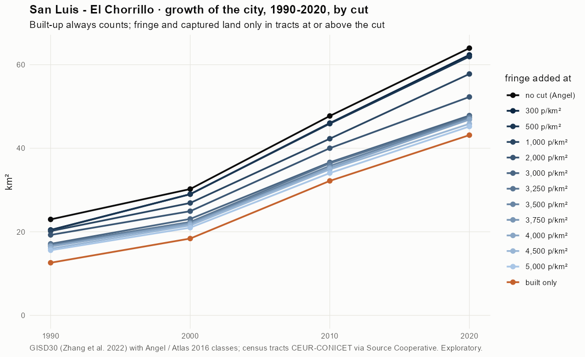
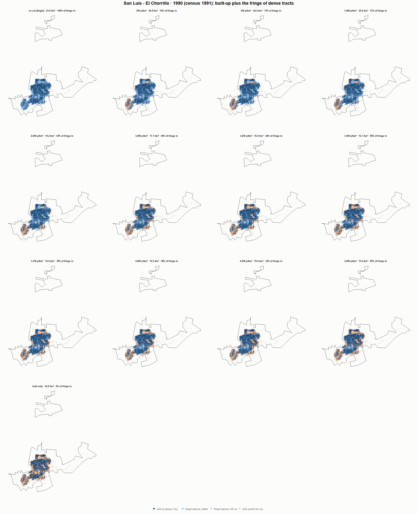
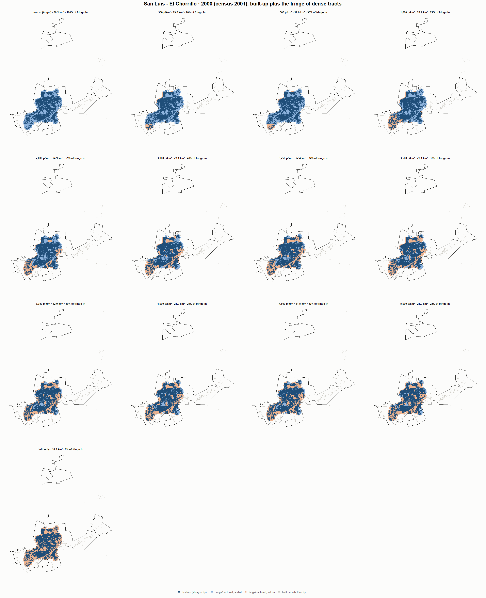
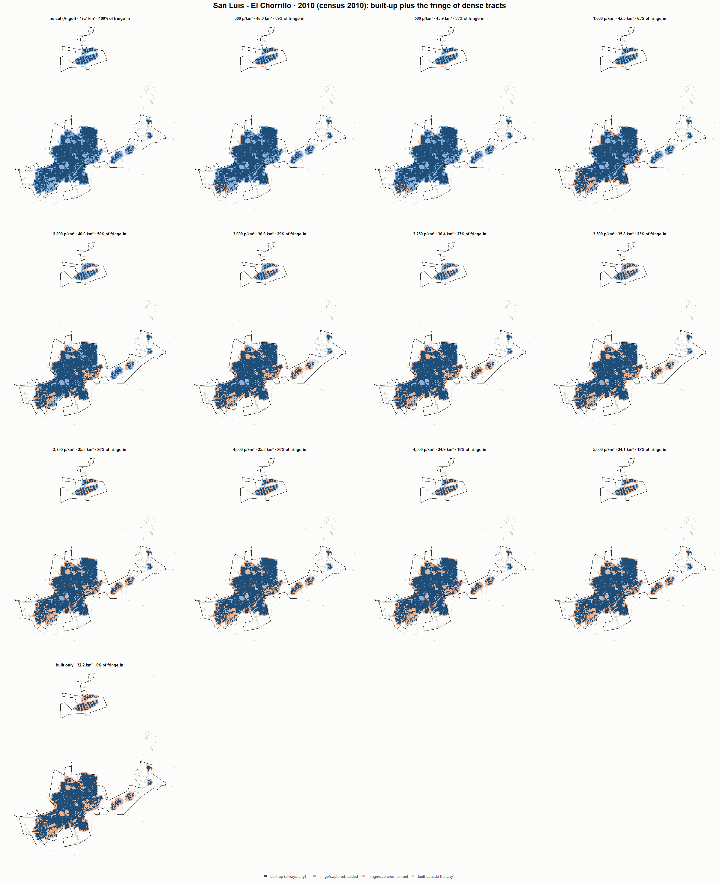
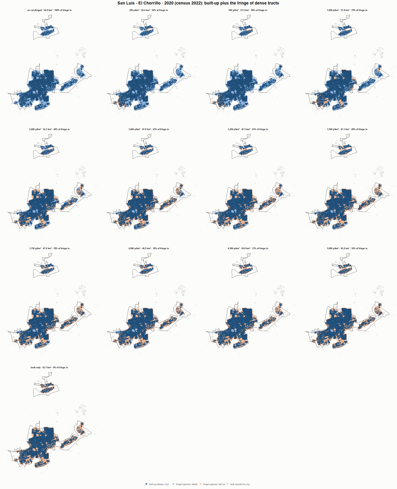

# San Luis - El Chorrillo · when does the fringe count as city? 1990-2020

Exploratory test 2. None of these numbers are project figures (they are not in `CIFRAS_CANONICAS.json`). Generated by `Rpipe/scripts/13_prueba_franja.R` from the tract tables of step 11. Run of 2026-11-08. [All agglomerations](../REPORTE.md).

**Idea.** Built-up land is always city. Fringe and captured open space join the city **only in dense tracts**, where they are probably built and unseen by the older imagery. No cut gives the full Angel extent; an infinite cut, built-up only. Method in the [index](../REPORTE.md#method).

## Is the early imagery under-detecting?

If the older imagery misses buildings, persons per km² of *built* land should come out higher in the early years.

| Year | Persons (tracts with built land) | Built km² | Persons / km² built | Median tract, persons / km² built | Fringe + captured, % of extent |
|---|---|---|---|---|---|
| 1990 (census 1991) | 106,906 | 12.6 | 8,492 | 7,730 | 45.0 |
| 2000 (census 2001) | 127,722 | 18.4 | 6,948 | 5,724 | 39.1 |
| 2010 (census 2010) | 192,639 | 32.2 | 5,985 | 5,680 | 32.4 |
| 2020 (census 2022) | 239,855 | 43.1 | 5,560 | 5,336 | 32.5 |

## Results

**1990 (census 1991).** Built-up 12.6 km²; fringe + captured 10.4 km²; 109,183 persons in the city's tracts.

| Fringe added at | City km² | Fringe added km² | % of fringe added | Fringe % of city | Tracts adding fringe | Persons / km² city |
|---|---|---|---|---|---|---|
| no cut (Angel) | 23.0 | 10.4 | 100.0 | 45.2 | 114 | 4,754 |
| 300 p/km² | 20.4 | 7.9 | 75.7 | 38.4 | 109 | 5,340 |
| 500 p/km² | 20.4 | 7.8 | 75.1 | 38.2 | 108 | 5,356 |
| 1,000 p/km² | 20.2 | 7.6 | 73.0 | 37.6 | 106 | 5,414 |
| 2,000 p/km² | 19.2 | 6.7 | 64.2 | 34.6 | 104 | 5,672 |
| 3,000 p/km² | 17.1 | 4.5 | 43.6 | 26.4 | 94 | 6,380 |
| 3,250 p/km² | 16.9 | 4.3 | 41.8 | 25.6 | 92 | 6,450 |
| 3,500 p/km² | 16.7 | 4.2 | 40.1 | 24.8 | 90 | 6,519 |
| 3,750 p/km² | 16.6 | 4.0 | 38.2 | 24.0 | 88 | 6,596 |
| 4,000 p/km² | 16.5 | 3.9 | 37.5 | 23.6 | 87 | 6,625 |
| 4,500 p/km² | 16.0 | 3.4 | 32.5 | 21.1 | 82 | 6,842 |
| 5,000 p/km² | 15.6 | 3.0 | 28.8 | 19.2 | 75 | 7,010 |
| built only | 12.6 | 0.0 | 0.0 | 0.0 | 0 | 8,673 |

**2000 (census 2001).** Built-up 18.4 km²; fringe + captured 11.9 km²; 135,994 persons in the city's tracts.

| Fringe added at | City km² | Fringe added km² | % of fringe added | Fringe % of city | Tracts adding fringe | Persons / km² city |
|---|---|---|---|---|---|---|
| no cut (Angel) | 30.2 | 11.9 | 100.0 | 39.2 | 155 | 4,498 |
| 300 p/km² | 29.0 | 10.6 | 89.6 | 36.6 | 152 | 4,689 |
| 500 p/km² | 29.0 | 10.6 | 89.6 | 36.6 | 152 | 4,689 |
| 1,000 p/km² | 26.9 | 8.5 | 71.8 | 31.7 | 148 | 5,056 |
| 2,000 p/km² | 24.9 | 6.5 | 55.2 | 26.3 | 143 | 5,455 |
| 3,000 p/km² | 23.1 | 4.7 | 39.6 | 20.3 | 132 | 5,893 |
| 3,250 p/km² | 22.4 | 4.0 | 33.5 | 17.8 | 128 | 6,084 |
| 3,500 p/km² | 22.1 | 3.8 | 31.8 | 17.0 | 125 | 6,140 |
| 3,750 p/km² | 22.0 | 3.6 | 30.5 | 16.4 | 121 | 6,183 |
| 4,000 p/km² | 21.9 | 3.5 | 29.3 | 15.9 | 118 | 6,223 |
| 4,500 p/km² | 21.5 | 3.2 | 26.6 | 14.6 | 107 | 6,315 |
| 5,000 p/km² | 21.0 | 2.6 | 21.9 | 12.4 | 96 | 6,481 |
| built only | 18.4 | 0.0 | 0.0 | 0.0 | 0 | 7,398 |

**2010 (census 2010).** Built-up 32.2 km²; fringe + captured 15.5 km²; 193,391 persons in the city's tracts.

| Fringe added at | City km² | Fringe added km² | % of fringe added | Fringe % of city | Tracts adding fringe | Persons / km² city |
|---|---|---|---|---|---|---|
| no cut (Angel) | 47.7 | 15.5 | 100.0 | 32.6 | 201 | 4,052 |
| 300 p/km² | 46.0 | 13.8 | 89.0 | 30.1 | 196 | 4,202 |
| 500 p/km² | 45.9 | 13.7 | 88.1 | 29.8 | 195 | 4,215 |
| 1,000 p/km² | 42.3 | 10.1 | 65.0 | 23.9 | 188 | 4,574 |
| 2,000 p/km² | 40.0 | 7.8 | 50.3 | 19.6 | 178 | 4,834 |
| 3,000 p/km² | 36.6 | 4.4 | 28.5 | 12.1 | 161 | 5,281 |
| 3,250 p/km² | 36.4 | 4.2 | 26.9 | 11.5 | 157 | 5,317 |
| 3,500 p/km² | 35.8 | 3.6 | 23.0 | 10.0 | 151 | 5,407 |
| 3,750 p/km² | 35.3 | 3.1 | 19.9 | 8.8 | 145 | 5,481 |
| 4,000 p/km² | 35.3 | 3.1 | 19.7 | 8.7 | 144 | 5,486 |
| 4,500 p/km² | 34.9 | 2.7 | 17.7 | 7.9 | 131 | 5,536 |
| 5,000 p/km² | 34.1 | 1.9 | 12.0 | 5.5 | 114 | 5,679 |
| built only | 32.2 | 0.0 | 0.0 | 0.0 | 0 | 6,009 |

**2020 (census 2022).** Built-up 43.1 km²; fringe + captured 20.8 km²; 240,434 persons in the city's tracts.

| Fringe added at | City km² | Fringe added km² | % of fringe added | Fringe % of city | Tracts adding fringe | Persons / km² city |
|---|---|---|---|---|---|---|
| no cut (Angel) | 64.0 | 20.8 | 100.0 | 32.6 | 249 | 3,759 |
| 300 p/km² | 62.4 | 19.2 | 92.3 | 30.8 | 246 | 3,856 |
| 500 p/km² | 61.9 | 18.8 | 90.3 | 30.3 | 244 | 3,882 |
| 1,000 p/km² | 57.8 | 14.6 | 70.3 | 25.3 | 234 | 4,161 |
| 2,000 p/km² | 52.3 | 9.1 | 43.9 | 17.5 | 212 | 4,598 |
| 3,000 p/km² | 47.8 | 4.7 | 22.5 | 9.8 | 184 | 5,027 |
| 3,250 p/km² | 47.5 | 4.3 | 20.7 | 9.1 | 179 | 5,066 |
| 3,500 p/km² | 47.3 | 4.1 | 19.8 | 8.7 | 176 | 5,086 |
| 3,750 p/km² | 47.0 | 3.8 | 18.5 | 8.2 | 170 | 5,117 |
| 4,000 p/km² | 46.9 | 3.7 | 17.8 | 7.9 | 167 | 5,132 |
| 4,500 p/km² | 45.8 | 2.7 | 13.0 | 5.9 | 149 | 5,244 |
| 5,000 p/km² | 45.2 | 2.1 | 9.9 | 4.6 | 135 | 5,319 |
| built only | 43.1 | 0.0 | 0.0 | 0.0 | 0 | 5,573 |

### Growth by cut

| Fringe added at | 1990 km² | 2000 km² | 2010 km² | 2020 km² | 1990-2000 %/yr | 2000-2010 %/yr | 2010-2020 %/yr | 1990-2020 %/yr |
|---|---|---|---|---|---|---|---|---|
| no cut (Angel) | 23.0 | 30.2 | 47.7 | 64.0 | 2.79 | 4.67 | 2.97 | 3.47 |
| 300 p/km² | 20.4 | 29.0 | 46.0 | 62.4 | 3.56 | 4.73 | 3.08 | 3.79 |
| 500 p/km² | 20.4 | 29.0 | 45.9 | 61.9 | 3.59 | 4.69 | 3.05 | 3.77 |
| 1,000 p/km² | 20.2 | 26.9 | 42.3 | 57.8 | 2.92 | 4.63 | 3.17 | 3.57 |
| 2,000 p/km² | 19.2 | 24.9 | 40.0 | 52.3 | 2.62 | 4.84 | 2.71 | 3.39 |
| 3,000 p/km² | 17.1 | 23.1 | 36.6 | 47.8 | 3.04 | 4.73 | 2.71 | 3.49 |
| 3,250 p/km² | 16.9 | 22.4 | 36.4 | 47.5 | 2.82 | 4.99 | 2.70 | 3.50 |
| 3,500 p/km² | 16.7 | 22.1 | 35.8 | 47.3 | 2.83 | 4.91 | 2.83 | 3.52 |
| 3,750 p/km² | 16.6 | 22.0 | 35.3 | 47.0 | 2.88 | 4.84 | 2.91 | 3.54 |
| 4,000 p/km² | 16.5 | 21.9 | 35.3 | 46.9 | 2.86 | 4.90 | 2.88 | 3.54 |
| 4,500 p/km² | 16.0 | 21.5 | 34.9 | 45.8 | 3.04 | 4.96 | 2.76 | 3.58 |
| 5,000 p/km² | 15.6 | 21.0 | 34.1 | 45.2 | 3.02 | 4.96 | 2.87 | 3.62 |
| built only | 12.6 | 18.4 | 32.2 | 43.1 | 3.86 | 5.76 | 2.97 | 4.19 |

## Maps

Same frame in the four years: the 2020 city plus 3 km. Dark blue is built-up, always city; light blue is fringe or captured land added because its tract is dense; light orange is fringe left out. Black line: the analysis perimeter.

### 1990

### 2000

### 2010

### 2020

## Reading

- **The premise.** Persons per km² of built land: 8,492 in 1990, 6,948 in 2000, 5,985 in 2010, 5,560 in 2020. 1990 is clearly higher than 2010: consistent with built land missed in 1990, though it also fits a denser city that later spread out.
- **At 500 p/km²** the fringe that joins the city is 75.1 % of all fringe in 1990 and 90.3 % in 2020.
- **Growth 1990-2020**: 3.47 %/yr with the full Angel extent, 3.77 %/yr at 500, 4.19 %/yr built-up only.

