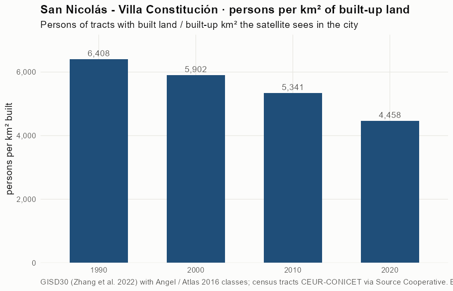
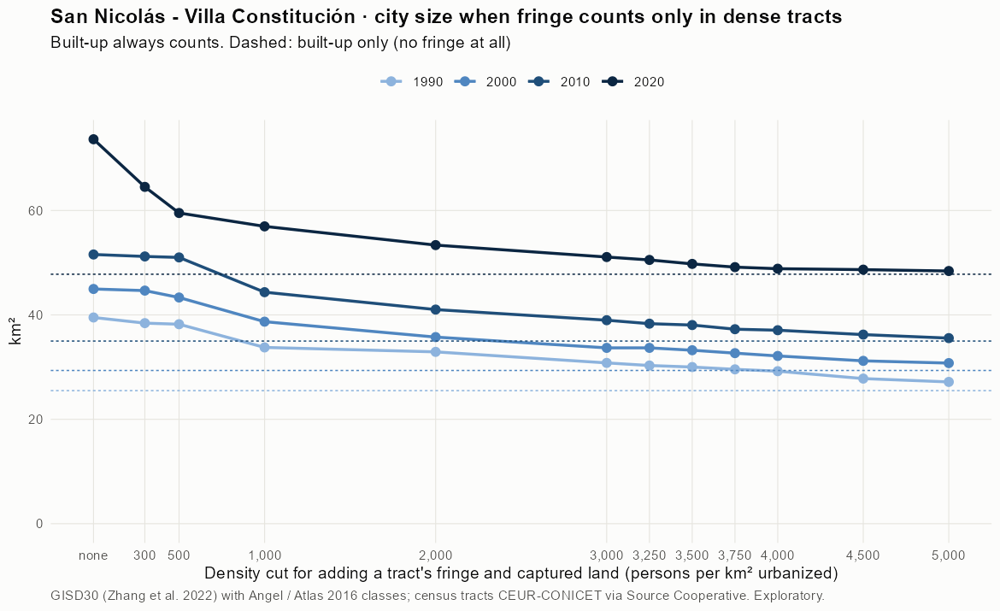
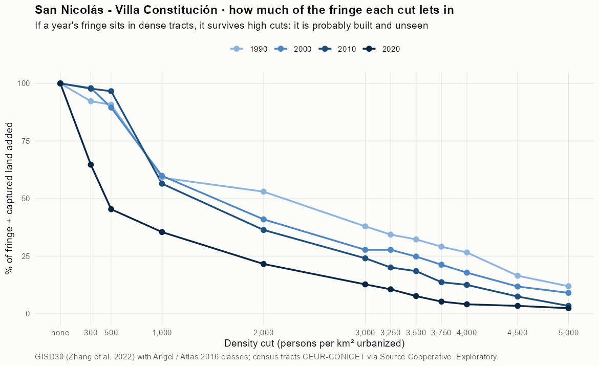
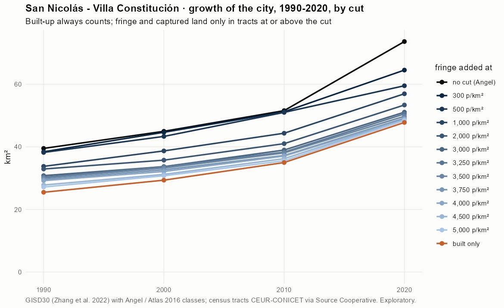
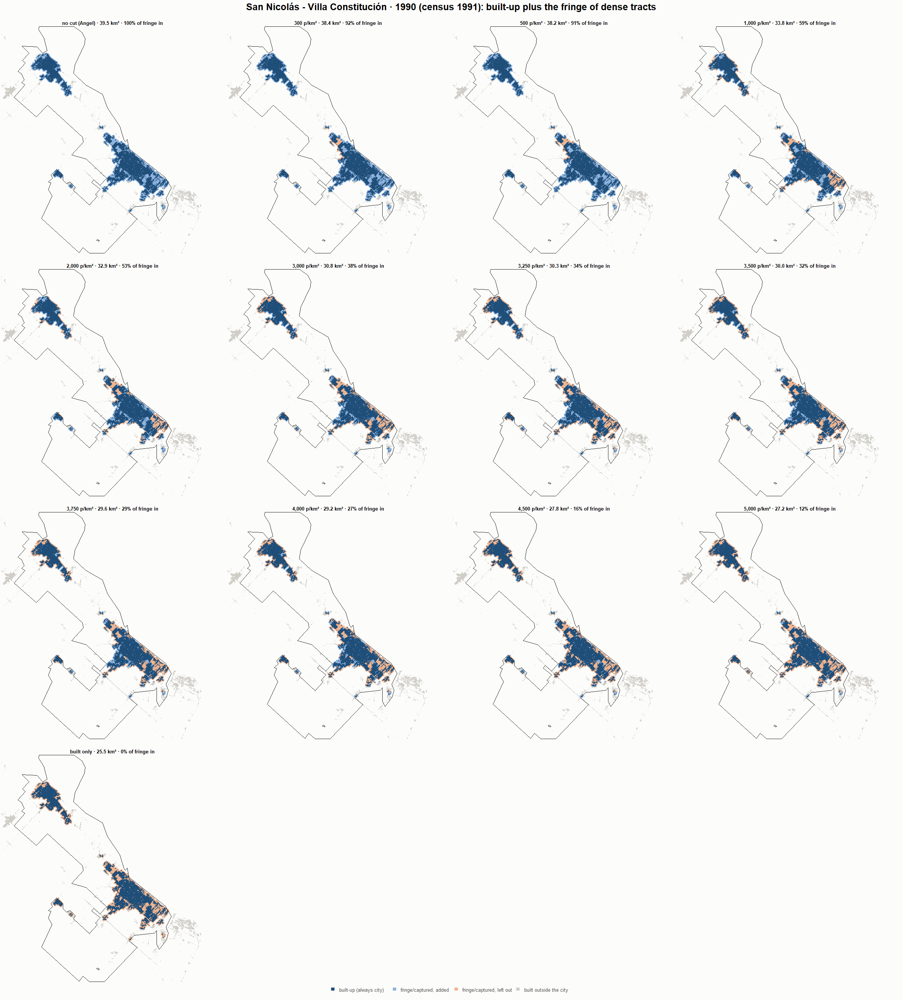
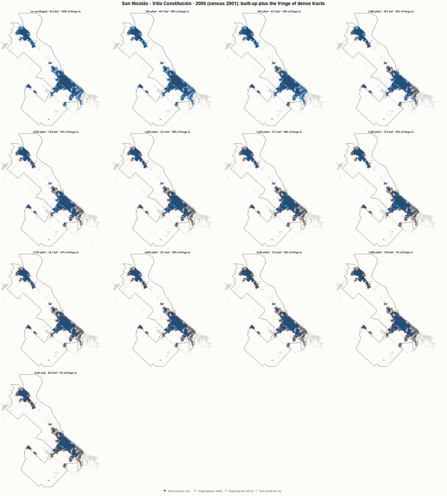
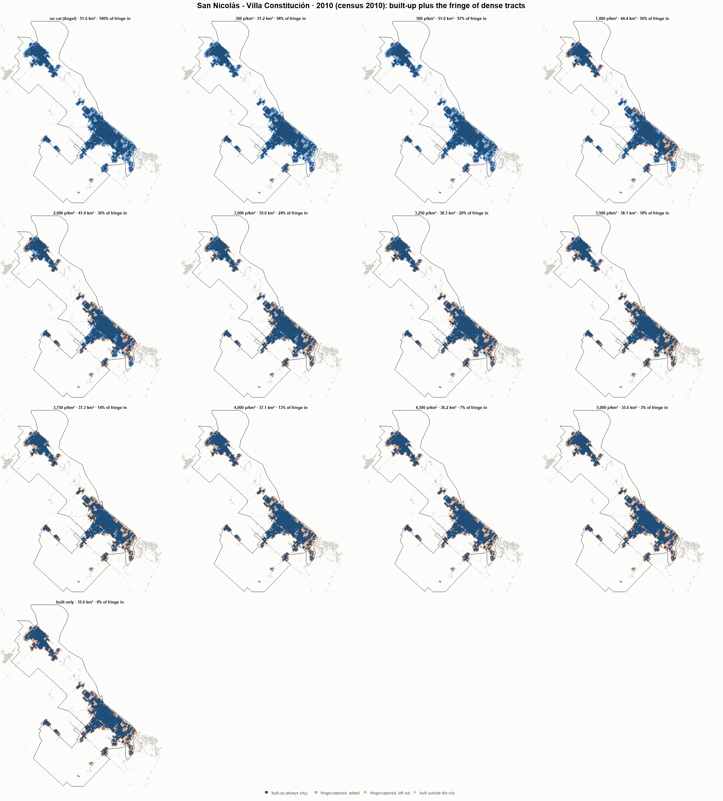
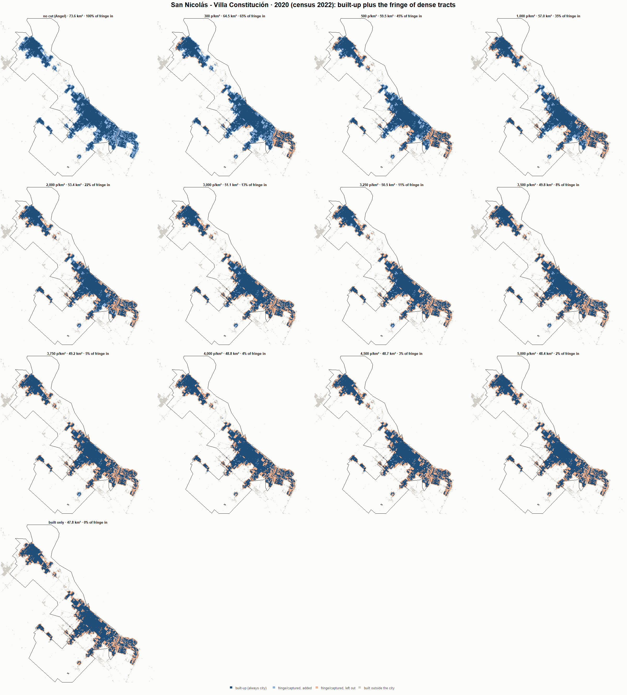

# San Nicolás - Villa Constitución · when does the fringe count as city? 1990-2020

Exploratory test 2. None of these numbers are project figures (they are not in `CIFRAS_CANONICAS.json`). Generated by `Rpipe/scripts/13_prueba_franja.R` from the tract tables of step 11. Run of 2026-11-08. [All agglomerations](../REPORTE.md).

**Idea.** Built-up land is always city. Fringe and captured open space join the city **only in dense tracts**, where they are probably built and unseen by the older imagery. No cut gives the full Angel extent; an infinite cut, built-up only. Method in the [index](../REPORTE.md#method).

## Is the early imagery under-detecting?

If the older imagery misses buildings, persons per km² of *built* land should come out higher in the early years.

| Year | Persons (tracts with built land) | Built km² | Persons / km² built | Median tract, persons / km² built | Fringe + captured, % of extent |
|---|---|---|---|---|---|
| 1990 (census 1991) | 163,339 | 25.5 | 6,408 | 6,027 | 35.2 |
| 2000 (census 2001) | 173,252 | 29.4 | 5,902 | 5,657 | 34.5 |
| 2010 (census 2010) | 186,892 | 35.0 | 5,341 | 5,451 | 31.9 |
| 2020 (census 2022) | 213,080 | 47.8 | 4,458 | 4,738 | 34.9 |

## Results

**1990 (census 1991).** Built-up 25.5 km²; fringe + captured 14.0 km²; 164,264 persons in the city's tracts.

| Fringe added at | City km² | Fringe added km² | % of fringe added | Fringe % of city | Tracts adding fringe | Persons / km² city |
|---|---|---|---|---|---|---|
| no cut (Angel) | 39.5 | 14.0 | 100.0 | 35.5 | 147 | 4,158 |
| 300 p/km² | 38.4 | 12.9 | 92.3 | 33.7 | 145 | 4,275 |
| 500 p/km² | 38.2 | 12.7 | 90.8 | 33.3 | 144 | 4,298 |
| 1,000 p/km² | 33.8 | 8.3 | 59.1 | 24.5 | 136 | 4,864 |
| 2,000 p/km² | 32.9 | 7.4 | 53.0 | 22.6 | 132 | 4,990 |
| 3,000 p/km² | 30.8 | 5.3 | 37.9 | 17.3 | 122 | 5,332 |
| 3,250 p/km² | 30.3 | 4.8 | 34.4 | 15.9 | 117 | 5,420 |
| 3,500 p/km² | 30.0 | 4.5 | 32.3 | 15.1 | 114 | 5,473 |
| 3,750 p/km² | 29.6 | 4.1 | 29.1 | 13.8 | 110 | 5,555 |
| 4,000 p/km² | 29.2 | 3.7 | 26.6 | 12.8 | 105 | 5,622 |
| 4,500 p/km² | 27.8 | 2.3 | 16.5 | 8.3 | 95 | 5,909 |
| 5,000 p/km² | 27.2 | 1.7 | 11.9 | 6.2 | 86 | 6,048 |
| built only | 25.5 | 0.0 | 0.0 | 0.0 | 0 | 6,444 |

**2000 (census 2001).** Built-up 29.4 km²; fringe + captured 15.6 km²; 174,429 persons in the city's tracts.

| Fringe added at | City km² | Fringe added km² | % of fringe added | Fringe % of city | Tracts adding fringe | Persons / km² city |
|---|---|---|---|---|---|---|
| no cut (Angel) | 45.0 | 15.6 | 100.0 | 34.7 | 151 | 3,879 |
| 300 p/km² | 44.7 | 15.3 | 98.0 | 34.3 | 149 | 3,906 |
| 500 p/km² | 43.3 | 14.0 | 89.5 | 32.3 | 147 | 4,025 |
| 1,000 p/km² | 38.7 | 9.3 | 59.9 | 24.2 | 140 | 4,507 |
| 2,000 p/km² | 35.8 | 6.4 | 41.0 | 17.9 | 129 | 4,879 |
| 3,000 p/km² | 33.7 | 4.3 | 27.7 | 12.9 | 115 | 5,178 |
| 3,250 p/km² | 33.7 | 4.3 | 27.7 | 12.9 | 115 | 5,178 |
| 3,500 p/km² | 33.2 | 3.9 | 24.8 | 11.7 | 111 | 5,249 |
| 3,750 p/km² | 32.7 | 3.3 | 21.3 | 10.2 | 105 | 5,338 |
| 4,000 p/km² | 32.1 | 2.8 | 17.8 | 8.7 | 99 | 5,428 |
| 4,500 p/km² | 31.2 | 1.8 | 11.8 | 5.9 | 87 | 5,591 |
| 5,000 p/km² | 30.8 | 1.4 | 9.1 | 4.6 | 75 | 5,669 |
| built only | 29.4 | 0.0 | 0.0 | 0.0 | 0 | 5,942 |

**2010 (census 2010).** Built-up 35.0 km²; fringe + captured 16.6 km²; 187,623 persons in the city's tracts.

| Fringe added at | City km² | Fringe added km² | % of fringe added | Fringe % of city | Tracts adding fringe | Persons / km² city |
|---|---|---|---|---|---|---|
| no cut (Angel) | 51.6 | 16.6 | 100.0 | 32.2 | 150 | 3,638 |
| 300 p/km² | 51.2 | 16.2 | 97.7 | 31.7 | 148 | 3,665 |
| 500 p/km² | 51.0 | 16.0 | 96.6 | 31.4 | 146 | 3,678 |
| 1,000 p/km² | 44.4 | 9.4 | 56.5 | 21.1 | 134 | 4,230 |
| 2,000 p/km² | 41.0 | 6.0 | 36.4 | 14.7 | 122 | 4,574 |
| 3,000 p/km² | 39.0 | 4.0 | 24.1 | 10.2 | 109 | 4,813 |
| 3,250 p/km² | 38.3 | 3.3 | 20.1 | 8.7 | 101 | 4,896 |
| 3,500 p/km² | 38.1 | 3.1 | 18.5 | 8.1 | 99 | 4,930 |
| 3,750 p/km² | 37.3 | 2.3 | 13.7 | 6.1 | 92 | 5,035 |
| 4,000 p/km² | 37.1 | 2.1 | 12.5 | 5.6 | 89 | 5,062 |
| 4,500 p/km² | 36.2 | 1.2 | 7.5 | 3.4 | 76 | 5,179 |
| 5,000 p/km² | 35.6 | 0.6 | 3.4 | 1.6 | 58 | 5,277 |
| built only | 35.0 | 0.0 | 0.0 | 0.0 | 0 | 5,362 |

**2020 (census 2022).** Built-up 47.8 km²; fringe + captured 25.9 km²; 214,002 persons in the city's tracts.

| Fringe added at | City km² | Fringe added km² | % of fringe added | Fringe % of city | Tracts adding fringe | Persons / km² city |
|---|---|---|---|---|---|---|
| no cut (Angel) | 73.6 | 25.9 | 100.0 | 35.1 | 177 | 2,906 |
| 300 p/km² | 64.5 | 16.7 | 64.7 | 25.9 | 166 | 3,317 |
| 500 p/km² | 59.5 | 11.7 | 45.4 | 19.7 | 157 | 3,595 |
| 1,000 p/km² | 57.0 | 9.2 | 35.5 | 16.1 | 150 | 3,757 |
| 2,000 p/km² | 53.4 | 5.6 | 21.6 | 10.5 | 132 | 4,010 |
| 3,000 p/km² | 51.1 | 3.3 | 12.7 | 6.4 | 116 | 4,189 |
| 3,250 p/km² | 50.5 | 2.7 | 10.6 | 5.4 | 112 | 4,235 |
| 3,500 p/km² | 49.8 | 2.0 | 7.6 | 4.0 | 102 | 4,300 |
| 3,750 p/km² | 49.2 | 1.4 | 5.3 | 2.8 | 92 | 4,354 |
| 4,000 p/km² | 48.8 | 1.1 | 4.1 | 2.2 | 88 | 4,381 |
| 4,500 p/km² | 48.7 | 0.9 | 3.4 | 1.8 | 78 | 4,397 |
| 5,000 p/km² | 48.4 | 0.6 | 2.4 | 1.3 | 64 | 4,420 |
| built only | 47.8 | 0.0 | 0.0 | 0.0 | 0 | 4,478 |

### Growth by cut

| Fringe added at | 1990 km² | 2000 km² | 2010 km² | 2020 km² | 1990-2000 %/yr | 2000-2010 %/yr | 2010-2020 %/yr | 1990-2020 %/yr |
|---|---|---|---|---|---|---|---|---|
| no cut (Angel) | 39.5 | 45.0 | 51.6 | 73.6 | 1.30 | 1.38 | 3.63 | 2.10 |
| 300 p/km² | 38.4 | 44.7 | 51.2 | 64.5 | 1.51 | 1.38 | 2.34 | 1.74 |
| 500 p/km² | 38.2 | 43.3 | 51.0 | 59.5 | 1.26 | 1.64 | 1.56 | 1.49 |
| 1,000 p/km² | 33.8 | 38.7 | 44.4 | 57.0 | 1.37 | 1.37 | 2.53 | 1.76 |
| 2,000 p/km² | 32.9 | 35.8 | 41.0 | 53.4 | 0.83 | 1.38 | 2.67 | 1.62 |
| 3,000 p/km² | 30.8 | 33.7 | 39.0 | 51.1 | 0.90 | 1.47 | 2.74 | 1.70 |
| 3,250 p/km² | 30.3 | 33.7 | 38.3 | 50.5 | 1.06 | 1.30 | 2.80 | 1.72 |
| 3,500 p/km² | 30.0 | 33.2 | 38.1 | 49.8 | 1.02 | 1.36 | 2.72 | 1.70 |
| 3,750 p/km² | 29.6 | 32.7 | 37.3 | 49.2 | 1.00 | 1.32 | 2.81 | 1.71 |
| 4,000 p/km² | 29.2 | 32.1 | 37.1 | 48.8 | 0.96 | 1.44 | 2.80 | 1.73 |
| 4,500 p/km² | 27.8 | 31.2 | 36.2 | 48.7 | 1.16 | 1.51 | 3.00 | 1.88 |
| 5,000 p/km² | 27.2 | 30.8 | 35.6 | 48.4 | 1.25 | 1.46 | 3.14 | 1.95 |
| built only | 25.5 | 29.4 | 35.0 | 47.8 | 1.42 | 1.77 | 3.17 | 2.12 |

## Maps

Same frame in the four years: the 2020 city plus 3 km. Dark blue is built-up, always city; light blue is fringe or captured land added because its tract is dense; light orange is fringe left out. Black line: the analysis perimeter.

### 1990

### 2000

### 2010

### 2020

## Reading

- **The premise.** Persons per km² of built land: 6,408 in 1990, 5,902 in 2000, 5,341 in 2010, 4,458 in 2020. 1990 is clearly higher than 2010: consistent with built land missed in 1990, though it also fits a denser city that later spread out.
- **At 500 p/km²** the fringe that joins the city is 90.8 % of all fringe in 1990 and 45.4 % in 2020.
- **Growth 1990-2020**: 2.10 %/yr with the full Angel extent, 1.49 %/yr at 500, 2.12 %/yr built-up only.

