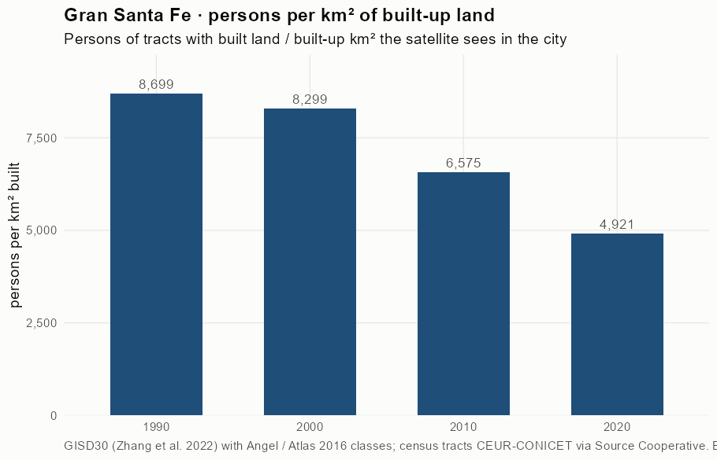
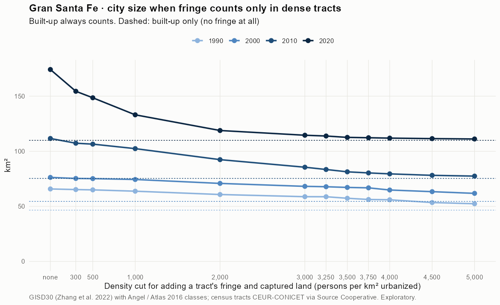
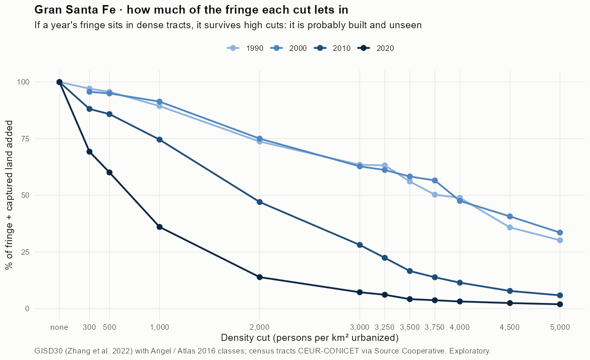
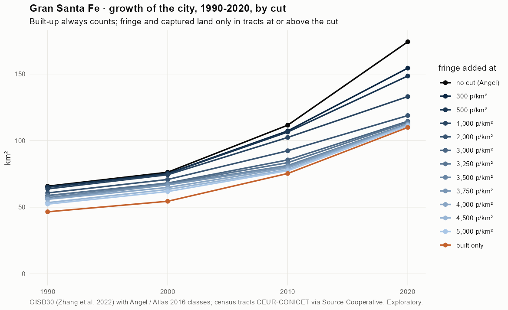
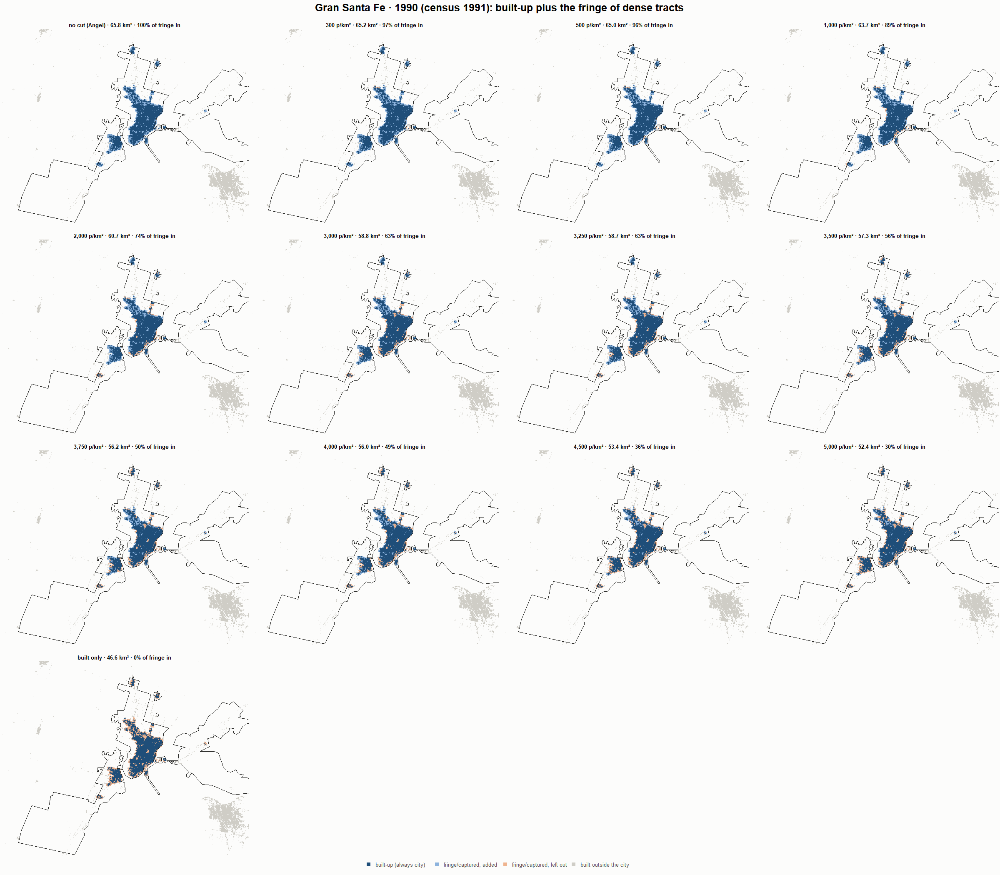
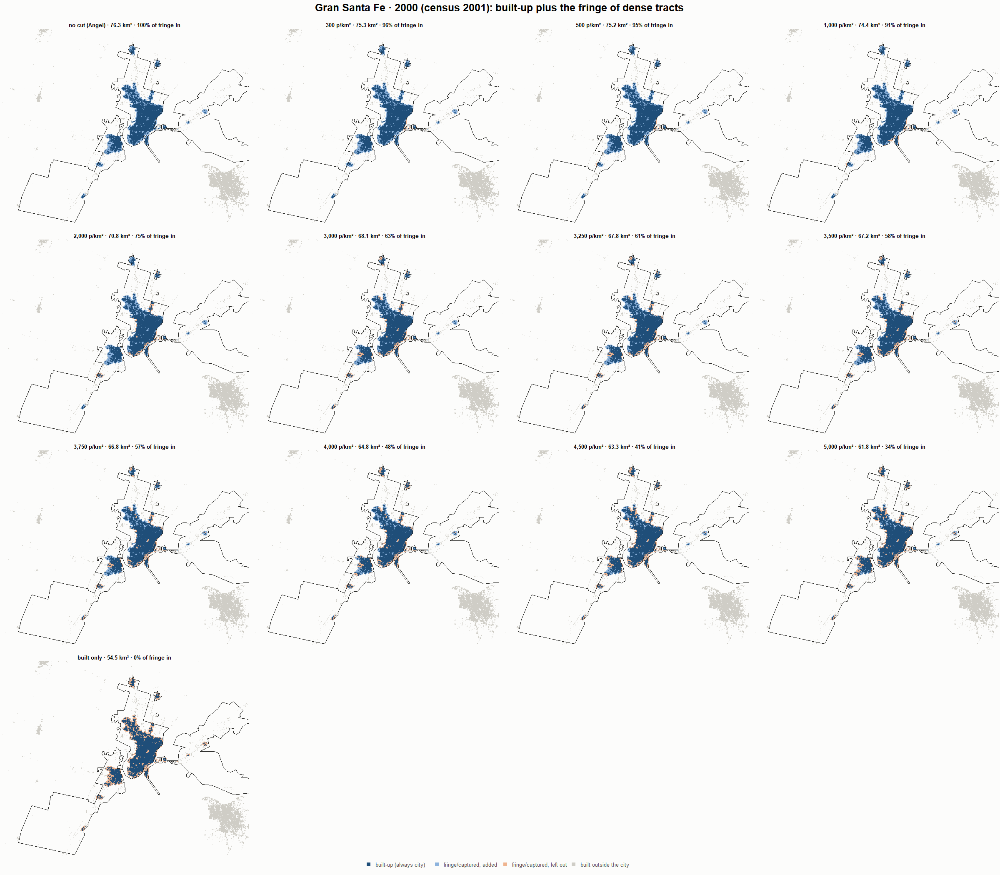
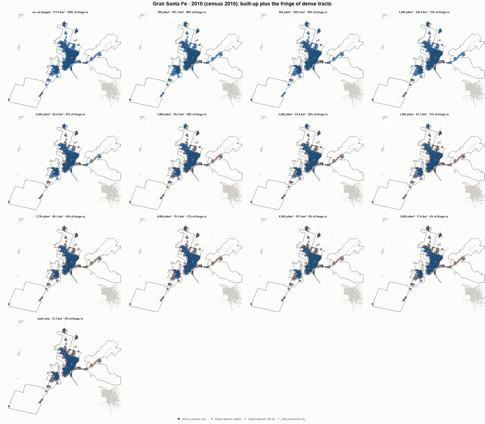
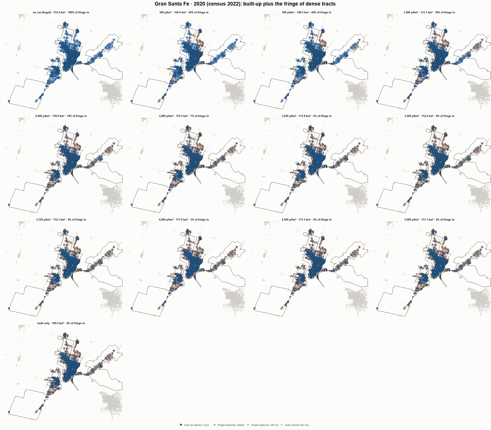

# Gran Santa Fe · when does the fringe count as city? 1990-2020

Exploratory test 2. None of these numbers are project figures (they are not in `CIFRAS_CANONICAS.json`). Generated by `Rpipe/scripts/13_prueba_franja.R` from the tract tables of step 11. Run of 2026-11-08. [All agglomerations](../REPORTE.md).

**Idea.** Built-up land is always city. Fringe and captured open space join the city **only in dense tracts**, where they are probably built and unseen by the older imagery. No cut gives the full Angel extent; an infinite cut, built-up only. Method in the [index](../REPORTE.md#method).

## Is the early imagery under-detecting?

If the older imagery misses buildings, persons per km² of *built* land should come out higher in the early years.

| Year | Persons (tracts with built land) | Built km² | Persons / km² built | Median tract, persons / km² built | Fringe + captured, % of extent |
|---|---|---|---|---|---|
| 1990 (census 1991) | 405,030 | 46.6 | 8,699 | 8,187 | 29.1 |
| 2000 (census 2001) | 451,976 | 54.5 | 8,299 | 7,770 | 28.6 |
| 2010 (census 2010) | 495,195 | 75.3 | 6,575 | 6,482 | 32.4 |
| 2020 (census 2022) | 540,885 | 109.9 | 4,921 | 4,641 | 36.9 |

## Results

**1990 (census 1991).** Built-up 46.6 km²; fringe + captured 19.2 km²; 406,521 persons in the city's tracts.

| Fringe added at | City km² | Fringe added km² | % of fringe added | Fringe % of city | Tracts adding fringe | Persons / km² city |
|---|---|---|---|---|---|---|
| no cut (Angel) | 65.8 | 19.2 | 100.0 | 29.2 | 252 | 6,180 |
| 300 p/km² | 65.2 | 18.7 | 97.1 | 28.6 | 250 | 6,233 |
| 500 p/km² | 65.0 | 18.4 | 95.7 | 28.3 | 249 | 6,259 |
| 1,000 p/km² | 63.7 | 17.2 | 89.4 | 27.0 | 245 | 6,377 |
| 2,000 p/km² | 60.7 | 14.2 | 73.7 | 23.3 | 238 | 6,694 |
| 3,000 p/km² | 58.8 | 12.2 | 63.5 | 20.8 | 229 | 6,919 |
| 3,250 p/km² | 58.7 | 12.2 | 63.2 | 20.7 | 228 | 6,924 |
| 3,500 p/km² | 57.3 | 10.8 | 56.1 | 18.8 | 217 | 7,090 |
| 3,750 p/km² | 56.2 | 9.7 | 50.3 | 17.2 | 209 | 7,231 |
| 4,000 p/km² | 56.0 | 9.4 | 48.9 | 16.8 | 207 | 7,265 |
| 4,500 p/km² | 53.4 | 6.9 | 35.8 | 12.9 | 190 | 7,607 |
| 5,000 p/km² | 52.4 | 5.8 | 30.2 | 11.1 | 178 | 7,764 |
| built only | 46.6 | 0.0 | 0.0 | 0.0 | 0 | 8,732 |

**2000 (census 2001).** Built-up 54.5 km²; fringe + captured 21.8 km²; 454,444 persons in the city's tracts.

| Fringe added at | City km² | Fringe added km² | % of fringe added | Fringe % of city | Tracts adding fringe | Persons / km² city |
|---|---|---|---|---|---|---|
| no cut (Angel) | 76.3 | 21.8 | 100.0 | 28.6 | 242 | 5,960 |
| 300 p/km² | 75.3 | 20.9 | 95.7 | 27.7 | 238 | 6,034 |
| 500 p/km² | 75.2 | 20.7 | 95.0 | 27.5 | 237 | 6,046 |
| 1,000 p/km² | 74.4 | 19.9 | 91.4 | 26.8 | 235 | 6,110 |
| 2,000 p/km² | 70.8 | 16.3 | 75.0 | 23.1 | 227 | 6,418 |
| 3,000 p/km² | 68.1 | 13.7 | 62.8 | 20.1 | 211 | 6,669 |
| 3,250 p/km² | 67.8 | 13.3 | 61.2 | 19.7 | 209 | 6,703 |
| 3,500 p/km² | 67.2 | 12.7 | 58.3 | 18.9 | 204 | 6,766 |
| 3,750 p/km² | 66.8 | 12.3 | 56.6 | 18.5 | 199 | 6,804 |
| 4,000 p/km² | 64.8 | 10.4 | 47.5 | 16.0 | 187 | 7,011 |
| 4,500 p/km² | 63.3 | 8.9 | 40.7 | 14.0 | 176 | 7,176 |
| 5,000 p/km² | 61.8 | 7.3 | 33.6 | 11.8 | 162 | 7,357 |
| built only | 54.5 | 0.0 | 0.0 | 0.0 | 0 | 8,345 |

**2010 (census 2010).** Built-up 75.3 km²; fringe + captured 36.3 km²; 495,429 persons in the city's tracts.

| Fringe added at | City km² | Fringe added km² | % of fringe added | Fringe % of city | Tracts adding fringe | Persons / km² city |
|---|---|---|---|---|---|---|
| no cut (Angel) | 111.6 | 36.3 | 100.0 | 32.5 | 262 | 4,439 |
| 300 p/km² | 107.3 | 32.0 | 88.1 | 29.8 | 254 | 4,618 |
| 500 p/km² | 106.5 | 31.1 | 85.8 | 29.3 | 251 | 4,654 |
| 1,000 p/km² | 102.4 | 27.1 | 74.6 | 26.4 | 240 | 4,839 |
| 2,000 p/km² | 92.4 | 17.1 | 47.0 | 18.5 | 217 | 5,363 |
| 3,000 p/km² | 85.5 | 10.2 | 28.1 | 11.9 | 186 | 5,794 |
| 3,250 p/km² | 83.4 | 8.1 | 22.4 | 9.7 | 179 | 5,937 |
| 3,500 p/km² | 81.3 | 6.0 | 16.6 | 7.4 | 167 | 6,091 |
| 3,750 p/km² | 80.3 | 5.0 | 13.8 | 6.2 | 156 | 6,167 |
| 4,000 p/km² | 79.5 | 4.1 | 11.4 | 5.2 | 148 | 6,234 |
| 4,500 p/km² | 78.1 | 2.8 | 7.8 | 3.6 | 134 | 6,340 |
| 5,000 p/km² | 77.4 | 2.1 | 5.8 | 2.7 | 121 | 6,398 |
| built only | 75.3 | 0.0 | 0.0 | 0.0 | 0 | 6,578 |

**2020 (census 2022).** Built-up 109.9 km²; fringe + captured 64.3 km²; 541,726 persons in the city's tracts.

| Fringe added at | City km² | Fringe added km² | % of fringe added | Fringe % of city | Tracts adding fringe | Persons / km² city |
|---|---|---|---|---|---|---|
| no cut (Angel) | 174.2 | 64.3 | 100.0 | 36.9 | 360 | 3,110 |
| 300 p/km² | 154.4 | 44.5 | 69.3 | 28.8 | 340 | 3,508 |
| 500 p/km² | 148.5 | 38.6 | 60.1 | 26.0 | 331 | 3,647 |
| 1,000 p/km² | 133.1 | 23.2 | 36.0 | 17.4 | 298 | 4,071 |
| 2,000 p/km² | 118.8 | 8.9 | 13.9 | 7.5 | 246 | 4,559 |
| 3,000 p/km² | 114.5 | 4.6 | 7.2 | 4.0 | 208 | 4,730 |
| 3,250 p/km² | 113.8 | 3.9 | 6.1 | 3.4 | 199 | 4,759 |
| 3,500 p/km² | 112.6 | 2.7 | 4.2 | 2.4 | 183 | 4,812 |
| 3,750 p/km² | 112.3 | 2.4 | 3.7 | 2.1 | 175 | 4,825 |
| 4,000 p/km² | 111.9 | 2.0 | 3.1 | 1.8 | 163 | 4,840 |
| 4,500 p/km² | 111.5 | 1.6 | 2.4 | 1.4 | 148 | 4,860 |
| 5,000 p/km² | 111.1 | 1.2 | 1.9 | 1.1 | 128 | 4,875 |
| built only | 109.9 | 0.0 | 0.0 | 0.0 | 0 | 4,929 |

### Growth by cut

| Fringe added at | 1990 km² | 2000 km² | 2010 km² | 2020 km² | 1990-2000 %/yr | 2000-2010 %/yr | 2010-2020 %/yr | 1990-2020 %/yr |
|---|---|---|---|---|---|---|---|---|
| no cut (Angel) | 65.8 | 76.3 | 111.6 | 174.2 | 1.49 | 3.88 | 4.55 | 3.30 |
| 300 p/km² | 65.2 | 75.3 | 107.3 | 154.4 | 1.45 | 3.60 | 3.71 | 2.92 |
| 500 p/km² | 65.0 | 75.2 | 106.5 | 148.5 | 1.47 | 3.54 | 3.39 | 2.80 |
| 1,000 p/km² | 63.7 | 74.4 | 102.4 | 133.1 | 1.55 | 3.25 | 2.66 | 2.48 |
| 2,000 p/km² | 60.7 | 70.8 | 92.4 | 118.8 | 1.55 | 2.70 | 2.55 | 2.26 |
| 3,000 p/km² | 58.8 | 68.1 | 85.5 | 114.5 | 1.49 | 2.30 | 2.97 | 2.25 |
| 3,250 p/km² | 58.7 | 67.8 | 83.4 | 113.8 | 1.45 | 2.10 | 3.15 | 2.23 |
| 3,500 p/km² | 57.3 | 67.2 | 81.3 | 112.6 | 1.59 | 1.93 | 3.31 | 2.27 |
| 3,750 p/km² | 56.2 | 66.8 | 80.3 | 112.3 | 1.74 | 1.86 | 3.40 | 2.33 |
| 4,000 p/km² | 56.0 | 64.8 | 79.5 | 111.9 | 1.48 | 2.06 | 3.48 | 2.34 |
| 4,500 p/km² | 53.4 | 63.3 | 78.1 | 111.5 | 1.71 | 2.12 | 3.62 | 2.48 |
| 5,000 p/km² | 52.4 | 61.8 | 77.4 | 111.1 | 1.67 | 2.29 | 3.68 | 2.54 |
| built only | 46.6 | 54.5 | 75.3 | 109.9 | 1.58 | 3.30 | 3.85 | 2.90 |

## Maps

Same frame in the four years: the 2020 city plus 3 km. Dark blue is built-up, always city; light blue is fringe or captured land added because its tract is dense; light orange is fringe left out. Black line: the analysis perimeter.

### 1990

### 2000

### 2010

### 2020

## Reading

- **The premise.** Persons per km² of built land: 8,699 in 1990, 8,299 in 2000, 6,575 in 2010, 4,921 in 2020. 1990 is clearly higher than 2010: consistent with built land missed in 1990, though it also fits a denser city that later spread out.
- **At 500 p/km²** the fringe that joins the city is 95.7 % of all fringe in 1990 and 60.1 % in 2020.
- **Growth 1990-2020**: 3.30 %/yr with the full Angel extent, 2.80 %/yr at 500, 2.90 %/yr built-up only.

