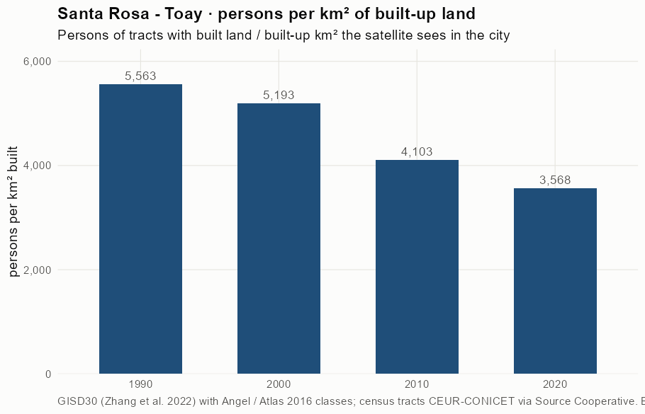
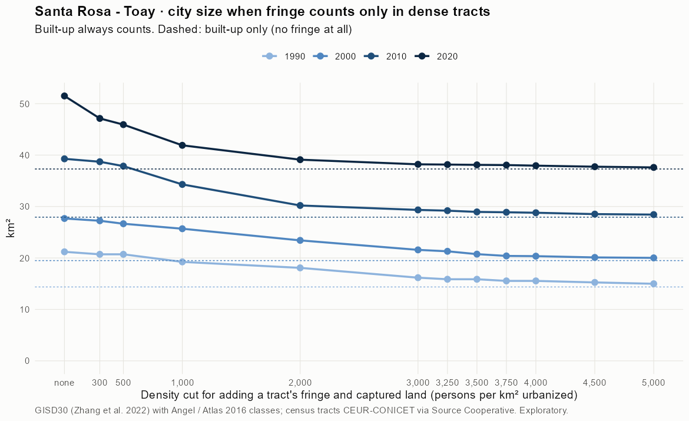
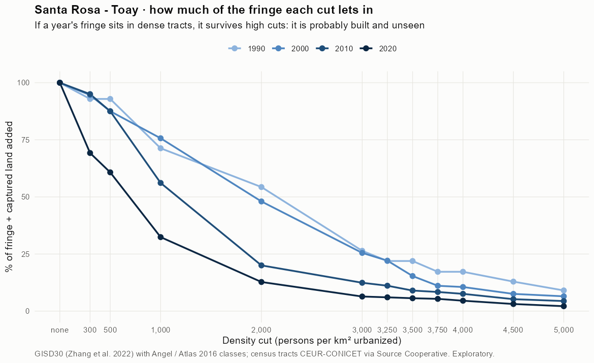
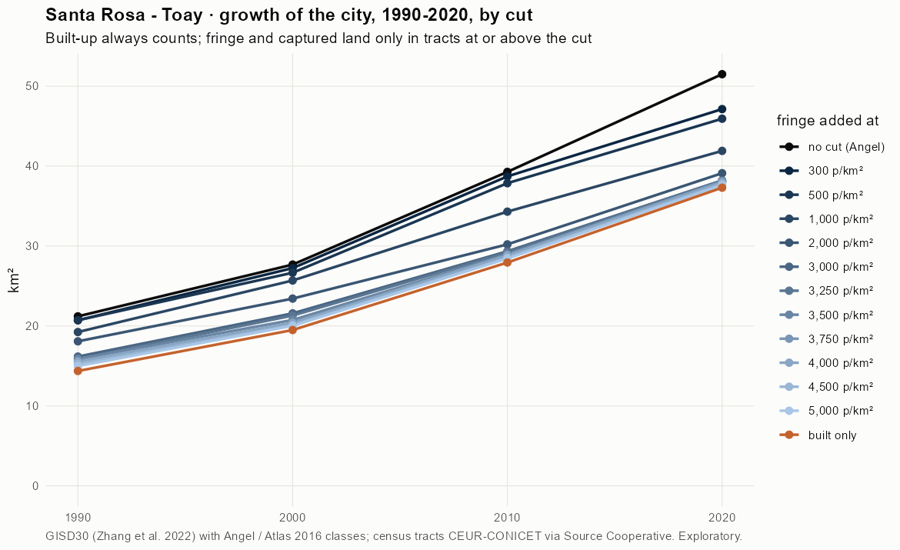
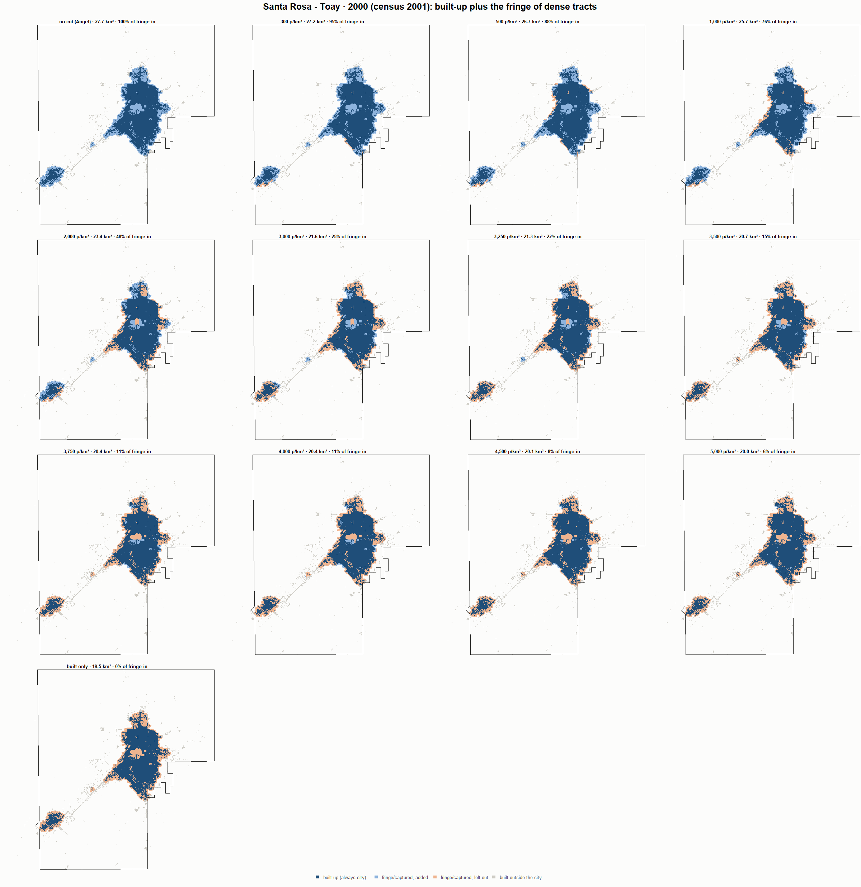
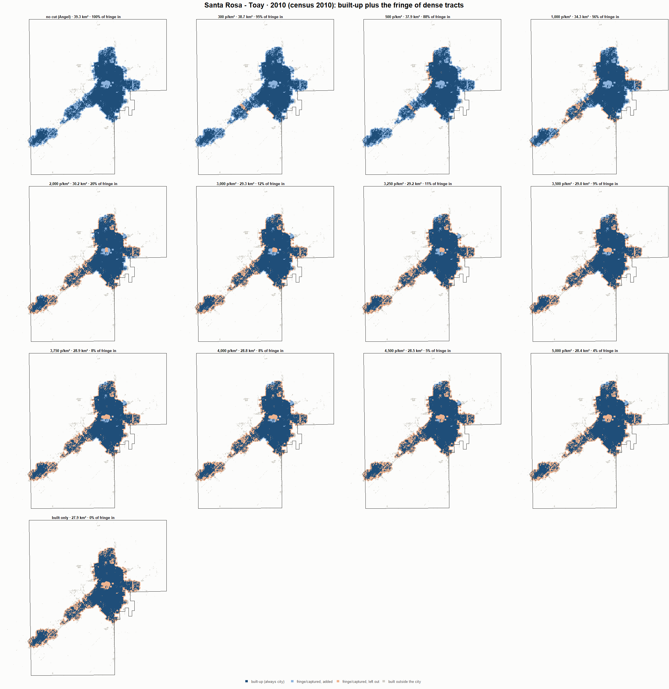

# Santa Rosa - Toay · when does the fringe count as city? 1990-2020

Exploratory test 2. None of these numbers are project figures (they are not in `CIFRAS_CANONICAS.json`). Generated by `Rpipe/scripts/13_prueba_franja.R` from the tract tables of step 11. Run of 2026-11-08. [All agglomerations](../REPORTE.md).

**Idea.** Built-up land is always city. Fringe and captured open space join the city **only in dense tracts**, where they are probably built and unseen by the older imagery. No cut gives the full Angel extent; an infinite cut, built-up only. Method in the [index](../REPORTE.md#method).

## Is the early imagery under-detecting?

If the older imagery misses buildings, persons per km² of *built* land should come out higher in the early years.

| Year | Persons (tracts with built land) | Built km² | Persons / km² built | Median tract, persons / km² built | Fringe + captured, % of extent |
|---|---|---|---|---|---|
| 1990 (census 1991) | 79,906 | 14.4 | 5,563 | 4,842 | 32.2 |
| 2000 (census 2001) | 101,199 | 19.5 | 5,193 | 4,937 | 29.4 |
| 2010 (census 2010) | 114,603 | 27.9 | 4,103 | 3,984 | 28.9 |
| 2020 (census 2022) | 133,081 | 37.3 | 3,568 | 2,999 | 27.5 |

## Results

**1990 (census 1991).** Built-up 14.4 km²; fringe + captured 6.8 km²; 80,053 persons in the city's tracts.

| Fringe added at | City km² | Fringe added km² | % of fringe added | Fringe % of city | Tracts adding fringe | Persons / km² city |
|---|---|---|---|---|---|---|
| no cut (Angel) | 21.2 | 6.8 | 100.0 | 32.2 | 84 | 3,777 |
| 300 p/km² | 20.7 | 6.3 | 92.9 | 30.6 | 82 | 3,865 |
| 500 p/km² | 20.7 | 6.3 | 92.9 | 30.6 | 82 | 3,865 |
| 1,000 p/km² | 19.2 | 4.9 | 71.3 | 25.3 | 76 | 4,161 |
| 2,000 p/km² | 18.1 | 3.7 | 54.3 | 20.5 | 71 | 4,429 |
| 3,000 p/km² | 16.2 | 1.8 | 26.4 | 11.2 | 58 | 4,951 |
| 3,250 p/km² | 15.9 | 1.5 | 21.9 | 9.5 | 57 | 5,046 |
| 3,500 p/km² | 15.9 | 1.5 | 21.9 | 9.5 | 57 | 5,046 |
| 3,750 p/km² | 15.5 | 1.2 | 17.2 | 7.6 | 52 | 5,151 |
| 4,000 p/km² | 15.5 | 1.2 | 17.2 | 7.6 | 52 | 5,151 |
| 4,500 p/km² | 15.2 | 0.9 | 12.9 | 5.8 | 42 | 5,250 |
| 5,000 p/km² | 15.0 | 0.6 | 9.1 | 4.1 | 29 | 5,343 |
| built only | 14.4 | 0.0 | 0.0 | 0.0 | 0 | 5,573 |

**2000 (census 2001).** Built-up 19.5 km²; fringe + captured 8.2 km²; 101,922 persons in the city's tracts.

| Fringe added at | City km² | Fringe added km² | % of fringe added | Fringe % of city | Tracts adding fringe | Persons / km² city |
|---|---|---|---|---|---|---|
| no cut (Angel) | 27.7 | 8.2 | 100.0 | 29.6 | 96 | 3,683 |
| 300 p/km² | 27.2 | 7.7 | 94.6 | 28.4 | 93 | 3,743 |
| 500 p/km² | 26.7 | 7.2 | 87.5 | 26.9 | 91 | 3,824 |
| 1,000 p/km² | 25.7 | 6.2 | 75.7 | 24.1 | 88 | 3,968 |
| 2,000 p/km² | 23.4 | 3.9 | 48.0 | 16.8 | 77 | 4,352 |
| 3,000 p/km² | 21.6 | 2.1 | 25.5 | 9.7 | 64 | 4,724 |
| 3,250 p/km² | 21.3 | 1.8 | 22.1 | 8.5 | 60 | 4,786 |
| 3,500 p/km² | 20.7 | 1.3 | 15.4 | 6.1 | 54 | 4,913 |
| 3,750 p/km² | 20.4 | 0.9 | 11.1 | 4.5 | 49 | 4,997 |
| 4,000 p/km² | 20.4 | 0.9 | 10.6 | 4.2 | 45 | 5,008 |
| 4,500 p/km² | 20.1 | 0.6 | 7.6 | 3.1 | 39 | 5,069 |
| 5,000 p/km² | 20.0 | 0.5 | 6.5 | 2.7 | 33 | 5,091 |
| built only | 19.5 | 0.0 | 0.0 | 0.0 | 0 | 5,230 |

**2010 (census 2010).** Built-up 27.9 km²; fringe + captured 11.3 km²; 114,814 persons in the city's tracts.

| Fringe added at | City km² | Fringe added km² | % of fringe added | Fringe % of city | Tracts adding fringe | Persons / km² city |
|---|---|---|---|---|---|---|
| no cut (Angel) | 39.3 | 11.3 | 100.0 | 28.9 | 96 | 2,923 |
| 300 p/km² | 38.7 | 10.8 | 95.0 | 27.8 | 95 | 2,966 |
| 500 p/km² | 37.9 | 9.9 | 87.5 | 26.2 | 93 | 3,033 |
| 1,000 p/km² | 34.3 | 6.4 | 56.1 | 18.6 | 80 | 3,348 |
| 2,000 p/km² | 30.2 | 2.3 | 20.0 | 7.5 | 57 | 3,801 |
| 3,000 p/km² | 29.3 | 1.4 | 12.4 | 4.8 | 44 | 3,913 |
| 3,250 p/km² | 29.2 | 1.3 | 11.1 | 4.3 | 38 | 3,933 |
| 3,500 p/km² | 29.0 | 1.0 | 9.0 | 3.5 | 34 | 3,965 |
| 3,750 p/km² | 28.9 | 1.0 | 8.4 | 3.3 | 32 | 3,975 |
| 4,000 p/km² | 28.8 | 0.9 | 7.6 | 3.0 | 30 | 3,988 |
| 4,500 p/km² | 28.5 | 0.6 | 5.2 | 2.1 | 23 | 4,025 |
| 5,000 p/km² | 28.4 | 0.5 | 4.4 | 1.8 | 17 | 4,038 |
| built only | 27.9 | 0.0 | 0.0 | 0.0 | 0 | 4,110 |

**2020 (census 2022).** Built-up 37.3 km²; fringe + captured 14.2 km²; 133,318 persons in the city's tracts.

| Fringe added at | City km² | Fringe added km² | % of fringe added | Fringe % of city | Tracts adding fringe | Persons / km² city |
|---|---|---|---|---|---|---|
| no cut (Angel) | 51.5 | 14.2 | 100.0 | 27.6 | 126 | 2,589 |
| 300 p/km² | 47.1 | 9.8 | 69.2 | 20.9 | 121 | 2,829 |
| 500 p/km² | 45.9 | 8.6 | 60.8 | 18.8 | 117 | 2,903 |
| 1,000 p/km² | 41.9 | 4.6 | 32.4 | 11.0 | 104 | 3,182 |
| 2,000 p/km² | 39.1 | 1.8 | 12.8 | 4.6 | 77 | 3,409 |
| 3,000 p/km² | 38.2 | 0.9 | 6.4 | 2.4 | 58 | 3,489 |
| 3,250 p/km² | 38.2 | 0.9 | 6.0 | 2.3 | 54 | 3,494 |
| 3,500 p/km² | 38.1 | 0.8 | 5.6 | 2.1 | 51 | 3,499 |
| 3,750 p/km² | 38.1 | 0.8 | 5.4 | 2.0 | 49 | 3,503 |
| 4,000 p/km² | 37.9 | 0.6 | 4.6 | 1.7 | 44 | 3,513 |
| 4,500 p/km² | 37.7 | 0.4 | 3.1 | 1.2 | 33 | 3,532 |
| 5,000 p/km² | 37.6 | 0.3 | 2.2 | 0.8 | 26 | 3,545 |
| built only | 37.3 | 0.0 | 0.0 | 0.0 | 0 | 3,574 |

### Growth by cut

| Fringe added at | 1990 km² | 2000 km² | 2010 km² | 2020 km² | 1990-2000 %/yr | 2000-2010 %/yr | 2010-2020 %/yr | 1990-2020 %/yr |
|---|---|---|---|---|---|---|---|---|
| no cut (Angel) | 21.2 | 27.7 | 39.3 | 51.5 | 2.70 | 3.56 | 2.75 | 3.00 |
| 300 p/km² | 20.7 | 27.2 | 38.7 | 47.1 | 2.78 | 3.58 | 1.99 | 2.78 |
| 500 p/km² | 20.7 | 26.7 | 37.9 | 45.9 | 2.55 | 3.57 | 1.95 | 2.69 |
| 1,000 p/km² | 19.2 | 25.7 | 34.3 | 41.9 | 2.93 | 2.93 | 2.02 | 2.63 |
| 2,000 p/km² | 18.1 | 23.4 | 30.2 | 39.1 | 2.62 | 2.58 | 2.62 | 2.61 |
| 3,000 p/km² | 16.2 | 21.6 | 29.3 | 38.2 | 2.93 | 3.12 | 2.68 | 2.91 |
| 3,250 p/km² | 15.9 | 21.3 | 29.2 | 38.2 | 2.99 | 3.20 | 2.71 | 2.97 |
| 3,500 p/km² | 15.9 | 20.7 | 29.0 | 38.1 | 2.72 | 3.39 | 2.78 | 2.96 |
| 3,750 p/km² | 15.5 | 20.4 | 28.9 | 38.1 | 2.76 | 3.54 | 2.80 | 3.03 |
| 4,000 p/km² | 15.5 | 20.4 | 28.8 | 37.9 | 2.73 | 3.53 | 2.80 | 3.02 |
| 4,500 p/km² | 15.2 | 20.1 | 28.5 | 37.7 | 2.80 | 3.56 | 2.84 | 3.07 |
| 5,000 p/km² | 15.0 | 20.0 | 28.4 | 37.6 | 2.94 | 3.57 | 2.84 | 3.11 |
| built only | 14.4 | 19.5 | 27.9 | 37.3 | 3.10 | 3.67 | 2.93 | 3.23 |

## Maps

Same frame in the four years: the 2020 city plus 3 km. Dark blue is built-up, always city; light blue is fringe or captured land added because its tract is dense; light orange is fringe left out. Black line: the analysis perimeter.

### 1990

### 2000

### 2010

### 2020

## Reading

- **The premise.** Persons per km² of built land: 5,563 in 1990, 5,193 in 2000, 4,103 in 2010, 3,568 in 2020. 1990 is clearly higher than 2010: consistent with built land missed in 1990, though it also fits a denser city that later spread out.
- **At 500 p/km²** the fringe that joins the city is 92.9 % of all fringe in 1990 and 60.8 % in 2020.
- **Growth 1990-2020**: 3.00 %/yr with the full Angel extent, 2.69 %/yr at 500, 3.23 %/yr built-up only.

