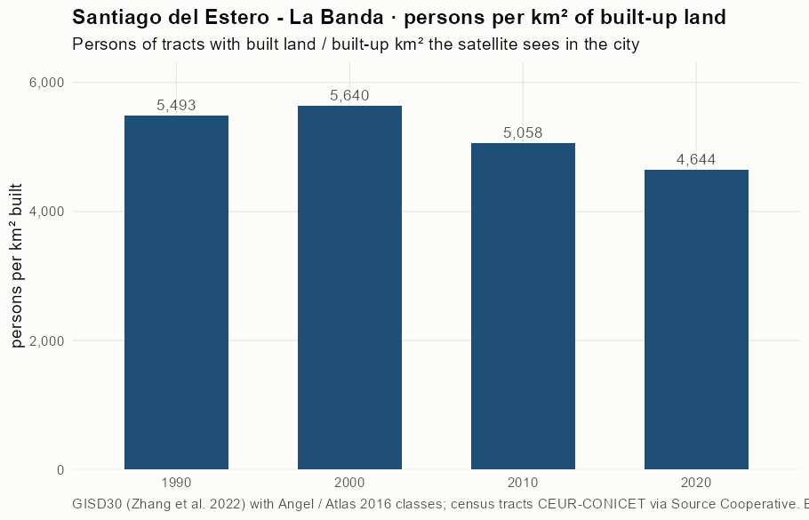
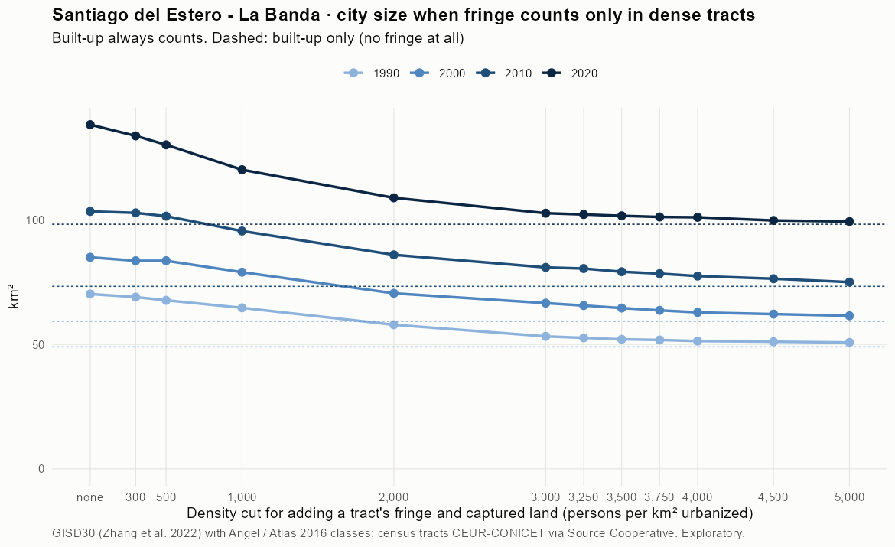
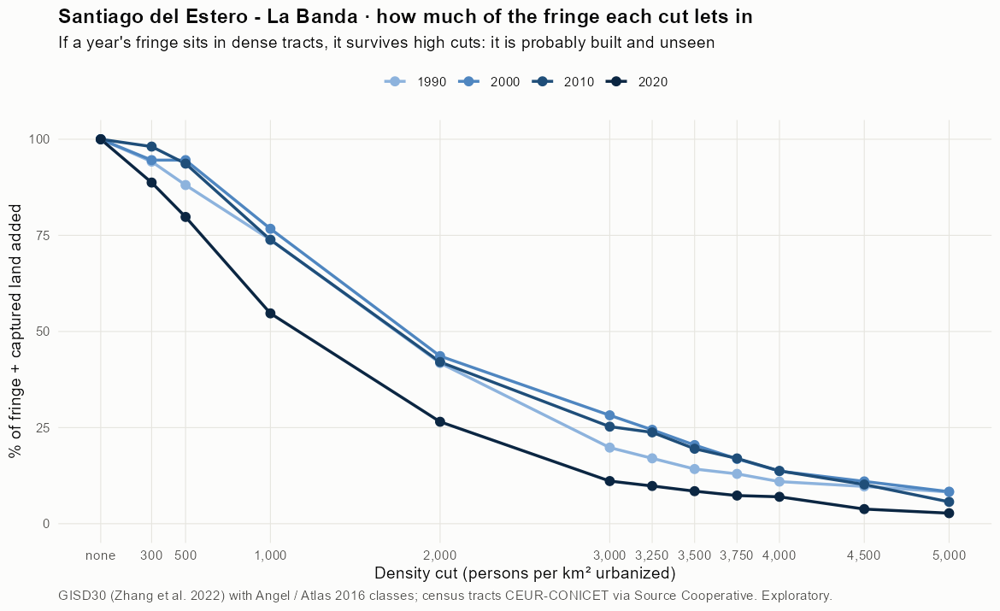
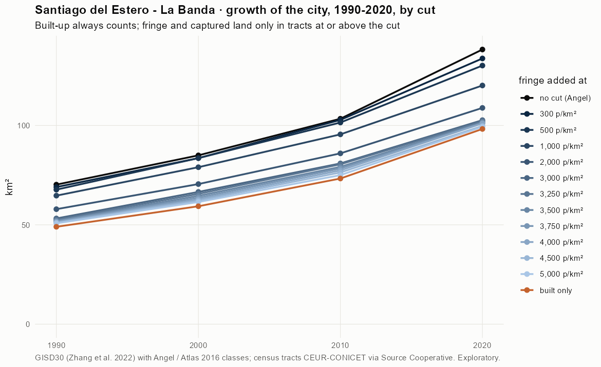
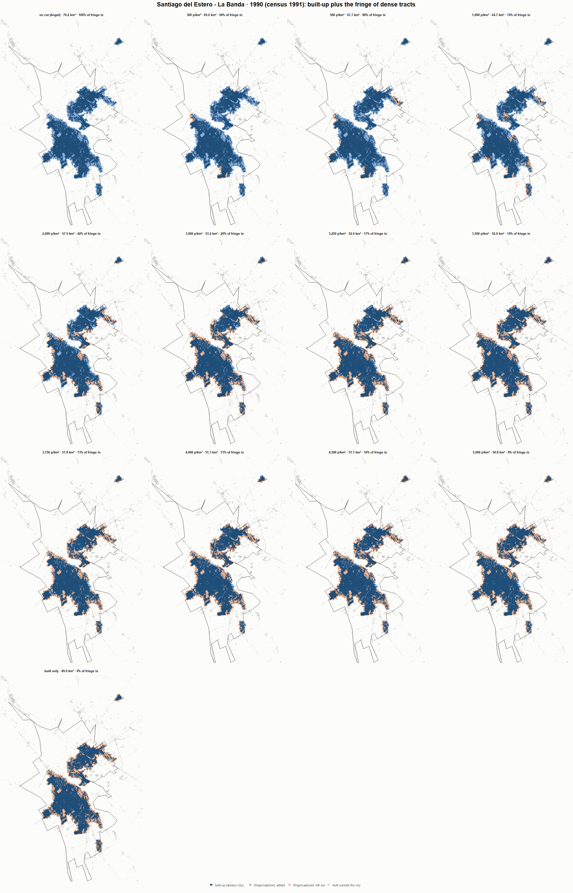
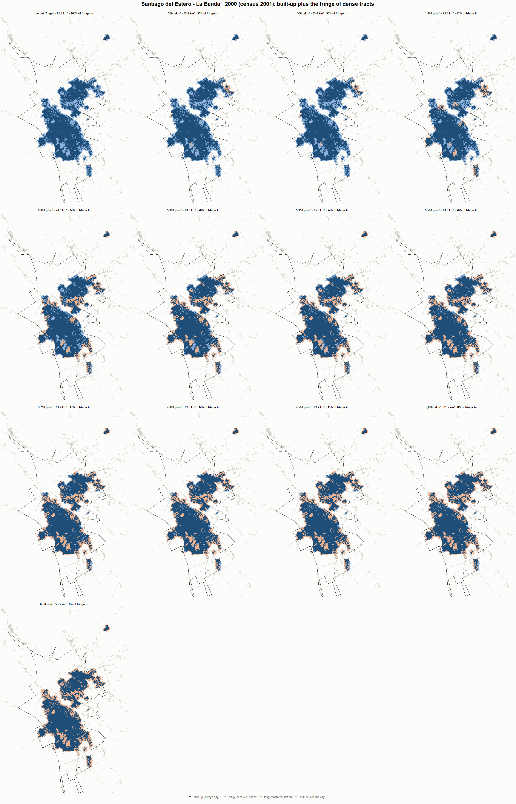
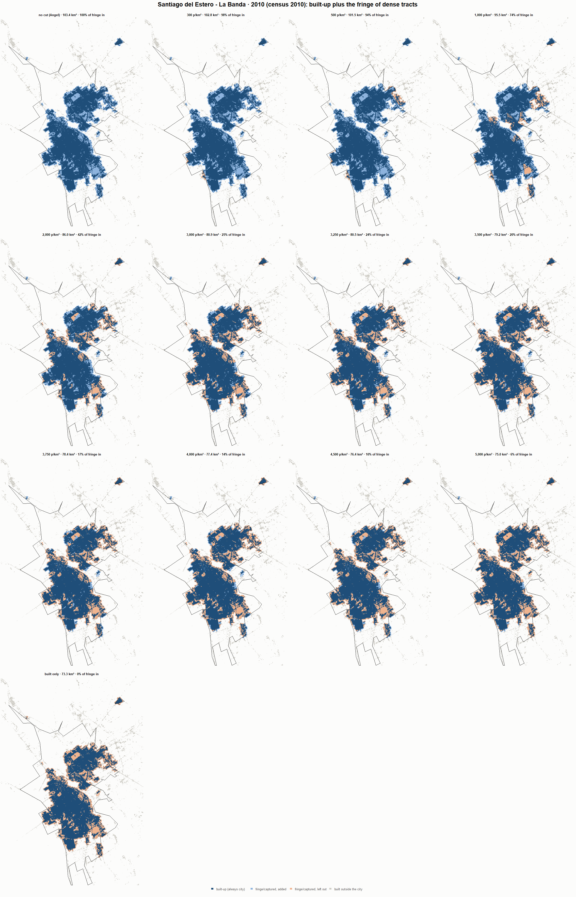

# Santiago del Estero - La Banda · when does the fringe count as city? 1990-2020

Exploratory test 2. None of these numbers are project figures (they are not in `CIFRAS_CANONICAS.json`). Generated by `Rpipe/scripts/13_prueba_franja.R` from the tract tables of step 11. Run of 2026-11-08. [All agglomerations](../REPORTE.md).

**Idea.** Built-up land is always city. Fringe and captured open space join the city **only in dense tracts**, where they are probably built and unseen by the older imagery. No cut gives the full Angel extent; an infinite cut, built-up only. Method in the [index](../REPORTE.md#method).

## Is the early imagery under-detecting?

If the older imagery misses buildings, persons per km² of *built* land should come out higher in the early years.

| Year | Persons (tracts with built land) | Built km² | Persons / km² built | Median tract, persons / km² built | Fringe + captured, % of extent |
|---|---|---|---|---|---|
| 1990 (census 1991) | 269,217 | 49.0 | 5,493 | 5,101 | 30.2 |
| 2000 (census 2001) | 334,708 | 59.3 | 5,640 | 5,271 | 30.1 |
| 2010 (census 2010) | 370,767 | 73.3 | 5,058 | 4,693 | 29.1 |
| 2020 (census 2022) | 456,280 | 98.2 | 4,644 | 4,616 | 28.9 |

## Results

**1990 (census 1991).** Built-up 49.0 km²; fringe + captured 21.2 km²; 270,247 persons in the city's tracts.

| Fringe added at | City km² | Fringe added km² | % of fringe added | Fringe % of city | Tracts adding fringe | Persons / km² city |
|---|---|---|---|---|---|---|
| no cut (Angel) | 70.2 | 21.2 | 100.0 | 30.2 | 188 | 3,848 |
| 300 p/km² | 69.0 | 20.0 | 94.2 | 29.0 | 184 | 3,917 |
| 500 p/km² | 67.7 | 18.7 | 88.1 | 27.6 | 182 | 3,992 |
| 1,000 p/km² | 64.7 | 15.7 | 73.9 | 24.2 | 175 | 4,178 |
| 2,000 p/km² | 57.9 | 8.9 | 41.8 | 15.3 | 156 | 4,669 |
| 3,000 p/km² | 53.2 | 4.2 | 19.8 | 7.9 | 131 | 5,079 |
| 3,250 p/km² | 52.6 | 3.6 | 17.0 | 6.9 | 126 | 5,136 |
| 3,500 p/km² | 52.0 | 3.0 | 14.2 | 5.8 | 122 | 5,194 |
| 3,750 p/km² | 51.8 | 2.8 | 13.0 | 5.3 | 119 | 5,221 |
| 4,000 p/km² | 51.3 | 2.3 | 11.0 | 4.5 | 113 | 5,265 |
| 4,500 p/km² | 51.1 | 2.1 | 9.7 | 4.0 | 107 | 5,292 |
| 5,000 p/km² | 50.8 | 1.7 | 8.2 | 3.4 | 92 | 5,324 |
| built only | 49.0 | 0.0 | 0.0 | 0.0 | 0 | 5,514 |

**2000 (census 2001).** Built-up 59.3 km²; fringe + captured 25.6 km²; 336,051 persons in the city's tracts.

| Fringe added at | City km² | Fringe added km² | % of fringe added | Fringe % of city | Tracts adding fringe | Persons / km² city |
|---|---|---|---|---|---|---|
| no cut (Angel) | 85.0 | 25.6 | 100.0 | 30.2 | 239 | 3,955 |
| 300 p/km² | 83.6 | 24.2 | 94.6 | 29.0 | 236 | 4,021 |
| 500 p/km² | 83.6 | 24.2 | 94.6 | 29.0 | 236 | 4,021 |
| 1,000 p/km² | 79.0 | 19.7 | 76.7 | 24.9 | 228 | 4,254 |
| 2,000 p/km² | 70.5 | 11.2 | 43.6 | 15.8 | 204 | 4,766 |
| 3,000 p/km² | 66.6 | 7.2 | 28.2 | 10.9 | 182 | 5,049 |
| 3,250 p/km² | 65.6 | 6.3 | 24.4 | 9.5 | 174 | 5,123 |
| 3,500 p/km² | 64.6 | 5.2 | 20.5 | 8.1 | 164 | 5,204 |
| 3,750 p/km² | 63.7 | 4.3 | 16.9 | 6.8 | 154 | 5,279 |
| 4,000 p/km² | 62.8 | 3.5 | 13.7 | 5.6 | 140 | 5,347 |
| 4,500 p/km² | 62.2 | 2.8 | 11.0 | 4.5 | 120 | 5,406 |
| 5,000 p/km² | 61.5 | 2.1 | 8.3 | 3.5 | 102 | 5,467 |
| built only | 59.3 | 0.0 | 0.0 | 0.0 | 0 | 5,663 |

**2010 (census 2010).** Built-up 73.3 km²; fringe + captured 30.1 km²; 371,593 persons in the city's tracts.

| Fringe added at | City km² | Fringe added km² | % of fringe added | Fringe % of city | Tracts adding fringe | Persons / km² city |
|---|---|---|---|---|---|---|
| no cut (Angel) | 103.4 | 30.1 | 100.0 | 29.1 | 245 | 3,594 |
| 300 p/km² | 102.8 | 29.5 | 98.1 | 28.7 | 242 | 3,614 |
| 500 p/km² | 101.5 | 28.2 | 93.7 | 27.8 | 241 | 3,661 |
| 1,000 p/km² | 95.5 | 22.2 | 73.8 | 23.3 | 232 | 3,890 |
| 2,000 p/km² | 86.0 | 12.7 | 42.1 | 14.7 | 206 | 4,323 |
| 3,000 p/km² | 80.9 | 7.6 | 25.2 | 9.4 | 175 | 4,593 |
| 3,250 p/km² | 80.5 | 7.1 | 23.8 | 8.9 | 170 | 4,619 |
| 3,500 p/km² | 79.2 | 5.9 | 19.5 | 7.4 | 153 | 4,693 |
| 3,750 p/km² | 78.4 | 5.1 | 17.0 | 6.5 | 142 | 4,739 |
| 4,000 p/km² | 77.4 | 4.1 | 13.7 | 5.3 | 124 | 4,799 |
| 4,500 p/km² | 76.4 | 3.1 | 10.2 | 4.0 | 104 | 4,866 |
| 5,000 p/km² | 75.0 | 1.7 | 5.7 | 2.3 | 84 | 4,954 |
| built only | 73.3 | 0.0 | 0.0 | 0.0 | 0 | 5,069 |

**2020 (census 2022).** Built-up 98.2 km²; fringe + captured 40.0 km²; 456,280 persons in the city's tracts.

| Fringe added at | City km² | Fringe added km² | % of fringe added | Fringe % of city | Tracts adding fringe | Persons / km² city |
|---|---|---|---|---|---|---|
| no cut (Angel) | 138.2 | 40.0 | 100.0 | 28.9 | 226 | 3,301 |
| 300 p/km² | 133.7 | 35.5 | 88.7 | 26.5 | 223 | 3,412 |
| 500 p/km² | 130.2 | 31.9 | 79.8 | 24.5 | 220 | 3,505 |
| 1,000 p/km² | 120.1 | 21.9 | 54.7 | 18.2 | 208 | 3,798 |
| 2,000 p/km² | 108.9 | 10.6 | 26.5 | 9.7 | 181 | 4,192 |
| 3,000 p/km² | 102.7 | 4.4 | 11.1 | 4.3 | 153 | 4,444 |
| 3,250 p/km² | 102.2 | 3.9 | 9.8 | 3.8 | 148 | 4,466 |
| 3,500 p/km² | 101.6 | 3.4 | 8.5 | 3.3 | 142 | 4,489 |
| 3,750 p/km² | 101.2 | 2.9 | 7.3 | 2.9 | 131 | 4,510 |
| 4,000 p/km² | 101.0 | 2.8 | 7.0 | 2.8 | 127 | 4,516 |
| 4,500 p/km² | 99.8 | 1.5 | 3.8 | 1.5 | 98 | 4,573 |
| 5,000 p/km² | 99.3 | 1.1 | 2.7 | 1.1 | 80 | 4,593 |
| built only | 98.2 | 0.0 | 0.0 | 0.0 | 0 | 4,644 |

### Growth by cut

| Fringe added at | 1990 km² | 2000 km² | 2010 km² | 2020 km² | 1990-2000 %/yr | 2000-2010 %/yr | 2010-2020 %/yr | 1990-2020 %/yr |
|---|---|---|---|---|---|---|---|---|
| no cut (Angel) | 70.2 | 85.0 | 103.4 | 138.2 | 1.92 | 1.98 | 2.95 | 2.28 |
| 300 p/km² | 69.0 | 83.6 | 102.8 | 133.7 | 1.94 | 2.10 | 2.66 | 2.23 |
| 500 p/km² | 67.7 | 83.6 | 101.5 | 130.2 | 2.13 | 1.96 | 2.52 | 2.20 |
| 1,000 p/km² | 64.7 | 79.0 | 95.5 | 120.1 | 2.02 | 1.92 | 2.32 | 2.09 |
| 2,000 p/km² | 57.9 | 70.5 | 86.0 | 108.9 | 1.99 | 2.00 | 2.39 | 2.13 |
| 3,000 p/km² | 53.2 | 66.6 | 80.9 | 102.7 | 2.26 | 1.97 | 2.41 | 2.22 |
| 3,250 p/km² | 52.6 | 65.6 | 80.5 | 102.2 | 2.23 | 2.06 | 2.42 | 2.24 |
| 3,500 p/km² | 52.0 | 64.6 | 79.2 | 101.6 | 2.19 | 2.06 | 2.53 | 2.26 |
| 3,750 p/km² | 51.8 | 63.7 | 78.4 | 101.2 | 2.09 | 2.11 | 2.58 | 2.26 |
| 4,000 p/km² | 51.3 | 62.8 | 77.4 | 101.0 | 2.04 | 2.11 | 2.70 | 2.28 |
| 4,500 p/km² | 51.1 | 62.2 | 76.4 | 99.8 | 1.99 | 2.08 | 2.71 | 2.26 |
| 5,000 p/km² | 50.8 | 61.5 | 75.0 | 99.3 | 1.93 | 2.01 | 2.85 | 2.26 |
| built only | 49.0 | 59.3 | 73.3 | 98.2 | 1.93 | 2.14 | 2.97 | 2.35 |

## Maps

Same frame in the four years: the 2020 city plus 3 km. Dark blue is built-up, always city; light blue is fringe or captured land added because its tract is dense; light orange is fringe left out. Black line: the analysis perimeter.

### 1990

### 2000

### 2010

### 2020

## Reading

- **The premise.** Persons per km² of built land: 5,493 in 1990, 5,640 in 2000, 5,058 in 2010, 4,644 in 2020. 1990 is not clearly higher than 2010: the census does not point to much built land missed in 1990.
- **At 500 p/km²** the fringe that joins the city is 88.1 % of all fringe in 1990 and 79.8 % in 2020.
- **Growth 1990-2020**: 2.28 %/yr with the full Angel extent, 2.20 %/yr at 500, 2.35 %/yr built-up only.

