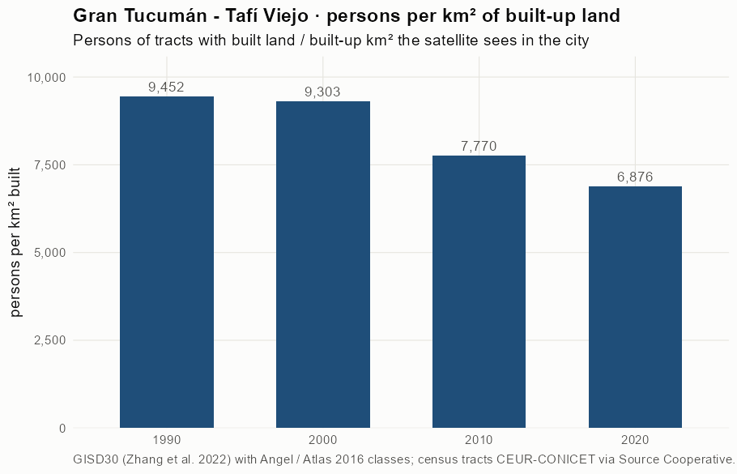
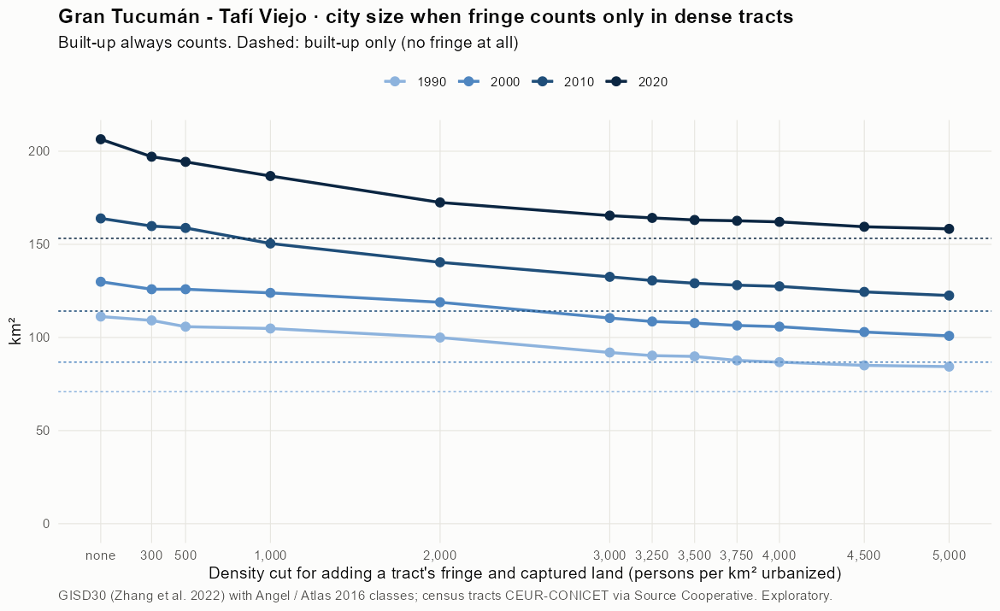
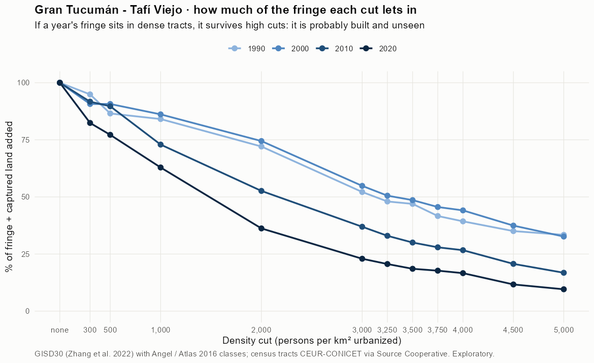
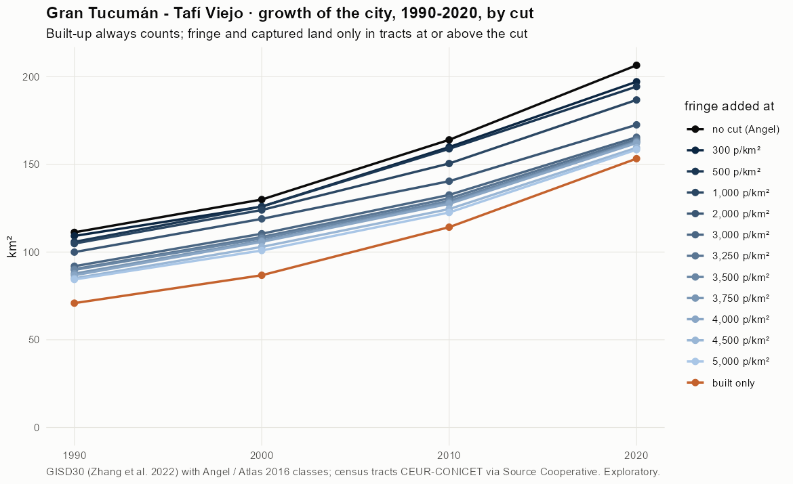
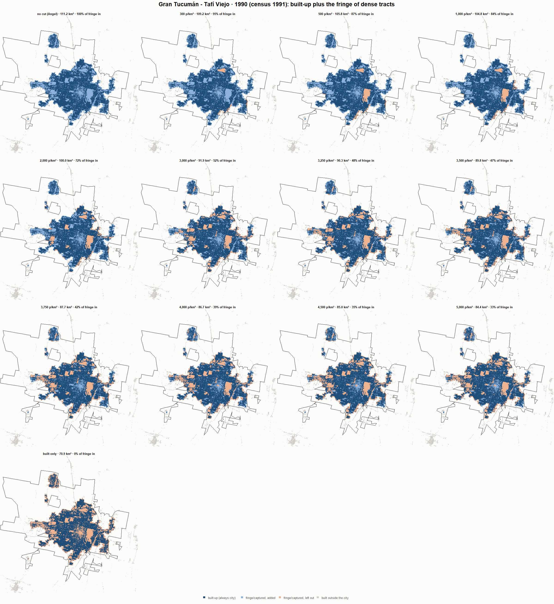
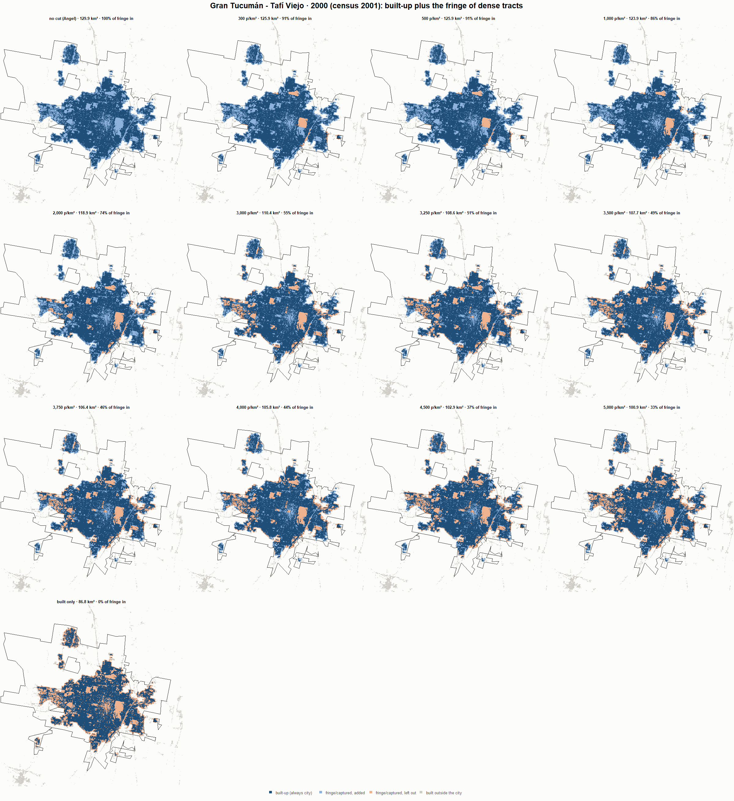
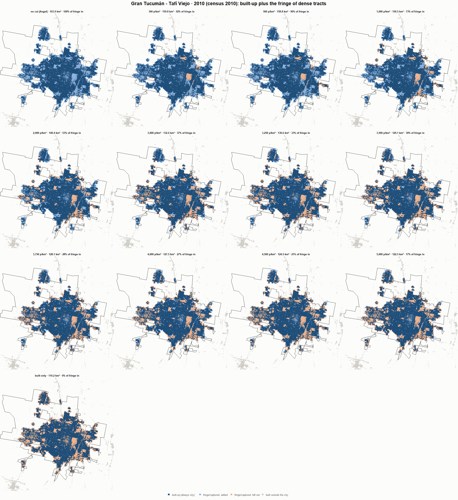
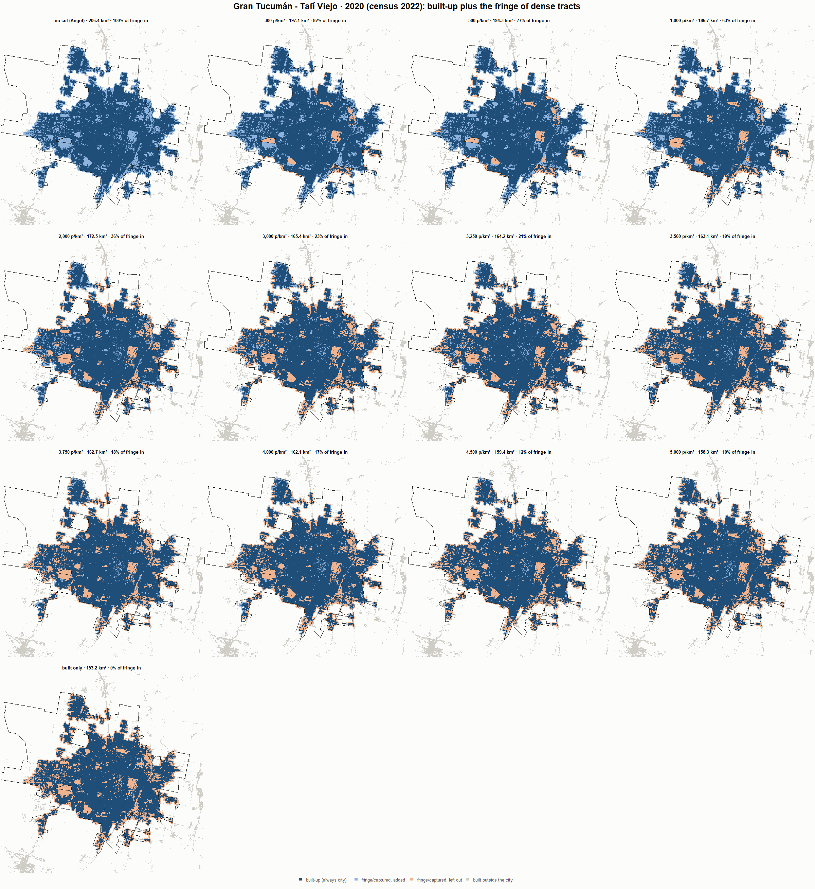

# Gran Tucumán - Tafí Viejo · when does the fringe count as city? 1990-2020

Exploratory test 2. None of these numbers are project figures (they are not in `CIFRAS_CANONICAS.json`). Generated by `Rpipe/scripts/13_prueba_franja.R` from the tract tables of step 11. Run of 2026-11-08. [All agglomerations](../REPORTE.md).

**Idea.** Built-up land is always city. Fringe and captured open space join the city **only in dense tracts**, where they are probably built and unseen by the older imagery. No cut gives the full Angel extent; an infinite cut, built-up only. Method in the [index](../REPORTE.md#method).

## Is the early imagery under-detecting?

If the older imagery misses buildings, persons per km² of *built* land should come out higher in the early years.

| Year | Persons (tracts with built land) | Built km² | Persons / km² built | Median tract, persons / km² built | Fringe + captured, % of extent |
|---|---|---|---|---|---|
| 1990 (census 1991) | 669,930 | 70.9 | 9,452 | 8,991 | 36.2 |
| 2000 (census 2001) | 807,174 | 86.8 | 9,303 | 8,753 | 33.2 |
| 2010 (census 2010) | 887,095 | 114.2 | 7,770 | 7,608 | 30.2 |
| 2020 (census 2022) | 1,053,616 | 153.2 | 6,876 | 6,635 | 25.7 |

## Results

**1990 (census 1991).** Built-up 70.9 km²; fringe + captured 40.3 km²; 675,473 persons in the city's tracts.

| Fringe added at | City km² | Fringe added km² | % of fringe added | Fringe % of city | Tracts adding fringe | Persons / km² city |
|---|---|---|---|---|---|---|
| no cut (Angel) | 111.2 | 40.3 | 100.0 | 36.3 | 568 | 6,073 |
| 300 p/km² | 109.2 | 38.3 | 94.9 | 35.1 | 565 | 6,188 |
| 500 p/km² | 105.8 | 34.9 | 86.5 | 33.0 | 561 | 6,385 |
| 1,000 p/km² | 104.8 | 33.9 | 84.1 | 32.4 | 559 | 6,445 |
| 2,000 p/km² | 100.0 | 29.1 | 72.1 | 29.1 | 548 | 6,757 |
| 3,000 p/km² | 91.9 | 21.0 | 52.2 | 22.9 | 518 | 7,348 |
| 3,250 p/km² | 90.3 | 19.4 | 48.0 | 21.5 | 512 | 7,484 |
| 3,500 p/km² | 89.8 | 18.9 | 47.0 | 21.1 | 510 | 7,520 |
| 3,750 p/km² | 87.7 | 16.8 | 41.6 | 19.2 | 496 | 7,704 |
| 4,000 p/km² | 86.7 | 15.9 | 39.3 | 18.3 | 489 | 7,787 |
| 4,500 p/km² | 85.0 | 14.1 | 35.0 | 16.6 | 470 | 7,945 |
| 5,000 p/km² | 84.4 | 13.5 | 33.4 | 16.0 | 460 | 8,008 |
| built only | 70.9 | 0.0 | 0.0 | 0.0 | 0 | 9,530 |

**2000 (census 2001).** Built-up 86.8 km²; fringe + captured 43.2 km²; 811,029 persons in the city's tracts.

| Fringe added at | City km² | Fringe added km² | % of fringe added | Fringe % of city | Tracts adding fringe | Persons / km² city |
|---|---|---|---|---|---|---|
| no cut (Angel) | 129.9 | 43.2 | 100.0 | 33.2 | 708 | 6,243 |
| 300 p/km² | 125.9 | 39.1 | 90.7 | 31.1 | 701 | 6,442 |
| 500 p/km² | 125.9 | 39.1 | 90.7 | 31.1 | 701 | 6,442 |
| 1,000 p/km² | 123.9 | 37.2 | 86.2 | 30.0 | 697 | 6,544 |
| 2,000 p/km² | 118.9 | 32.1 | 74.5 | 27.0 | 683 | 6,821 |
| 3,000 p/km² | 110.4 | 23.7 | 54.8 | 21.4 | 650 | 7,344 |
| 3,250 p/km² | 108.6 | 21.8 | 50.6 | 20.1 | 640 | 7,469 |
| 3,500 p/km² | 107.7 | 21.0 | 48.6 | 19.5 | 633 | 7,528 |
| 3,750 p/km² | 106.4 | 19.7 | 45.6 | 18.5 | 624 | 7,620 |
| 4,000 p/km² | 105.8 | 19.0 | 44.1 | 18.0 | 619 | 7,666 |
| 4,500 p/km² | 102.9 | 16.2 | 37.4 | 15.7 | 589 | 7,880 |
| 5,000 p/km² | 100.9 | 14.1 | 32.7 | 14.0 | 565 | 8,041 |
| built only | 86.8 | 0.0 | 0.0 | 0.0 | 0 | 9,347 |

**2010 (census 2010).** Built-up 114.2 km²; fringe + captured 49.8 km²; 889,861 persons in the city's tracts.

| Fringe added at | City km² | Fringe added km² | % of fringe added | Fringe % of city | Tracts adding fringe | Persons / km² city |
|---|---|---|---|---|---|---|
| no cut (Angel) | 163.9 | 49.8 | 100.0 | 30.4 | 685 | 5,428 |
| 300 p/km² | 159.8 | 45.6 | 91.7 | 28.6 | 677 | 5,568 |
| 500 p/km² | 158.8 | 44.6 | 89.7 | 28.1 | 676 | 5,604 |
| 1,000 p/km² | 150.5 | 36.3 | 72.9 | 24.1 | 666 | 5,914 |
| 2,000 p/km² | 140.4 | 26.2 | 52.6 | 18.7 | 638 | 6,340 |
| 3,000 p/km² | 132.6 | 18.4 | 36.9 | 13.9 | 596 | 6,713 |
| 3,250 p/km² | 130.6 | 16.4 | 33.0 | 12.6 | 586 | 6,814 |
| 3,500 p/km² | 129.1 | 14.9 | 30.0 | 11.6 | 575 | 6,892 |
| 3,750 p/km² | 128.1 | 13.9 | 27.9 | 10.9 | 566 | 6,948 |
| 4,000 p/km² | 127.5 | 13.3 | 26.7 | 10.4 | 558 | 6,982 |
| 4,500 p/km² | 124.5 | 10.3 | 20.7 | 8.3 | 523 | 7,149 |
| 5,000 p/km² | 122.5 | 8.4 | 16.8 | 6.8 | 490 | 7,262 |
| built only | 114.2 | 0.0 | 0.0 | 0.0 | 0 | 7,794 |

**2020 (census 2022).** Built-up 153.2 km²; fringe + captured 53.2 km²; 1,054,805 persons in the city's tracts.

| Fringe added at | City km² | Fringe added km² | % of fringe added | Fringe % of city | Tracts adding fringe | Persons / km² city |
|---|---|---|---|---|---|---|
| no cut (Angel) | 206.4 | 53.2 | 100.0 | 25.8 | 743 | 5,110 |
| 300 p/km² | 197.1 | 43.8 | 82.4 | 22.2 | 731 | 5,353 |
| 500 p/km² | 194.3 | 41.1 | 77.2 | 21.1 | 722 | 5,429 |
| 1,000 p/km² | 186.7 | 33.5 | 62.9 | 17.9 | 704 | 5,650 |
| 2,000 p/km² | 172.5 | 19.3 | 36.2 | 11.2 | 648 | 6,115 |
| 3,000 p/km² | 165.4 | 12.2 | 22.9 | 7.4 | 587 | 6,376 |
| 3,250 p/km² | 164.2 | 11.0 | 20.6 | 6.7 | 573 | 6,424 |
| 3,500 p/km² | 163.1 | 9.9 | 18.5 | 6.0 | 558 | 6,468 |
| 3,750 p/km² | 162.7 | 9.4 | 17.7 | 5.8 | 546 | 6,485 |
| 4,000 p/km² | 162.1 | 8.8 | 16.6 | 5.5 | 532 | 6,508 |
| 4,500 p/km² | 159.4 | 6.2 | 11.7 | 3.9 | 483 | 6,616 |
| 5,000 p/km² | 158.3 | 5.1 | 9.6 | 3.2 | 455 | 6,663 |
| built only | 153.2 | 0.0 | 0.0 | 0.0 | 0 | 6,884 |

### Growth by cut

| Fringe added at | 1990 km² | 2000 km² | 2010 km² | 2020 km² | 1990-2000 %/yr | 2000-2010 %/yr | 2010-2020 %/yr | 1990-2020 %/yr |
|---|---|---|---|---|---|---|---|---|
| no cut (Angel) | 111.2 | 129.9 | 163.9 | 206.4 | 1.57 | 2.35 | 2.33 | 2.08 |
| 300 p/km² | 109.2 | 125.9 | 159.8 | 197.1 | 1.44 | 2.41 | 2.12 | 1.99 |
| 500 p/km² | 105.8 | 125.9 | 158.8 | 194.3 | 1.75 | 2.35 | 2.04 | 2.05 |
| 1,000 p/km² | 104.8 | 123.9 | 150.5 | 186.7 | 1.69 | 1.96 | 2.18 | 1.94 |
| 2,000 p/km² | 100.0 | 118.9 | 140.4 | 172.5 | 1.75 | 1.67 | 2.08 | 1.84 |
| 3,000 p/km² | 91.9 | 110.4 | 132.6 | 165.4 | 1.85 | 1.84 | 2.24 | 1.98 |
| 3,250 p/km² | 90.3 | 108.6 | 130.6 | 164.2 | 1.87 | 1.86 | 2.32 | 2.01 |
| 3,500 p/km² | 89.8 | 107.7 | 129.1 | 163.1 | 1.84 | 1.83 | 2.36 | 2.01 |
| 3,750 p/km² | 87.7 | 106.4 | 128.1 | 162.7 | 1.96 | 1.87 | 2.42 | 2.08 |
| 4,000 p/km² | 86.7 | 105.8 | 127.5 | 162.1 | 2.01 | 1.88 | 2.43 | 2.11 |
| 4,500 p/km² | 85.0 | 102.9 | 124.5 | 159.4 | 1.93 | 1.92 | 2.51 | 2.12 |
| 5,000 p/km² | 84.4 | 100.9 | 122.5 | 158.3 | 1.80 | 1.97 | 2.60 | 2.12 |
| built only | 70.9 | 86.8 | 114.2 | 153.2 | 2.04 | 2.78 | 2.99 | 2.60 |

## Maps

Same frame in the four years: the 2020 city plus 3 km. Dark blue is built-up, always city; light blue is fringe or captured land added because its tract is dense; light orange is fringe left out. Black line: the analysis perimeter.

### 1990

### 2000

### 2010

### 2020

## Reading

- **The premise.** Persons per km² of built land: 9,452 in 1990, 9,303 in 2000, 7,770 in 2010, 6,876 in 2020. 1990 is clearly higher than 2010: consistent with built land missed in 1990, though it also fits a denser city that later spread out.
- **At 500 p/km²** the fringe that joins the city is 86.5 % of all fringe in 1990 and 77.2 % in 2020.
- **Growth 1990-2020**: 2.08 %/yr with the full Angel extent, 2.05 %/yr at 500, 2.60 %/yr built-up only.

