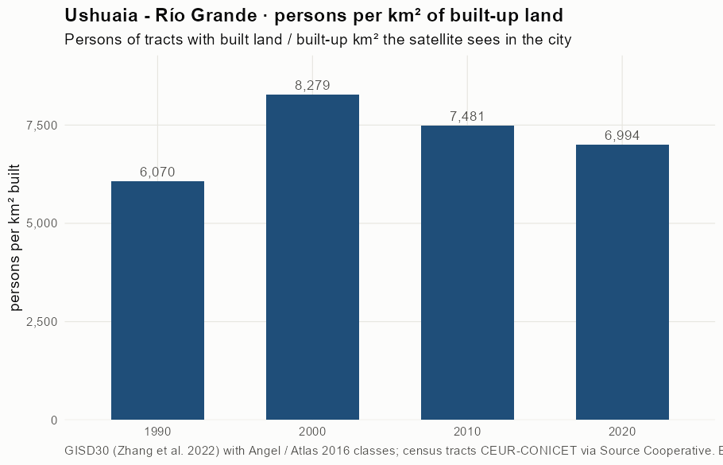
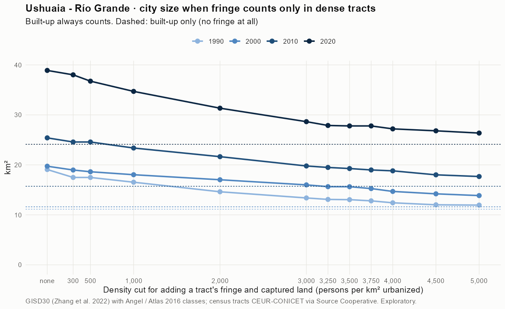
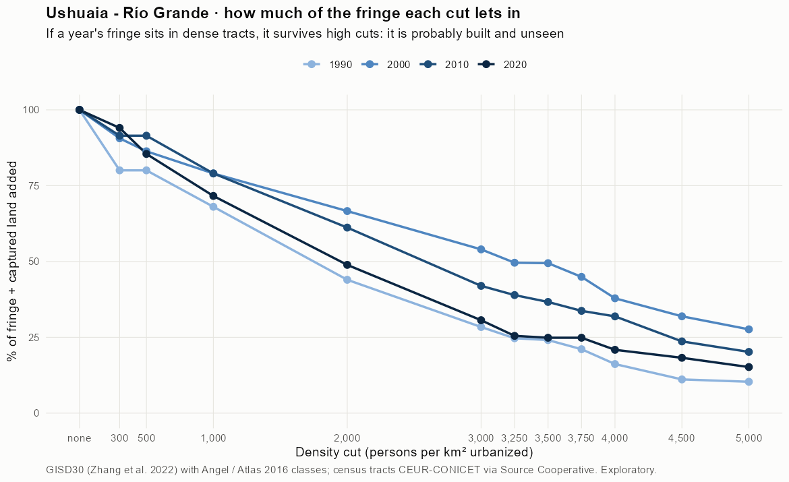
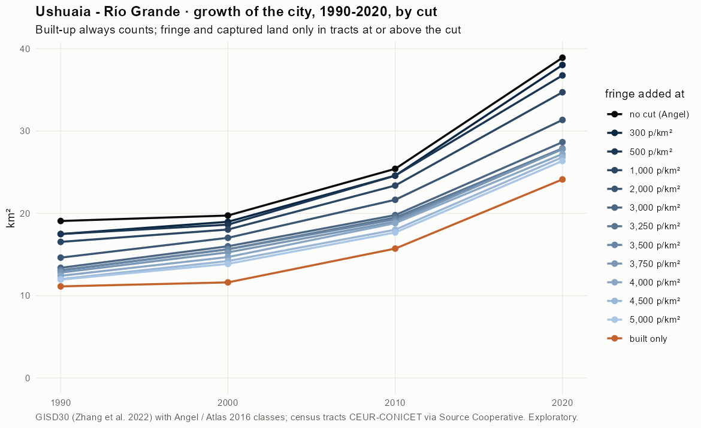
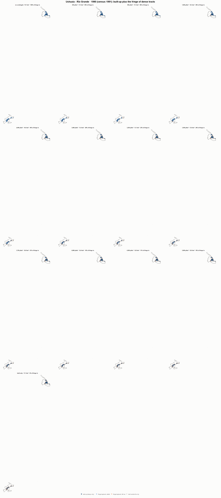
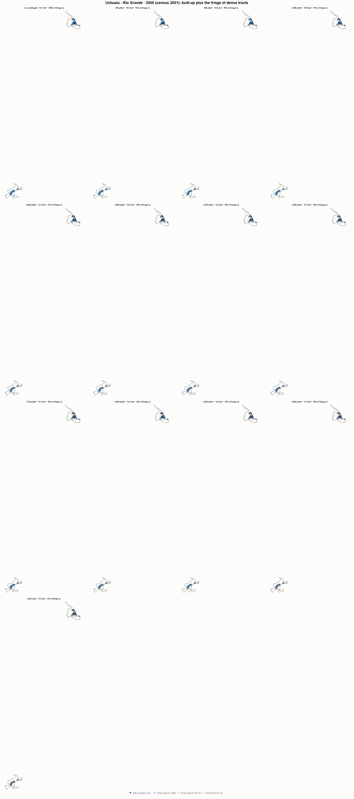
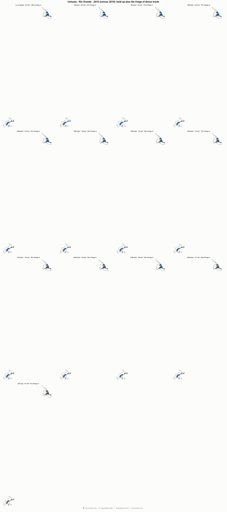
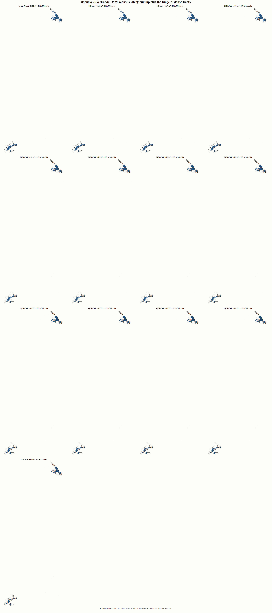

# Ushuaia - Río Grande · when does the fringe count as city? 1990-2020

Exploratory test 2. None of these numbers are project figures (they are not in `CIFRAS_CANONICAS.json`). Generated by `Rpipe/scripts/13_prueba_franja.R` from the tract tables of step 11. Run of 2026-11-08. [All agglomerations](../REPORTE.md).

**Idea.** Built-up land is always city. Fringe and captured open space join the city **only in dense tracts**, where they are probably built and unseen by the older imagery. No cut gives the full Angel extent; an infinite cut, built-up only. Method in the [index](../REPORTE.md#method).

## Is the early imagery under-detecting?

If the older imagery misses buildings, persons per km² of *built* land should come out higher in the early years.

| Year | Persons (tracts with built land) | Built km² | Persons / km² built | Median tract, persons / km² built | Fringe + captured, % of extent |
|---|---|---|---|---|---|
| 1990 (census 1991) | 67,545 | 11.1 | 6,070 | 4,967 | 41.6 |
| 2000 (census 2001) | 96,156 | 11.6 | 8,279 | 7,253 | 41.1 |
| 2010 (census 2010) | 117,583 | 15.7 | 7,481 | 6,766 | 38.1 |
| 2020 (census 2022) | 168,670 | 24.1 | 6,994 | 6,674 | 38.0 |

## Results

**1990 (census 1991).** Built-up 11.1 km²; fringe + captured 7.9 km²; 67,545 persons in the city's tracts.

| Fringe added at | City km² | Fringe added km² | % of fringe added | Fringe % of city | Tracts adding fringe | Persons / km² city |
|---|---|---|---|---|---|---|
| no cut (Angel) | 19.1 | 7.9 | 100.0 | 41.6 | 92 | 3,542 |
| 300 p/km² | 17.5 | 6.4 | 80.1 | 36.4 | 88 | 3,863 |
| 500 p/km² | 17.5 | 6.4 | 80.1 | 36.4 | 88 | 3,863 |
| 1,000 p/km² | 16.5 | 5.4 | 68.0 | 32.7 | 84 | 4,086 |
| 2,000 p/km² | 14.6 | 3.5 | 44.0 | 23.9 | 73 | 4,620 |
| 3,000 p/km² | 13.4 | 2.3 | 28.4 | 16.9 | 58 | 5,047 |
| 3,250 p/km² | 13.1 | 2.0 | 24.7 | 15.0 | 55 | 5,160 |
| 3,500 p/km² | 13.0 | 1.9 | 24.1 | 14.7 | 54 | 5,179 |
| 3,750 p/km² | 12.8 | 1.7 | 21.1 | 13.1 | 52 | 5,276 |
| 4,000 p/km² | 12.4 | 1.3 | 16.2 | 10.4 | 47 | 5,441 |
| 4,500 p/km² | 12.0 | 0.9 | 11.1 | 7.4 | 41 | 5,623 |
| 5,000 p/km² | 12.0 | 0.8 | 10.3 | 6.9 | 39 | 5,652 |
| built only | 11.1 | 0.0 | 0.0 | 0.0 | 0 | 6,070 |

**2000 (census 2001).** Built-up 11.6 km²; fringe + captured 8.1 km²; 97,985 persons in the city's tracts.

| Fringe added at | City km² | Fringe added km² | % of fringe added | Fringe % of city | Tracts adding fringe | Persons / km² city |
|---|---|---|---|---|---|---|
| no cut (Angel) | 19.7 | 8.1 | 100.0 | 41.1 | 120 | 4,965 |
| 300 p/km² | 19.0 | 7.4 | 90.6 | 38.8 | 118 | 5,165 |
| 500 p/km² | 18.6 | 7.0 | 86.3 | 37.6 | 117 | 5,261 |
| 1,000 p/km² | 18.0 | 6.4 | 79.0 | 35.6 | 113 | 5,434 |
| 2,000 p/km² | 17.0 | 5.4 | 66.6 | 31.8 | 107 | 5,756 |
| 3,000 p/km² | 16.0 | 4.4 | 54.0 | 27.4 | 98 | 6,125 |
| 3,250 p/km² | 15.6 | 4.0 | 49.6 | 25.7 | 94 | 6,265 |
| 3,500 p/km² | 15.6 | 4.0 | 49.5 | 25.7 | 93 | 6,269 |
| 3,750 p/km² | 15.3 | 3.6 | 44.9 | 23.9 | 90 | 6,420 |
| 4,000 p/km² | 14.7 | 3.1 | 37.9 | 20.9 | 84 | 6,671 |
| 4,500 p/km² | 14.2 | 2.6 | 31.9 | 18.2 | 76 | 6,897 |
| 5,000 p/km² | 13.9 | 2.2 | 27.6 | 16.2 | 72 | 7,071 |
| built only | 11.6 | 0.0 | 0.0 | 0.0 | 0 | 8,436 |

**2010 (census 2010).** Built-up 15.7 km²; fringe + captured 9.7 km²; 118,554 persons in the city's tracts.

| Fringe added at | City km² | Fringe added km² | % of fringe added | Fringe % of city | Tracts adding fringe | Persons / km² city |
|---|---|---|---|---|---|---|
| no cut (Angel) | 25.4 | 9.7 | 100.0 | 38.1 | 123 | 4,667 |
| 300 p/km² | 24.6 | 8.9 | 91.5 | 36.1 | 121 | 4,824 |
| 500 p/km² | 24.6 | 8.9 | 91.5 | 36.1 | 121 | 4,824 |
| 1,000 p/km² | 23.4 | 7.7 | 79.0 | 32.8 | 118 | 5,072 |
| 2,000 p/km² | 21.6 | 5.9 | 61.2 | 27.4 | 109 | 5,478 |
| 3,000 p/km² | 19.8 | 4.1 | 42.0 | 20.6 | 99 | 5,993 |
| 3,250 p/km² | 19.5 | 3.8 | 38.9 | 19.3 | 97 | 6,084 |
| 3,500 p/km² | 19.3 | 3.6 | 36.7 | 18.4 | 94 | 6,153 |
| 3,750 p/km² | 19.0 | 3.3 | 33.7 | 17.2 | 91 | 6,245 |
| 4,000 p/km² | 18.8 | 3.1 | 31.9 | 16.4 | 89 | 6,304 |
| 4,500 p/km² | 18.0 | 2.3 | 23.7 | 12.7 | 81 | 6,583 |
| 5,000 p/km² | 17.7 | 2.0 | 20.2 | 11.1 | 77 | 6,708 |
| built only | 15.7 | 0.0 | 0.0 | 0.0 | 0 | 7,543 |

**2020 (census 2022).** Built-up 24.1 km²; fringe + captured 14.8 km²; 171,360 persons in the city's tracts.

| Fringe added at | City km² | Fringe added km² | % of fringe added | Fringe % of city | Tracts adding fringe | Persons / km² city |
|---|---|---|---|---|---|---|
| no cut (Angel) | 38.9 | 14.8 | 100.0 | 38.0 | 170 | 4,406 |
| 300 p/km² | 38.0 | 13.9 | 94.0 | 36.6 | 169 | 4,508 |
| 500 p/km² | 36.7 | 12.6 | 85.5 | 34.4 | 167 | 4,663 |
| 1,000 p/km² | 34.7 | 10.6 | 71.6 | 30.5 | 163 | 4,938 |
| 2,000 p/km² | 31.3 | 7.2 | 48.9 | 23.1 | 149 | 5,467 |
| 3,000 p/km² | 28.6 | 4.5 | 30.6 | 15.8 | 130 | 5,982 |
| 3,250 p/km² | 27.9 | 3.8 | 25.5 | 13.5 | 125 | 6,146 |
| 3,500 p/km² | 27.8 | 3.7 | 24.9 | 13.2 | 124 | 6,166 |
| 3,750 p/km² | 27.8 | 3.7 | 24.9 | 13.2 | 124 | 6,166 |
| 4,000 p/km² | 27.2 | 3.1 | 20.9 | 11.3 | 117 | 6,299 |
| 4,500 p/km² | 26.8 | 2.7 | 18.2 | 10.1 | 112 | 6,391 |
| 5,000 p/km² | 26.4 | 2.2 | 15.2 | 8.5 | 105 | 6,500 |
| built only | 24.1 | 0.0 | 0.0 | 0.0 | 0 | 7,105 |

### Growth by cut

| Fringe added at | 1990 km² | 2000 km² | 2010 km² | 2020 km² | 1990-2000 %/yr | 2000-2010 %/yr | 2010-2020 %/yr | 1990-2020 %/yr |
|---|---|---|---|---|---|---|---|---|
| no cut (Angel) | 19.1 | 19.7 | 25.4 | 38.9 | 0.34 | 2.56 | 4.35 | 2.40 |
| 300 p/km² | 17.5 | 19.0 | 24.6 | 38.0 | 0.82 | 2.62 | 4.46 | 2.62 |
| 500 p/km² | 17.5 | 18.6 | 24.6 | 36.7 | 0.63 | 2.81 | 4.10 | 2.51 |
| 1,000 p/km² | 16.5 | 18.0 | 23.4 | 34.7 | 0.87 | 2.63 | 4.03 | 2.50 |
| 2,000 p/km² | 14.6 | 17.0 | 21.6 | 31.3 | 1.53 | 2.43 | 3.77 | 2.57 |
| 3,000 p/km² | 13.4 | 16.0 | 19.8 | 28.6 | 1.80 | 2.15 | 3.77 | 2.57 |
| 3,250 p/km² | 13.1 | 15.6 | 19.5 | 27.9 | 1.80 | 2.22 | 3.65 | 2.55 |
| 3,500 p/km² | 13.0 | 15.6 | 19.3 | 27.8 | 1.83 | 2.12 | 3.73 | 2.55 |
| 3,750 p/km² | 12.8 | 15.3 | 19.0 | 27.8 | 1.77 | 2.21 | 3.88 | 2.62 |
| 4,000 p/km² | 12.4 | 14.7 | 18.8 | 27.2 | 1.70 | 2.50 | 3.76 | 2.65 |
| 4,500 p/km² | 12.0 | 14.2 | 18.0 | 26.8 | 1.69 | 2.40 | 4.06 | 2.71 |
| 5,000 p/km² | 12.0 | 13.9 | 17.7 | 26.4 | 1.49 | 2.46 | 4.08 | 2.67 |
| built only | 11.1 | 11.6 | 15.7 | 24.1 | 0.43 | 3.07 | 4.38 | 2.61 |

## Maps

Same frame in the four years: the 2020 city plus 3 km. Dark blue is built-up, always city; light blue is fringe or captured land added because its tract is dense; light orange is fringe left out. Black line: the analysis perimeter.

### 1990

### 2000

### 2010

### 2020

## Reading

- **The premise.** Persons per km² of built land: 6,070 in 1990, 8,279 in 2000, 7,481 in 2010, 6,994 in 2020. 1990 is not clearly higher than 2010: the census does not point to much built land missed in 1990.
- **At 500 p/km²** the fringe that joins the city is 80.1 % of all fringe in 1990 and 85.5 % in 2020.
- **Growth 1990-2020**: 2.40 %/yr with the full Angel extent, 2.51 %/yr at 500, 2.61 %/yr built-up only.

