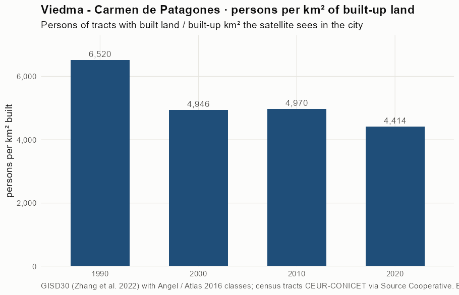
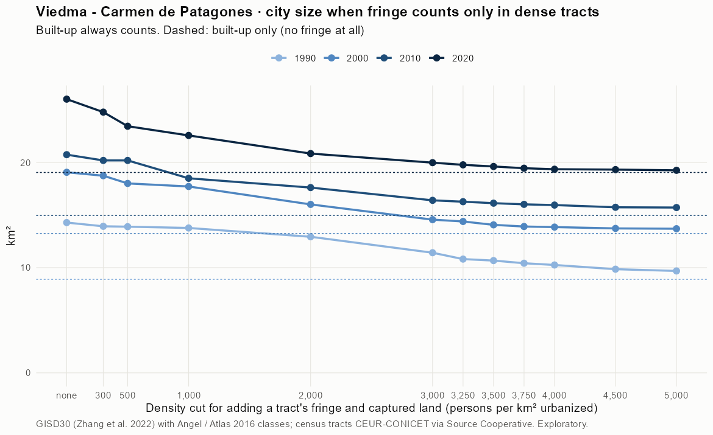
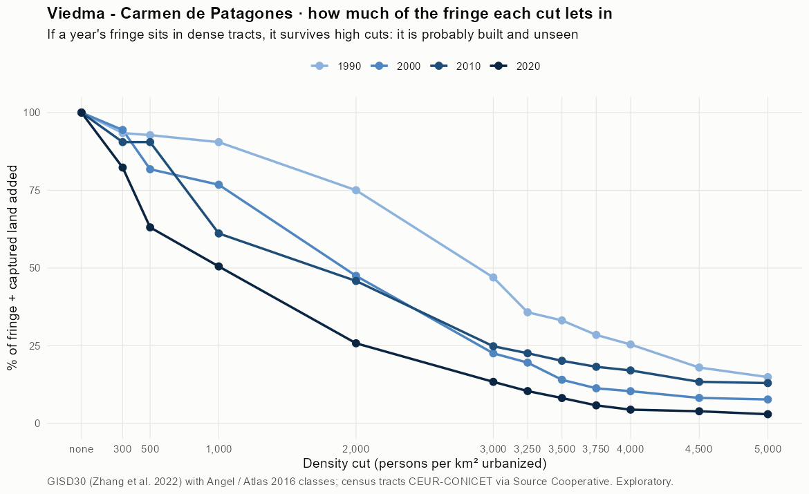
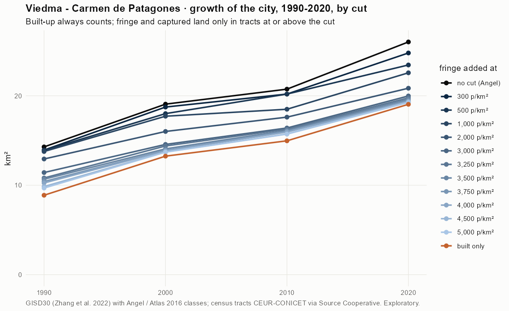
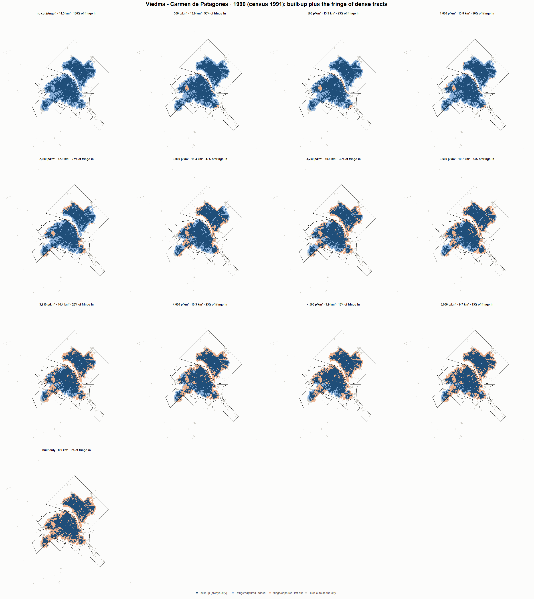
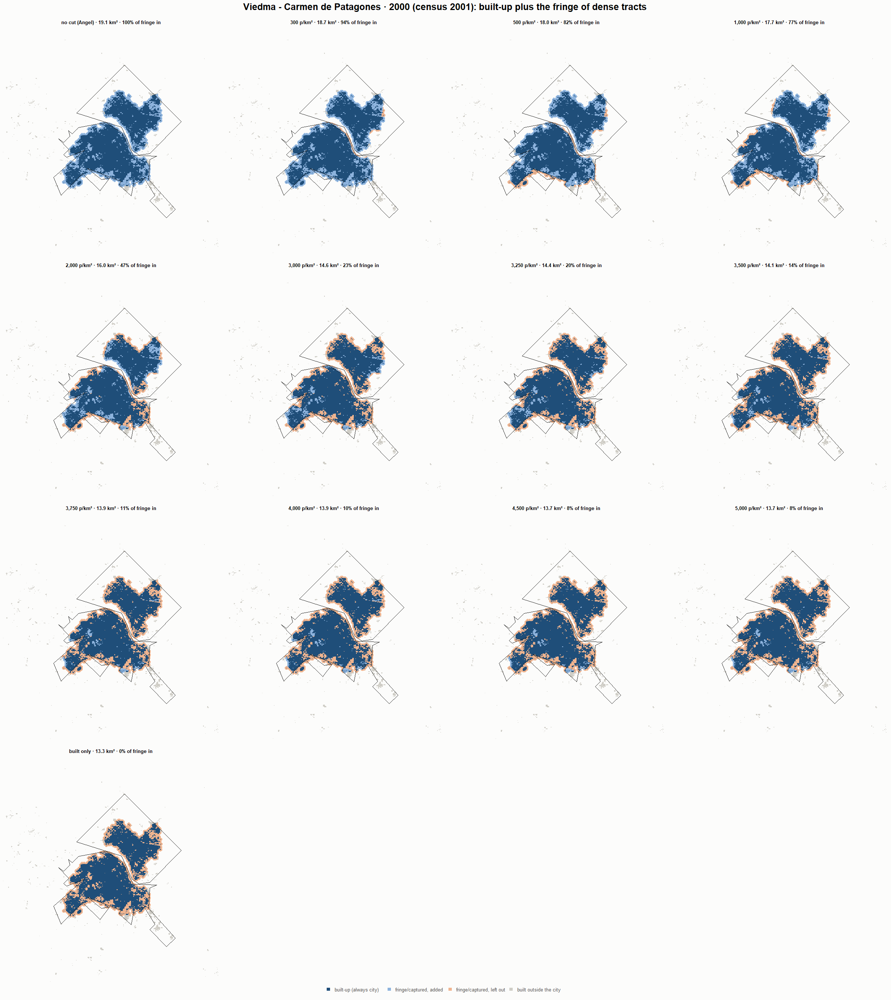
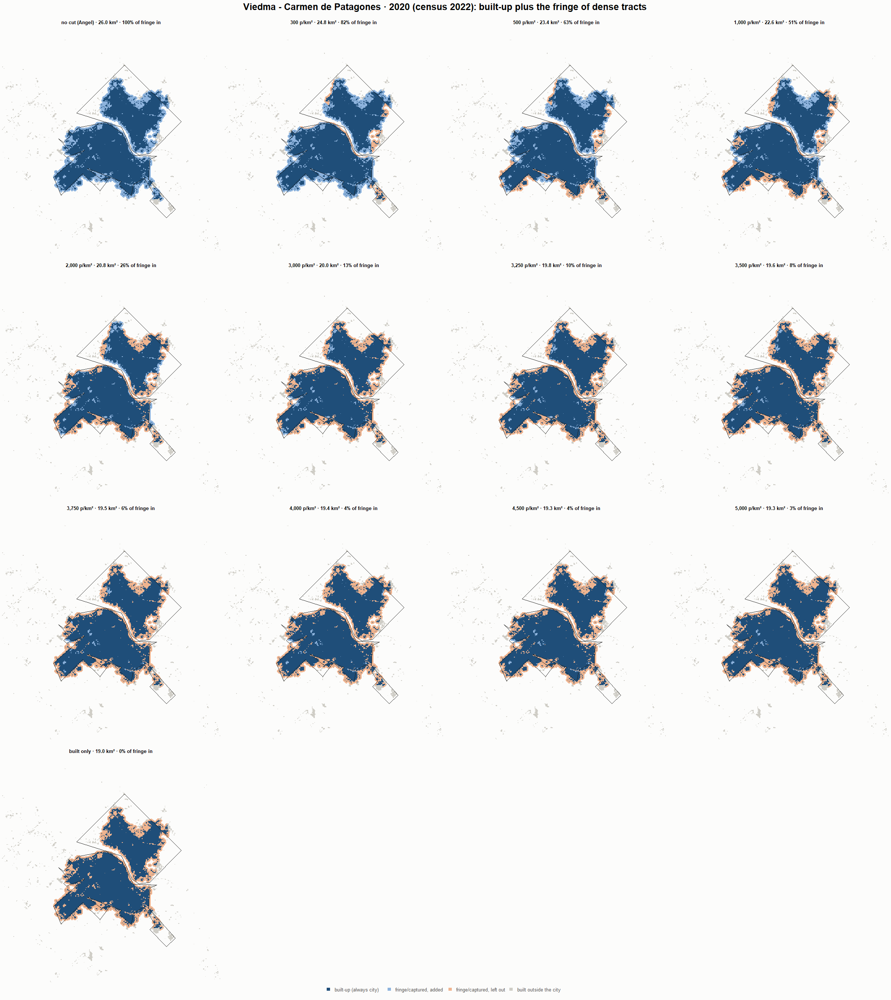

# Viedma - Carmen de Patagones · when does the fringe count as city? 1990-2020

Exploratory test 2. None of these numbers are project figures (they are not in `CIFRAS_CANONICAS.json`). Generated by `Rpipe/scripts/13_prueba_franja.R` from the tract tables of step 11. Run of 2026-11-08. [All agglomerations](../REPORTE.md).

**Idea.** Built-up land is always city. Fringe and captured open space join the city **only in dense tracts**, where they are probably built and unseen by the older imagery. No cut gives the full Angel extent; an infinite cut, built-up only. Method in the [index](../REPORTE.md#method).

## Is the early imagery under-detecting?

If the older imagery misses buildings, persons per km² of *built* land should come out higher in the early years.

| Year | Persons (tracts with built land) | Built km² | Persons / km² built | Median tract, persons / km² built | Fringe + captured, % of extent |
|---|---|---|---|---|---|
| 1990 (census 1991) | 57,910 | 8.9 | 6,520 | 5,267 | 37.0 |
| 2000 (census 2001) | 65,552 | 13.3 | 4,946 | 4,113 | 30.5 |
| 2010 (census 2010) | 74,386 | 15.0 | 4,970 | 4,098 | 27.8 |
| 2020 (census 2022) | 84,082 | 19.0 | 4,414 | 3,873 | 26.8 |

## Results

**1990 (census 1991).** Built-up 8.9 km²; fringe + captured 5.4 km²; 57,957 persons in the city's tracts.

| Fringe added at | City km² | Fringe added km² | % of fringe added | Fringe % of city | Tracts adding fringe | Persons / km² city |
|---|---|---|---|---|---|---|
| no cut (Angel) | 14.3 | 5.4 | 100.0 | 37.8 | 60 | 4,057 |
| 300 p/km² | 13.9 | 5.0 | 93.4 | 36.2 | 54 | 4,160 |
| 500 p/km² | 13.9 | 5.0 | 92.8 | 36.1 | 53 | 4,171 |
| 1,000 p/km² | 13.8 | 4.9 | 90.5 | 35.5 | 51 | 4,208 |
| 2,000 p/km² | 12.9 | 4.1 | 75.0 | 31.3 | 48 | 4,480 |
| 3,000 p/km² | 11.4 | 2.5 | 47.0 | 22.2 | 42 | 5,075 |
| 3,250 p/km² | 10.8 | 1.9 | 35.8 | 17.9 | 37 | 5,359 |
| 3,500 p/km² | 10.7 | 1.8 | 33.1 | 16.8 | 33 | 5,430 |
| 3,750 p/km² | 10.4 | 1.5 | 28.5 | 14.8 | 30 | 5,562 |
| 4,000 p/km² | 10.3 | 1.4 | 25.4 | 13.4 | 26 | 5,652 |
| 4,500 p/km² | 9.9 | 1.0 | 18.0 | 9.9 | 19 | 5,882 |
| 5,000 p/km² | 9.7 | 0.8 | 14.9 | 8.3 | 16 | 5,983 |
| built only | 8.9 | 0.0 | 0.0 | 0.0 | 0 | 6,525 |

**2000 (census 2001).** Built-up 13.3 km²; fringe + captured 5.8 km²; 65,552 persons in the city's tracts.

| Fringe added at | City km² | Fringe added km² | % of fringe added | Fringe % of city | Tracts adding fringe | Persons / km² city |
|---|---|---|---|---|---|---|
| no cut (Angel) | 19.1 | 5.8 | 100.0 | 30.5 | 69 | 3,438 |
| 300 p/km² | 18.7 | 5.5 | 94.4 | 29.3 | 67 | 3,498 |
| 500 p/km² | 18.0 | 4.8 | 81.8 | 26.4 | 66 | 3,640 |
| 1,000 p/km² | 17.7 | 4.5 | 76.8 | 25.2 | 64 | 3,700 |
| 2,000 p/km² | 16.0 | 2.8 | 47.5 | 17.2 | 56 | 4,094 |
| 3,000 p/km² | 14.6 | 1.3 | 22.6 | 9.0 | 39 | 4,501 |
| 3,250 p/km² | 14.4 | 1.1 | 19.6 | 7.9 | 36 | 4,555 |
| 3,500 p/km² | 14.1 | 0.8 | 14.0 | 5.8 | 34 | 4,659 |
| 3,750 p/km² | 13.9 | 0.7 | 11.3 | 4.7 | 29 | 4,712 |
| 4,000 p/km² | 13.9 | 0.6 | 10.4 | 4.4 | 25 | 4,731 |
| 4,500 p/km² | 13.7 | 0.5 | 8.2 | 3.5 | 20 | 4,774 |
| 5,000 p/km² | 13.7 | 0.4 | 7.7 | 3.3 | 17 | 4,784 |
| built only | 13.3 | 0.0 | 0.0 | 0.0 | 0 | 4,946 |

**2010 (census 2010).** Built-up 15.0 km²; fringe + captured 5.8 km²; 74,386 persons in the city's tracts.

| Fringe added at | City km² | Fringe added km² | % of fringe added | Fringe % of city | Tracts adding fringe | Persons / km² city |
|---|---|---|---|---|---|---|
| no cut (Angel) | 20.7 | 5.8 | 100.0 | 27.8 | 77 | 3,586 |
| 300 p/km² | 20.2 | 5.2 | 90.5 | 25.9 | 74 | 3,684 |
| 500 p/km² | 20.2 | 5.2 | 90.5 | 25.9 | 74 | 3,684 |
| 1,000 p/km² | 18.5 | 3.5 | 61.1 | 19.1 | 70 | 4,022 |
| 2,000 p/km² | 17.6 | 2.6 | 45.8 | 15.0 | 63 | 4,223 |
| 3,000 p/km² | 16.4 | 1.4 | 24.8 | 8.7 | 43 | 4,536 |
| 3,250 p/km² | 16.3 | 1.3 | 22.6 | 8.0 | 40 | 4,572 |
| 3,500 p/km² | 16.1 | 1.2 | 20.1 | 7.2 | 37 | 4,612 |
| 3,750 p/km² | 16.0 | 1.1 | 18.2 | 6.6 | 33 | 4,644 |
| 4,000 p/km² | 16.0 | 1.0 | 17.0 | 6.2 | 28 | 4,663 |
| 4,500 p/km² | 15.7 | 0.8 | 13.4 | 4.9 | 24 | 4,726 |
| 5,000 p/km² | 15.7 | 0.7 | 13.0 | 4.8 | 18 | 4,733 |
| built only | 15.0 | 0.0 | 0.0 | 0.0 | 0 | 4,970 |

**2020 (census 2022).** Built-up 19.0 km²; fringe + captured 7.0 km²; 84,231 persons in the city's tracts.

| Fringe added at | City km² | Fringe added km² | % of fringe added | Fringe % of city | Tracts adding fringe | Persons / km² city |
|---|---|---|---|---|---|---|
| no cut (Angel) | 26.0 | 7.0 | 100.0 | 26.8 | 89 | 3,237 |
| 300 p/km² | 24.8 | 5.7 | 82.3 | 23.2 | 85 | 3,398 |
| 500 p/km² | 23.4 | 4.4 | 63.1 | 18.8 | 84 | 3,593 |
| 1,000 p/km² | 22.6 | 3.5 | 50.5 | 15.6 | 80 | 3,732 |
| 2,000 p/km² | 20.8 | 1.8 | 25.8 | 8.6 | 71 | 4,041 |
| 3,000 p/km² | 20.0 | 0.9 | 13.4 | 4.7 | 56 | 4,216 |
| 3,250 p/km² | 19.8 | 0.7 | 10.4 | 3.7 | 49 | 4,260 |
| 3,500 p/km² | 19.6 | 0.6 | 8.2 | 2.9 | 42 | 4,294 |
| 3,750 p/km² | 19.5 | 0.4 | 5.8 | 2.1 | 37 | 4,330 |
| 4,000 p/km² | 19.4 | 0.3 | 4.4 | 1.6 | 31 | 4,351 |
| 4,500 p/km² | 19.3 | 0.3 | 3.9 | 1.4 | 26 | 4,360 |
| 5,000 p/km² | 19.3 | 0.2 | 3.0 | 1.1 | 22 | 4,375 |
| built only | 19.0 | 0.0 | 0.0 | 0.0 | 0 | 4,422 |

### Growth by cut

| Fringe added at | 1990 km² | 2000 km² | 2010 km² | 2020 km² | 1990-2000 %/yr | 2000-2010 %/yr | 2010-2020 %/yr | 1990-2020 %/yr |
|---|---|---|---|---|---|---|---|---|
| no cut (Angel) | 14.3 | 19.1 | 20.7 | 26.0 | 2.93 | 0.85 | 2.29 | 2.02 |
| 300 p/km² | 13.9 | 18.7 | 20.2 | 24.8 | 3.01 | 0.75 | 2.07 | 1.94 |
| 500 p/km² | 13.9 | 18.0 | 20.2 | 23.4 | 2.63 | 1.15 | 1.50 | 1.76 |
| 1,000 p/km² | 13.8 | 17.7 | 18.5 | 22.6 | 2.55 | 0.43 | 2.01 | 1.66 |
| 2,000 p/km² | 12.9 | 16.0 | 17.6 | 20.8 | 2.16 | 0.96 | 1.70 | 1.60 |
| 3,000 p/km² | 11.4 | 14.6 | 16.4 | 20.0 | 2.46 | 1.19 | 1.99 | 1.88 |
| 3,250 p/km² | 10.8 | 14.4 | 16.3 | 19.8 | 2.90 | 1.24 | 1.97 | 2.03 |
| 3,500 p/km² | 10.7 | 14.1 | 16.1 | 19.6 | 2.80 | 1.38 | 1.98 | 2.05 |
| 3,750 p/km² | 10.4 | 13.9 | 16.0 | 19.5 | 2.93 | 1.42 | 1.96 | 2.10 |
| 4,000 p/km² | 10.3 | 13.9 | 16.0 | 19.4 | 3.06 | 1.42 | 1.95 | 2.14 |
| 4,500 p/km² | 9.9 | 13.7 | 15.7 | 19.3 | 3.37 | 1.37 | 2.07 | 2.27 |
| 5,000 p/km² | 9.7 | 13.7 | 15.7 | 19.3 | 3.53 | 1.38 | 2.05 | 2.32 |
| built only | 8.9 | 13.3 | 15.0 | 19.0 | 4.08 | 1.22 | 2.44 | 2.58 |

## Maps

Same frame in the four years: the 2020 city plus 3 km. Dark blue is built-up, always city; light blue is fringe or captured land added because its tract is dense; light orange is fringe left out. Black line: the analysis perimeter.

### 1990

### 2000

### 2010

### 2020

## Reading

- **The premise.** Persons per km² of built land: 6,520 in 1990, 4,946 in 2000, 4,970 in 2010, 4,414 in 2020. 1990 is clearly higher than 2010: consistent with built land missed in 1990, though it also fits a denser city that later spread out.
- **At 500 p/km²** the fringe that joins the city is 92.8 % of all fringe in 1990 and 63.1 % in 2020.
- **Growth 1990-2020**: 2.02 %/yr with the full Angel extent, 1.76 %/yr at 500, 2.58 %/yr built-up only.

