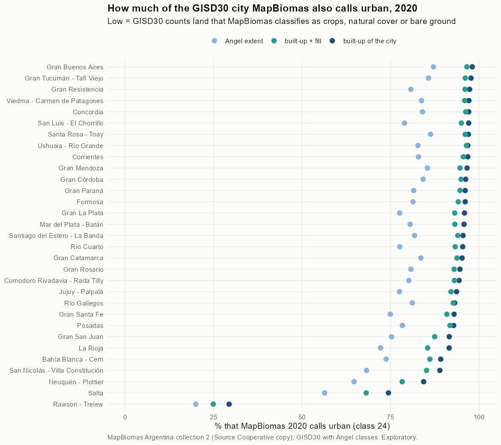
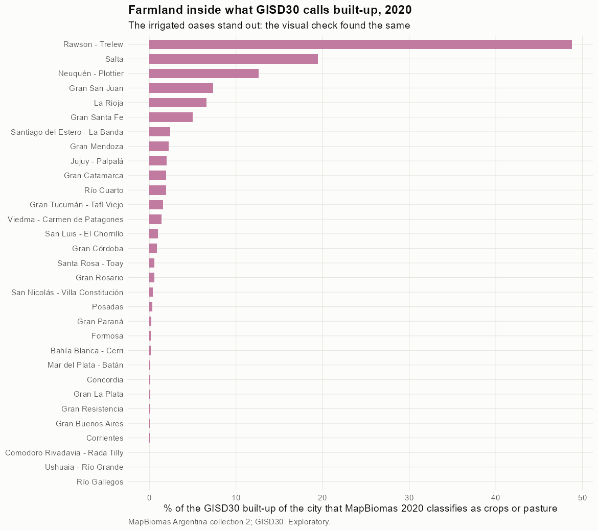

# MapBiomas 2020 against the GISD30 city and the tests, all agglomerations

Exploratory. None of these numbers are project figures (they are not in `CIFRAS_CANONICAS.json`). Generated by `Rpipe/scripts/17_mapbiomas.R`. Run of 2026-11-17. Method: [METODOS.md](../METODOS.md).

**Source.** MapBiomas Argentina collection 2 (CC BY-SA 4.0), 2020, read from the Source Cooperative copy (`tristangruppwri/mapbiomas`, original class codes): the official bucket answers 403. That copy covers 2019-2024 only, so 1990-2010 wait for Pedro's tract tables (`radios_mancha_mapbiomas`).

**Columns.** *Built % MB urban*: share of the GISD30 built-up of the city that MapBiomas calls urban. *Built % crops*: share that MapBiomas calls crops or pasture. *Fill*: the gap rule of step 16 (60 m, > 200 m from the edge, not on water) and what MapBiomas says under it, in all tracts and only in tracts above the test 3 cut (p25, census 2022). *Jaccard*: overlap / union with MapBiomas urban (1 = identical).

| Agglomeration | MB urban km² | of which outside the city | Built km² | Built % MB urban | Built % crops | Fill km² | Fill % MB urban | Fill % crops | Fill % water | Fill in dense tracts: % MB urban | % crops | Fringe % MB urban | Jaccard built | Jaccard built+fill | Jaccard test 3 | Jaccard Angel |
|---|---|---|---|---|---|---|---|---|---|---|---|---|---|---|---|---|
| [Bahía Blanca - Cerri](bahia_blanca/REPORTE.md) | 119.1 | 6.8 | 107.1 | 89.2 | 0.1 | 16.4 | 66.1 | 1.3 | 0.0 | 92.9 | 0.2 | 20.7 | 0.73 | 0.78 | 0.74 | 0.71 |
| [Comodoro Rivadavia - Rada Tilly](comodoro_rivadavia/REPORTE.md) | 80.0 | 11.1 | 55.9 | 94.4 | 0.0 | 9.6 | 85.2 | 0.1 | 0.1 | 90.6 | 0.0 | 38.8 | 0.63 | 0.72 | 0.65 | 0.71 |
| [Concordia](concordia/REPORTE.md) | 45.0 | 8.0 | 31.1 | 97.1 | 0.1 | 3.5 | 88.8 | 0.3 | 0.0 | 96.6 | 0.0 | 39.3 | 0.66 | 0.72 | 0.67 | 0.71 |
| [Corrientes](corrientes/REPORTE.md) | 89.4 | 23.6 | 56.6 | 96.8 | 0.0 | 5.1 | 81.7 | 0.5 | 0.0 | 95.5 | 0.0 | 38.8 | 0.60 | 0.64 | 0.61 | 0.64 |
| [Formosa](formosa/REPORTE.md) | 69.6 | 9.0 | 51.4 | 96.1 | 0.2 | 7.6 | 80.9 | 1.7 | 0.0 | 92.9 | 0.8 | 32.9 | 0.69 | 0.76 | 0.71 | 0.73 |
| [Gran Buenos Aires](buenos_aires/REPORTE.md) | 2,551.5 | 332.6 | 1,940.8 | 98.1 | 0.1 | 219.4 | 83.1 | 4.0 | 0.0 | 93.7 | 1.9 | 34.3 | 0.74 | 0.79 | 0.74 | 0.77 |
| [Gran Catamarca](catamarca/REPORTE.md) | 79.4 | 15.3 | 52.0 | 95.2 | 1.9 | 7.7 | 84.0 | 9.4 | 0.0 | 96.4 | 2.3 | 47.8 | 0.60 | 0.67 | 0.63 | 0.70 |
| [Gran Córdoba](cordoba/REPORTE.md) | 423.2 | 64.1 | 302.0 | 96.2 | 0.9 | 39.1 | 85.0 | 7.5 | 0.0 | 98.5 | 1.4 | 41.3 | 0.67 | 0.74 | 0.68 | 0.73 |
| [Gran La Plata](la_plata/REPORTE.md) | 423.8 | 125.6 | 245.0 | 95.9 | 0.1 | 49.7 | 79.5 | 3.0 | 0.0 | 91.3 | 2.0 | 26.5 | 0.54 | 0.62 | 0.55 | 0.58 |
| [Gran Mendoza](mendoza/REPORTE.md) | 375.1 | 94.4 | 200.3 | 96.6 | 2.2 | 49.9 | 86.6 | 9.1 | 0.0 | 99.0 | 0.5 | 56.0 | 0.51 | 0.61 | 0.54 | 0.66 |
| [Gran Paraná](parana/REPORTE.md) | 89.6 | 12.4 | 63.3 | 96.1 | 0.2 | 9.0 | 84.3 | 0.9 | 0.0 | 96.3 | 0.1 | 39.4 | 0.66 | 0.73 | 0.68 | 0.72 |
| [Gran Resistencia](resistencia/REPORTE.md) | 117.9 | 18.7 | 84.4 | 97.3 | 0.1 | 6.9 | 80.2 | 1.4 | 0.0 | 92.9 | 1.6 | 36.6 | 0.68 | 0.72 | 0.69 | 0.70 |
| [Gran Rosario](rosario/REPORTE.md) | 337.1 | 49.8 | 252.0 | 94.6 | 0.6 | 33.0 | 80.5 | 5.6 | 0.0 | 91.7 | 0.6 | 31.6 | 0.68 | 0.74 | 0.68 | 0.71 |
| [Gran San Juan](san_juan/REPORTE.md) | 213.5 | 53.3 | 130.4 | 91.6 | 7.3 | 29.4 | 69.2 | 23.6 | 0.0 | 93.1 | 4.3 | 38.5 | 0.53 | 0.60 | 0.57 | 0.60 |
| [Gran Santa Fe](santa_fe/REPORTE.md) | 222.6 | 92.1 | 109.9 | 92.9 | 5.0 | 16.8 | 77.7 | 18.2 | 0.0 | 88.9 | 8.8 | 32.3 | 0.44 | 0.49 | 0.45 | 0.49 |
| [Gran Tucumán - Tafí Viejo](tucuman/REPORTE.md) | 216.3 | 39.4 | 153.2 | 97.7 | 1.6 | 15.9 | 80.4 | 15.9 | 0.2 | 93.0 | 6.2 | 38.6 | 0.68 | 0.73 | 0.70 | 0.72 |
| [Jujuy - Palpalá](jujuy/REPORTE.md) | 77.6 | 14.5 | 50.9 | 93.6 | 2.0 | 8.6 | 82.8 | 10.6 | 0.0 | 90.6 | 6.4 | 37.8 | 0.59 | 0.67 | 0.62 | 0.66 |
| [La Rioja](la_rioja/REPORTE.md) | 55.9 | 1.7 | 54.2 | 91.5 | 6.6 | 8.1 | 44.6 | 44.3 | 0.0 | 65.0 | 29.7 | 7.9 | 0.82 | 0.82 | 0.81 | 0.71 |
| [Mar del Plata - Batán](mar_del_plata/REPORTE.md) | 161.0 | 17.6 | 134.6 | 95.8 | 0.1 | 13.0 | 66.4 | 2.2 | 0.0 | 70.8 | 3.9 | 19.6 | 0.77 | 0.80 | 0.77 | 0.73 |
| [Neuquén - Plottier](neuquen/REPORTE.md) | 192.3 | 36.3 | 146.8 | 84.3 | 12.6 | 32.2 | 50.7 | 38.8 | 0.1 | 94.2 | 4.4 | 25.5 | 0.58 | 0.61 | 0.59 | 0.56 |
| [Posadas](posadas/REPORTE.md) | 91.9 | 9.2 | 74.4 | 92.8 | 0.3 | 9.5 | 83.8 | 6.3 | 0.0 | 97.6 | 0.6 | 26.0 | 0.71 | 0.78 | 0.74 | 0.72 |
| [Rawson - Trelew](rawson/REPORTE.md) | 51.9 | 5.8 | 132.0 | 29.4 | 48.8 | 37.7 | 9.3 | 53.5 | 0.0 | 95.9 | 0.0 | 6.3 | 0.27 | 0.24 | 0.27 | 0.19 |
| [Río Cuarto](rio_cuarto/REPORTE.md) | 57.8 | 12.9 | 33.6 | 95.4 | 1.9 | 5.7 | 81.0 | 14.0 | 0.0 | 96.6 | 2.8 | 44.4 | 0.54 | 0.61 | 0.63 | 0.63 |
| [Río Gallegos](rio_gallegos/REPORTE.md) | 34.2 | 6.7 | 23.3 | 93.1 | 0.0 | 2.7 | 89.2 | 0.0 | 0.0 | 100.0 | 0.0 | 43.3 | 0.61 | 0.67 | 0.64 | 0.68 |
| [Salta](salta/REPORTE.md) | 177.5 | 36.7 | 144.2 | 74.4 | 19.5 | 36.8 | 43.4 | 50.0 | 0.1 | 93.8 | 5.6 | 25.5 | 0.50 | 0.52 | 0.52 | 0.49 |
| [San Luis - El Chorrillo](san_luis/REPORTE.md) | 60.3 | 9.8 | 43.1 | 97.1 | 1.0 | 5.7 | 79.4 | 9.3 | 0.0 | 84.7 | 7.7 | 27.0 | 0.68 | 0.74 | 0.70 | 0.68 |
| [San Nicolás - Villa Constitución](san_nicolas/REPORTE.md) | 62.5 | 12.2 | 47.8 | 88.9 | 0.4 | 6.5 | 57.3 | 8.4 | 0.0 | 77.2 | 7.2 | 20.7 | 0.63 | 0.66 | 0.64 | 0.59 |
| [Santa Rosa - Toay](santa_rosa/REPORTE.md) | 48.7 | 4.3 | 37.3 | 97.0 | 0.6 | 3.9 | 87.6 | 3.1 | 0.0 | 99.8 | 0.0 | 46.9 | 0.73 | 0.79 | 0.75 | 0.80 |
| [Santiago del Estero - La Banda](santiago_del_estero/REPORTE.md) | 140.5 | 27.5 | 98.2 | 95.5 | 2.4 | 11.1 | 80.8 | 13.0 | 0.0 | 90.7 | 7.1 | 35.4 | 0.65 | 0.70 | 0.66 | 0.68 |
| [Ushuaia - Río Grande](ushuaia/REPORTE.md) | 44.2 | 11.2 | 24.1 | 96.8 | 0.0 | 3.3 | 93.7 | 0.0 | 0.5 | 97.9 | 0.0 | 52.5 | 0.52 | 0.59 | 0.57 | 0.65 |
| [Viedma - Carmen de Patagones](viedma/REPORTE.md) | 26.0 | 4.2 | 19.0 | 97.1 | 1.4 | 1.3 | 78.9 | 8.4 | 0.0 | 82.9 | 7.1 | 39.5 | 0.70 | 0.73 | 0.71 | 0.72 |

