# Percolacion de intersecciones de calles: que radios forman el aglomerado

Generado por `Rpipe/scripts/30_percolacion_calles.R` el 2026-11-28. Exploratorio: ningun numero es cifra del proyecto. Todo sale de `resumen.csv` y de cada `<aglomerado>/radios_por_d.csv` y `curva.csv`.

## Metodo, paso a paso

1. **Intersecciones.** Nodos de la red de calles de Overture donde se juntan 3 o mas tramos, en el cuadrado del paso 29 (calles manejables: sin sendas, veredas ni ciclovias; un puente cuenta como cruce).
2. **Percolacion** (Arcaute et al. 2015, J. R. Soc. Interface 12: 20140745). Dos intersecciones se unen si estan a menos de d metros; cada componente conexa es una ciudad. Se barre d de 20 a 2000 m (cada 10 m hasta 500, cada 50 hasta 2000). El tamano de la ciudad crece a saltos: los saltos marcan los d donde cambia lo que se esta llamando ciudad, y las mesetas entre saltos son los d defendibles.
3. **La ciudad a cada d.** La componente con mas intersecciones dentro del perimetro de analisis (EPH, paso 07). Su area: las celdas de 20 m a menos de d/2 de una de sus intersecciones.
4. **Radios censales 2022.** Un radio es de la ciudad si al menos 50% de su area cae en ella, y del perimetro EPH si al menos 50% cae en el perimetro. A cada d se cuentan radios y personas en los dos, solo en la percolacion y solo en el EPH.
5. **Criterio principal (propuesto): d cubre 99%.** El menor d al que la ciudad contiene el 99% de las intersecciones del perimetro EPH. Se calcula sobre todo el barrido, no solo los d mapeados. A ese d, los radios "solo percolacion" son lo que la red de calles agrega al aglomerado oficial, y los "solo EPH" lo que el perimetro tiene y la red no une al nucleo.
6. **Diagnostico: d cubre 100%.** El menor d que contiene todas las intersecciones del perimetro. Es fragil: si el perimetro tiene un fragmento lejano o mucho campo vacio, solo se alcanza a d muy alto, y para llegar la percolacion encadena localidades vecinas. Cuando d cubre 100% queda muy por encima de d cubre 99%, el perimetro EPH tiene partes que conviene revisar a mano.
7. **Referencia: el d que mejor reproduce el EPH.** Entre los d mapeados, el que deja menos personas en radios que difieren (solo percolacion + solo EPH).
8. **Mapa final** (paso 31). La ciudad a d cubre 99% (a 2000 m si no lo alcanza) con las sedes de gobierno local del paso 29, coloreadas por su comunidad de Leiden (tau 15 y 30 min) y unidas al nucleo de su grupo: la sede con menor tiempo total de viaje al resto, sin ponderar por poblacion. Muestra donde la continuidad fisica de las calles y las comunidades por tiempo de viaje coinciden y donde no.

Lectura: a d bajo (alrededor de 150-200 m) la percolacion da la ciudad compacta; a d de varios cientos de metros se suman las localidades vecinas y aparece el aglomerado. Los radios "solo percolacion" son los candidatos a agregar al aglomerado; los "solo EPH", los que la red de calles no une al nucleo.

## Resumen

| aglomerado | intersecciones | radios EPH | personas EPH | saltos mas grandes (d, m) | **d cubre 99%** | a d cubre 99%: solo percolacion (radios / personas) | solo EPH (radios / personas) | d cubre 100% | a d cubre 100%: solo percolacion | solo EPH | d mejor |
|---|---:|---:|---:|---|---:|---:|---:|---:|---:|---:|---:|
| Bahía Blanca - Cerri | 14,932 | 473 | 331,231 | 140, 1400, 130 | **1,550** | 89 / 64,220 | 1 / 47 | > 2000 | > 2000 / > 2000 | > 2000 / > 2000 | 800 |
| Comodoro Rivadavia - Rada Tilly | 22,407 | 317 | 210,983 | 290, 850, 900 | **430** | 0 / 0 | 1 / 162 | 600 | 3 / 916 | 1 / 162 | 430 |
| Concordia | 11,842 | 215 | 174,660 | 600, 100, 110 | **1,250** | 21 / 12,188 | 0 / 0 | 1,250 | 21 / 12,188 | 0 / 0 | 800 |
| Corrientes | 27,476 | 448 | 428,925 | 100, 110, 130 | **1,300** | 15 / 10,872 | 1 / 966 | > 2000 | > 2000 / > 2000 | > 2000 / > 2000 | 800 |
| Formosa | 8,094 | 311 | 257,809 | 550, 120, 130 | **> 2000** | > 2000 / > 2000 | > 2000 / > 2000 | > 2000 | > 2000 / > 2000 | > 2000 / > 2000 | 2000 |
| Gran Buenos Aires | 240,087 | 15,515 | 14,562,254 | 130, 140, 120 | **430** | 3 / 805 | 187 / 100,640 | > 2000 | > 2000 / > 2000 | > 2000 / > 2000 | 2000 |
| Gran Buenos Aires (100km) | 285,048 | 16,108 | 15,061,658 | 130, 140, 120 | **600** | 289 / 188,167 | 137 / 50,319 | > 2000 | > 2000 / > 2000 | > 2000 / > 2000 | 800 |
| Gran Catamarca | 10,991 | 246 | 229,102 | 120, 140, 190 | **650** | 1 / 671 | 2 / 367 | 1,350 | 9 / 6,157 | 1 / 163 | 650 |
| Gran Córdoba | 78,247 | 2,330 | 1,709,852 | 700, 110, 120 | **700** | 425 / 216,870 | 9 / 6,167 | 1,800 | 606 / 331,592 | 0 / 0 | 500 |
| Gran La Plata | 66,942 | 1,225 | 916,202 | 490, 140, 210 | **1,000** | 2,237 / 2,273,821 | 17 / 7,325 | > 2000 | > 2000 / > 2000 | > 2000 / > 2000 | 200 |
| Gran Mendoza | 41,984 | 1,338 | 1,115,703 | 120, 110, 170 | **410** | 85 / 84,018 | 23 / 22,946 | > 2000 | > 2000 / > 2000 | > 2000 / > 2000 | 410 |
| Gran Paraná | 30,349 | 509 | 301,776 | 1100, 1350, 130 | **550** | 5 / 1,133 | 8 / 1,182 | 1,200 | 105 / 39,636 | 0 / 0 | 1000 |
| Gran Resistencia | 26,160 | 525 | 414,305 | 120, 130, 140 | **370** | 1 / 238 | 7 / 4,303 | 1,050 | 25 / 14,292 | 0 / 0 | 1000 |
| Gran Rosario | 46,499 | 2,070 | 1,447,588 | 160, 130, 120 | **550** | 32 / 12,677 | 9 / 3,328 | 1,300 | 119 / 63,157 | 1 / 34 | 550 |
| Gran San Juan | 22,676 | 624 | 601,627 | 130, 110, 1350 | **700** | 12 / 9,810 | 10 / 10,577 | 1,550 | 118 / 121,156 | 2 / 1,700 | 700 |
| Gran Santa Fe | 30,279 | 742 | 536,948 | 110, 600, 1500 | **1,500** | 112 / 71,481 | 8 / 2,847 | > 2000 | > 2000 / > 2000 | > 2000 / > 2000 | 800 |
| Gran Tucumán - Tafí Viejo | 27,784 | 1,114 | 1,039,709 | 160, 140, 1650 | **380** | 10 / 8,000 | 10 / 7,777 | 1,100 | 131 / 101,407 | 2 / 492 | 380 |
| Jujuy - Palpalá | 16,064 | 395 | 377,504 | 1250, 130, 180 | **800** | 10 / 4,390 | 5 / 1,931 | 1,800 | 122 / 115,988 | 2 / 851 | 800 |
| La Rioja | 9,370 | 258 | 209,485 | 130, 100, 120 | **1,700** | 0 / 0 | 2 / 1,643 | > 2000 | > 2000 / > 2000 | > 2000 / > 2000 | 1700 |
| Mar del Plata - Batán | 23,848 | 1,038 | 659,699 | 110, 1050, 440 | **700** | 7 / 1,268 | 6 / 1,485 | 1,850 | 200 / 53,959 | 0 / 0 | 800 |
| Neuquén - Plottier | 32,519 | 677 | 500,612 | 460, 120, 420 | **500** | 16 / 8,297 | 6 / 5,210 | 900 | 100 / 68,937 | 0 / 0 | 500 |
| Posadas | 25,899 | 510 | 385,202 | 1100, 110, 100 | **650** | 7 / 3,907 | 2 / 235 | 1,750 | 87 / 44,355 | 0 / 0 | 650 |
| Rawson - Trelew | 11,515 | 227 | 147,163 | 650, 100, 600 | **950** | 19 / 8,886 | 0 / 0 | 1,200 | 19 / 8,886 | 0 / 0 | 800 |
| Río Cuarto | 9,174 | 350 | 187,790 | 160, 150, 120 | **550** | 1 / 920 | 2 / 1,586 | 1,700 | 14 / 7,564 | 0 / 0 | 800 |
| Río Gallegos | 7,598 | 150 | 113,121 | 170, 100, 130 | **250** | 11 / 1,203 | 2 / 967 | 390 | 13 / 1,446 | 1 / 129 | 800 |
| Salta | 26,304 | 725 | 705,323 | 140, 120, 650 | **800** | 29 / 22,014 | 12 / 13,092 | 1,700 | 39 / 28,811 | 3 / 1,986 | 1700 |
| San Luis - El Chorrillo | 12,595 | 284 | 232,842 | 130, 800, 110 | **800** | 34 / 18,454 | 0 / 0 | 800 | 34 / 18,454 | 0 / 0 | 800 |
| San Nicolás - Villa Constitución | 19,197 | 241 | 213,119 | 1150, 750, 150 | **800** | 22 / 14,782 | 4 / 1,678 | 1,350 | 399 / 299,213 | 1 / 956 | 1000 |
| Santa Rosa - Toay | 6,952 | 220 | 133,002 | 120, 110, 210 | **1,900** | 1 / 80 | 2 / 923 | > 2000 | > 2000 / > 2000 | > 2000 / > 2000 | 1900 |
| Santiago del Estero - La Banda | 18,225 | 341 | 447,801 | 280, 130, 110 | **700** | 5 / 4,807 | 4 / 5,942 | 1,700 | 51 / 54,428 | 0 / 0 | 500 |
| Ushuaia - Río Grande | 2,796 | 99 | 78,490 | 200, 110, 140 | **700** | 1 / 919 | 3 / 2,046 | 1,000 | 1 / 919 | 0 / 0 | 1000 |
| Viedma - Carmen de Patagones | 6,546 | 123 | 81,663 | 290, 110, 120 | **290** | 3 / 1,191 | 1 / 82 | 400 | 3 / 1,191 | 0 / 0 | 400 |

## Lo construido segun MapBiomas 2022

Urbano de MapBiomas Argentina (coleccion 2, clase 24, 30 m) en el cuadrado, y cuanto de el cae dentro del perimetro EPH y dentro de la ciudad por percolacion al d que cubre el 99% (2000 m si no lo alcanza). Si la ciudad captura mucho mas urbano que el perimetro, lo construido ya excede al aglomerado oficial.

| aglomerado | d (m) | urbano en el cuadrado (km2) | en el perimetro EPH | en la ciudad por percolacion | en la ciudad y fuera del perimetro (km2) | en el perimetro y fuera de la ciudad (km2) |
|---|---:|---:|---:|---:|---:|---:|
| Bahía Blanca - Cerri | 1550 | 143.9 | 113.5 (78.9%) | 140.6 (97.7%) | 27.1 | 0.0 |
| Comodoro Rivadavia - Rada Tilly | 430 | 82.9 | 74.4 (89.7%) | 79.8 (96.2%) | 6.0 | 0.5 |
| Concordia | 1250 | 55.3 | 38.9 (70.3%) | 49.1 (88.8%) | 10.2 | 0.0 |
| Corrientes | 1300 | 247.7 | 76.1 (30.7%) | 96.1 (38.8%) | 20.0 | 0.1 |
| Formosa | 2000 | 71.7 | 63.6 (88.6%) | 68.9 (96.1%) | 6.1 | 0.7 |
| Gran Buenos Aires | 430 | 2,113.4 | 2,096.6 (99.2%) | 2,067.2 (97.8%) | 7.2 | 36.5 |
| Gran Buenos Aires (100km) | 600 | 2,584.9 | 2,343.9 (90.7%) | 2,472.9 (95.7%) | 156.0 | 27.0 |
| Gran Catamarca | 650 | 98.3 | 74.8 (76.1%) | 75.4 (76.7%) | 3.2 | 2.7 |
| Gran Córdoba | 700 | 607.8 | 378.3 (62.2%) | 559.3 (92.0%) | 182.3 | 1.3 |
| Gran La Plata | 1000 | 691.8 | 308.8 (44.6%) | 663.0 (95.8%) | 356.4 | 2.2 |
| Gran Mendoza | 410 | 417.4 | 298.0 (71.4%) | 339.0 (81.2%) | 53.7 | 12.6 |
| Gran Paraná | 550 | 287.4 | 82.4 (28.7%) | 86.9 (30.2%) | 5.0 | 0.5 |
| Gran Resistencia | 370 | 232.7 | 105.2 (45.2%) | 109.6 (47.1%) | 7.2 | 2.8 |
| Gran Rosario | 550 | 349.7 | 282.1 (80.7%) | 319.4 (91.3%) | 39.5 | 2.2 |
| Gran San Juan | 700 | 256.9 | 179.0 (69.7%) | 187.6 (73.0%) | 13.2 | 4.5 |
| Gran Santa Fe | 1500 | 288.3 | 140.5 (48.7%) | 181.1 (62.8%) | 40.8 | 0.3 |
| Gran Tucumán - Tafí Viejo | 380 | 273.0 | 181.3 (66.4%) | 192.7 (70.6%) | 14.5 | 3.1 |
| Jujuy - Palpalá | 800 | 107.0 | 69.7 (65.1%) | 75.3 (70.4%) | 6.9 | 1.2 |
| La Rioja | 1700 | 57.8 | 56.9 (98.5%) | 57.1 (98.8%) | 0.2 | 0.0 |
| Mar del Plata - Batán | 700 | 209.8 | 152.7 (72.8%) | 156.7 (74.7%) | 6.0 | 2.0 |
| Neuquén - Plottier | 500 | 223.5 | 160.2 (71.7%) | 176.0 (78.8%) | 22.8 | 7.0 |
| Posadas | 650 | 114.9 | 85.5 (74.4%) | 91.7 (79.8%) | 6.3 | 0.0 |
| Rawson - Trelew | 950 | 55.4 | 44.6 (80.6%) | 55.3 (99.9%) | 10.7 | 0.1 |
| Río Cuarto | 550 | 69.4 | 54.1 (77.9%) | 57.6 (83.0%) | 4.1 | 0.5 |
| Río Gallegos | 250 | 36.1 | 30.3 (84.1%) | 34.3 (95.1%) | 4.3 | 0.3 |
| Salta | 800 | 193.0 | 150.8 (78.1%) | 175.8 (91.1%) | 27.6 | 2.6 |
| San Luis - El Chorrillo | 800 | 67.0 | 54.8 (81.9%) | 62.2 (93.0%) | 7.4 | 0.0 |
| San Nicolás - Villa Constitución | 800 | 130.7 | 53.7 (41.1%) | 64.5 (49.3%) | 11.1 | 0.4 |
| Santa Rosa - Toay | 1900 | 52.5 | 48.4 (92.4%) | 49.5 (94.4%) | 1.1 | 0.0 |
| Santiago del Estero - La Banda | 700 | 174.1 | 121.2 (69.6%) | 137.4 (78.9%) | 18.1 | 1.8 |
| Ushuaia - Río Grande | 700 | 16.4 | 14.7 (90.0%) | 16.2 (98.9%) | 1.5 | 0.0 |
| Viedma - Carmen de Patagones | 290 | 31.1 | 22.0 (70.8%) | 24.9 (80.1%) | 3.1 | 0.3 |

## Por aglomerado

### Bahía Blanca - Cerri

14,932 intersecciones en el cuadrado, 11,195 dentro del perimetro EPH. Perimetro EPH: 473 radios, 331,231 personas. Saltos mas grandes del tamano de la ciudad en d = 140, 1400, 130 m.

**La ciudad cubre el 99% del aglomerado EPH a d = 1550 m.** A ese d, la percolacion agrega 89 radios (64,220 personas) fuera del perimetro y deja 1 radios del perimetro (47 personas) con menos del 50% de su area dentro.

Diagnostico: no cubre el 100% a 2000 m.

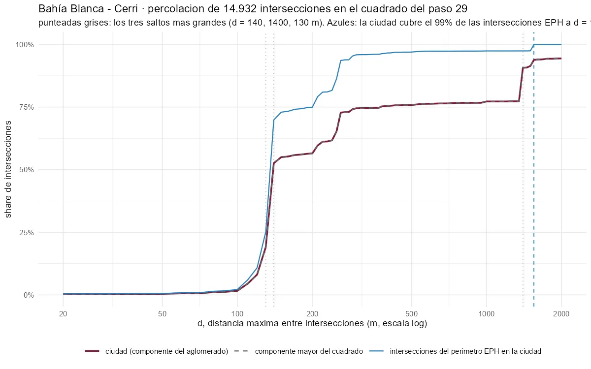

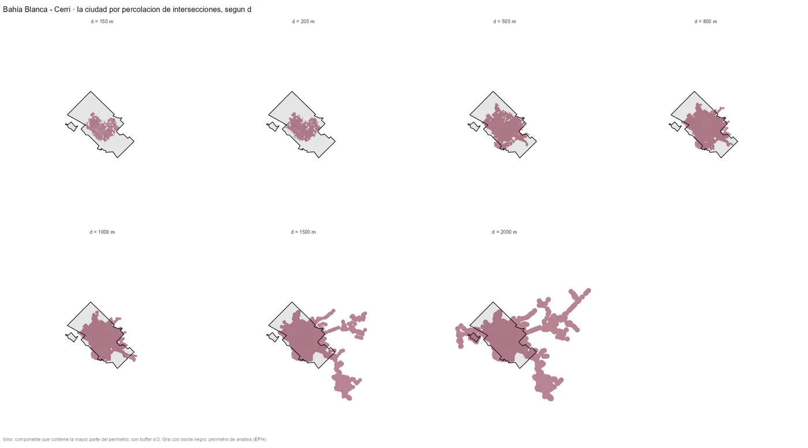

| d (m) | intersecciones de la ciudad | km2 | en los dos (radios / personas) | solo percolacion | solo EPH |
|---:|---:|---:|---:|---:|---:|
| 150 | 8,212 | 72.4 | 408 / 289,851 | 0 / 0 | 65 / 41,380 |
| 200 | 8,436 | 83.3 | 412 / 292,179 | 0 / 0 | 61 / 39,052 |
| 500 | 11,318 | 169.6 | 456 / 320,734 | 0 / 0 | 17 / 10,497 |
| 800 | 11,449 | 205.3 | 461 / 323,387 | 0 / 0 | 12 / 7,844 |
| 1000 | 11,533 | 227.5 | 461 / 323,387 | 1 / 619 | 12 / 7,844 |
| 1500 | 13,648 | 424.2 | 462 / 323,480 | 89 / 64,220 | 11 / 7,751 |
| **1550** | 14,007 | 465.8 | 472 / 331,184 | 89 / 64,220 | 1 / 47 |
| 2000 | 14,097 | 631.9 | 472 / 331,184 | 89 / 64,220 | 1 / 47 |

En negrita, los d que cubren el 99% y el 100% del aglomerado EPH. El que mejor lo reproduce (menos personas en radios que difieren) es d = 800 m.

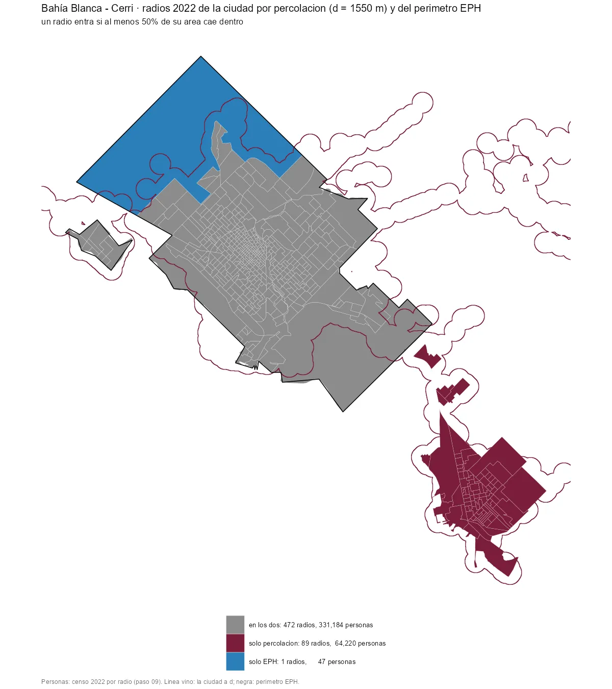

Mapa final, comunidades de Leiden con tau 15 min:

Mapa final, comunidades de Leiden con tau 30 min:

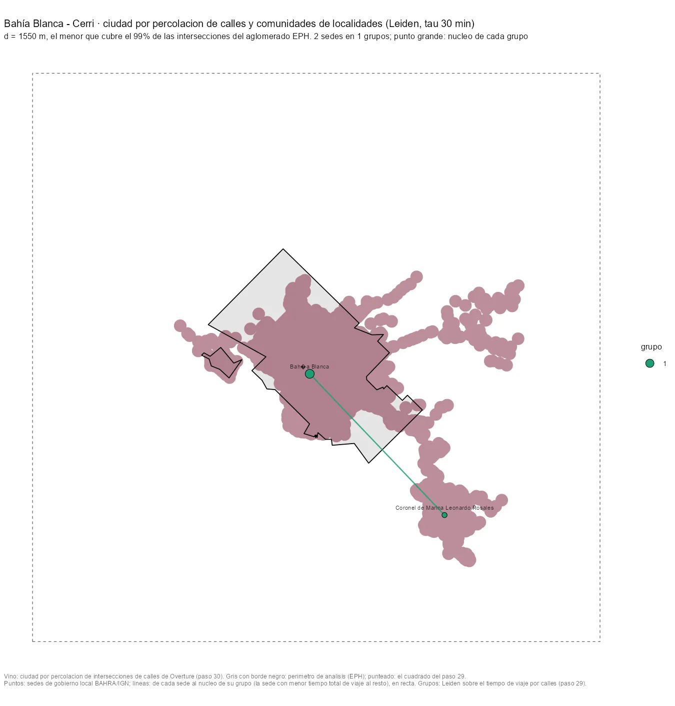

Lo construido (MapBiomas 2022): 143.9 km2 de urbano en el cuadrado; 113.5 km2 dentro del perimetro EPH y 140.6 km2 dentro de la ciudad a d = 1550 m. La ciudad suma 27.1 km2 de urbano fuera del perimetro; el perimetro tiene 0 km2 de urbano fuera de la ciudad.

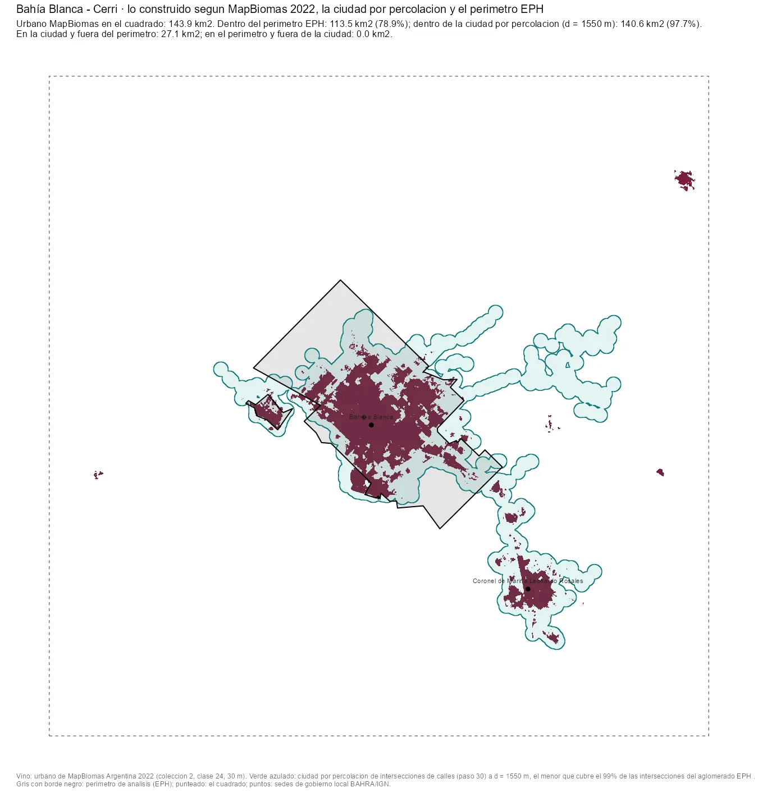

### Comodoro Rivadavia - Rada Tilly

22,407 intersecciones en el cuadrado, 11,435 dentro del perimetro EPH. Perimetro EPH: 317 radios, 210,983 personas. Saltos mas grandes del tamano de la ciudad en d = 290, 850, 900 m.

**La ciudad cubre el 99% del aglomerado EPH a d = 430 m.** A ese d, la percolacion agrega 0 radios (0 personas) fuera del perimetro y deja 1 radios del perimetro (162 personas) con menos del 50% de su area dentro.

Diagnostico: cubre el 100% a d = 600 m (agrega 3 radios, 916 personas; deja 1 radios, 162 personas).

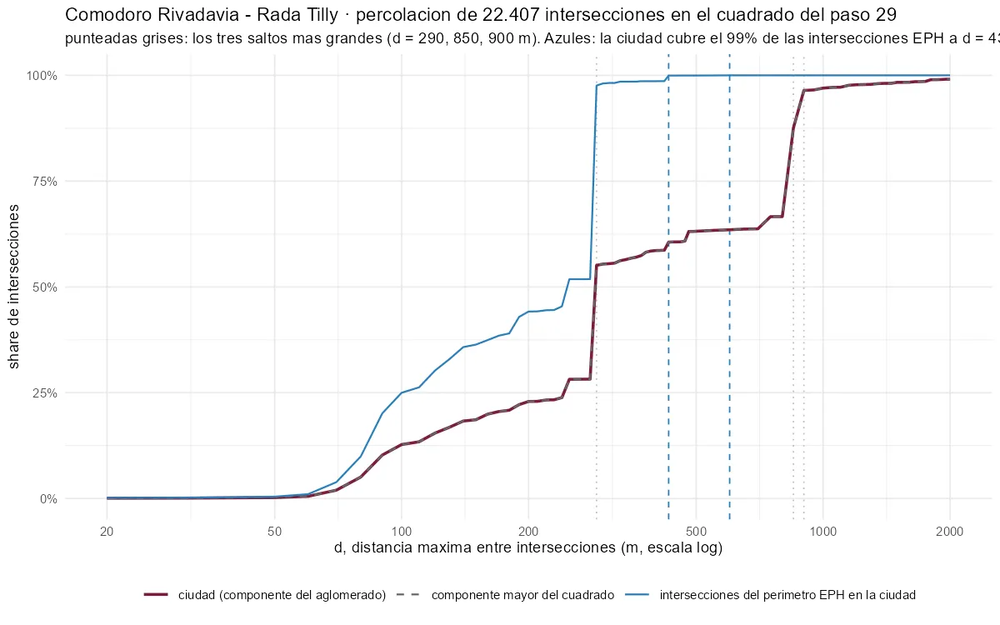

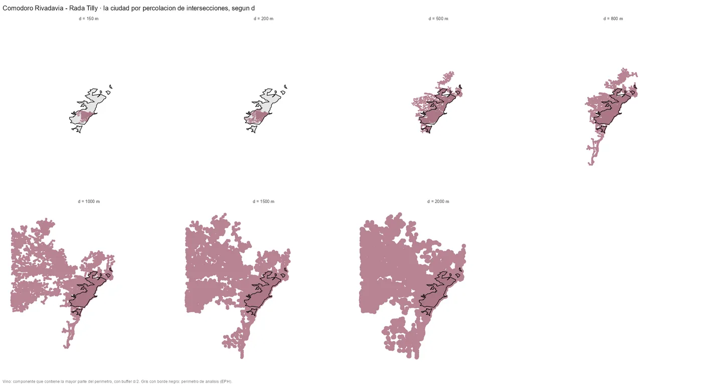

| d (m) | intersecciones de la ciudad | km2 | en los dos (radios / personas) | solo percolacion | solo EPH |
|---:|---:|---:|---:|---:|---:|
| 150 | 4,171 | 23.3 | 178 / 115,063 | 0 / 0 | 139 / 95,920 |
| 200 | 5,139 | 34.6 | 192 / 123,596 | 0 / 0 | 125 / 87,387 |
| **430** | 13,576 | 183.2 | 316 / 210,821 | 0 / 0 | 1 / 162 |
| 500 | 14,152 | 227.8 | 316 / 210,821 | 2 / 622 | 1 / 162 |
| **600** | 14,230 | 255.1 | 316 / 210,821 | 3 / 916 | 1 / 162 |
| 800 | 14,926 | 340.4 | 317 / 210,983 | 4 / 1,193 | 0 / 0 |
| 1000 | 21,731 | 1104.2 | 317 / 210,983 | 7 / 2,607 | 0 / 0 |
| 1500 | 22,036 | 1477.5 | 317 / 210,983 | 8 / 3,741 | 0 / 0 |
| 2000 | 22,200 | 1808.8 | 317 / 210,983 | 10 / 3,778 | 0 / 0 |

En negrita, los d que cubren el 99% y el 100% del aglomerado EPH. El que mejor lo reproduce (menos personas en radios que difieren) es d = 430 m.

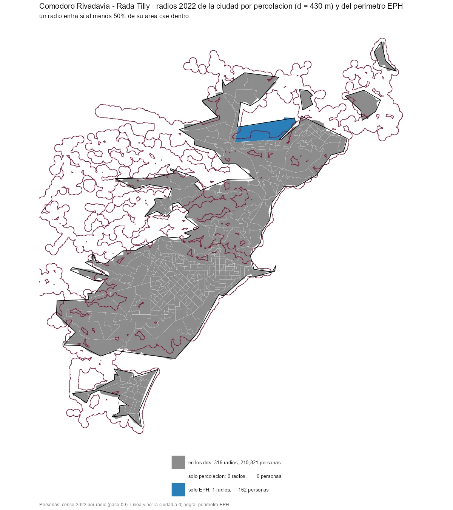

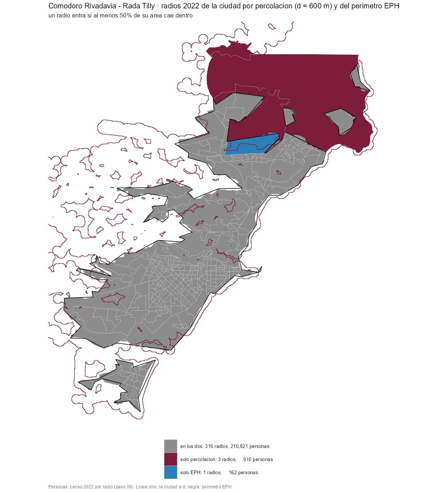

Mapa final, comunidades de Leiden con tau 15 min:

Mapa final, comunidades de Leiden con tau 30 min:

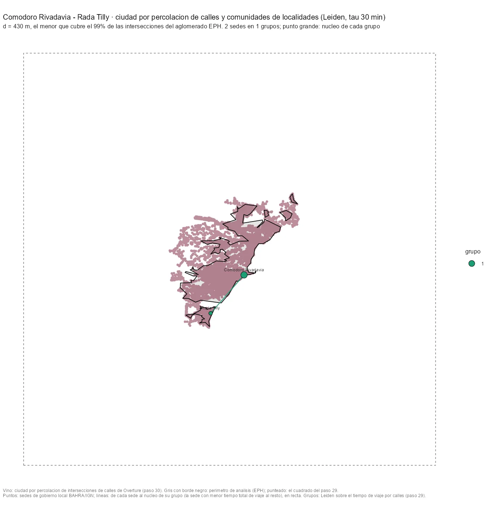

Lo construido (MapBiomas 2022): 82.9 km2 de urbano en el cuadrado; 74.4 km2 dentro del perimetro EPH y 79.8 km2 dentro de la ciudad a d = 430 m. La ciudad suma 6 km2 de urbano fuera del perimetro; el perimetro tiene 0.5 km2 de urbano fuera de la ciudad.

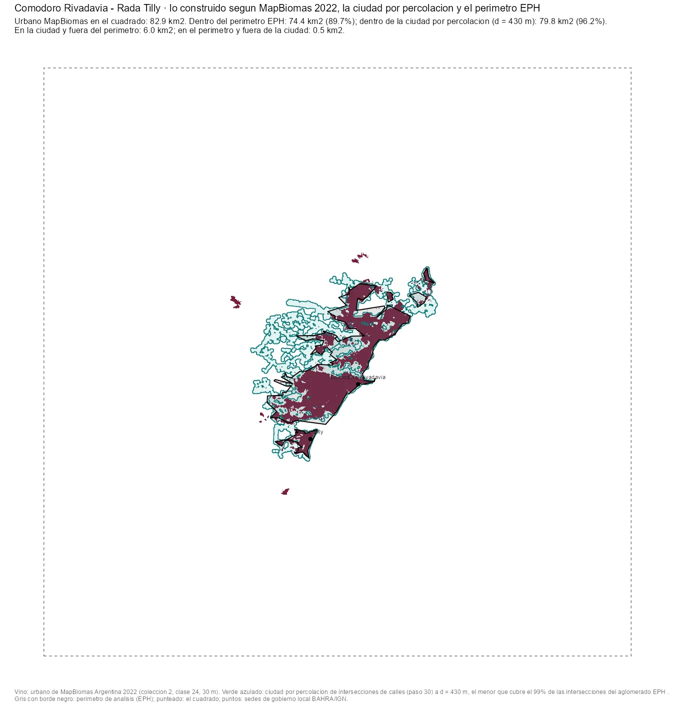

### Concordia

11,842 intersecciones en el cuadrado, 4,829 dentro del perimetro EPH. Perimetro EPH: 215 radios, 174,660 personas. Saltos mas grandes del tamano de la ciudad en d = 600, 100, 110 m.

**La ciudad cubre el 99% del aglomerado EPH a d = 1250 m.** A ese d, la percolacion agrega 21 radios (12,188 personas) fuera del perimetro y deja 0 radios del perimetro (0 personas) con menos del 50% de su area dentro.

Diagnostico: cubre el 100% a d = 1250 m (agrega 21 radios, 12,188 personas; deja 0 radios, 0 personas).

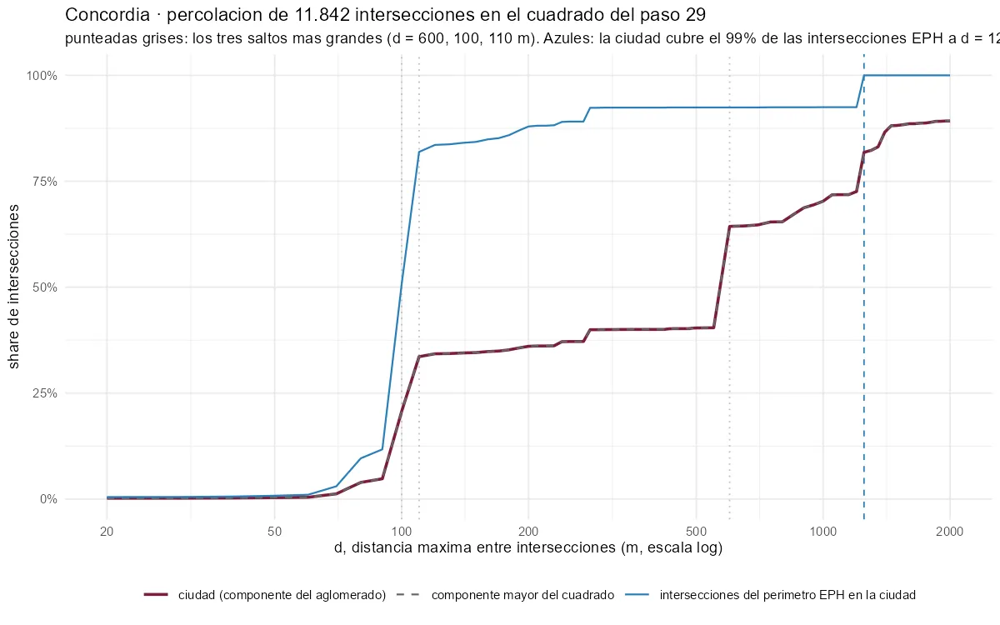

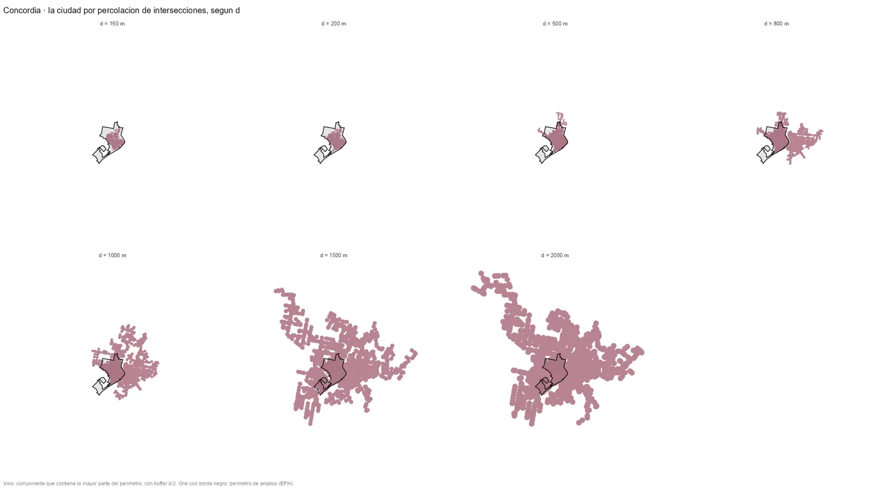

| d (m) | intersecciones de la ciudad | km2 | en los dos (radios / personas) | solo percolacion | solo EPH |
|---:|---:|---:|---:|---:|---:|
| 150 | 4,093 | 28.2 | 184 / 151,399 | 0 / 0 | 31 / 23,261 |
| 200 | 4,269 | 32.2 | 190 / 156,529 | 0 / 0 | 25 / 18,131 |
| 500 | 4,781 | 55.8 | 198 / 162,578 | 1 / 9 | 17 / 12,082 |
| 800 | 7,747 | 154.8 | 202 / 165,635 | 2 / 638 | 13 / 9,025 |
| 1000 | 8,324 | 270.8 | 203 / 166,151 | 6 / 2,254 | 12 / 8,509 |
| **1250** | 9,690 | 532.3 | 215 / 174,660 | 21 / 12,188 | 0 / 0 |
| 1500 | 10,442 | 814.3 | 215 / 174,660 | 34 / 16,487 | 0 / 0 |
| 2000 | 10,568 | 1135.7 | 215 / 174,660 | 37 / 17,090 | 0 / 0 |

En negrita, los d que cubren el 99% y el 100% del aglomerado EPH. El que mejor lo reproduce (menos personas en radios que difieren) es d = 800 m.

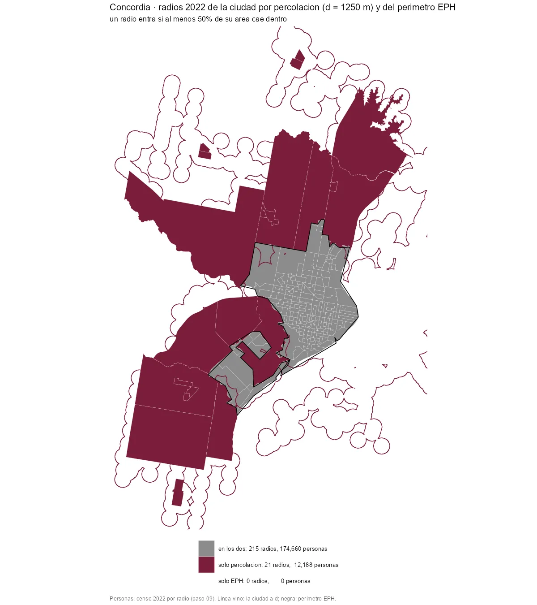

Mapa final, comunidades de Leiden con tau 15 min:

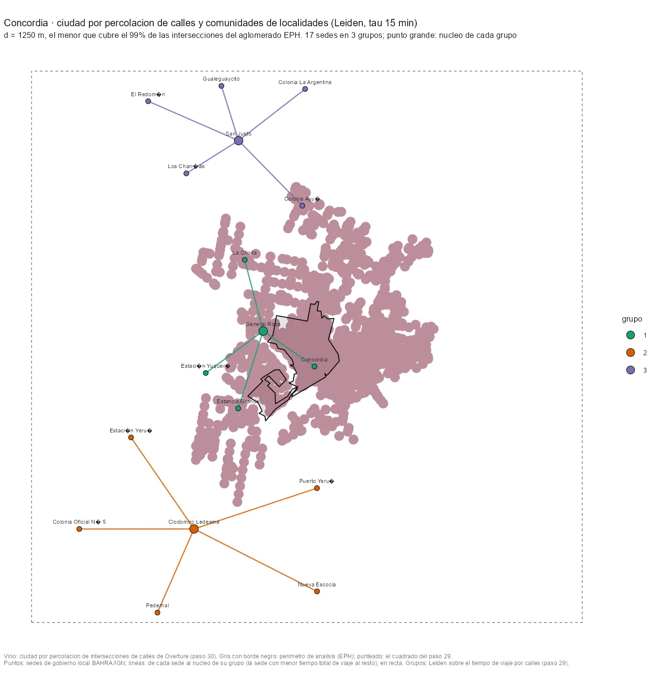

Mapa final, comunidades de Leiden con tau 30 min:

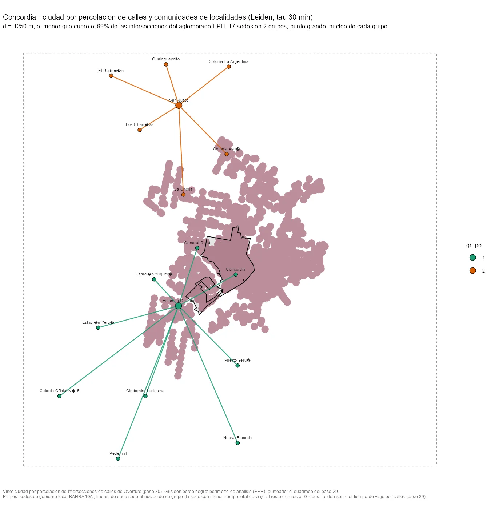

Lo construido (MapBiomas 2022): 55.3 km2 de urbano en el cuadrado; 38.9 km2 dentro del perimetro EPH y 49.1 km2 dentro de la ciudad a d = 1250 m. La ciudad suma 10.2 km2 de urbano fuera del perimetro; el perimetro tiene 0 km2 de urbano fuera de la ciudad.

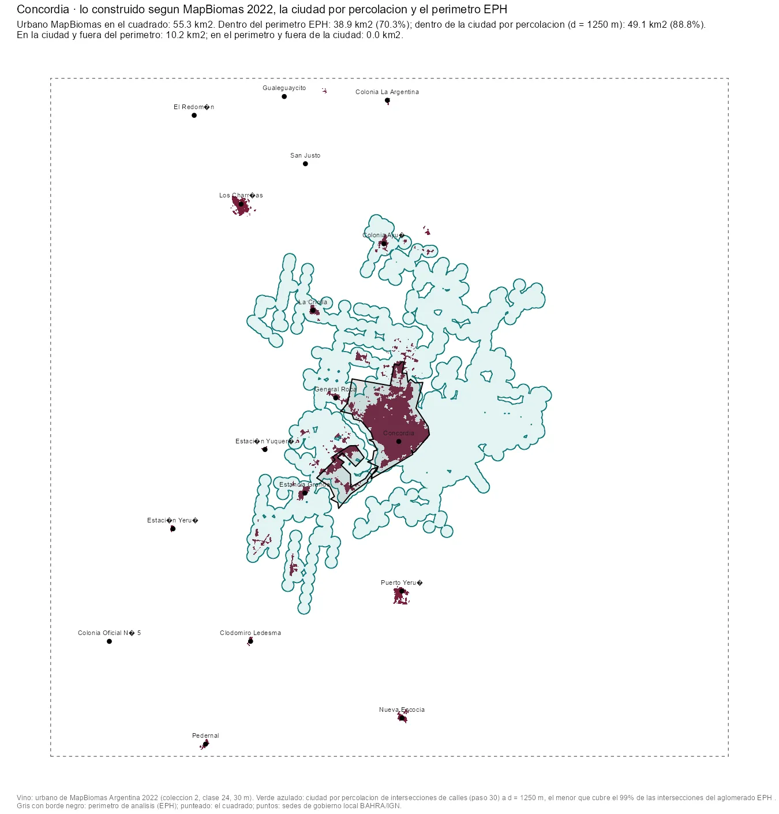

### Corrientes

27,476 intersecciones en el cuadrado, 8,970 dentro del perimetro EPH. Perimetro EPH: 448 radios, 428,925 personas. Saltos mas grandes del tamano de la ciudad en d = 100, 110, 130 m.

**La ciudad cubre el 99% del aglomerado EPH a d = 1300 m.** A ese d, la percolacion agrega 15 radios (10,872 personas) fuera del perimetro y deja 1 radios del perimetro (966 personas) con menos del 50% de su area dentro.

Diagnostico: no cubre el 100% a 2000 m.

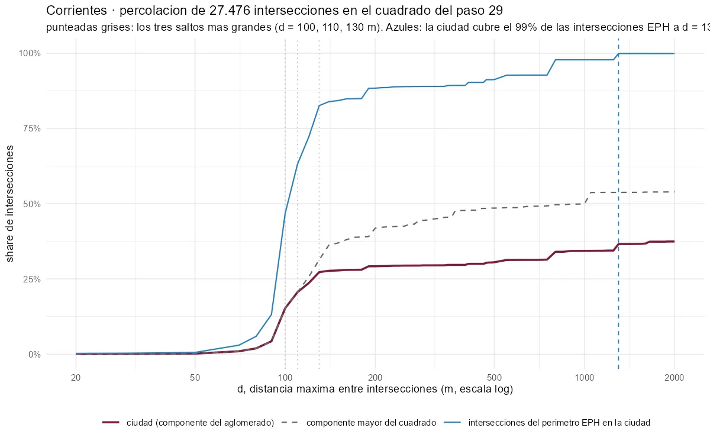

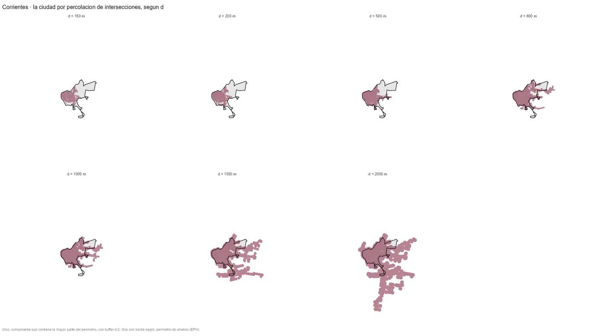

| d (m) | intersecciones de la ciudad | km2 | en los dos (radios / personas) | solo percolacion | solo EPH |
|---:|---:|---:|---:|---:|---:|
| 150 | 7,643 | 49.4 | 401 / 379,159 | 1 / 681 | 47 / 49,766 |
| 200 | 8,028 | 56.1 | 411 / 388,410 | 1 / 681 | 37 / 40,515 |
| 500 | 8,396 | 81.1 | 435 / 417,656 | 1 / 681 | 13 / 11,269 |
| 800 | 9,348 | 145.8 | 444 / 424,701 | 6 / 3,806 | 4 / 4,224 |
| 1000 | 9,434 | 174.1 | 444 / 424,701 | 7 / 4,309 | 4 / 4,224 |
| **1300** | 10,060 | 289.4 | 447 / 427,959 | 15 / 10,872 | 1 / 966 |
| 1500 | 10,072 | 327.9 | 447 / 427,959 | 17 / 11,193 | 1 / 966 |
| 2000 | 10,288 | 513 | 448 / 428,925 | 25 / 13,713 | 0 / 0 |

En negrita, los d que cubren el 99% y el 100% del aglomerado EPH. El que mejor lo reproduce (menos personas en radios que difieren) es d = 800 m.

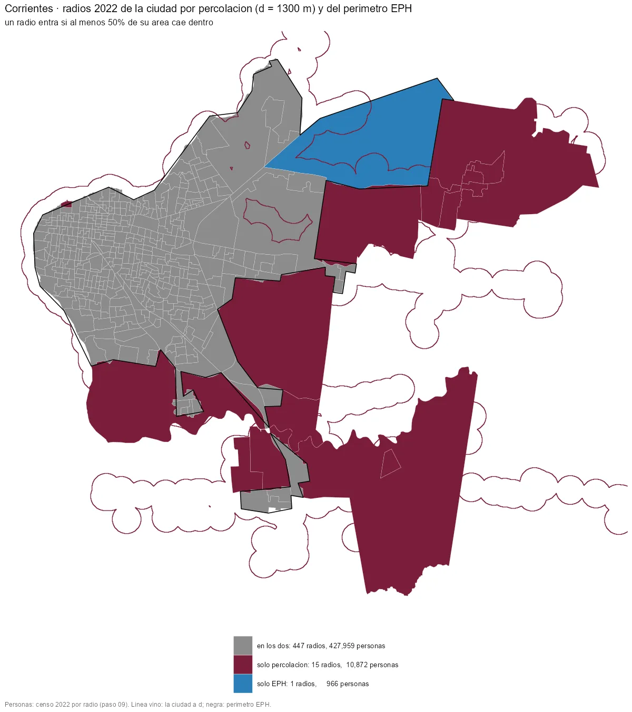

Mapa final, comunidades de Leiden con tau 15 min:

Mapa final, comunidades de Leiden con tau 30 min:

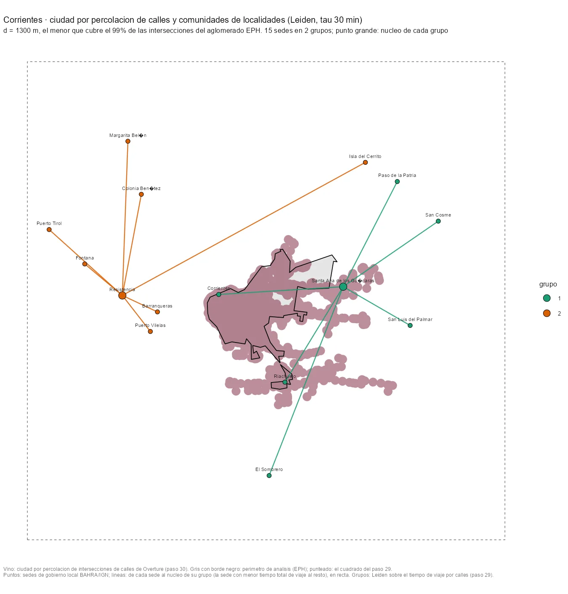

Lo construido (MapBiomas 2022): 247.7 km2 de urbano en el cuadrado; 76.1 km2 dentro del perimetro EPH y 96.1 km2 dentro de la ciudad a d = 1300 m. La ciudad suma 20 km2 de urbano fuera del perimetro; el perimetro tiene 0.1 km2 de urbano fuera de la ciudad.

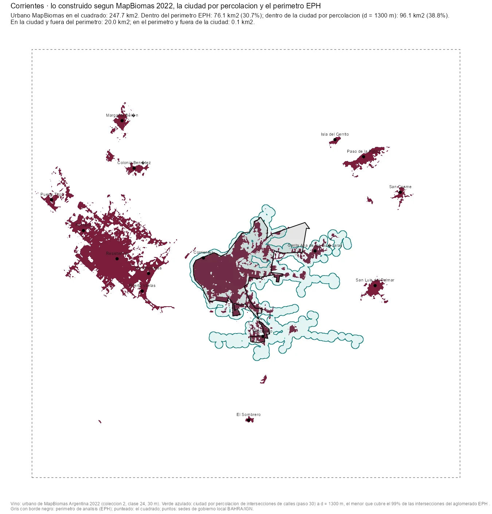

### Formosa

8,094 intersecciones en el cuadrado, 6,343 dentro del perimetro EPH. Perimetro EPH: 311 radios, 257,809 personas. Saltos mas grandes del tamano de la ciudad en d = 550, 120, 130 m.

**La ciudad no llega a cubrir el 99% del aglomerado EPH a 2000 m.**

Diagnostico: no cubre el 100% a 2000 m.

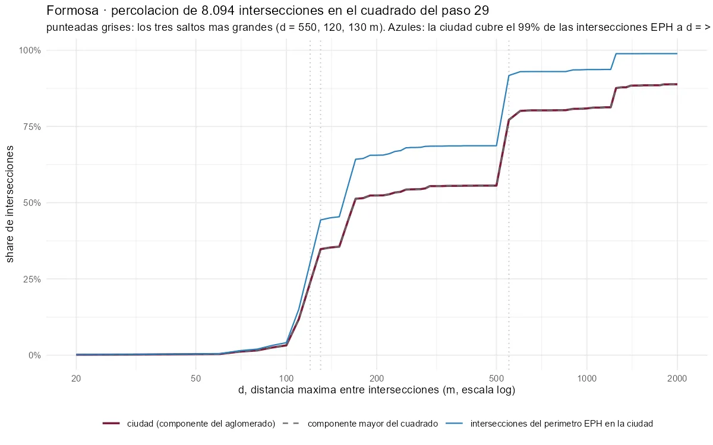

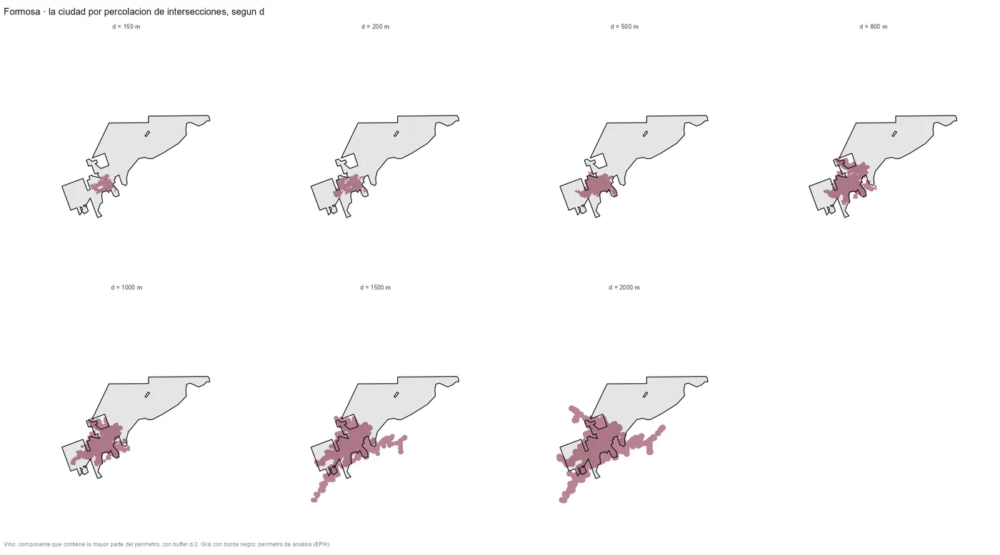

| d (m) | intersecciones de la ciudad | km2 | en los dos (radios / personas) | solo percolacion | solo EPH |
|---:|---:|---:|---:|---:|---:|
| 150 | 2,880 | 24.7 | 158 / 130,881 | 0 / 0 | 153 / 126,928 |
| 200 | 4,239 | 42.3 | 212 / 174,930 | 0 / 0 | 99 / 82,879 |
| 500 | 4,500 | 62.2 | 225 / 185,638 | 0 / 0 | 86 / 72,171 |
| 800 | 6,501 | 123.8 | 295 / 251,996 | 3 / 819 | 16 / 5,813 |
| 1000 | 6,549 | 146.4 | 295 / 251,996 | 5 / 879 | 16 / 5,813 |
| 1500 | 7,157 | 251.3 | 307 / 256,249 | 9 / 2,441 | 4 / 1,560 |
| 2000 | 7,190 | 327.6 | 308 / 256,610 | 9 / 2,441 | 3 / 1,199 |

En negrita, los d que cubren el 99% y el 100% del aglomerado EPH. El que mejor lo reproduce (menos personas en radios que difieren) es d = 2000 m.

Mapa final, comunidades de Leiden con tau 15 min:

Mapa final, comunidades de Leiden con tau 30 min:

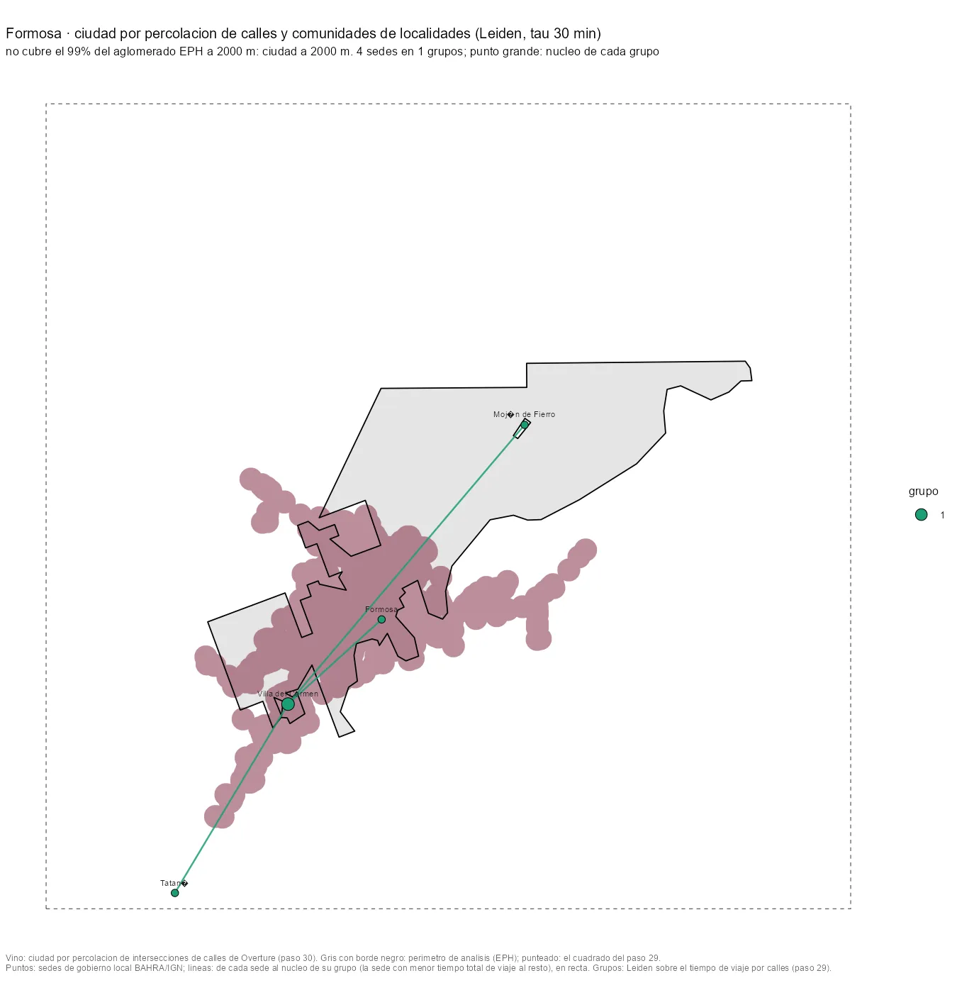

Lo construido (MapBiomas 2022): 71.7 km2 de urbano en el cuadrado; 63.6 km2 dentro del perimetro EPH y 68.9 km2 dentro de la ciudad a d = 2000 m. La ciudad suma 6.1 km2 de urbano fuera del perimetro; el perimetro tiene 0.7 km2 de urbano fuera de la ciudad.

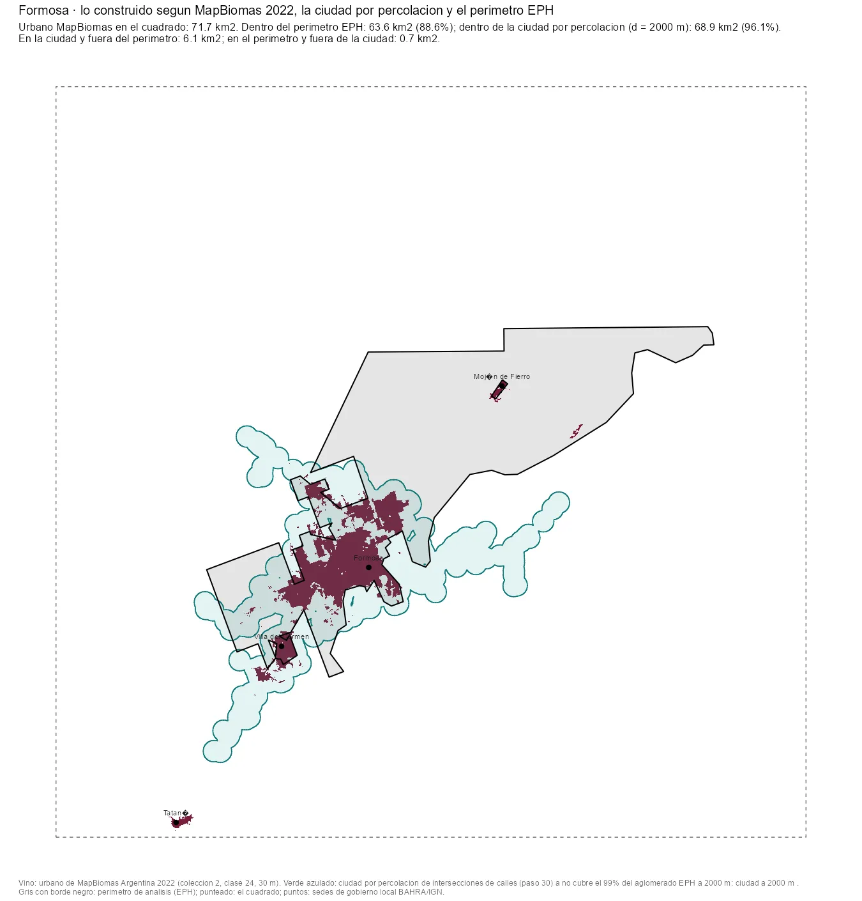

### Gran Buenos Aires

240,087 intersecciones en el cuadrado, 237,402 dentro del perimetro EPH. Perimetro EPH: 15,515 radios, 14,562,254 personas. Saltos mas grandes del tamano de la ciudad en d = 130, 140, 120 m.

**La ciudad cubre el 99% del aglomerado EPH a d = 430 m.** A ese d, la percolacion agrega 3 radios (805 personas) fuera del perimetro y deja 187 radios del perimetro (100,640 personas) con menos del 50% de su area dentro.

Diagnostico: no cubre el 100% a 2000 m.

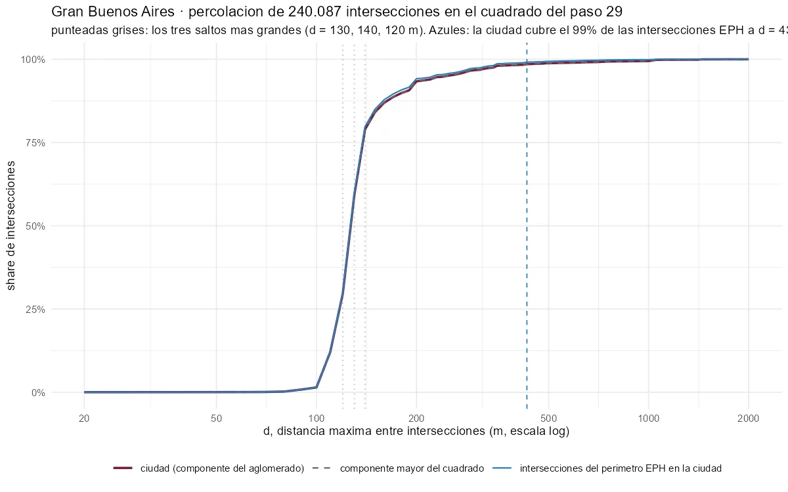

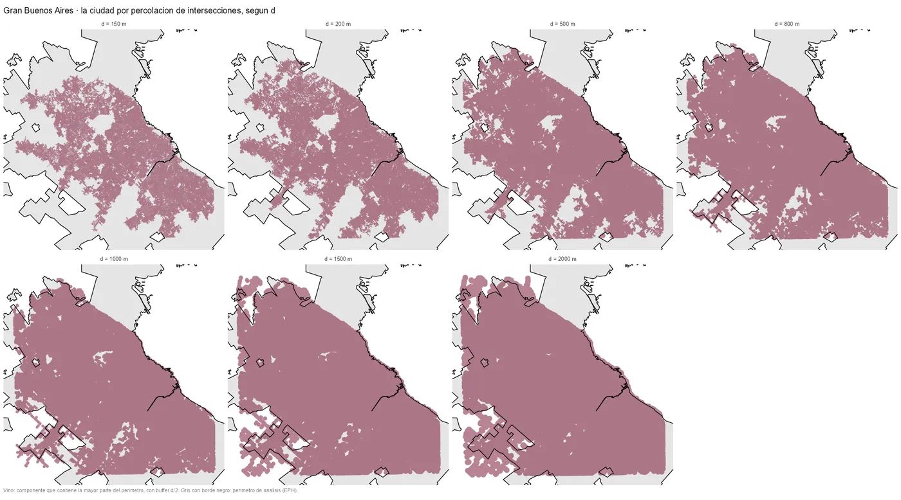

| d (m) | intersecciones de la ciudad | km2 | en los dos (radios / personas) | solo percolacion | solo EPH |
|---:|---:|---:|---:|---:|---:|
| 150 | 201,926 | 1597.5 | 14,329 / 13,536,021 | 0 / 0 | 1,186 / 1,026,233 |
| 200 | 224,156 | 1992.4 | 15,018 / 14,199,985 | 1 / 308 | 497 / 362,269 |
| **430** | 236,541 | 2572.1 | 15,328 / 14,461,614 | 3 / 805 | 187 / 100,640 |
| 500 | 237,221 | 2681.5 | 15,356 / 14,481,066 | 3 / 805 | 159 / 81,188 |
| 800 | 238,544 | 3037.8 | 15,426 / 14,522,389 | 6 / 1,777 | 89 / 39,865 |
| 1000 | 238,785 | 3204.1 | 15,438 / 14,533,322 | 8 / 1,938 | 77 / 28,932 |
| 1500 | 240,022 | 3567.9 | 15,463 / 14,547,164 | 32 / 7,389 | 52 / 15,090 |
| 2000 | 240,056 | 3766.9 | 15,468 / 14,548,989 | 41 / 7,933 | 47 / 13,265 |

En negrita, los d que cubren el 99% y el 100% del aglomerado EPH. El que mejor lo reproduce (menos personas en radios que difieren) es d = 2000 m.

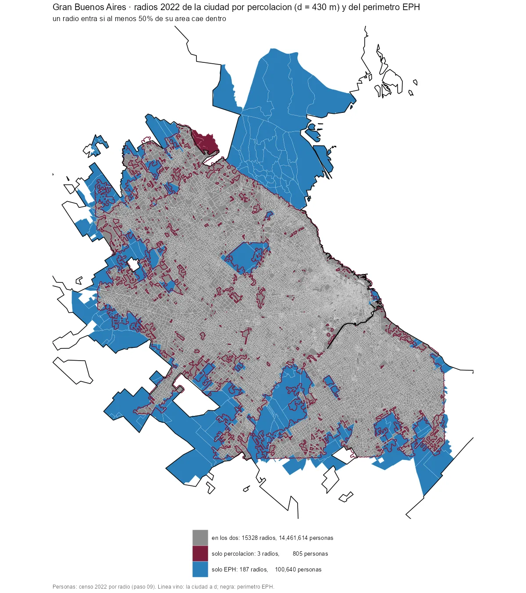

Mapa final, comunidades de Leiden con tau 15 min:

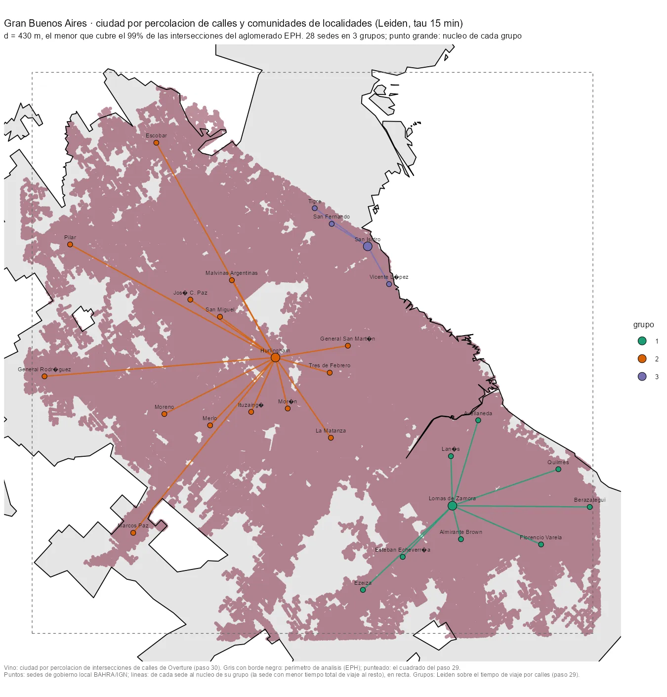

Mapa final, comunidades de Leiden con tau 30 min:

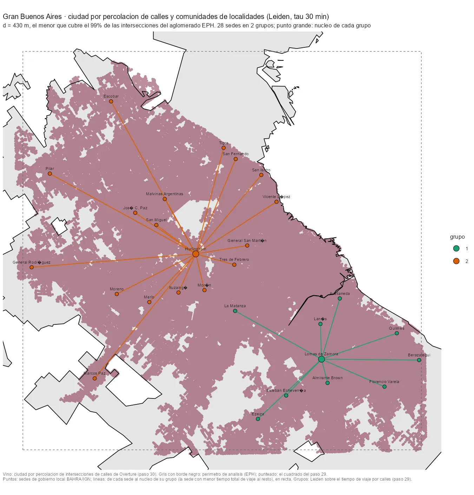

Lo construido (MapBiomas 2022): 2,113.4 km2 de urbano en el cuadrado; 2,096.6 km2 dentro del perimetro EPH y 2,067.2 km2 dentro de la ciudad a d = 430 m. La ciudad suma 7.2 km2 de urbano fuera del perimetro; el perimetro tiene 36.5 km2 de urbano fuera de la ciudad.

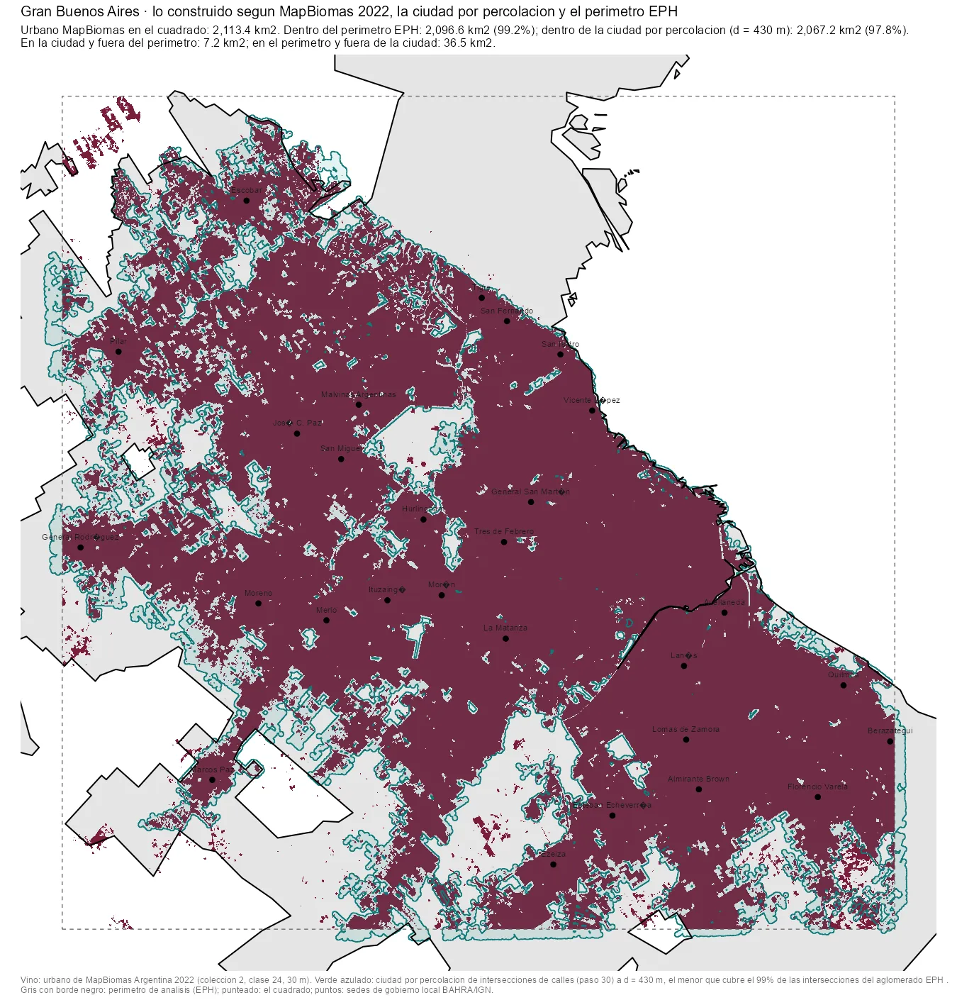

### Gran Buenos Aires (100km)

285,048 intersecciones en el cuadrado, 261,023 dentro del perimetro EPH. Perimetro EPH: 16,108 radios, 15,061,658 personas. Saltos mas grandes del tamano de la ciudad en d = 130, 140, 120 m.

**La ciudad cubre el 99% del aglomerado EPH a d = 600 m.** A ese d, la percolacion agrega 289 radios (188,167 personas) fuera del perimetro y deja 137 radios del perimetro (50,319 personas) con menos del 50% de su area dentro.

Diagnostico: no cubre el 100% a 2000 m.

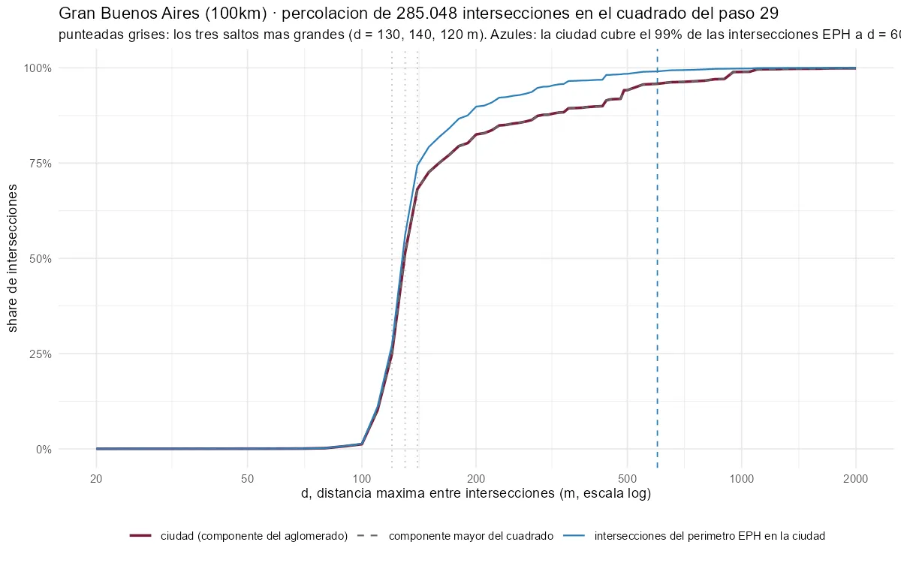

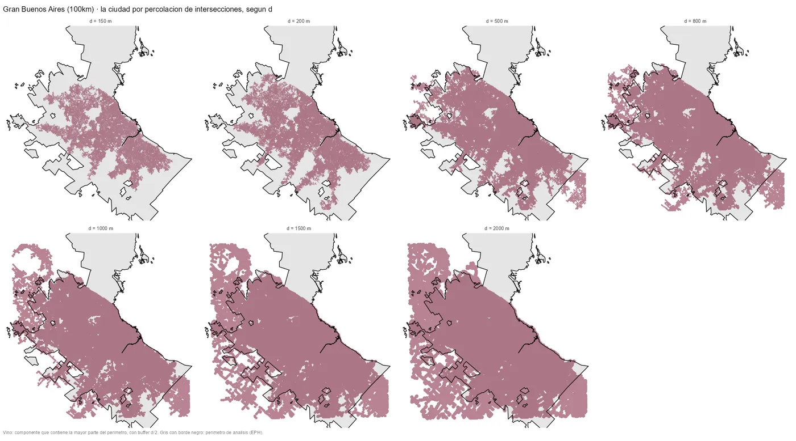

| d (m) | intersecciones de la ciudad | km2 | en los dos (radios / personas) | solo percolacion | solo EPH |
|---:|---:|---:|---:|---:|---:|
| 150 | 206,942 | 1641 | 14,525 / 13,748,587 | 0 / 0 | 1,583 / 1,313,071 |
| 200 | 235,230 | 2065.8 | 15,317 / 14,509,414 | 2 / 492 | 791 / 552,244 |
| 500 | 268,314 | 3317.8 | 15,907 / 14,967,231 | 238 / 159,987 | 201 / 94,427 |
| **600** | 273,092 | 3668.4 | 15,971 / 15,011,339 | 289 / 188,167 | 137 / 50,319 |
| 800 | 275,440 | 4147.8 | 16,017 / 15,034,392 | 319 / 197,282 | 91 / 27,266 |
| 1000 | 281,995 | 4708.8 | 16,038 / 15,044,796 | 483 / 323,732 | 70 / 16,862 |
| 1500 | 284,363 | 5754.5 | 16,059 / 15,051,629 | 550 / 351,127 | 49 / 10,029 |
| 2000 | 284,711 | 6455.9 | 16,063 / 15,052,741 | 576 / 356,141 | 45 / 8,917 |

En negrita, los d que cubren el 99% y el 100% del aglomerado EPH. El que mejor lo reproduce (menos personas en radios que difieren) es d = 800 m.

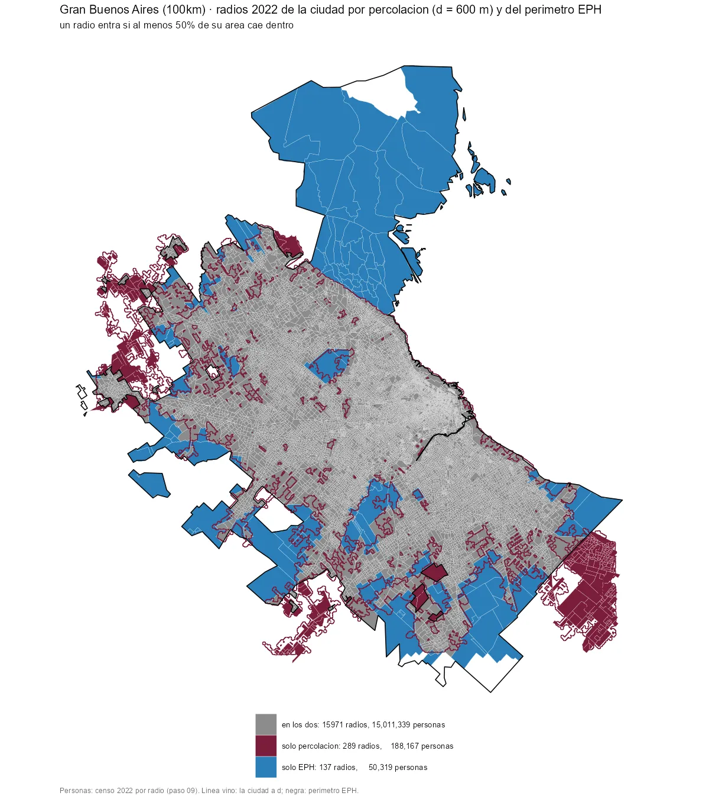

Mapa final, comunidades de Leiden con tau 15 min:

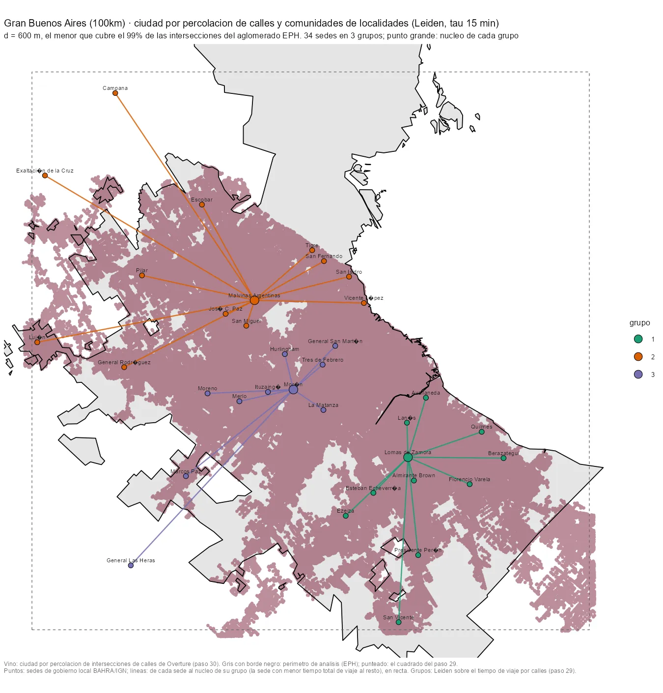

Mapa final, comunidades de Leiden con tau 30 min:

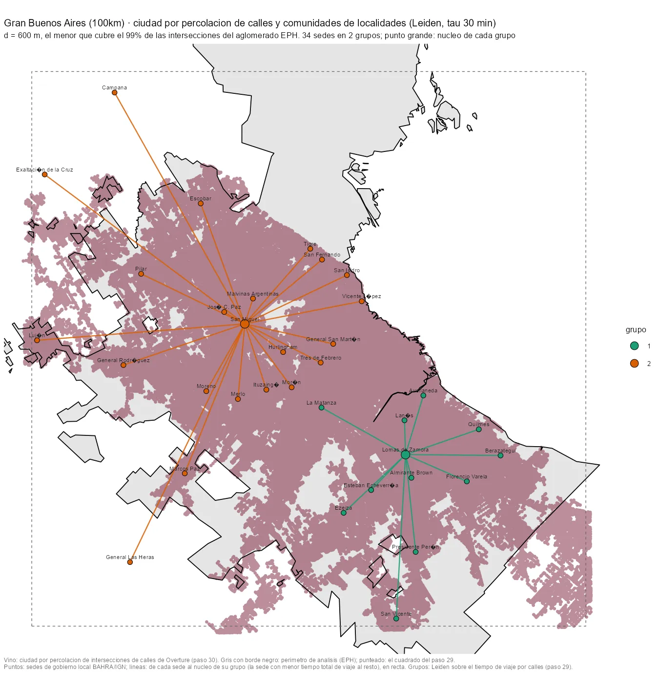

Lo construido (MapBiomas 2022): 2,584.9 km2 de urbano en el cuadrado; 2,343.9 km2 dentro del perimetro EPH y 2,472.9 km2 dentro de la ciudad a d = 600 m. La ciudad suma 156 km2 de urbano fuera del perimetro; el perimetro tiene 27 km2 de urbano fuera de la ciudad.

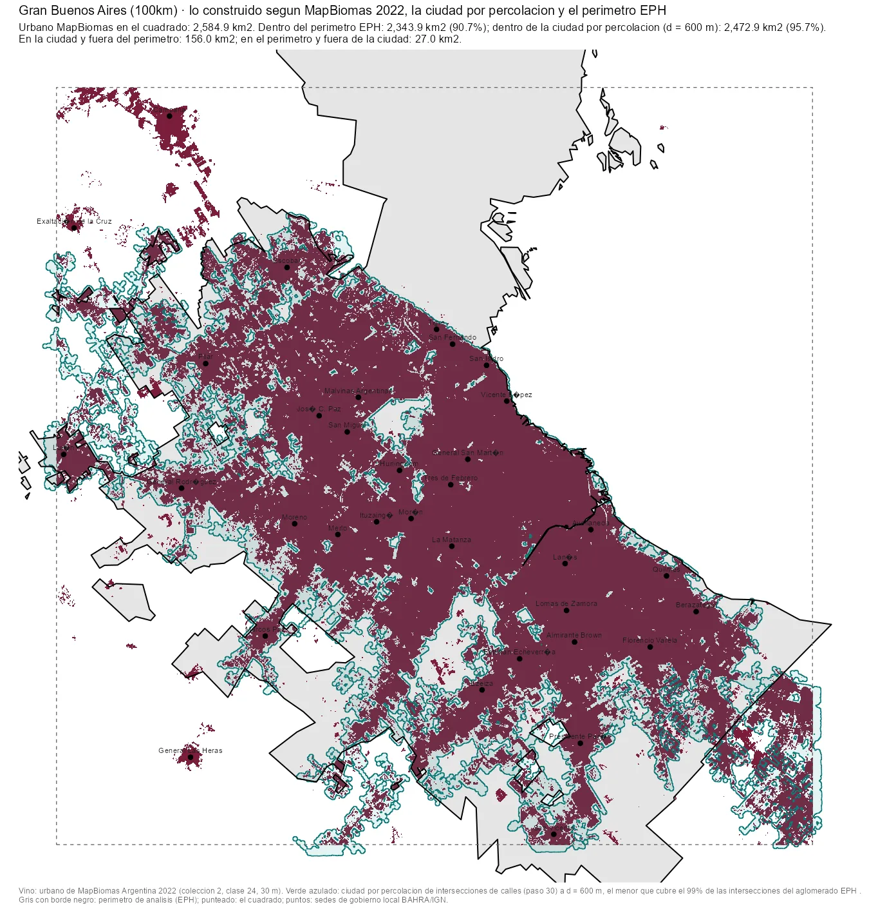

### Gran Catamarca

10,991 intersecciones en el cuadrado, 8,442 dentro del perimetro EPH. Perimetro EPH: 246 radios, 229,102 personas. Saltos mas grandes del tamano de la ciudad en d = 120, 140, 190 m.

**La ciudad cubre el 99% del aglomerado EPH a d = 650 m.** A ese d, la percolacion agrega 1 radios (671 personas) fuera del perimetro y deja 2 radios del perimetro (367 personas) con menos del 50% de su area dentro.

Diagnostico: cubre el 100% a d = 1350 m (agrega 9 radios, 6,157 personas; deja 1 radios, 163 personas).

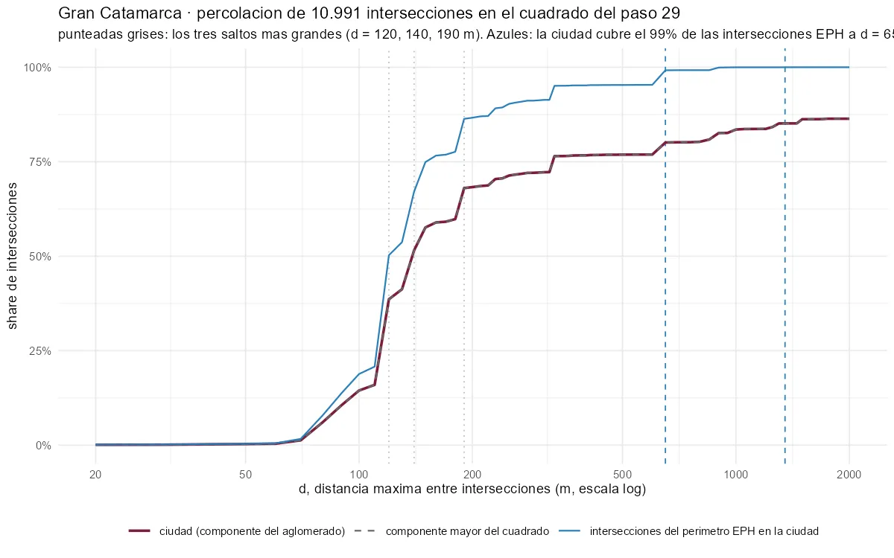

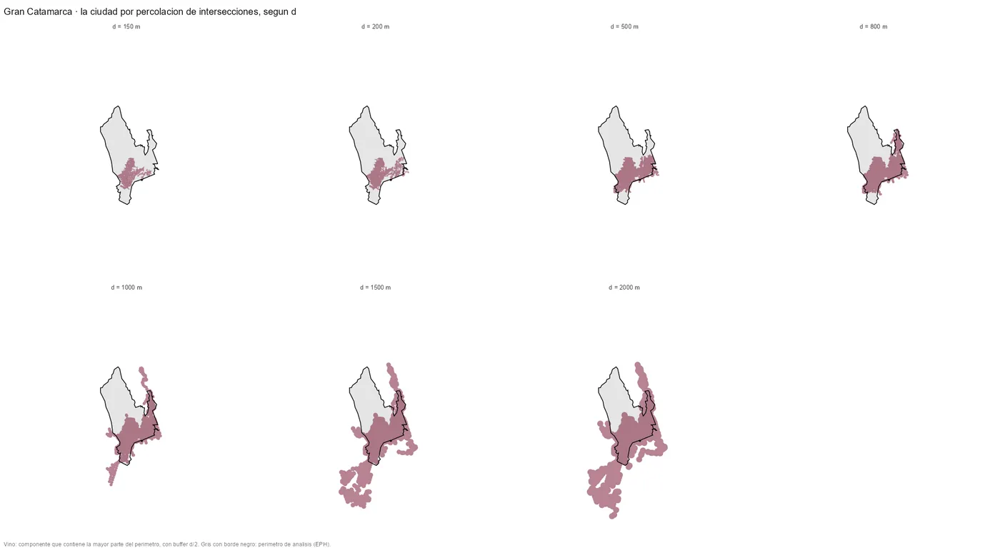

| d (m) | intersecciones de la ciudad | km2 | en los dos (radios / personas) | solo percolacion | solo EPH |
|---:|---:|---:|---:|---:|---:|
| 150 | 6,331 | 42.4 | 190 / 174,276 | 0 / 0 | 56 / 54,826 |
| 200 | 7,506 | 58.3 | 214 / 199,984 | 0 / 0 | 32 / 29,118 |
| 500 | 8,449 | 99.4 | 234 / 219,967 | 1 / 671 | 12 / 9,135 |
| **650** | 8,802 | 124.6 | 244 / 228,735 | 1 / 671 | 2 / 367 |
| 800 | 8,821 | 136.9 | 244 / 228,735 | 1 / 671 | 2 / 367 |
| 1000 | 9,179 | 192.4 | 245 / 228,939 | 5 / 4,647 | 1 / 163 |
| **1350** | 9,358 | 310.5 | 245 / 228,939 | 9 / 6,157 | 1 / 163 |
| 1500 | 9,480 | 348.5 | 245 / 228,939 | 14 / 8,783 | 1 / 163 |
| 2000 | 9,494 | 431.7 | 245 / 228,939 | 18 / 10,030 | 1 / 163 |

En negrita, los d que cubren el 99% y el 100% del aglomerado EPH. El que mejor lo reproduce (menos personas en radios que difieren) es d = 650 m.

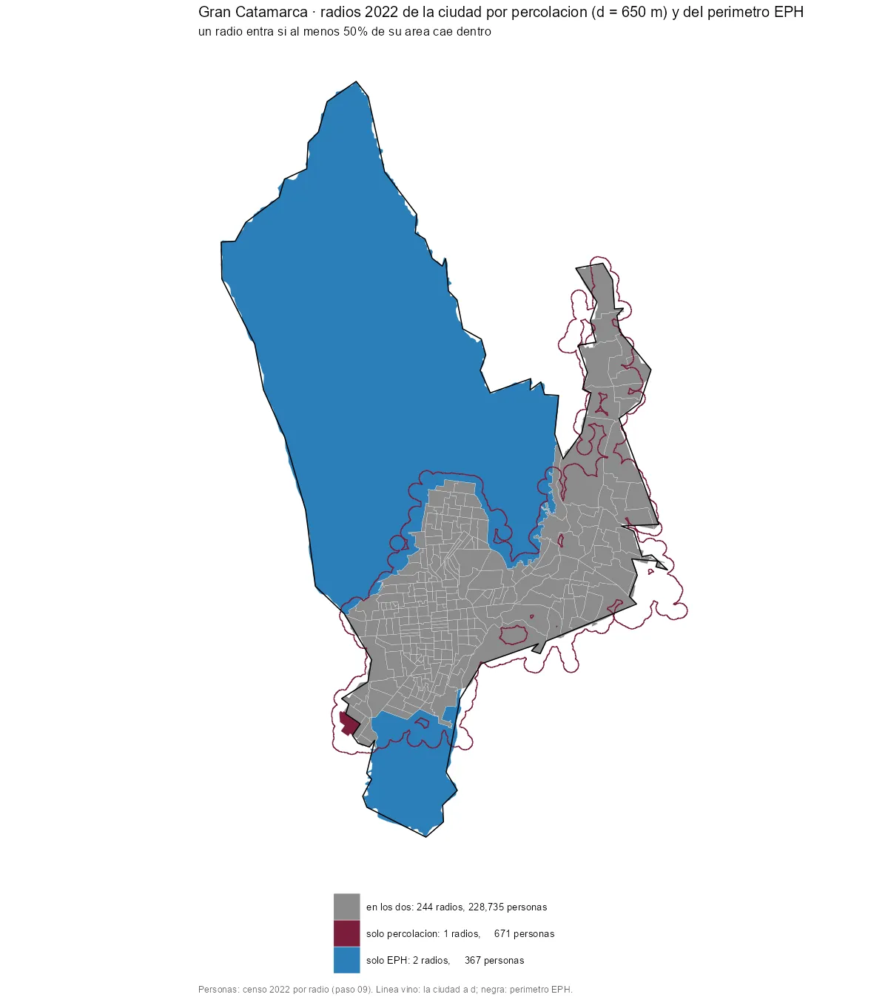

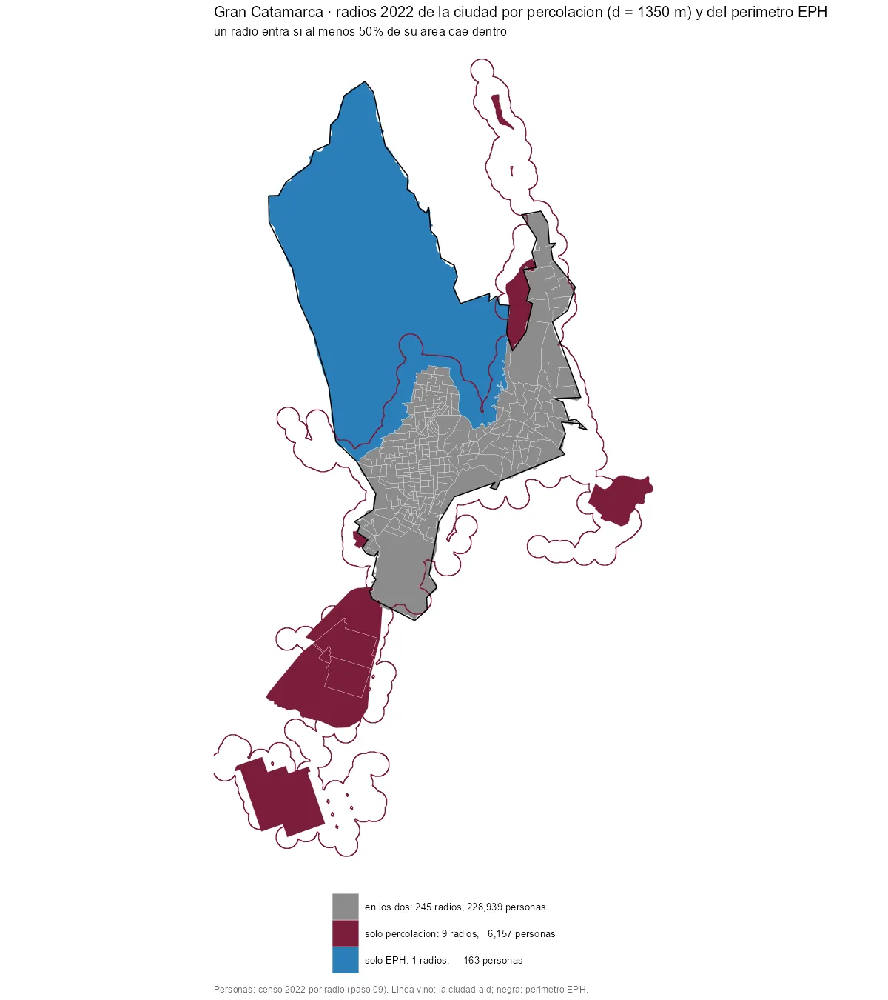

Mapa final, comunidades de Leiden con tau 15 min:

Mapa final, comunidades de Leiden con tau 30 min:

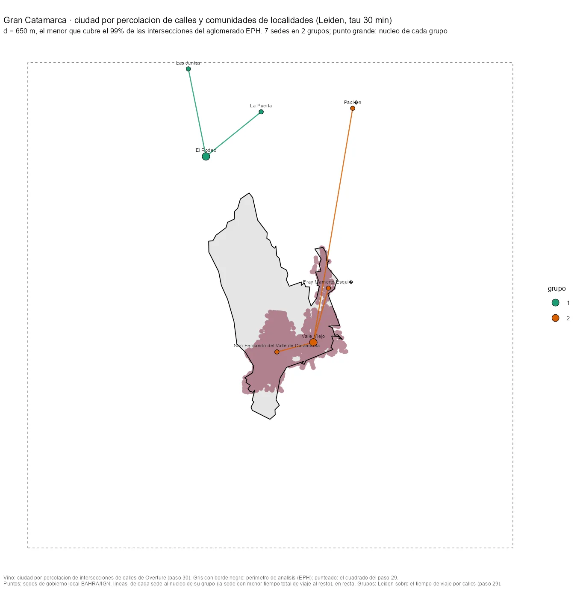

Lo construido (MapBiomas 2022): 98.3 km2 de urbano en el cuadrado; 74.8 km2 dentro del perimetro EPH y 75.4 km2 dentro de la ciudad a d = 650 m. La ciudad suma 3.2 km2 de urbano fuera del perimetro; el perimetro tiene 2.7 km2 de urbano fuera de la ciudad.

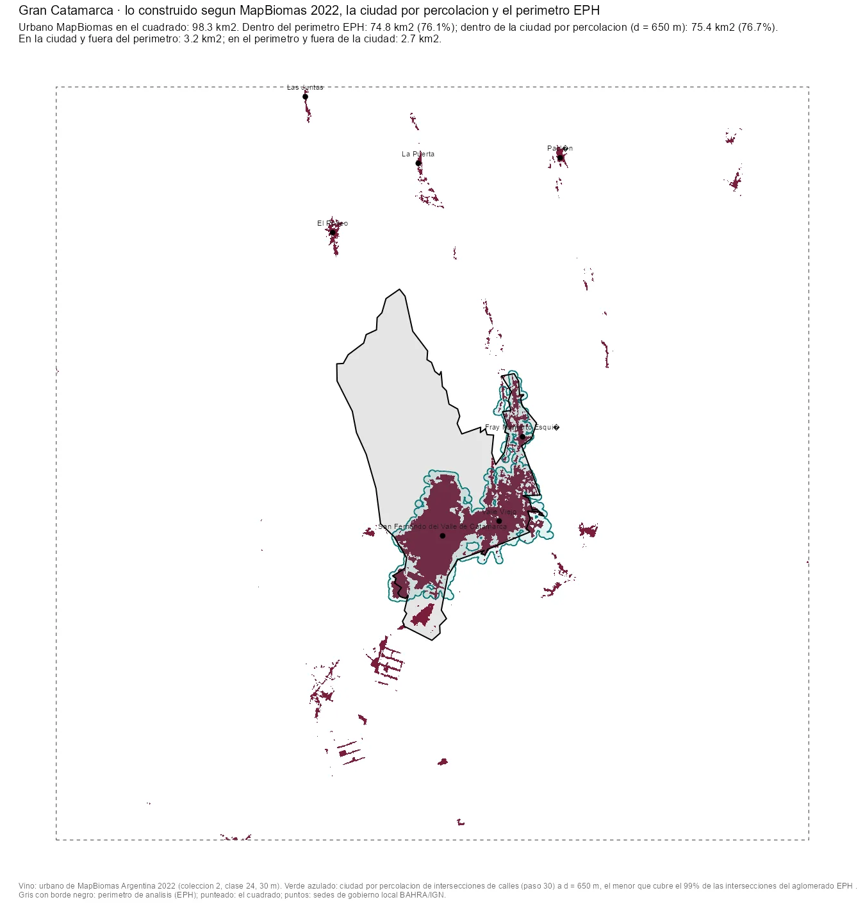

### Gran Córdoba

78,247 intersecciones en el cuadrado, 48,228 dentro del perimetro EPH. Perimetro EPH: 2,330 radios, 1,709,852 personas. Saltos mas grandes del tamano de la ciudad en d = 700, 110, 120 m.

**La ciudad cubre el 99% del aglomerado EPH a d = 700 m.** A ese d, la percolacion agrega 425 radios (216,870 personas) fuera del perimetro y deja 9 radios del perimetro (6,167 personas) con menos del 50% de su area dentro.

Diagnostico: cubre el 100% a d = 1800 m (agrega 606 radios, 331,592 personas; deja 0 radios, 0 personas).

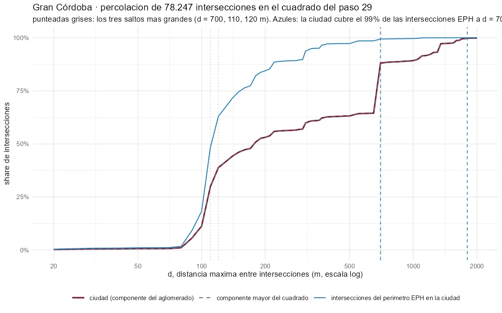

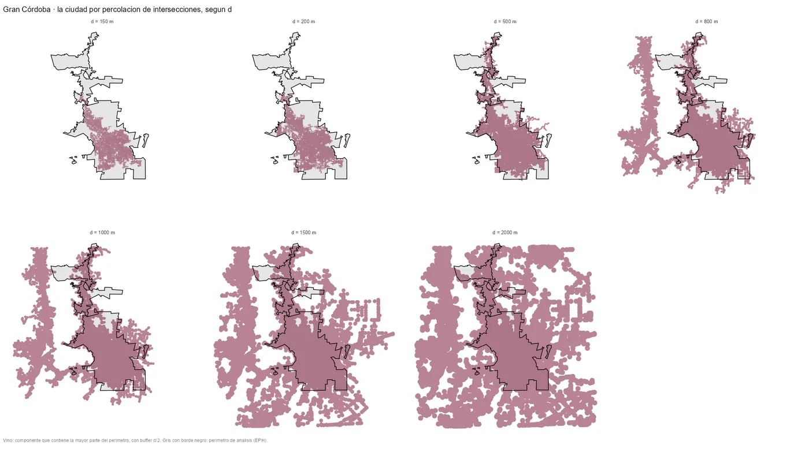

| d (m) | intersecciones de la ciudad | km2 | en los dos (radios / personas) | solo percolacion | solo EPH |
|---:|---:|---:|---:|---:|---:|
| 150 | 36,081 | 228.3 | 1,957 / 1,422,505 | 0 / 0 | 373 / 287,347 |
| 200 | 41,551 | 295.1 | 2,094 / 1,526,389 | 5 / 3,002 | 236 / 183,463 |
| 500 | 49,418 | 572.6 | 2,278 / 1,661,045 | 11 / 7,362 | 52 / 48,807 |
| **700** | 68,862 | 1117.2 | 2,321 / 1,703,685 | 425 / 216,870 | 9 / 6,167 |
| 800 | 69,328 | 1222.9 | 2,324 / 1,706,338 | 432 / 220,048 | 6 / 3,514 |
| 1000 | 69,814 | 1424.7 | 2,325 / 1,707,056 | 442 / 221,667 | 5 / 2,796 |
| 1500 | 76,208 | 2551.4 | 2,328 / 1,708,705 | 540 / 293,425 | 2 / 1,147 |
| **1800** | 78,081 | 3332.4 | 2,330 / 1,709,852 | 606 / 331,592 | 0 / 0 |
| 2000 | 78,113 | 3574.2 | 2,330 / 1,709,852 | 610 / 331,879 | 0 / 0 |

En negrita, los d que cubren el 99% y el 100% del aglomerado EPH. El que mejor lo reproduce (menos personas en radios que difieren) es d = 500 m.

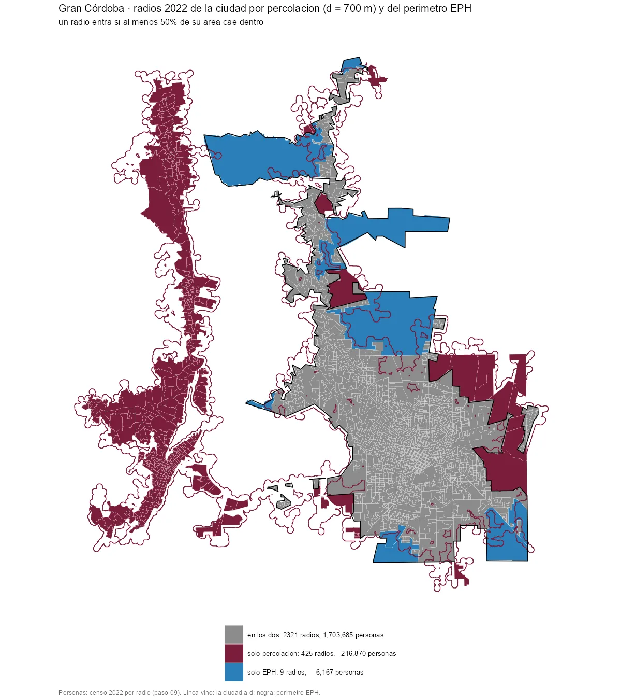

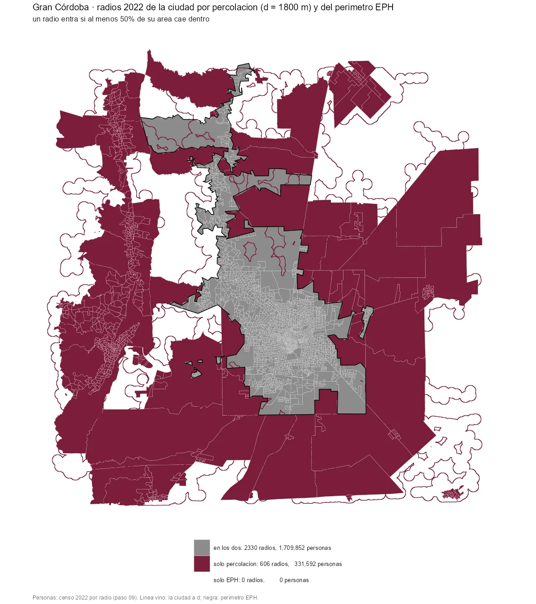

Mapa final, comunidades de Leiden con tau 15 min:

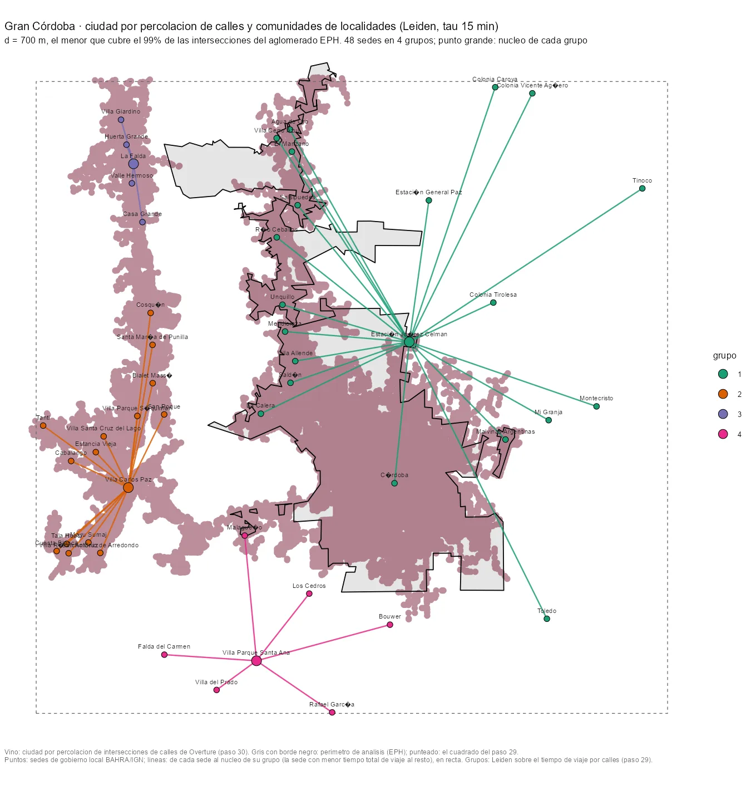

Mapa final, comunidades de Leiden con tau 30 min:

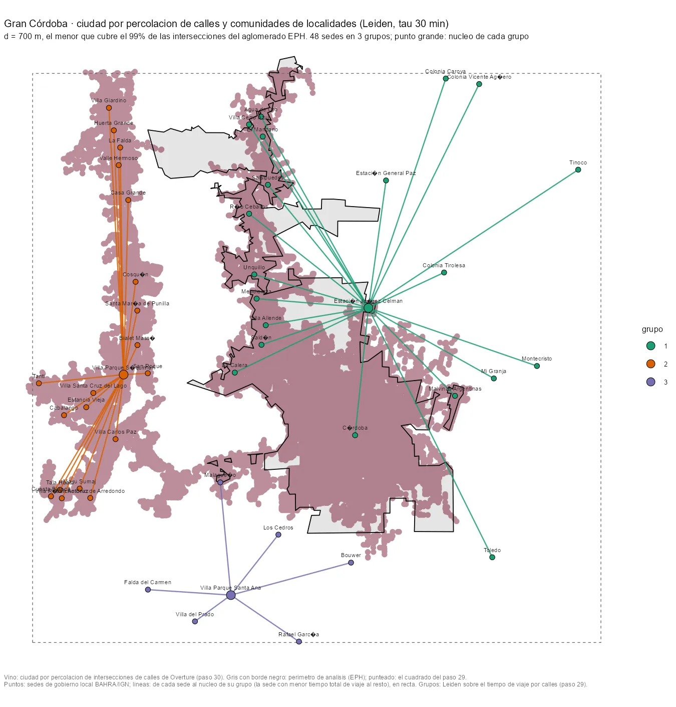

Lo construido (MapBiomas 2022): 607.8 km2 de urbano en el cuadrado; 378.3 km2 dentro del perimetro EPH y 559.3 km2 dentro de la ciudad a d = 700 m. La ciudad suma 182.3 km2 de urbano fuera del perimetro; el perimetro tiene 1.3 km2 de urbano fuera de la ciudad.

### Gran La Plata

66,942 intersecciones en el cuadrado, 24,708 dentro del perimetro EPH. Perimetro EPH: 1,225 radios, 916,202 personas. Saltos mas grandes del tamano de la ciudad en d = 490, 140, 210 m.

**La ciudad cubre el 99% del aglomerado EPH a d = 1000 m.** A ese d, la percolacion agrega 2,237 radios (2,273,821 personas) fuera del perimetro y deja 17 radios del perimetro (7,325 personas) con menos del 50% de su area dentro.

Diagnostico: no cubre el 100% a 2000 m.

| d (m) | intersecciones de la ciudad | km2 | en los dos (radios / personas) | solo percolacion | solo EPH |
|---:|---:|---:|---:|---:|---:|
| 150 | 14,540 | 135.5 | 910 / 678,460 | 0 / 0 | 315 / 237,742 |
| 200 | 15,589 | 164.9 | 939 / 702,232 | 0 / 0 | 286 / 213,970 |
| 500 | 61,238 | 881.6 | 1,188 / 897,612 | 2,186 / 2,233,875 | 37 / 18,590 |
| 800 | 61,752 | 1092.5 | 1,203 / 906,715 | 2,219 / 2,264,966 | 22 / 9,487 |
| **1000** | 63,098 | 1276.4 | 1,208 / 908,877 | 2,237 / 2,273,821 | 17 / 7,325 |
| 1500 | 65,970 | 1850.4 | 1,215 / 911,142 | 2,326 / 2,324,003 | 10 / 5,060 |
| 2000 | 66,822 | 2605.1 | 1,218 / 912,039 | 2,345 / 2,329,252 | 7 / 4,163 |

En negrita, los d que cubren el 99% y el 100% del aglomerado EPH. El que mejor lo reproduce (menos personas en radios que difieren) es d = 200 m.

Mapa final, comunidades de Leiden con tau 15 min:

Mapa final, comunidades de Leiden con tau 30 min:

Lo construido (MapBiomas 2022): 691.8 km2 de urbano en el cuadrado; 308.8 km2 dentro del perimetro EPH y 663 km2 dentro de la ciudad a d = 1000 m. La ciudad suma 356.4 km2 de urbano fuera del perimetro; el perimetro tiene 2.2 km2 de urbano fuera de la ciudad.

### Gran Mendoza

41,984 intersecciones en el cuadrado, 31,408 dentro del perimetro EPH. Perimetro EPH: 1,338 radios, 1,115,703 personas. Saltos mas grandes del tamano de la ciudad en d = 120, 110, 170 m.

**La ciudad cubre el 99% del aglomerado EPH a d = 410 m.** A ese d, la percolacion agrega 85 radios (84,018 personas) fuera del perimetro y deja 23 radios del perimetro (22,946 personas) con menos del 50% de su area dentro.

Diagnostico: no cubre el 100% a 2000 m.

| d (m) | intersecciones de la ciudad | km2 | en los dos (radios / personas) | solo percolacion | solo EPH |
|---:|---:|---:|---:|---:|---:|
| 150 | 20,370 | 131.2 | 998 / 802,414 | 0 / 0 | 340 / 313,289 |
| 200 | 26,432 | 200.9 | 1,169 / 949,160 | 0 / 0 | 169 / 166,543 |
| **410** | 35,479 | 462.5 | 1,315 / 1,092,757 | 85 / 84,018 | 23 / 22,946 |
| 500 | 37,038 | 580.9 | 1,325 / 1,106,365 | 120 / 126,252 | 13 / 9,338 |
| 800 | 38,799 | 890.9 | 1,331 / 1,111,932 | 150 / 164,172 | 7 / 3,771 |
| 1000 | 39,827 | 1093.5 | 1,332 / 1,112,038 | 175 / 195,806 | 6 / 3,665 |
| 1500 | 41,105 | 1615 | 1,333 / 1,112,885 | 208 / 231,262 | 5 / 2,818 |
| 2000 | 41,306 | 1992.3 | 1,333 / 1,112,885 | 223 / 248,597 | 5 / 2,818 |

En negrita, los d que cubren el 99% y el 100% del aglomerado EPH. El que mejor lo reproduce (menos personas en radios que difieren) es d = 410 m.

Mapa final, comunidades de Leiden con tau 15 min:

Mapa final, comunidades de Leiden con tau 30 min:

Lo construido (MapBiomas 2022): 417.4 km2 de urbano en el cuadrado; 298 km2 dentro del perimetro EPH y 339 km2 dentro de la ciudad a d = 410 m. La ciudad suma 53.7 km2 de urbano fuera del perimetro; el perimetro tiene 12.6 km2 de urbano fuera de la ciudad.

### Gran Paraná

30,349 intersecciones en el cuadrado, 7,670 dentro del perimetro EPH. Perimetro EPH: 509 radios, 301,776 personas. Saltos mas grandes del tamano de la ciudad en d = 1100, 1350, 130 m.

**La ciudad cubre el 99% del aglomerado EPH a d = 550 m.** A ese d, la percolacion agrega 5 radios (1,133 personas) fuera del perimetro y deja 8 radios del perimetro (1,182 personas) con menos del 50% de su area dentro.

Diagnostico: cubre el 100% a d = 1200 m (agrega 105 radios, 39,636 personas; deja 0 radios, 0 personas).

| d (m) | intersecciones de la ciudad | km2 | en los dos (radios / personas) | solo percolacion | solo EPH |
|---:|---:|---:|---:|---:|---:|
| 150 | 5,001 | 41.5 | 373 / 234,875 | 0 / 0 | 136 / 66,901 |
| 200 | 5,627 | 56.5 | 414 / 255,613 | 0 / 0 | 95 / 46,163 |
| 500 | 7,603 | 113.8 | 487 / 293,267 | 3 / 678 | 22 / 8,509 |
| **550** | 8,080 | 131.7 | 501 / 300,594 | 5 / 1,133 | 8 / 1,182 |
| 800 | 8,178 | 163.3 | 504 / 300,946 | 6 / 1,286 | 5 / 830 |
| 1000 | 8,261 | 198.9 | 507 / 301,724 | 7 / 1,432 | 2 / 52 |
| **1200** | 11,787 | 675.7 | 509 / 301,776 | 105 / 39,636 | 0 / 0 |
| 1500 | 14,037 | 1188.6 | 509 / 301,776 | 176 / 68,528 | 0 / 0 |
| 2000 | 14,741 | 1765.9 | 509 / 301,776 | 213 / 75,921 | 0 / 0 |

En negrita, los d que cubren el 99% y el 100% del aglomerado EPH. El que mejor lo reproduce (menos personas en radios que difieren) es d = 1000 m.

Mapa final, comunidades de Leiden con tau 15 min:

Mapa final, comunidades de Leiden con tau 30 min:

Lo construido (MapBiomas 2022): 287.4 km2 de urbano en el cuadrado; 82.4 km2 dentro del perimetro EPH y 86.9 km2 dentro de la ciudad a d = 550 m. La ciudad suma 5 km2 de urbano fuera del perimetro; el perimetro tiene 0.5 km2 de urbano fuera de la ciudad.

### Gran Resistencia

26,160 intersecciones en el cuadrado, 12,650 dentro del perimetro EPH. Perimetro EPH: 525 radios, 414,305 personas. Saltos mas grandes del tamano de la ciudad en d = 120, 130, 140 m.

**La ciudad cubre el 99% del aglomerado EPH a d = 370 m.** A ese d, la percolacion agrega 1 radios (238 personas) fuera del perimetro y deja 7 radios del perimetro (4,303 personas) con menos del 50% de su area dentro.

Diagnostico: cubre el 100% a d = 1050 m (agrega 25 radios, 14,292 personas; deja 0 radios, 0 personas).

| d (m) | intersecciones de la ciudad | km2 | en los dos (radios / personas) | solo percolacion | solo EPH |
|---:|---:|---:|---:|---:|---:|
| 150 | 10,147 | 69.6 | 447 / 349,226 | 0 / 0 | 78 / 65,079 |
| 200 | 11,507 | 87 | 479 / 376,148 | 0 / 0 | 46 / 38,157 |
| **370** | 13,091 | 144.9 | 518 / 410,002 | 1 / 238 | 7 / 4,303 |
| 500 | 13,336 | 173.2 | 522 / 411,994 | 2 / 1,306 | 3 / 2,311 |
| 800 | 13,639 | 229.5 | 524 / 413,205 | 6 / 2,691 | 1 / 1,100 |
| 1000 | 13,716 | 267.3 | 525 / 414,305 | 6 / 2,691 | 0 / 0 |
| **1050** | 14,760 | 393.4 | 525 / 414,305 | 25 / 14,292 | 0 / 0 |
| 1500 | 14,776 | 486.1 | 525 / 414,305 | 30 / 16,212 | 0 / 0 |
| 2000 | 14,816 | 601.6 | 525 / 414,305 | 31 / 16,850 | 0 / 0 |

En negrita, los d que cubren el 99% y el 100% del aglomerado EPH. El que mejor lo reproduce (menos personas en radios que difieren) es d = 1000 m.

Mapa final, comunidades de Leiden con tau 15 min:

Mapa final, comunidades de Leiden con tau 30 min:

Lo construido (MapBiomas 2022): 232.7 km2 de urbano en el cuadrado; 105.2 km2 dentro del perimetro EPH y 109.6 km2 dentro de la ciudad a d = 370 m. La ciudad suma 7.2 km2 de urbano fuera del perimetro; el perimetro tiene 2.8 km2 de urbano fuera de la ciudad.

### Gran Rosario

46,499 intersecciones en el cuadrado, 32,845 dentro del perimetro EPH. Perimetro EPH: 2,070 radios, 1,447,588 personas. Saltos mas grandes del tamano de la ciudad en d = 160, 130, 120 m.

**La ciudad cubre el 99% del aglomerado EPH a d = 550 m.** A ese d, la percolacion agrega 32 radios (12,677 personas) fuera del perimetro y deja 9 radios del perimetro (3,328 personas) con menos del 50% de su area dentro.

Diagnostico: cubre el 100% a d = 1300 m (agrega 119 radios, 63,157 personas; deja 1 radios, 34 personas).

| d (m) | intersecciones de la ciudad | km2 | en los dos (radios / personas) | solo percolacion | solo EPH |
|---:|---:|---:|---:|---:|---:|
| 150 | 18,099 | 129 | 1,579 / 1,075,511 | 0 / 0 | 491 / 372,077 |
| 200 | 30,797 | 265.2 | 1,908 / 1,332,549 | 1 / 431 | 162 / 115,039 |
| 500 | 39,260 | 533.4 | 2,059 / 1,442,817 | 30 / 11,930 | 11 / 4,771 |
| **550** | 39,503 | 568.2 | 2,061 / 1,444,260 | 32 / 12,677 | 9 / 3,328 |
| 800 | 40,661 | 742.7 | 2,066 / 1,446,568 | 42 / 18,195 | 4 / 1,020 |
| 1000 | 41,788 | 932.8 | 2,067 / 1,447,331 | 62 / 29,476 | 3 / 257 |
| **1300** | 44,929 | 1585.7 | 2,069 / 1,447,554 | 119 / 63,157 | 1 / 34 |
| 1500 | 45,194 | 1924.4 | 2,069 / 1,447,554 | 127 / 64,304 | 1 / 34 |
| 2000 | 46,400 | 2921.1 | 2,070 / 1,447,588 | 163 / 77,449 | 0 / 0 |

En negrita, los d que cubren el 99% y el 100% del aglomerado EPH. El que mejor lo reproduce (menos personas en radios que difieren) es d = 550 m.

Mapa final, comunidades de Leiden con tau 15 min:

Mapa final, comunidades de Leiden con tau 30 min:

Lo construido (MapBiomas 2022): 349.7 km2 de urbano en el cuadrado; 282.1 km2 dentro del perimetro EPH y 319.4 km2 dentro de la ciudad a d = 550 m. La ciudad suma 39.5 km2 de urbano fuera del perimetro; el perimetro tiene 2.2 km2 de urbano fuera de la ciudad.

### Gran San Juan

22,676 intersecciones en el cuadrado, 16,913 dentro del perimetro EPH. Perimetro EPH: 624 radios, 601,627 personas. Saltos mas grandes del tamano de la ciudad en d = 130, 110, 1350 m.

**La ciudad cubre el 99% del aglomerado EPH a d = 700 m.** A ese d, la percolacion agrega 12 radios (9,810 personas) fuera del perimetro y deja 10 radios del perimetro (10,577 personas) con menos del 50% de su area dentro.

Diagnostico: cubre el 100% a d = 1550 m (agrega 118 radios, 121,156 personas; deja 2 radios, 1,700 personas).

| d (m) | intersecciones de la ciudad | km2 | en los dos (radios / personas) | solo percolacion | solo EPH |
|---:|---:|---:|---:|---:|---:|
| 150 | 11,270 | 79.8 | 460 / 424,611 | 0 / 0 | 164 / 177,016 |
| 200 | 12,621 | 105.7 | 493 / 460,799 | 0 / 0 | 131 / 140,828 |
| 500 | 16,789 | 266.2 | 581 / 557,810 | 1 / 658 | 43 / 43,817 |
| **700** | 18,170 | 405.2 | 614 / 591,050 | 12 / 9,810 | 10 / 10,577 |
| 800 | 18,799 | 490 | 615 / 592,439 | 21 / 19,098 | 9 / 9,188 |
| 1000 | 19,362 | 634.4 | 620 / 598,545 | 34 / 35,006 | 4 / 3,082 |
| 1500 | 22,004 | 1400.8 | 622 / 599,927 | 118 / 121,156 | 2 / 1,700 |
| **1550** | 22,023 | 1431 | 622 / 599,927 | 118 / 121,156 | 2 / 1,700 |
| 2000 | 22,264 | 1711.7 | 623 / 601,036 | 123 / 124,589 | 1 / 591 |

En negrita, los d que cubren el 99% y el 100% del aglomerado EPH. El que mejor lo reproduce (menos personas en radios que difieren) es d = 700 m.

Mapa final, comunidades de Leiden con tau 15 min:

Mapa final, comunidades de Leiden con tau 30 min:

Lo construido (MapBiomas 2022): 256.9 km2 de urbano en el cuadrado; 179 km2 dentro del perimetro EPH y 187.6 km2 dentro de la ciudad a d = 700 m. La ciudad suma 13.2 km2 de urbano fuera del perimetro; el perimetro tiene 4.5 km2 de urbano fuera de la ciudad.

### Gran Santa Fe

30,279 intersecciones en el cuadrado, 14,182 dentro del perimetro EPH. Perimetro EPH: 742 radios, 536,948 personas. Saltos mas grandes del tamano de la ciudad en d = 110, 600, 1500 m.

**La ciudad cubre el 99% del aglomerado EPH a d = 1500 m.** A ese d, la percolacion agrega 112 radios (71,481 personas) fuera del perimetro y deja 8 radios del perimetro (2,847 personas) con menos del 50% de su area dentro.

Diagnostico: no cubre el 100% a 2000 m.

| d (m) | intersecciones de la ciudad | km2 | en los dos (radios / personas) | solo percolacion | solo EPH |
|---:|---:|---:|---:|---:|---:|
| 150 | 7,078 | 50.9 | 503 / 350,288 | 0 / 0 | 239 / 186,660 |
| 200 | 7,451 | 58.8 | 514 / 361,848 | 0 / 0 | 228 / 175,100 |
| 500 | 8,848 | 104.6 | 559 / 401,862 | 0 / 0 | 183 / 135,086 |
| 800 | 12,964 | 265.8 | 688 / 501,461 | 3 / 1,716 | 54 / 35,487 |
| 1000 | 13,604 | 389.8 | 690 / 503,379 | 14 / 8,573 | 52 / 33,569 |
| **1500** | 19,405 | 1281.3 | 734 / 534,101 | 112 / 71,481 | 8 / 2,847 |
| 2000 | 19,991 | 1746.6 | 736 / 535,235 | 127 / 77,701 | 6 / 1,713 |

En negrita, los d que cubren el 99% y el 100% del aglomerado EPH. El que mejor lo reproduce (menos personas en radios que difieren) es d = 800 m.

Mapa final, comunidades de Leiden con tau 15 min:

Mapa final, comunidades de Leiden con tau 30 min:

Lo construido (MapBiomas 2022): 288.3 km2 de urbano en el cuadrado; 140.5 km2 dentro del perimetro EPH y 181.1 km2 dentro de la ciudad a d = 1500 m. La ciudad suma 40.8 km2 de urbano fuera del perimetro; el perimetro tiene 0.3 km2 de urbano fuera de la ciudad.

### Gran Tucumán - Tafí Viejo

27,784 intersecciones en el cuadrado, 19,183 dentro del perimetro EPH. Perimetro EPH: 1,114 radios, 1,039,709 personas. Saltos mas grandes del tamano de la ciudad en d = 160, 140, 1650 m.

**La ciudad cubre el 99% del aglomerado EPH a d = 380 m.** A ese d, la percolacion agrega 10 radios (8,000 personas) fuera del perimetro y deja 10 radios del perimetro (7,777 personas) con menos del 50% de su area dentro.

Diagnostico: cubre el 100% a d = 1100 m (agrega 131 radios, 101,407 personas; deja 2 radios, 492 personas).

| d (m) | intersecciones de la ciudad | km2 | en los dos (radios / personas) | solo percolacion | solo EPH |
|---:|---:|---:|---:|---:|---:|
| 150 | 10,666 | 80.5 | 563 / 547,636 | 0 / 0 | 551 / 492,073 |
| 200 | 16,851 | 150.3 | 981 / 910,434 | 1 / 262 | 133 / 129,275 |
| **380** | 20,531 | 248.3 | 1,104 / 1,031,932 | 10 / 8,000 | 10 / 7,777 |
| 500 | 20,754 | 278.9 | 1,107 / 1,034,634 | 20 / 14,181 | 7 / 5,075 |
| 800 | 22,625 | 417.3 | 1,111 / 1,039,028 | 84 / 71,651 | 3 / 681 |
| 1000 | 23,602 | 611.2 | 1,112 / 1,039,217 | 123 / 95,733 | 2 / 492 |
| **1100** | 23,769 | 682.8 | 1,112 / 1,039,217 | 131 / 101,407 | 2 / 492 |
| 1500 | 24,411 | 991.8 | 1,113 / 1,039,358 | 175 / 125,591 | 1 / 351 |
| 2000 | 27,074 | 1774.8 | 1,114 / 1,039,709 | 323 / 236,824 | 0 / 0 |

En negrita, los d que cubren el 99% y el 100% del aglomerado EPH. El que mejor lo reproduce (menos personas en radios que difieren) es d = 380 m.

Mapa final, comunidades de Leiden con tau 15 min:

Mapa final, comunidades de Leiden con tau 30 min:

Lo construido (MapBiomas 2022): 273 km2 de urbano en el cuadrado; 181.3 km2 dentro del perimetro EPH y 192.7 km2 dentro de la ciudad a d = 380 m. La ciudad suma 14.5 km2 de urbano fuera del perimetro; el perimetro tiene 3.1 km2 de urbano fuera de la ciudad.

### Jujuy - Palpalá

16,064 intersecciones en el cuadrado, 9,883 dentro del perimetro EPH. Perimetro EPH: 395 radios, 377,504 personas. Saltos mas grandes del tamano de la ciudad en d = 1250, 130, 180 m.

**La ciudad cubre el 99% del aglomerado EPH a d = 800 m.** A ese d, la percolacion agrega 10 radios (4,390 personas) fuera del perimetro y deja 5 radios del perimetro (1,931 personas) con menos del 50% de su area dentro.

Diagnostico: cubre el 100% a d = 1800 m (agrega 122 radios, 115,988 personas; deja 2 radios, 851 personas).

| d (m) | intersecciones de la ciudad | km2 | en los dos (radios / personas) | solo percolacion | solo EPH |
|---:|---:|---:|---:|---:|---:|
| 150 | 6,094 | 37.7 | 260 / 249,172 | 0 / 0 | 135 / 128,332 |
| 200 | 8,305 | 59.6 | 325 / 320,735 | 1 / 214 | 70 / 56,769 |
| 500 | 10,691 | 124.3 | 386 / 372,257 | 9 / 4,292 | 9 / 5,247 |
| **800** | 10,891 | 163.9 | 390 / 375,573 | 10 / 4,390 | 5 / 1,931 |
| 1000 | 11,120 | 205.3 | 390 / 375,573 | 11 / 4,810 | 5 / 1,931 |
| 1500 | 15,670 | 612.8 | 391 / 375,672 | 120 / 114,295 | 4 / 1,832 |
| **1800** | 15,739 | 715.5 | 393 / 376,653 | 122 / 115,988 | 2 / 851 |
| 2000 | 15,762 | 780.2 | 393 / 376,653 | 123 / 116,265 | 2 / 851 |

En negrita, los d que cubren el 99% y el 100% del aglomerado EPH. El que mejor lo reproduce (menos personas en radios que difieren) es d = 800 m.

Mapa final, comunidades de Leiden con tau 15 min:

Mapa final, comunidades de Leiden con tau 30 min:

Lo construido (MapBiomas 2022): 107 km2 de urbano en el cuadrado; 69.7 km2 dentro del perimetro EPH y 75.3 km2 dentro de la ciudad a d = 800 m. La ciudad suma 6.9 km2 de urbano fuera del perimetro; el perimetro tiene 1.2 km2 de urbano fuera de la ciudad.

### La Rioja

9,370 intersecciones en el cuadrado, 8,773 dentro del perimetro EPH. Perimetro EPH: 258 radios, 209,485 personas. Saltos mas grandes del tamano de la ciudad en d = 130, 100, 120 m.

**La ciudad cubre el 99% del aglomerado EPH a d = 1700 m.** A ese d, la percolacion agrega 0 radios (0 personas) fuera del perimetro y deja 2 radios del perimetro (1,643 personas) con menos del 50% de su area dentro.

Diagnostico: no cubre el 100% a 2000 m.

| d (m) | intersecciones de la ciudad | km2 | en los dos (radios / personas) | solo percolacion | solo EPH |
|---:|---:|---:|---:|---:|---:|
| 150 | 7,167 | 51.1 | 227 / 182,370 | 0 / 0 | 31 / 27,115 |
| 200 | 8,244 | 71.9 | 244 / 197,876 | 0 / 0 | 14 / 11,609 |
| 500 | 8,819 | 113.2 | 255 / 207,484 | 0 / 0 | 3 / 2,001 |
| 800 | 8,915 | 141.2 | 255 / 207,484 | 0 / 0 | 3 / 2,001 |
| 1000 | 8,973 | 163.8 | 255 / 207,484 | 0 / 0 | 3 / 2,001 |
| 1500 | 8,995 | 209.3 | 255 / 207,484 | 0 / 0 | 3 / 2,001 |
| **1700** | 9,052 | 243.2 | 256 / 207,842 | 0 / 0 | 2 / 1,643 |
| 2000 | 9,270 | 306.5 | 256 / 207,842 | 5 / 2,925 | 2 / 1,643 |

En negrita, los d que cubren el 99% y el 100% del aglomerado EPH. El que mejor lo reproduce (menos personas en radios que difieren) es d = 1700 m.

Mapa final, comunidades de Leiden con tau 15 min:

Mapa final, comunidades de Leiden con tau 30 min:

Lo construido (MapBiomas 2022): 57.8 km2 de urbano en el cuadrado; 56.9 km2 dentro del perimetro EPH y 57.1 km2 dentro de la ciudad a d = 1700 m. La ciudad suma 0.2 km2 de urbano fuera del perimetro; el perimetro tiene 0 km2 de urbano fuera de la ciudad.

### Mar del Plata - Batán

23,848 intersecciones en el cuadrado, 16,189 dentro del perimetro EPH. Perimetro EPH: 1,038 radios, 659,699 personas. Saltos mas grandes del tamano de la ciudad en d = 110, 1050, 440 m.

**La ciudad cubre el 99% del aglomerado EPH a d = 700 m.** A ese d, la percolacion agrega 7 radios (1,268 personas) fuera del perimetro y deja 6 radios del perimetro (1,485 personas) con menos del 50% de su area dentro.

Diagnostico: cubre el 100% a d = 1850 m (agrega 200 radios, 53,959 personas; deja 0 radios, 0 personas).

| d (m) | intersecciones de la ciudad | km2 | en los dos (radios / personas) | solo percolacion | solo EPH |
|---:|---:|---:|---:|---:|---:|
| 150 | 12,824 | 114.7 | 914 / 589,359 | 0 / 0 | 124 / 70,340 |
| 200 | 13,323 | 127.2 | 927 / 599,700 | 0 / 0 | 111 / 59,999 |
| 500 | 15,501 | 194.3 | 997 / 635,125 | 3 / 283 | 41 / 24,574 |
| **700** | 16,891 | 274.9 | 1,032 / 658,214 | 7 / 1,268 | 6 / 1,485 |
| 800 | 16,903 | 291 | 1,033 / 658,799 | 8 / 1,399 | 5 / 900 |
| 1000 | 18,009 | 409.2 | 1,036 / 659,167 | 32 / 10,538 | 2 / 532 |
| 1500 | 23,001 | 746.7 | 1,038 / 659,699 | 191 / 53,096 | 0 / 0 |
| **1850** | 23,168 | 937 | 1,038 / 659,699 | 200 / 53,959 | 0 / 0 |
| 2000 | 23,176 | 992 | 1,038 / 659,699 | 202 / 54,140 | 0 / 0 |

En negrita, los d que cubren el 99% y el 100% del aglomerado EPH. El que mejor lo reproduce (menos personas en radios que difieren) es d = 800 m.

Mapa final, comunidades de Leiden con tau 15 min:

Mapa final, comunidades de Leiden con tau 30 min:

Lo construido (MapBiomas 2022): 209.8 km2 de urbano en el cuadrado; 152.7 km2 dentro del perimetro EPH y 156.7 km2 dentro de la ciudad a d = 700 m. La ciudad suma 6 km2 de urbano fuera del perimetro; el perimetro tiene 2 km2 de urbano fuera de la ciudad.

### Neuquén - Plottier

32,519 intersecciones en el cuadrado, 21,248 dentro del perimetro EPH. Perimetro EPH: 677 radios, 500,612 personas. Saltos mas grandes del tamano de la ciudad en d = 460, 120, 420 m.

**La ciudad cubre el 99% del aglomerado EPH a d = 500 m.** A ese d, la percolacion agrega 16 radios (8,297 personas) fuera del perimetro y deja 6 radios del perimetro (5,210 personas) con menos del 50% de su area dentro.

Diagnostico: cubre el 100% a d = 900 m (agrega 100 radios, 68,937 personas; deja 0 radios, 0 personas).

| d (m) | intersecciones de la ciudad | km2 | en los dos (radios / personas) | solo percolacion | solo EPH |
|---:|---:|---:|---:|---:|---:|
| 150 | 8,887 | 48.1 | 344 / 254,981 | 0 / 0 | 333 / 245,631 |
| 200 | 10,176 | 61.6 | 363 / 269,638 | 0 / 0 | 314 / 230,974 |
| **500** | 25,067 | 333.2 | 671 / 495,402 | 16 / 8,297 | 6 / 5,210 |
| 800 | 28,758 | 576.9 | 677 / 500,612 | 96 / 66,670 | 0 / 0 |
| **900** | 28,927 | 641.1 | 677 / 500,612 | 100 / 68,937 | 0 / 0 |
| 1000 | 28,967 | 682.1 | 677 / 500,612 | 101 / 69,300 | 0 / 0 |
| 1500 | 31,939 | 1227.6 | 677 / 500,612 | 148 / 99,972 | 0 / 0 |
| 2000 | 31,960 | 1406.5 | 677 / 500,612 | 149 / 100,833 | 0 / 0 |

En negrita, los d que cubren el 99% y el 100% del aglomerado EPH. El que mejor lo reproduce (menos personas en radios que difieren) es d = 500 m.

Mapa final, comunidades de Leiden con tau 15 min:

Mapa final, comunidades de Leiden con tau 30 min:

Lo construido (MapBiomas 2022): 223.5 km2 de urbano en el cuadrado; 160.2 km2 dentro del perimetro EPH y 176 km2 dentro de la ciudad a d = 500 m. La ciudad suma 22.8 km2 de urbano fuera del perimetro; el perimetro tiene 7 km2 de urbano fuera de la ciudad.

### Posadas

25,899 intersecciones en el cuadrado, 12,295 dentro del perimetro EPH. Perimetro EPH: 510 radios, 385,202 personas. Saltos mas grandes del tamano de la ciudad en d = 1100, 110, 100 m.

**La ciudad cubre el 99% del aglomerado EPH a d = 650 m.** A ese d, la percolacion agrega 7 radios (3,907 personas) fuera del perimetro y deja 2 radios del perimetro (235 personas) con menos del 50% de su area dentro.

Diagnostico: cubre el 100% a d = 1750 m (agrega 87 radios, 44,355 personas; deja 0 radios, 0 personas).

| d (m) | intersecciones de la ciudad | km2 | en los dos (radios / personas) | solo percolacion | solo EPH |
|---:|---:|---:|---:|---:|---:|
| 150 | 7,601 | 50.7 | 366 / 268,043 | 0 / 0 | 144 / 117,159 |
| 200 | 7,774 | 56 | 370 / 270,771 | 0 / 0 | 140 / 114,431 |
| 500 | 12,845 | 180.5 | 507 / 384,170 | 6 / 3,215 | 3 / 1,032 |
| **650** | 13,105 | 233.7 | 508 / 384,967 | 7 / 3,907 | 2 / 235 |
| 800 | 13,277 | 285.6 | 509 / 385,127 | 11 / 4,228 | 1 / 75 |
| 1000 | 14,691 | 396.1 | 509 / 385,127 | 39 / 22,816 | 1 / 75 |
| 1500 | 23,378 | 1514.4 | 510 / 385,202 | 66 / 33,942 | 0 / 0 |
| **1750** | 24,870 | 2138.7 | 510 / 385,202 | 87 / 44,355 | 0 / 0 |
| 2000 | 25,175 | 2496.9 | 510 / 385,202 | 98 / 47,144 | 0 / 0 |

En negrita, los d que cubren el 99% y el 100% del aglomerado EPH. El que mejor lo reproduce (menos personas en radios que difieren) es d = 650 m.

Mapa final, comunidades de Leiden con tau 15 min:

Mapa final, comunidades de Leiden con tau 30 min:

Lo construido (MapBiomas 2022): 114.9 km2 de urbano en el cuadrado; 85.5 km2 dentro del perimetro EPH y 91.7 km2 dentro de la ciudad a d = 650 m. La ciudad suma 6.3 km2 de urbano fuera del perimetro; el perimetro tiene 0 km2 de urbano fuera de la ciudad.

### Rawson - Trelew

11,515 intersecciones en el cuadrado, 7,278 dentro del perimetro EPH. Perimetro EPH: 227 radios, 147,163 personas. Saltos mas grandes del tamano de la ciudad en d = 650, 100, 600 m.

**La ciudad cubre el 99% del aglomerado EPH a d = 950 m.** A ese d, la percolacion agrega 19 radios (8,886 personas) fuera del perimetro y deja 0 radios del perimetro (0 personas) con menos del 50% de su area dentro.

Diagnostico: cubre el 100% a d = 1200 m (agrega 19 radios, 8,886 personas; deja 0 radios, 0 personas).

| d (m) | intersecciones de la ciudad | km2 | en los dos (radios / personas) | solo percolacion | solo EPH |
|---:|---:|---:|---:|---:|---:|
| 150 | 4,056 | 24 | 146 / 97,304 | 0 / 0 | 81 / 49,859 |
| 200 | 4,227 | 28.3 | 150 / 100,417 | 0 / 0 | 77 / 46,746 |
| 500 | 5,483 | 92.3 | 155 / 104,547 | 1 / 378 | 72 / 42,616 |
| 800 | 9,876 | 346.5 | 226 / 147,144 | 11 / 4,077 | 1 / 19 |
| **950** | 10,575 | 458.6 | 227 / 147,163 | 19 / 8,886 | 0 / 0 |
| 1000 | 10,613 | 485.2 | 227 / 147,163 | 19 / 8,886 | 0 / 0 |
| **1200** | 10,692 | 552.5 | 227 / 147,163 | 19 / 8,886 | 0 / 0 |
| 1500 | 10,963 | 669.9 | 227 / 147,163 | 19 / 8,886 | 0 / 0 |
| 2000 | 11,050 | 847.2 | 227 / 147,163 | 19 / 8,886 | 0 / 0 |

En negrita, los d que cubren el 99% y el 100% del aglomerado EPH. El que mejor lo reproduce (menos personas en radios que difieren) es d = 800 m.

Mapa final, comunidades de Leiden con tau 15 min:

Mapa final, comunidades de Leiden con tau 30 min:

Lo construido (MapBiomas 2022): 55.4 km2 de urbano en el cuadrado; 44.6 km2 dentro del perimetro EPH y 55.3 km2 dentro de la ciudad a d = 950 m. La ciudad suma 10.7 km2 de urbano fuera del perimetro; el perimetro tiene 0.1 km2 de urbano fuera de la ciudad.

### Río Cuarto

9,174 intersecciones en el cuadrado, 6,032 dentro del perimetro EPH. Perimetro EPH: 350 radios, 187,790 personas. Saltos mas grandes del tamano de la ciudad en d = 160, 150, 120 m.

**La ciudad cubre el 99% del aglomerado EPH a d = 550 m.** A ese d, la percolacion agrega 1 radios (920 personas) fuera del perimetro y deja 2 radios del perimetro (1,586 personas) con menos del 50% de su area dentro.

Diagnostico: cubre el 100% a d = 1700 m (agrega 14 radios, 7,564 personas; deja 0 radios, 0 personas).

| d (m) | intersecciones de la ciudad | km2 | en los dos (radios / personas) | solo percolacion | solo EPH |
|---:|---:|---:|---:|---:|---:|
| 150 | 3,730 | 30.6 | 255 / 130,108 | 0 / 0 | 95 / 57,682 |
| 200 | 5,720 | 53.8 | 340 / 181,421 | 0 / 0 | 10 / 6,369 |
| 500 | 6,379 | 86.5 | 348 / 186,204 | 1 / 920 | 2 / 1,586 |
| **550** | 6,413 | 91.6 | 348 / 186,204 | 1 / 920 | 2 / 1,586 |
| 800 | 6,474 | 113.5 | 349 / 186,722 | 1 / 920 | 1 / 1,068 |
| 1000 | 6,556 | 150.4 | 349 / 186,722 | 3 / 1,843 | 1 / 1,068 |
| 1500 | 7,139 | 335 | 350 / 187,790 | 13 / 7,306 | 0 / 0 |
| **1700** | 7,202 | 428.4 | 350 / 187,790 | 14 / 7,564 | 0 / 0 |
| 2000 | 7,254 | 572.4 | 350 / 187,790 | 15 / 7,924 | 0 / 0 |

En negrita, los d que cubren el 99% y el 100% del aglomerado EPH. El que mejor lo reproduce (menos personas en radios que difieren) es d = 800 m.

Mapa final, comunidades de Leiden con tau 15 min:

Mapa final, comunidades de Leiden con tau 30 min:

Lo construido (MapBiomas 2022): 69.4 km2 de urbano en el cuadrado; 54.1 km2 dentro del perimetro EPH y 57.6 km2 dentro de la ciudad a d = 550 m. La ciudad suma 4.1 km2 de urbano fuera del perimetro; el perimetro tiene 0.5 km2 de urbano fuera de la ciudad.

### Río Gallegos

7,598 intersecciones en el cuadrado, 4,659 dentro del perimetro EPH. Perimetro EPH: 150 radios, 113,121 personas. Saltos mas grandes del tamano de la ciudad en d = 170, 100, 130 m.

**La ciudad cubre el 99% del aglomerado EPH a d = 250 m.** A ese d, la percolacion agrega 11 radios (1,203 personas) fuera del perimetro y deja 2 radios del perimetro (967 personas) con menos del 50% de su area dentro.

Diagnostico: cubre el 100% a d = 390 m (agrega 13 radios, 1,446 personas; deja 1 radios, 129 personas).

| d (m) | intersecciones de la ciudad | km2 | en los dos (radios / personas) | solo percolacion | solo EPH |
|---:|---:|---:|---:|---:|---:|
| 150 | 3,583 | 21.6 | 117 / 97,871 | 0 / 0 | 33 / 15,250 |
| 200 | 5,391 | 39.5 | 143 / 108,670 | 3 / 389 | 7 / 4,451 |
| **250** | 6,208 | 57.4 | 148 / 112,154 | 11 / 1,203 | 2 / 967 |
| **390** | 6,366 | 74.3 | 149 / 112,992 | 13 / 1,446 | 1 / 129 |
| 500 | 6,369 | 81.7 | 149 / 112,992 | 13 / 1,446 | 1 / 129 |
| 800 | 6,414 | 102.8 | 150 / 113,121 | 13 / 1,446 | 0 / 0 |
| 1000 | 6,575 | 130.2 | 150 / 113,121 | 13 / 1,446 | 0 / 0 |
| 1500 | 6,722 | 204.2 | 150 / 113,121 | 13 / 1,446 | 0 / 0 |
| 2000 | 6,776 | 282.5 | 150 / 113,121 | 13 / 1,446 | 0 / 0 |

En negrita, los d que cubren el 99% y el 100% del aglomerado EPH. El que mejor lo reproduce (menos personas en radios que difieren) es d = 800 m.

Mapa final, comunidades de Leiden con tau 15 min:

Mapa final, comunidades de Leiden con tau 30 min:

Lo construido (MapBiomas 2022): 36.1 km2 de urbano en el cuadrado; 30.3 km2 dentro del perimetro EPH y 34.3 km2 dentro de la ciudad a d = 250 m. La ciudad suma 4.3 km2 de urbano fuera del perimetro; el perimetro tiene 0.3 km2 de urbano fuera de la ciudad.

### Salta

26,304 intersecciones en el cuadrado, 19,955 dentro del perimetro EPH. Perimetro EPH: 725 radios, 705,323 personas. Saltos mas grandes del tamano de la ciudad en d = 140, 120, 650 m.

**La ciudad cubre el 99% del aglomerado EPH a d = 800 m.** A ese d, la percolacion agrega 29 radios (22,014 personas) fuera del perimetro y deja 12 radios del perimetro (13,092 personas) con menos del 50% de su area dentro.

Diagnostico: cubre el 100% a d = 1700 m (agrega 39 radios, 28,811 personas; deja 3 radios, 1,986 personas).

| d (m) | intersecciones de la ciudad | km2 | en los dos (radios / personas) | solo percolacion | solo EPH |
|---:|---:|---:|---:|---:|---:|
| 150 | 14,288 | 87 | 574 / 566,492 | 0 / 0 | 151 / 138,831 |
| 200 | 14,982 | 103 | 601 / 597,476 | 0 / 0 | 124 / 107,847 |
| 500 | 20,667 | 254.3 | 680 / 662,284 | 5 / 3,182 | 45 / 43,039 |
| **800** | 23,485 | 430.7 | 713 / 692,231 | 29 / 22,014 | 12 / 13,092 |
| 1000 | 23,755 | 516.2 | 713 / 692,231 | 31 / 23,502 | 12 / 13,092 |
| 1500 | 24,034 | 674.1 | 714 / 692,792 | 36 / 26,182 | 11 / 12,531 |
| **1700** | 24,467 | 787.2 | 722 / 703,337 | 39 / 28,811 | 3 / 1,986 |
| 2000 | 25,317 | 987.8 | 723 / 703,828 | 64 / 51,065 | 2 / 1,495 |

En negrita, los d que cubren el 99% y el 100% del aglomerado EPH. El que mejor lo reproduce (menos personas en radios que difieren) es d = 1700 m.

Mapa final, comunidades de Leiden con tau 15 min:

Mapa final, comunidades de Leiden con tau 30 min:

Lo construido (MapBiomas 2022): 193 km2 de urbano en el cuadrado; 150.8 km2 dentro del perimetro EPH y 175.8 km2 dentro de la ciudad a d = 800 m. La ciudad suma 27.6 km2 de urbano fuera del perimetro; el perimetro tiene 2.6 km2 de urbano fuera de la ciudad.

### San Luis - El Chorrillo

12,595 intersecciones en el cuadrado, 7,550 dentro del perimetro EPH. Perimetro EPH: 284 radios, 232,842 personas. Saltos mas grandes del tamano de la ciudad en d = 130, 800, 110 m.

**La ciudad cubre el 99% del aglomerado EPH a d = 800 m.** A ese d, la percolacion agrega 34 radios (18,454 personas) fuera del perimetro y deja 0 radios del perimetro (0 personas) con menos del 50% de su area dentro.

Diagnostico: cubre el 100% a d = 800 m (agrega 34 radios, 18,454 personas; deja 0 radios, 0 personas).

| d (m) | intersecciones de la ciudad | km2 | en los dos (radios / personas) | solo percolacion | solo EPH |
|---:|---:|---:|---:|---:|---:|
| 150 | 6,007 | 38.1 | 219 / 182,115 | 6 / 4,791 | 65 / 50,727 |
| 200 | 6,296 | 46.4 | 231 / 191,697 | 7 / 5,410 | 53 / 41,145 |
| 500 | 8,325 | 107.3 | 262 / 215,329 | 11 / 6,796 | 22 / 17,513 |
| **800** | 10,489 | 206.1 | 284 / 232,842 | 34 / 18,454 | 0 / 0 |
| 1000 | 10,598 | 240.7 | 284 / 232,842 | 34 / 18,454 | 0 / 0 |
| 1500 | 11,092 | 390.5 | 284 / 232,842 | 44 / 20,304 | 0 / 0 |
| 2000 | 11,335 | 496.9 | 284 / 232,842 | 49 / 22,168 | 0 / 0 |

En negrita, los d que cubren el 99% y el 100% del aglomerado EPH. El que mejor lo reproduce (menos personas en radios que difieren) es d = 800 m.

Mapa final, comunidades de Leiden con tau 15 min:

Mapa final, comunidades de Leiden con tau 30 min:

Lo construido (MapBiomas 2022): 67 km2 de urbano en el cuadrado; 54.8 km2 dentro del perimetro EPH y 62.2 km2 dentro de la ciudad a d = 800 m. La ciudad suma 7.4 km2 de urbano fuera del perimetro; el perimetro tiene 0 km2 de urbano fuera de la ciudad.

### San Nicolás - Villa Constitución

19,197 intersecciones en el cuadrado, 5,752 dentro del perimetro EPH. Perimetro EPH: 241 radios, 213,119 personas. Saltos mas grandes del tamano de la ciudad en d = 1150, 750, 150 m.

**La ciudad cubre el 99% del aglomerado EPH a d = 800 m.** A ese d, la percolacion agrega 22 radios (14,782 personas) fuera del perimetro y deja 4 radios del perimetro (1,678 personas) con menos del 50% de su area dentro.

Diagnostico: cubre el 100% a d = 1350 m (agrega 399 radios, 299,213 personas; deja 1 radios, 956 personas).

| d (m) | intersecciones de la ciudad | km2 | en los dos (radios / personas) | solo percolacion | solo EPH |
|---:|---:|---:|---:|---:|---:|
| 150 | 3,131 | 27.3 | 140 / 130,890 | 0 / 0 | 101 / 82,229 |
| 200 | 3,477 | 35.4 | 151 / 140,934 | 0 / 0 | 90 / 72,185 |
| 500 | 4,468 | 75.8 | 162 / 147,179 | 2 / 291 | 79 / 65,940 |
| **800** | 7,566 | 232.5 | 237 / 211,441 | 22 / 14,782 | 4 / 1,678 |
| 1000 | 7,742 | 315.7 | 240 / 212,163 | 26 / 15,320 | 1 / 956 |
| **1350** | 17,771 | 1150.6 | 240 / 212,163 | 399 / 299,213 | 1 / 956 |
| 1500 | 18,706 | 1617.5 | 240 / 212,163 | 424 / 308,116 | 1 / 956 |
| 2000 | 19,162 | 2327.8 | 240 / 212,163 | 445 / 312,598 | 1 / 956 |

En negrita, los d que cubren el 99% y el 100% del aglomerado EPH. El que mejor lo reproduce (menos personas en radios que difieren) es d = 1000 m.

Mapa final, comunidades de Leiden con tau 15 min:

Mapa final, comunidades de Leiden con tau 30 min:

Lo construido (MapBiomas 2022): 130.7 km2 de urbano en el cuadrado; 53.7 km2 dentro del perimetro EPH y 64.5 km2 dentro de la ciudad a d = 800 m. La ciudad suma 11.1 km2 de urbano fuera del perimetro; el perimetro tiene 0.4 km2 de urbano fuera de la ciudad.

### Santa Rosa - Toay

6,952 intersecciones en el cuadrado, 6,013 dentro del perimetro EPH. Perimetro EPH: 220 radios, 133,002 personas. Saltos mas grandes del tamano de la ciudad en d = 120, 110, 210 m.

**La ciudad cubre el 99% del aglomerado EPH a d = 1900 m.** A ese d, la percolacion agrega 1 radios (80 personas) fuera del perimetro y deja 2 radios del perimetro (923 personas) con menos del 50% de su area dentro.

Diagnostico: no cubre el 100% a 2000 m.

| d (m) | intersecciones de la ciudad | km2 | en los dos (radios / personas) | solo percolacion | solo EPH |
|---:|---:|---:|---:|---:|---:|
| 150 | 4,565 | 33.4 | 181 / 109,663 | 0 / 0 | 39 / 23,339 |
| 200 | 4,923 | 41.1 | 191 / 114,485 | 0 / 0 | 29 / 18,517 |
| 500 | 6,064 | 72.4 | 216 / 131,519 | 0 / 0 | 4 / 1,483 |
| 800 | 6,110 | 92.8 | 217 / 131,649 | 0 / 0 | 3 / 1,353 |
| 1000 | 6,126 | 107.5 | 217 / 131,649 | 0 / 0 | 3 / 1,353 |
| 1500 | 6,146 | 146.6 | 217 / 131,649 | 0 / 0 | 3 / 1,353 |
| **1900** | 6,286 | 210.8 | 218 / 132,079 | 1 / 80 | 2 / 923 |
| 2000 | 6,289 | 224.5 | 218 / 132,079 | 1 / 80 | 2 / 923 |

En negrita, los d que cubren el 99% y el 100% del aglomerado EPH. El que mejor lo reproduce (menos personas en radios que difieren) es d = 1900 m.

Mapa final, comunidades de Leiden con tau 15 min:

Mapa final, comunidades de Leiden con tau 30 min:

Lo construido (MapBiomas 2022): 52.5 km2 de urbano en el cuadrado; 48.4 km2 dentro del perimetro EPH y 49.5 km2 dentro de la ciudad a d = 1900 m. La ciudad suma 1.1 km2 de urbano fuera del perimetro; el perimetro tiene 0 km2 de urbano fuera de la ciudad.

### Santiago del Estero - La Banda

18,225 intersecciones en el cuadrado, 12,325 dentro del perimetro EPH. Perimetro EPH: 341 radios, 447,801 personas. Saltos mas grandes del tamano de la ciudad en d = 280, 130, 110 m.

**La ciudad cubre el 99% del aglomerado EPH a d = 700 m.** A ese d, la percolacion agrega 5 radios (4,807 personas) fuera del perimetro y deja 4 radios del perimetro (5,942 personas) con menos del 50% de su area dentro.

Diagnostico: cubre el 100% a d = 1700 m (agrega 51 radios, 54,428 personas; deja 0 radios, 0 personas).

| d (m) | intersecciones de la ciudad | km2 | en los dos (radios / personas) | solo percolacion | solo EPH |
|---:|---:|---:|---:|---:|---:|
| 150 | 7,064 | 52.4 | 209 / 262,761 | 0 / 0 | 132 / 185,040 |
| 200 | 7,818 | 66.7 | 235 / 297,860 | 0 / 0 | 106 / 149,941 |
| 500 | 13,090 | 197.5 | 336 / 440,257 | 2 / 1,737 | 5 / 7,544 |
| **700** | 13,395 | 252.9 | 337 / 441,859 | 5 / 4,807 | 4 / 5,942 |
| 800 | 13,641 | 297.3 | 337 / 441,859 | 9 / 8,446 | 4 / 5,942 |
| 1000 | 13,749 | 357.4 | 337 / 441,859 | 11 / 10,090 | 4 / 5,942 |
| 1500 | 15,613 | 929 | 339 / 444,872 | 33 / 36,601 | 2 / 2,929 |
| **1700** | 16,426 | 1249.5 | 341 / 447,801 | 51 / 54,428 | 0 / 0 |
| 2000 | 17,174 | 1679.4 | 341 / 447,801 | 65 / 66,094 | 0 / 0 |

En negrita, los d que cubren el 99% y el 100% del aglomerado EPH. El que mejor lo reproduce (menos personas en radios que difieren) es d = 500 m.

Mapa final, comunidades de Leiden con tau 15 min:

Mapa final, comunidades de Leiden con tau 30 min:

Lo construido (MapBiomas 2022): 174.1 km2 de urbano en el cuadrado; 121.2 km2 dentro del perimetro EPH y 137.4 km2 dentro de la ciudad a d = 700 m. La ciudad suma 18.1 km2 de urbano fuera del perimetro; el perimetro tiene 1.8 km2 de urbano fuera de la ciudad.

### Ushuaia - Río Grande

2,796 intersecciones en el cuadrado, 2,373 dentro del perimetro EPH. Perimetro EPH: 99 radios, 78,490 personas. Saltos mas grandes del tamano de la ciudad en d = 200, 110, 140 m.

**La ciudad cubre el 99% del aglomerado EPH a d = 700 m.** A ese d, la percolacion agrega 1 radios (919 personas) fuera del perimetro y deja 3 radios del perimetro (2,046 personas) con menos del 50% de su area dentro.

Diagnostico: cubre el 100% a d = 1000 m (agrega 1 radios, 919 personas; deja 0 radios, 0 personas).

| d (m) | intersecciones de la ciudad | km2 | en los dos (radios / personas) | solo percolacion | solo EPH |
|---:|---:|---:|---:|---:|---:|
| 150 | 1,579 | 10 | 66 / 51,596 | 1 / 919 | 33 / 26,894 |
| 200 | 2,224 | 16.8 | 86 / 68,239 | 1 / 919 | 13 / 10,251 |
| 500 | 2,476 | 33.6 | 95 / 76,243 | 1 / 919 | 4 / 2,247 |
| **700** | 2,580 | 49.7 | 96 / 76,444 | 1 / 919 | 3 / 2,046 |
| 800 | 2,582 | 54.2 | 98 / 77,893 | 1 / 919 | 1 / 597 |
| **1000** | 2,584 | 63.7 | 99 / 78,490 | 1 / 919 | 0 / 0 |
| 1500 | 2,597 | 94.4 | 99 / 78,490 | 1 / 919 | 0 / 0 |
| 2000 | 2,643 | 140.7 | 99 / 78,490 | 1 / 919 | 0 / 0 |

En negrita, los d que cubren el 99% y el 100% del aglomerado EPH. El que mejor lo reproduce (menos personas en radios que difieren) es d = 1000 m.

Mapa final, comunidades de Leiden con tau 15 min:

Mapa final, comunidades de Leiden con tau 30 min:

Lo construido (MapBiomas 2022): 16.4 km2 de urbano en el cuadrado; 14.7 km2 dentro del perimetro EPH y 16.2 km2 dentro de la ciudad a d = 700 m. La ciudad suma 1.5 km2 de urbano fuera del perimetro; el perimetro tiene 0 km2 de urbano fuera de la ciudad.

### Viedma - Carmen de Patagones

6,546 intersecciones en el cuadrado, 3,311 dentro del perimetro EPH. Perimetro EPH: 123 radios, 81,663 personas. Saltos mas grandes del tamano de la ciudad en d = 290, 110, 120 m.

**La ciudad cubre el 99% del aglomerado EPH a d = 290 m.** A ese d, la percolacion agrega 3 radios (1,191 personas) fuera del perimetro y deja 1 radios del perimetro (82 personas) con menos del 50% de su area dentro.

Diagnostico: cubre el 100% a d = 400 m (agrega 3 radios, 1,191 personas; deja 0 radios, 0 personas).

| d (m) | intersecciones de la ciudad | km2 | en los dos (radios / personas) | solo percolacion | solo EPH |
|---:|---:|---:|---:|---:|---:|
| 150 | 2,753 | 18.4 | 87 / 55,836 | 2 / 954 | 36 / 25,827 |
| 200 | 2,891 | 21.1 | 87 / 55,836 | 2 / 954 | 36 / 25,827 |
| **290** | 4,575 | 42.7 | 122 / 81,581 | 3 / 1,191 | 1 / 82 |
| **400** | 4,780 | 53.8 | 123 / 81,663 | 3 / 1,191 | 0 / 0 |
| 500 | 4,901 | 65.5 | 123 / 81,663 | 4 / 1,594 | 0 / 0 |
| 800 | 5,015 | 92.3 | 123 / 81,663 | 4 / 1,594 | 0 / 0 |
| 1000 | 5,027 | 106.3 | 123 / 81,663 | 4 / 1,594 | 0 / 0 |
| 1500 | 5,075 | 169 | 123 / 81,663 | 4 / 1,594 | 0 / 0 |
| 2000 | 5,105 | 239.7 | 123 / 81,663 | 4 / 1,594 | 0 / 0 |

En negrita, los d que cubren el 99% y el 100% del aglomerado EPH. El que mejor lo reproduce (menos personas en radios que difieren) es d = 400 m.

Mapa final, comunidades de Leiden con tau 15 min:

Mapa final, comunidades de Leiden con tau 30 min:

Lo construido (MapBiomas 2022): 31.1 km2 de urbano en el cuadrado; 22 km2 dentro del perimetro EPH y 24.9 km2 dentro de la ciudad a d = 290 m. La ciudad suma 3.1 km2 de urbano fuera del perimetro; el perimetro tiene 0.3 km2 de urbano fuera de la ciudad.

## Limitaciones

- Overture junta OpenStreetMap y otras fuentes: donde el mapeo de calles es pobre, la percolacion subestima la ciudad.
- Los cruces a distinto nivel (puentes, autopistas) cuentan como intersecciones.
- El buffer d/2 redondea los bordes: a d grande un radio rural grande puede pasar el corte del area solo por el buffer.
- La regla del area penaliza los radios grandes del borde, que pueden tener un barrio en una esquina.
- Personas: censo 2022 por radio (paso 09, copia CEUR-CONICET de los datos del INDEC).
