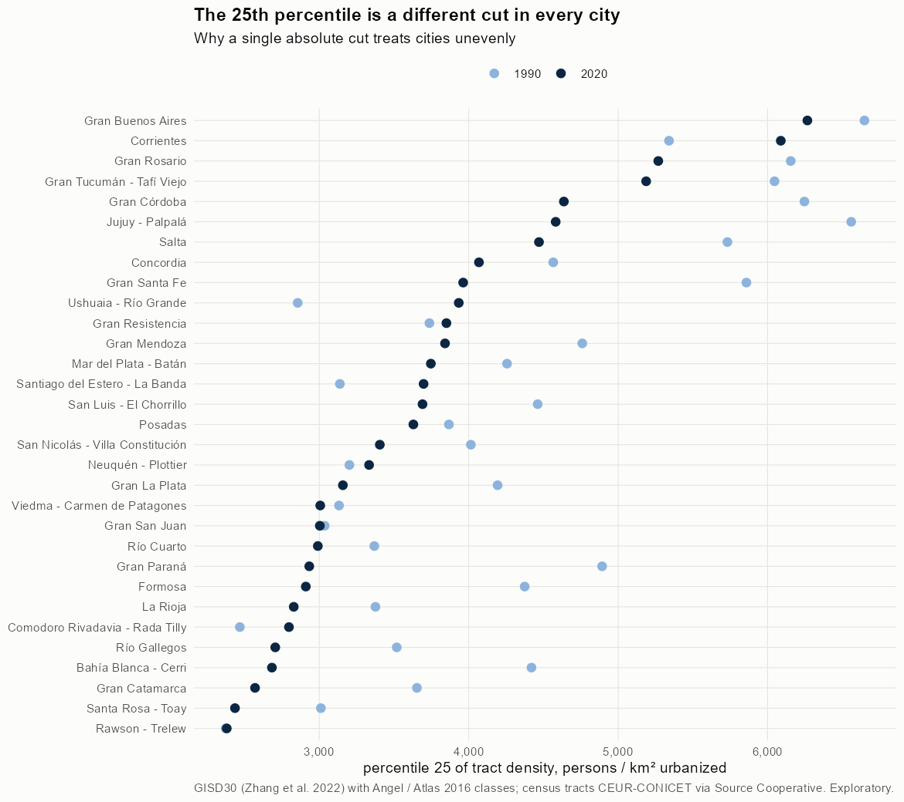
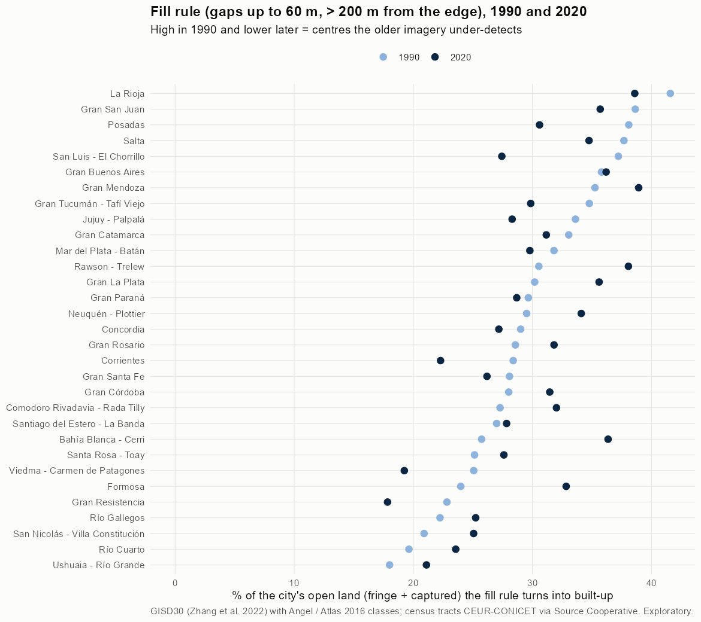

# Rules · relative cut (test 3) and fill of the centre, all agglomerations

Exploratory. None of these numbers are project figures (they are not in `CIFRAS_CANONICAS.json`). Generated by `Rpipe/scripts/16_reglas.R` from step 11. Run of 2026-11-15. Method: [METODOS.md](../METODOS.md).

## Method

- **Test 3.** Built-up always counts; fringe and captured land only in tracts at or above percentile p of the city's own tract densities that census (p = 10, 20, 25, 30, 40, 50, 60, 70, 75, 80, 90). Percentiles over tracts with at least 10 % of their area in the city.
- **Edge ring vs interior.** Each open pixel of the city gets its distance to the nearest land outside the city. Within 200 m it is the edge ring; beyond, interior.
- **Fill rule.** An interior open pixel that closing the built-up with radius 60 m covers (a narrow gap between built pixels) becomes built-up. With a dense tract (>= 500 p/km²) as an extra condition, or without it. Sensitivity: gap 30/60/90 m, distance 100/200/400 m, and the share rule (60/70/80/90 % built within 150 m).
- **What the fill changes.** Inside the Angel city it moves land from open to built: the Angel extent is the same, built-up and persons per km² built change. Without the dense-tract condition it also keeps, in tests 1-3, interior land of sparse tracts.

## All agglomerations · test 3 at p25 and the fill

| Agglomeration | p25 1990 p/km² | p25 2020 p/km² | Angel 2020 km² | Test 3 2020 km² | Growth Angel %/yr | Growth test 3 %/yr | Fill 1990 km² (% open) | Fill 2020 km² (% open) | Built 1990 km² | + fill (dense) | Persons/km² built 1990 | with fill |
|---|---|---|---|---|---|---|---|---|---|---|---|---|
| [Bahía Blanca - Cerri](bahia_blanca/REPORTE.md) | 4,420 | 2,683 | 151.8 | 108.4 | 1.72 | 2.01 | 8.3 (26) | 16.4 (36) | 58.9 | 65.1 | 4,566 | 4,135 |
| [Comodoro Rivadavia - Rada Tilly](comodoro_rivadavia/REPORTE.md) | 2,468 | 2,797 | 84.0 | 58.4 | 2.51 | 2.60 | 4.6 (27) | 9.6 (32) | 23.9 | 26.9 | 5,260 | 4,683 |
| [Concordia](concordia/REPORTE.md) | 4,566 | 4,069 | 43.8 | 32.6 | 2.33 | 2.12 | 2.1 (29) | 3.5 (27) | 14.9 | 16.9 | 7,951 | 6,998 |
| [Corrientes](corrientes/REPORTE.md) | 5,341 | 6,089 | 79.4 | 57.6 | 2.05 | 1.92 | 3.5 (28) | 5.1 (22) | 30.9 | 34.4 | 8,458 | 7,606 |
| [Formosa](formosa/REPORTE.md) | 4,374 | 2,910 | 74.3 | 54.5 | 2.82 | 2.84 | 2.5 (24) | 7.6 (33) | 22.0 | 24.2 | 6,792 | 6,184 |
| [Gran Buenos Aires](buenos_aires/REPORTE.md) | 6,648 | 6,266 | 2,541.8 | 1,960.9 | 1.35 | 1.36 | 152.3 (36) | 219.4 (36) | 1,278.2 | 1,420.2 | 8,892 | 8,003 |
| [Gran Catamarca](catamarca/REPORTE.md) | 3,653 | 2,570 | 76.8 | 56.0 | 3.56 | 3.68 | 3.6 (33) | 7.7 (31) | 15.9 | 19.5 | 7,439 | 6,083 |
| [Gran Córdoba](cordoba/REPORTE.md) | 6,247 | 4,637 | 426.4 | 307.6 | 2.41 | 2.35 | 17.6 (28) | 39.1 (31) | 145.9 | 162.4 | 8,410 | 7,556 |
| [Gran La Plata](la_plata/REPORTE.md) | 4,193 | 3,158 | 383.9 | 251.8 | 2.75 | 2.50 | 16.6 (30) | 49.7 (36) | 114.9 | 130.6 | 5,704 | 5,019 |
| [Gran Mendoza](mendoza/REPORTE.md) | 4,760 | 3,842 | 328.6 | 214.1 | 2.88 | 2.65 | 22.6 (35) | 49.9 (39) | 75.9 | 98.3 | 10,489 | 8,100 |
| [Gran Paraná](parana/REPORTE.md) | 4,893 | 2,933 | 93.7 | 65.8 | 2.73 | 2.51 | 4.0 (30) | 9.0 (29) | 28.6 | 32.5 | 7,409 | 6,520 |
| [Gran Resistencia](resistencia/REPORTE.md) | 3,737 | 3,851 | 122.9 | 87.2 | 1.84 | 1.88 | 5.7 (23) | 6.9 (18) | 46.0 | 51.1 | 6,542 | 5,883 |
| [Gran Rosario](rosario/REPORTE.md) | 6,155 | 5,269 | 355.7 | 253.3 | 2.23 | 2.02 | 14.6 (29) | 33.0 (32) | 132.6 | 146.4 | 8,665 | 7,850 |
| [Gran San Juan](san_juan/REPORTE.md) | 3,036 | 3,004 | 212.8 | 142.0 | 2.30 | 2.25 | 17.6 (39) | 29.4 (36) | 61.8 | 78.7 | 6,268 | 4,927 |
| [Gran Santa Fe](santa_fe/REPORTE.md) | 5,858 | 3,963 | 174.2 | 111.9 | 3.30 | 2.69 | 5.4 (28) | 16.8 (26) | 46.6 | 51.9 | 8,732 | 7,826 |
| [Gran Tucumán - Tafí Viejo](tucuman/REPORTE.md) | 6,046 | 5,188 | 206.4 | 158.0 | 2.08 | 2.25 | 14.0 (35) | 15.9 (30) | 70.9 | 84.4 | 9,530 | 8,006 |
| [Jujuy - Palpalá](jujuy/REPORTE.md) | 6,560 | 4,582 | 81.4 | 55.1 | 4.22 | 4.05 | 3.9 (34) | 8.6 (28) | 12.0 | 15.9 | 16,221 | 12,256 |
| [La Rioja](la_rioja/REPORTE.md) | 3,376 | 2,829 | 75.1 | 57.2 | 3.19 | 3.55 | 4.8 (42) | 8.1 (39) | 17.7 | 22.5 | 5,855 | 4,617 |
| [Mar del Plata - Batán](mar_del_plata/REPORTE.md) | 4,257 | 3,747 | 174.4 | 136.4 | 1.26 | 1.27 | 10.0 (32) | 13.0 (30) | 90.6 | 99.7 | 5,773 | 5,247 |
| [Neuquén - Plottier](neuquen/REPORTE.md) | 3,202 | 3,333 | 241.1 | 151.6 | 3.24 | 3.04 | 10.2 (30) | 32.2 (34) | 58.1 | 63.7 | 4,807 | 4,382 |
| [Posadas](posadas/REPORTE.md) | 3,867 | 3,630 | 105.6 | 78.9 | 3.25 | 3.36 | 7.2 (38) | 9.5 (31) | 21.4 | 28.5 | 9,862 | 7,406 |
| [Rawson - Trelew](rawson/REPORTE.md) | 2,374 | 2,381 | 231.0 | 133.3 | 1.40 | 1.95 | 24.9 (31) | 37.7 (38) | 70.7 | 72.5 | 1,479 | 1,444 |
| [Río Cuarto](rio_cuarto/REPORTE.md) | 3,368 | 2,990 | 57.9 | 39.6 | 3.00 | 2.73 | 2.5 (20) | 5.7 (24) | 11.1 | 13.6 | 9,647 | 7,879 |
| [Río Gallegos](rio_gallegos/REPORTE.md) | 3,519 | 2,706 | 32.2 | 24.3 | 2.37 | 2.30 | 1.1 (22) | 2.7 (25) | 11.3 | 12.4 | 5,747 | 5,243 |
| [Salta](salta/REPORTE.md) | 5,731 | 4,470 | 249.9 | 150.7 | 5.02 | 4.40 | 9.2 (38) | 36.8 (35) | 33.0 | 42.1 | 11,653 | 9,152 |
| [San Luis - El Chorrillo](san_luis/REPORTE.md) | 4,462 | 3,691 | 64.0 | 47.0 | 3.47 | 3.65 | 3.9 (37) | 5.7 (27) | 12.6 | 15.7 | 8,673 | 6,971 |
| [San Nicolás - Villa Constitución](san_nicolas/REPORTE.md) | 4,014 | 3,405 | 73.6 | 50.0 | 2.10 | 1.83 | 2.9 (21) | 6.5 (25) | 25.5 | 28.4 | 6,444 | 5,790 |
| [Santa Rosa - Toay](santa_rosa/REPORTE.md) | 3,011 | 2,436 | 51.5 | 38.6 | 3.00 | 2.94 | 1.7 (25) | 3.9 (28) | 14.4 | 16.1 | 5,573 | 4,978 |
| [Santiago del Estero - La Banda](santiago_del_estero/REPORTE.md) | 3,138 | 3,698 | 138.2 | 101.4 | 2.28 | 2.20 | 5.7 (27) | 11.1 (28) | 49.0 | 54.5 | 5,514 | 4,958 |
| [Ushuaia - Río Grande](ushuaia/REPORTE.md) | 2,856 | 3,934 | 38.9 | 27.3 | 2.40 | 2.34 | 1.5 (18) | 3.3 (21) | 11.1 | 12.5 | 6,070 | 5,404 |
| [Viedma - Carmen de Patagones](viedma/REPORTE.md) | 3,132 | 3,007 | 26.0 | 20.0 | 2.02 | 1.96 | 1.4 (25) | 1.3 (19) | 8.9 | 10.2 | 6,525 | 5,671 |

## Maps by agglomeration

Each link opens the full map. All maps of an agglomeration share one frame: its 2020 city plus 3 km. 

| Agglomeration | Maps (four years each) |
|---|---|
| [Bahía Blanca - Cerri](bahia_blanca/REPORTE.md) | [ring and fill](bahia_blanca/img/anillo_centro.png) · [test 3](bahia_blanca/img/prueba3.png) · [density](bahia_blanca/img/distribucion.png) |
| [Comodoro Rivadavia - Rada Tilly](comodoro_rivadavia/REPORTE.md) | [ring and fill](comodoro_rivadavia/img/anillo_centro.png) · [test 3](comodoro_rivadavia/img/prueba3.png) · [density](comodoro_rivadavia/img/distribucion.png) |
| [Concordia](concordia/REPORTE.md) | [ring and fill](concordia/img/anillo_centro.png) · [test 3](concordia/img/prueba3.png) · [density](concordia/img/distribucion.png) |
| [Corrientes](corrientes/REPORTE.md) | [ring and fill](corrientes/img/anillo_centro.png) · [test 3](corrientes/img/prueba3.png) · [density](corrientes/img/distribucion.png) |
| [Formosa](formosa/REPORTE.md) | [ring and fill](formosa/img/anillo_centro.png) · [test 3](formosa/img/prueba3.png) · [density](formosa/img/distribucion.png) |
| [Gran Buenos Aires](buenos_aires/REPORTE.md) | [ring and fill](buenos_aires/img/anillo_centro.png) · [test 3](buenos_aires/img/prueba3.png) · [density](buenos_aires/img/distribucion.png) |
| [Gran Catamarca](catamarca/REPORTE.md) | [ring and fill](catamarca/img/anillo_centro.png) · [test 3](catamarca/img/prueba3.png) · [density](catamarca/img/distribucion.png) |
| [Gran Córdoba](cordoba/REPORTE.md) | [ring and fill](cordoba/img/anillo_centro.png) · [test 3](cordoba/img/prueba3.png) · [density](cordoba/img/distribucion.png) |
| [Gran La Plata](la_plata/REPORTE.md) | [ring and fill](la_plata/img/anillo_centro.png) · [test 3](la_plata/img/prueba3.png) · [density](la_plata/img/distribucion.png) |
| [Gran Mendoza](mendoza/REPORTE.md) | [ring and fill](mendoza/img/anillo_centro.png) · [test 3](mendoza/img/prueba3.png) · [density](mendoza/img/distribucion.png) |
| [Gran Paraná](parana/REPORTE.md) | [ring and fill](parana/img/anillo_centro.png) · [test 3](parana/img/prueba3.png) · [density](parana/img/distribucion.png) |
| [Gran Resistencia](resistencia/REPORTE.md) | [ring and fill](resistencia/img/anillo_centro.png) · [test 3](resistencia/img/prueba3.png) · [density](resistencia/img/distribucion.png) |
| [Gran Rosario](rosario/REPORTE.md) | [ring and fill](rosario/img/anillo_centro.png) · [test 3](rosario/img/prueba3.png) · [density](rosario/img/distribucion.png) |
| [Gran San Juan](san_juan/REPORTE.md) | [ring and fill](san_juan/img/anillo_centro.png) · [test 3](san_juan/img/prueba3.png) · [density](san_juan/img/distribucion.png) |
| [Gran Santa Fe](santa_fe/REPORTE.md) | [ring and fill](santa_fe/img/anillo_centro.png) · [test 3](santa_fe/img/prueba3.png) · [density](santa_fe/img/distribucion.png) |
| [Gran Tucumán - Tafí Viejo](tucuman/REPORTE.md) | [ring and fill](tucuman/img/anillo_centro.png) · [test 3](tucuman/img/prueba3.png) · [density](tucuman/img/distribucion.png) |
| [Jujuy - Palpalá](jujuy/REPORTE.md) | [ring and fill](jujuy/img/anillo_centro.png) · [test 3](jujuy/img/prueba3.png) · [density](jujuy/img/distribucion.png) |
| [La Rioja](la_rioja/REPORTE.md) | [ring and fill](la_rioja/img/anillo_centro.png) · [test 3](la_rioja/img/prueba3.png) · [density](la_rioja/img/distribucion.png) |
| [Mar del Plata - Batán](mar_del_plata/REPORTE.md) | [ring and fill](mar_del_plata/img/anillo_centro.png) · [test 3](mar_del_plata/img/prueba3.png) · [density](mar_del_plata/img/distribucion.png) |
| [Neuquén - Plottier](neuquen/REPORTE.md) | [ring and fill](neuquen/img/anillo_centro.png) · [test 3](neuquen/img/prueba3.png) · [density](neuquen/img/distribucion.png) |
| [Posadas](posadas/REPORTE.md) | [ring and fill](posadas/img/anillo_centro.png) · [test 3](posadas/img/prueba3.png) · [density](posadas/img/distribucion.png) |
| [Rawson - Trelew](rawson/REPORTE.md) | [ring and fill](rawson/img/anillo_centro.png) · [test 3](rawson/img/prueba3.png) · [density](rawson/img/distribucion.png) |
| [Río Cuarto](rio_cuarto/REPORTE.md) | [ring and fill](rio_cuarto/img/anillo_centro.png) · [test 3](rio_cuarto/img/prueba3.png) · [density](rio_cuarto/img/distribucion.png) |
| [Río Gallegos](rio_gallegos/REPORTE.md) | [ring and fill](rio_gallegos/img/anillo_centro.png) · [test 3](rio_gallegos/img/prueba3.png) · [density](rio_gallegos/img/distribucion.png) |
| [Salta](salta/REPORTE.md) | [ring and fill](salta/img/anillo_centro.png) · [test 3](salta/img/prueba3.png) · [density](salta/img/distribucion.png) |
| [San Luis - El Chorrillo](san_luis/REPORTE.md) | [ring and fill](san_luis/img/anillo_centro.png) · [test 3](san_luis/img/prueba3.png) · [density](san_luis/img/distribucion.png) |
| [San Nicolás - Villa Constitución](san_nicolas/REPORTE.md) | [ring and fill](san_nicolas/img/anillo_centro.png) · [test 3](san_nicolas/img/prueba3.png) · [density](san_nicolas/img/distribucion.png) |
| [Santa Rosa - Toay](santa_rosa/REPORTE.md) | [ring and fill](santa_rosa/img/anillo_centro.png) · [test 3](santa_rosa/img/prueba3.png) · [density](santa_rosa/img/distribucion.png) |
| [Santiago del Estero - La Banda](santiago_del_estero/REPORTE.md) | [ring and fill](santiago_del_estero/img/anillo_centro.png) · [test 3](santiago_del_estero/img/prueba3.png) · [density](santiago_del_estero/img/distribucion.png) |
| [Ushuaia - Río Grande](ushuaia/REPORTE.md) | [ring and fill](ushuaia/img/anillo_centro.png) · [test 3](ushuaia/img/prueba3.png) · [density](ushuaia/img/distribucion.png) |
| [Viedma - Carmen de Patagones](viedma/REPORTE.md) | [ring and fill](viedma/img/anillo_centro.png) · [test 3](viedma/img/prueba3.png) · [density](viedma/img/distribucion.png) |

