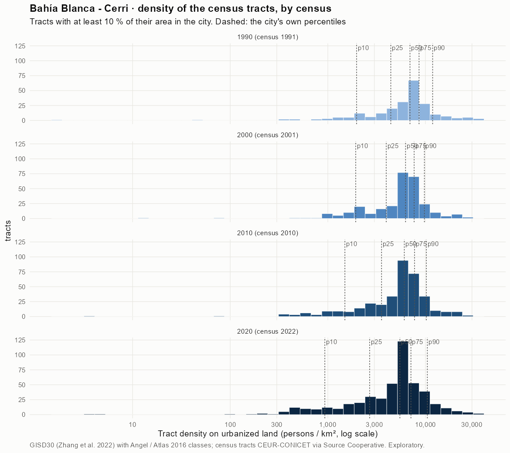
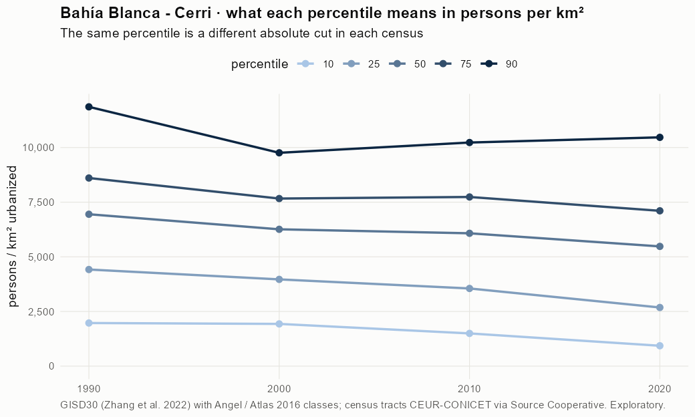
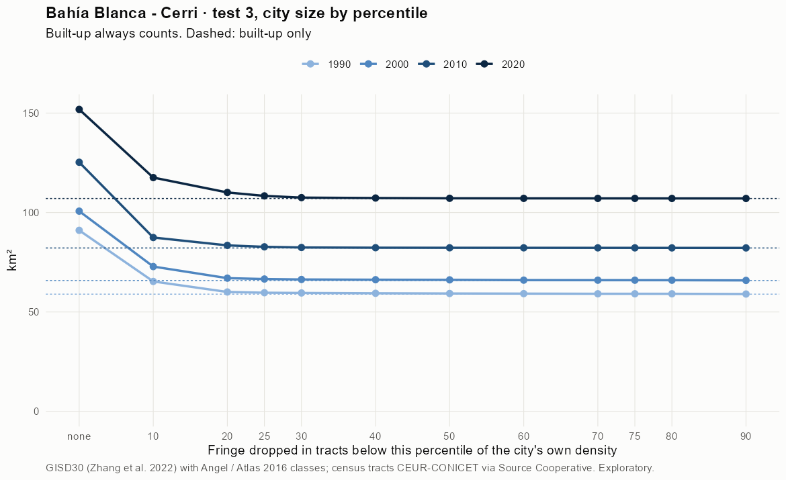
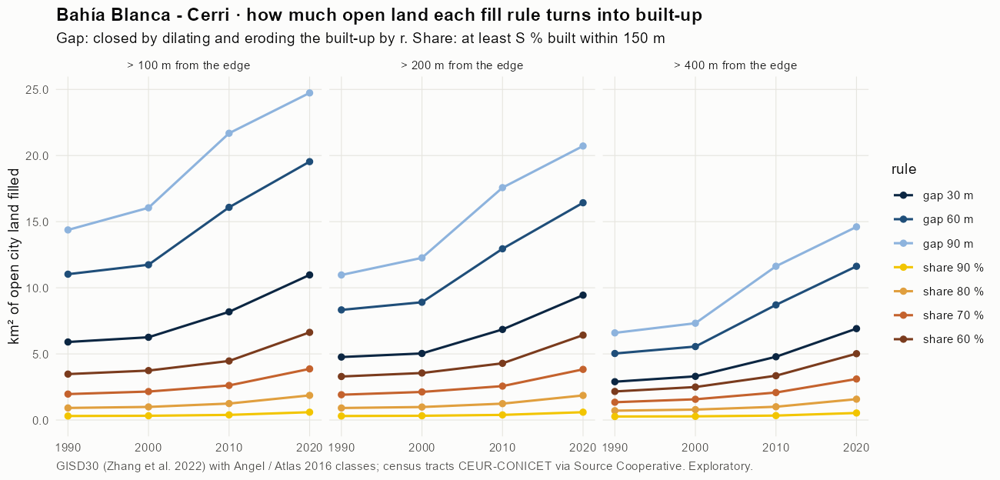
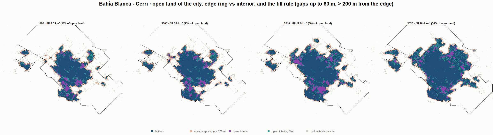
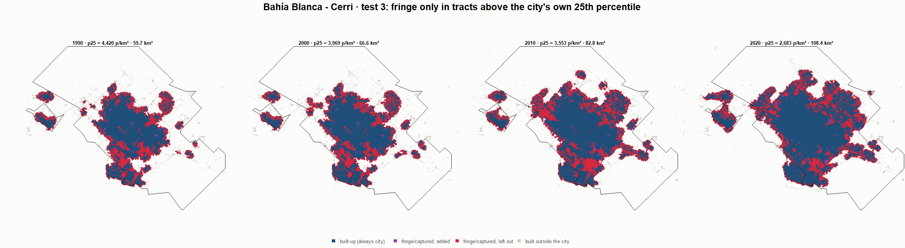

# Bahía Blanca - Cerri · relative cut (test 3) and the fill rule, 1990-2020

Exploratory. None of these numbers are project figures (they are not in `CIFRAS_CANONICAS.json`). Generated by `Rpipe/scripts/16_reglas.R` from step 11. Run of 2026-11-15. [All agglomerations](../REPORTE.md) · [methods](../../METODOS.md).

## The density of the tracts

Tracts with at least 10 % of their area in the city, and the city's own percentiles of their density on urbanized land.

| Year | Tracts | p10 | p25 | p50 | p75 | p90 |
|---|---|---|---|---|---|---|
| 1990 (census 1991) | 227 | 1,972 | 4,420 | 6,948 | 8,606 | 11,862 |
| 2000 (census 2001) | 287 | 1,932 | 3,969 | 6,260 | 7,667 | 9,759 |
| 2010 (census 2010) | 362 | 1,497 | 3,553 | 6,077 | 7,739 | 10,229 |
| 2020 (census 2022) | 468 | 932 | 2,683 | 5,478 | 7,106 | 10,466 |

## Test 3 · fringe only above the city's own percentile

Built-up land is always city. Fringe and captured land join only in tracts at or above percentile p of the city's own tract densities, that census.

| Percentile | 1990 cut p/km² | 2000 cut p/km² | 2010 cut p/km² | 2020 cut p/km² | 1990 km² | 2000 km² | 2010 km² | 2020 km² | 1990-2020 %/yr |
|---|---|---|---|---|---|---|---|---|---|
| none (Angel) | 0 | 0 | 0 | 0 | 91.0 | 100.7 | 125.3 | 151.8 | 1.72 |
| p10 | 1,972 | 1,932 | 1,497 | 932 | 65.3 | 72.8 | 87.4 | 117.6 | 1.98 |
| p20 | 3,532 | 3,140 | 2,912 | 2,278 | 60.1 | 67.0 | 83.5 | 110.1 | 2.04 |
| p25 | 4,420 | 3,969 | 3,553 | 2,683 | 59.7 | 66.6 | 82.8 | 108.4 | 2.01 |
| p30 | 5,123 | 4,943 | 4,472 | 3,390 | 59.6 | 66.3 | 82.4 | 107.5 | 1.99 |
| p40 | 6,241 | 5,751 | 5,506 | 4,650 | 59.4 | 66.2 | 82.3 | 107.3 | 1.99 |
| p50 | 6,948 | 6,260 | 6,077 | 5,478 | 59.3 | 66.1 | 82.3 | 107.2 | 1.99 |
| p60 | 7,493 | 6,702 | 6,502 | 5,983 | 59.2 | 66.0 | 82.3 | 107.1 | 1.99 |
| p70 | 8,143 | 7,067 | 7,079 | 6,605 | 59.1 | 66.0 | 82.2 | 107.1 | 2.00 |
| p75 | 8,606 | 7,667 | 7,739 | 7,106 | 59.1 | 66.0 | 82.2 | 107.1 | 2.00 |
| p80 | 9,442 | 8,219 | 8,319 | 7,837 | 59.1 | 66.0 | 82.2 | 107.1 | 2.00 |
| p90 | 11,862 | 9,759 | 10,229 | 10,466 | 59.0 | 65.9 | 82.2 | 107.1 | 2.01 |
| built only | — | — | — | — | 58.9 | 65.8 | 82.2 | 107.1 | 2.01 |

## Fill rule · open land in the centre that is probably built

An open pixel of the city (fringe or captured) farther than D from any land outside the city becomes built-up if it is a narrow gap in the built-up: closing the built-up (dilate, then erode) with a square of radius r covers it. Central rule: r = 60 m, D = 200 m; *dense* = tract at or above 500 p/km². The alternative share rule fills a pixel with at least S of the pixels within 150 m built.

| Year | Open city land km² | Interior (> 200 m) km² | Filled km² | Filled in dense tracts km² | Built-up km² | Built-up + fill km² | Persons / km² built | With fill |
|---|---|---|---|---|---|---|---|---|
| 1990 (census 1991) | 32.4 | 17.2 | 8.3 | 6.1 | 58.9 | 65.1 | 4,566 | 4,135 |
| 2000 (census 2001) | 35.2 | 18.6 | 8.9 | 7.3 | 65.8 | 73.1 | 4,287 | 3,858 |
| 2010 (census 2010) | 43.4 | 26.6 | 12.9 | 9.2 | 82.2 | 91.4 | 3,639 | 3,273 |
| 2020 (census 2022) | 45.2 | 28.3 | 16.4 | 10.4 | 107.1 | 117.4 | 3,098 | 2,824 |

**Sensitivity: km² filled by each rule** (in brackets, % of the interior open land):

| Year | Farther than | gap 30 m | gap 60 m | gap 90 m | share 60 % | share 70 % | share 80 % | share 90 % |
|---|---|---|---|---|---|---|---|---|
| 1990 | 100 m | 5.9 (28) | 11.0 (52) | 14.4 (67) | 3.5 (16) | 2.0 (9) | 0.9 (4) | 0.3 (1) |
| 1990 | 200 m | 4.8 (28) | 8.3 (49) | 11.0 (64) | 3.3 (19) | 1.9 (11) | 0.9 (5) | 0.3 (2) |
| 1990 | 400 m | 2.9 (25) | 5.0 (44) | 6.6 (58) | 2.2 (19) | 1.3 (12) | 0.7 (6) | 0.3 (2) |
| 2000 | 100 m | 6.3 (27) | 11.7 (51) | 16.0 (69) | 3.7 (16) | 2.2 (9) | 1.0 (4) | 0.3 (1) |
| 2000 | 200 m | 5.0 (27) | 8.9 (48) | 12.3 (66) | 3.6 (19) | 2.1 (11) | 1.0 (5) | 0.3 (2) |
| 2000 | 400 m | 3.3 (27) | 5.6 (46) | 7.3 (60) | 2.5 (21) | 1.6 (13) | 0.8 (6) | 0.3 (2) |
| 2010 | 100 m | 8.2 (26) | 16.1 (51) | 21.7 (69) | 4.5 (14) | 2.6 (8) | 1.2 (4) | 0.4 (1) |
| 2010 | 200 m | 6.8 (26) | 12.9 (49) | 17.6 (66) | 4.3 (16) | 2.6 (10) | 1.2 (5) | 0.4 (1) |
| 2010 | 400 m | 4.8 (25) | 8.7 (45) | 11.6 (60) | 3.4 (17) | 2.1 (11) | 1.0 (5) | 0.3 (2) |
| 2020 | 100 m | 11.0 (33) | 19.5 (59) | 24.7 (75) | 6.6 (20) | 3.9 (12) | 1.9 (6) | 0.6 (2) |
| 2020 | 200 m | 9.4 (33) | 16.4 (58) | 20.7 (73) | 6.4 (23) | 3.8 (14) | 1.9 (7) | 0.6 (2) |
| 2020 | 400 m | 6.9 (33) | 11.6 (56) | 14.6 (71) | 5.0 (24) | 3.1 (15) | 1.6 (8) | 0.5 (3) |

**Test 3 at p25 plus the central fill, without asking for a dense tract** (the fill keeps interior gaps of sparse tracts that test 3 drops):

| Year | Angel km² | Test 3 p25 km² | Test 3 + fill km² |
|---|---|---|---|
| 1990 | 91.0 | 59.7 | 67.5 |
| 2000 | 100.7 | 66.6 | 74.9 |
| 2010 | 125.3 | 82.8 | 95.3 |
| 2020 | 151.8 | 108.4 | 123.9 |

## Maps

### Edge ring, interior and fill

### Test 3 at p25

