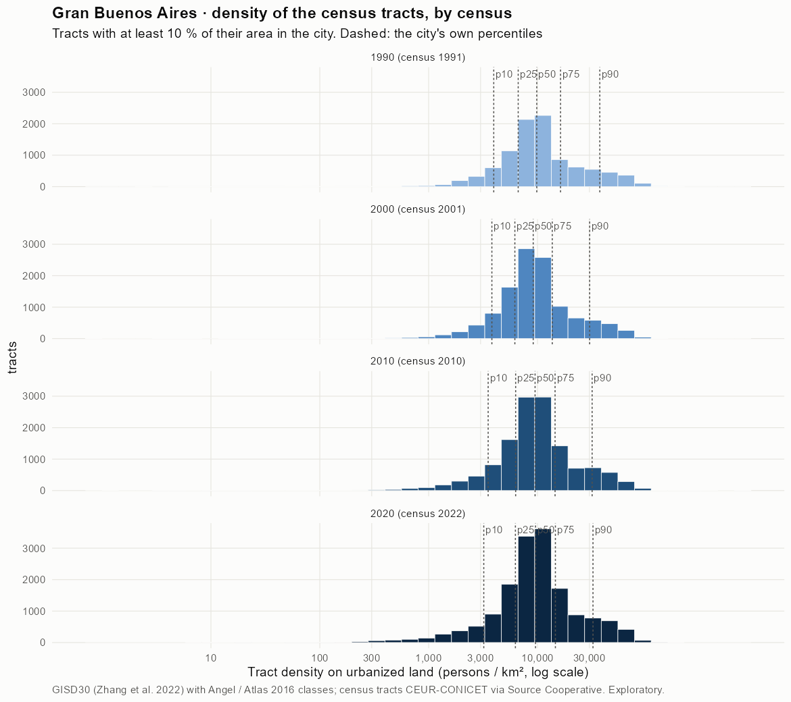
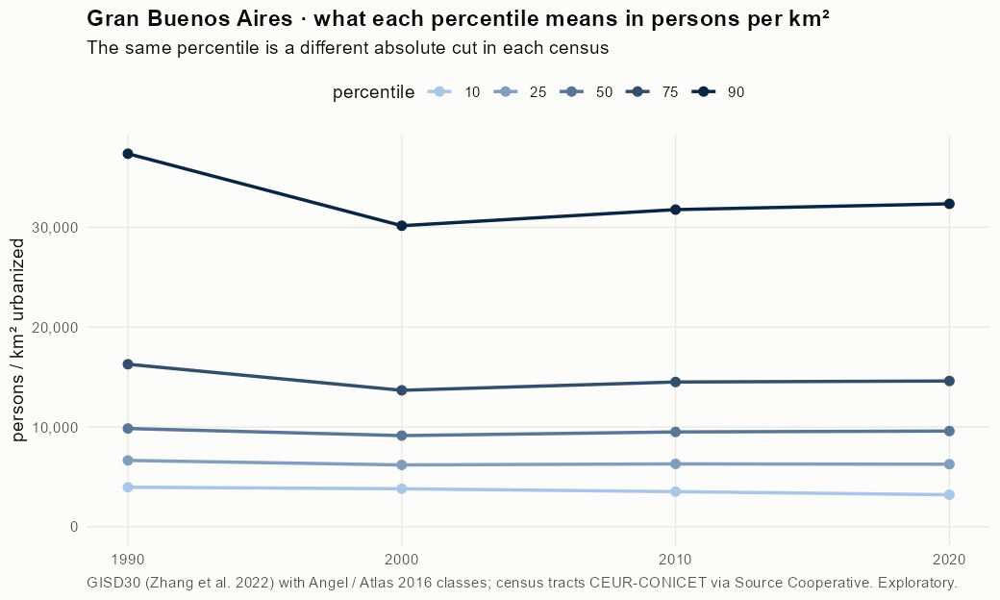
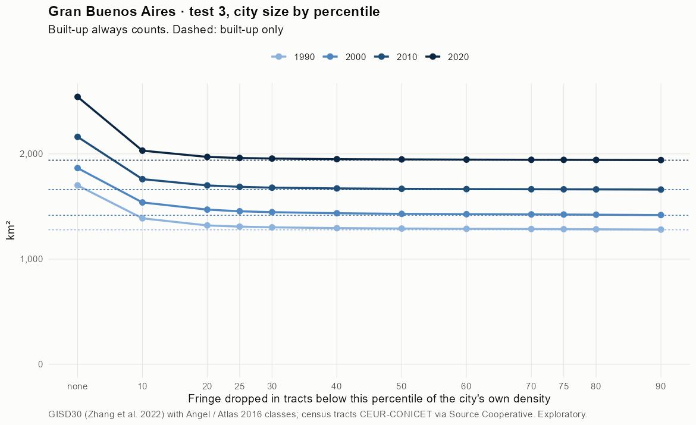
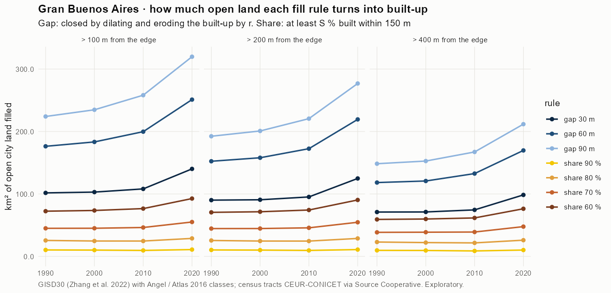
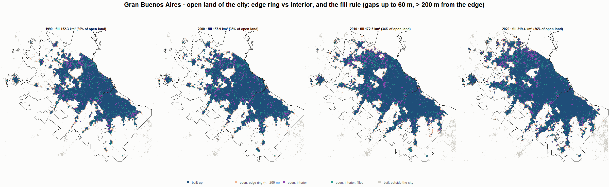
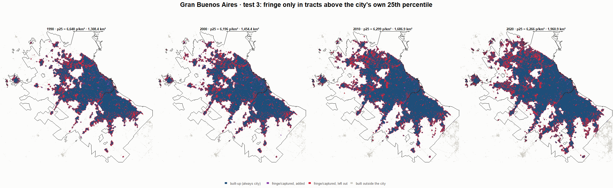

# Gran Buenos Aires · relative cut (test 3) and the fill rule, 1990-2020

Exploratory. None of these numbers are project figures (they are not in `CIFRAS_CANONICAS.json`). Generated by `Rpipe/scripts/16_reglas.R` from step 11. Run of 2026-11-15. [All agglomerations](../REPORTE.md) · [methods](../../METODOS.md).

## The density of the tracts

Tracts with at least 10 % of their area in the city, and the city's own percentiles of their density on urbanized land.

| Year | Tracts | p10 | p25 | p50 | p75 | p90 |
|---|---|---|---|---|---|---|
| 1990 (census 1991) | 9,812 | 3,963 | 6,648 | 9,842 | 16,280 | 37,361 |
| 2000 (census 2001) | 11,838 | 3,810 | 6,196 | 9,133 | 13,669 | 30,150 |
| 2010 (census 2010) | 13,403 | 3,522 | 6,299 | 9,500 | 14,501 | 31,762 |
| 2020 (census 2022) | 15,956 | 3,209 | 6,266 | 9,590 | 14,601 | 32,343 |

## Test 3 · fringe only above the city's own percentile

Built-up land is always city. Fringe and captured land join only in tracts at or above percentile p of the city's own tract densities, that census.

| Percentile | 1990 cut p/km² | 2000 cut p/km² | 2010 cut p/km² | 2020 cut p/km² | 1990 km² | 2000 km² | 2010 km² | 2020 km² | 1990-2020 %/yr |
|---|---|---|---|---|---|---|---|---|---|
| none (Angel) | 0 | 0 | 0 | 0 | 1,700.6 | 1,865.0 | 2,161.9 | 2,541.8 | 1.35 |
| p10 | 3,963 | 3,810 | 3,522 | 3,209 | 1,387.2 | 1,538.1 | 1,759.6 | 2,030.6 | 1.28 |
| p20 | 5,899 | 5,508 | 5,522 | 5,425 | 1,319.7 | 1,470.1 | 1,700.0 | 1,971.1 | 1.35 |
| p25 | 6,648 | 6,196 | 6,299 | 6,266 | 1,308.4 | 1,454.4 | 1,686.9 | 1,960.9 | 1.36 |
| p30 | 7,334 | 6,830 | 6,961 | 6,994 | 1,301.7 | 1,445.7 | 1,678.6 | 1,955.5 | 1.37 |
| p40 | 8,593 | 8,004 | 8,230 | 8,319 | 1,294.1 | 1,435.7 | 1,671.7 | 1,949.7 | 1.38 |
| p50 | 9,842 | 9,133 | 9,500 | 9,590 | 1,290.2 | 1,429.7 | 1,667.8 | 1,947.3 | 1.38 |
| p60 | 11,212 | 10,381 | 10,914 | 11,035 | 1,287.7 | 1,426.6 | 1,665.3 | 1,945.4 | 1.38 |
| p70 | 13,483 | 12,175 | 12,984 | 13,057 | 1,285.7 | 1,424.4 | 1,663.8 | 1,943.8 | 1.39 |
| p75 | 16,280 | 13,669 | 14,501 | 14,601 | 1,284.4 | 1,423.4 | 1,663.1 | 1,943.3 | 1.39 |
| p80 | 20,775 | 16,502 | 17,353 | 17,407 | 1,282.9 | 1,421.7 | 1,662.4 | 1,942.6 | 1.39 |
| p90 | 37,361 | 30,150 | 31,762 | 32,343 | 1,280.5 | 1,418.6 | 1,660.8 | 1,941.4 | 1.40 |
| built only | — | — | — | — | 1,278.2 | 1,415.9 | 1,659.4 | 1,940.1 | 1.40 |

## Fill rule · open land in the centre that is probably built

An open pixel of the city (fringe or captured) farther than D from any land outside the city becomes built-up if it is a narrow gap in the built-up: closing the built-up (dilate, then erode) with a square of radius r covers it. Central rule: r = 60 m, D = 200 m; *dense* = tract at or above 500 p/km². The alternative share rule fills a pixel with at least S of the pixels within 150 m built.

| Year | Open city land km² | Interior (> 200 m) km² | Filled km² | Filled in dense tracts km² | Built-up km² | Built-up + fill km² | Persons / km² built | With fill |
|---|---|---|---|---|---|---|---|---|
| 1990 (census 1991) | 425.5 | 287.0 | 152.3 | 142.0 | 1,278.2 | 1,420.2 | 8,892 | 8,003 |
| 2000 (census 2001) | 452.8 | 298.0 | 157.9 | 146.2 | 1,415.9 | 1,562.1 | 8,567 | 7,765 |
| 2010 (census 2010) | 506.6 | 334.9 | 172.5 | 150.4 | 1,659.4 | 1,809.8 | 8,253 | 7,567 |
| 2020 (census 2022) | 606.2 | 415.5 | 219.4 | 175.6 | 1,940.1 | 2,115.7 | 7,768 | 7,123 |

**Sensitivity: km² filled by each rule** (in brackets, % of the interior open land):

| Year | Farther than | gap 30 m | gap 60 m | gap 90 m | share 60 % | share 70 % | share 80 % | share 90 % |
|---|---|---|---|---|---|---|---|---|
| 1990 | 100 m | 101.7 (31) | 176.3 (54) | 224.1 (69) | 72.4 (22) | 45.0 (14) | 25.5 (8) | 10.3 (3) |
| 1990 | 200 m | 90.1 (31) | 152.3 (53) | 192.4 (67) | 70.5 (25) | 44.5 (16) | 25.5 (9) | 10.3 (4) |
| 1990 | 400 m | 71.0 (31) | 118.2 (51) | 148.4 (64) | 59.2 (26) | 38.5 (17) | 23.0 (10) | 9.7 (4) |
| 2000 | 100 m | 103.0 (30) | 183.3 (54) | 234.8 (69) | 73.5 (22) | 45.1 (13) | 24.6 (7) | 10.1 (3) |
| 2000 | 200 m | 90.7 (30) | 157.9 (53) | 200.8 (67) | 71.5 (24) | 44.6 (15) | 24.6 (8) | 10.1 (3) |
| 2000 | 400 m | 71.1 (30) | 120.7 (51) | 152.7 (65) | 59.8 (25) | 38.7 (16) | 22.1 (9) | 9.5 (4) |
| 2010 | 100 m | 108.1 (28) | 199.7 (52) | 258.1 (68) | 76.5 (20) | 46.3 (12) | 24.6 (6) | 9.5 (3) |
| 2010 | 200 m | 95.2 (28) | 172.5 (51) | 220.6 (66) | 74.3 (22) | 45.7 (14) | 24.5 (7) | 9.5 (3) |
| 2010 | 400 m | 74.5 (28) | 132.6 (50) | 167.2 (63) | 61.6 (23) | 39.0 (15) | 21.6 (8) | 8.7 (3) |
| 2020 | 100 m | 140.1 (30) | 251.1 (54) | 319.8 (68) | 92.6 (20) | 55.1 (12) | 28.8 (6) | 10.9 (2) |
| 2020 | 200 m | 124.8 (30) | 219.4 (53) | 276.9 (67) | 90.4 (22) | 54.6 (13) | 28.7 (7) | 10.9 (3) |
| 2020 | 400 m | 98.4 (30) | 169.7 (51) | 211.7 (64) | 76.3 (23) | 47.7 (14) | 26.0 (8) | 10.1 (3) |

**Test 3 at p25 plus the central fill, without asking for a dense tract** (the fill keeps interior gaps of sparse tracts that test 3 drops):

| Year | Angel km² | Test 3 p25 km² | Test 3 + fill km² |
|---|---|---|---|
| 1990 | 1,700.6 | 1,308.4 | 1,445.6 |
| 2000 | 1,865.0 | 1,454.4 | 1,593.4 |
| 2010 | 2,161.9 | 1,686.9 | 1,845.0 |
| 2020 | 2,541.8 | 1,960.9 | 2,168.5 |

## Maps

### Edge ring, interior and fill

### Test 3 at p25

