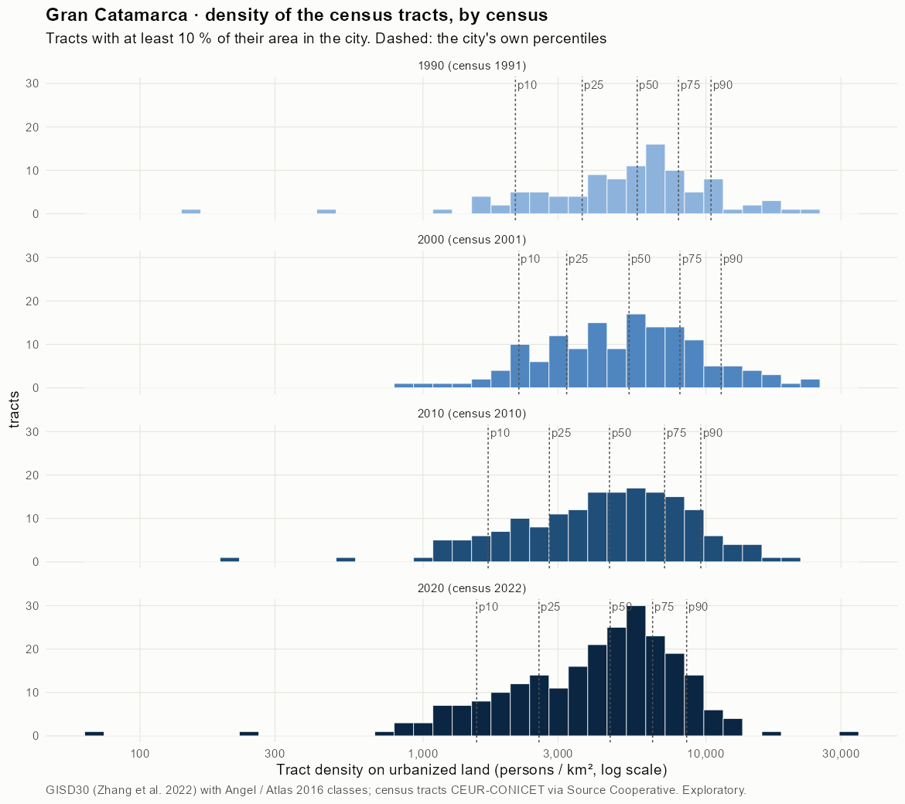
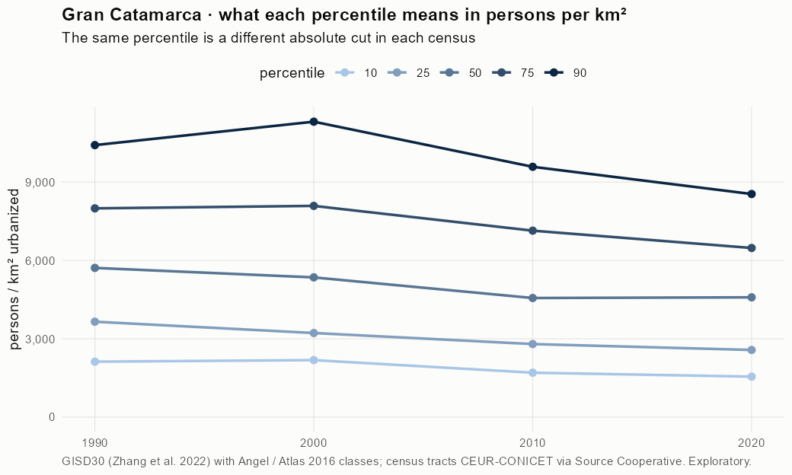
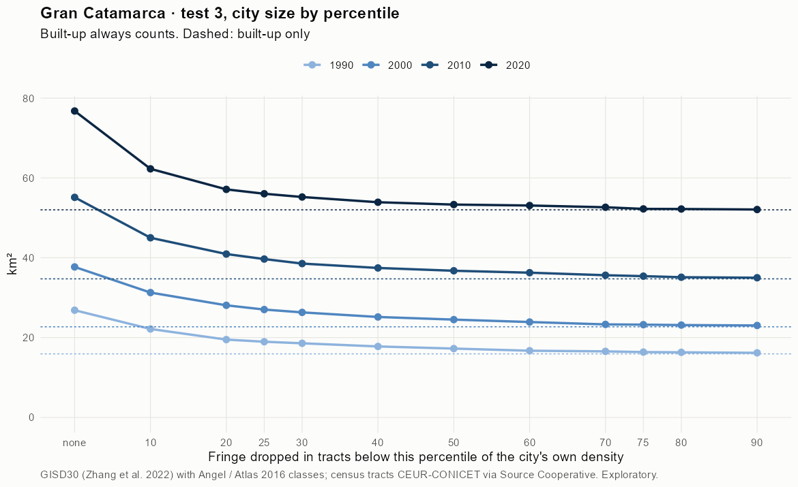
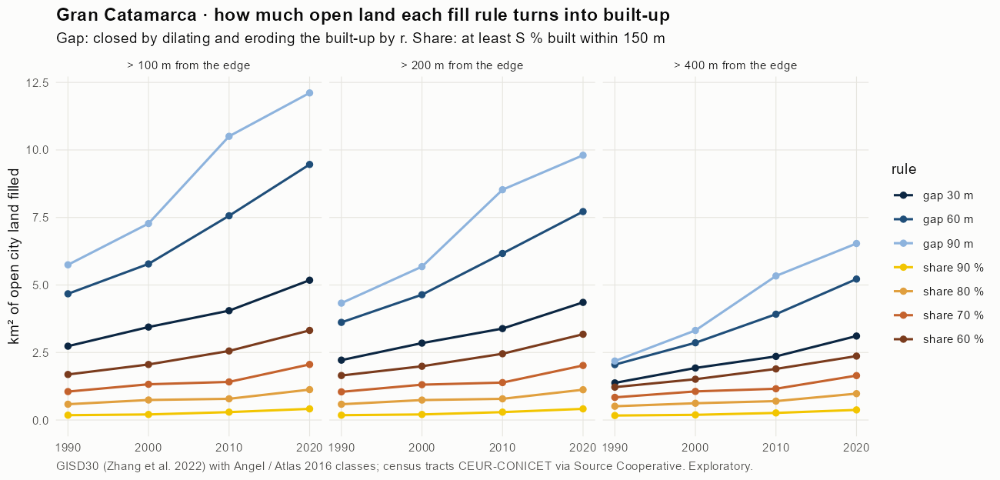
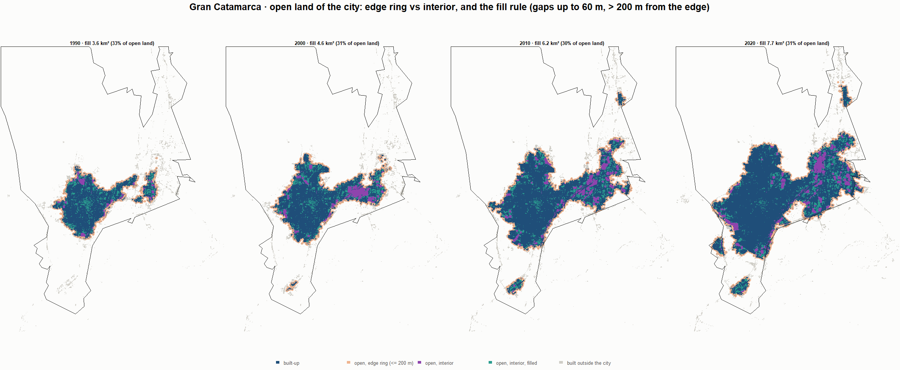
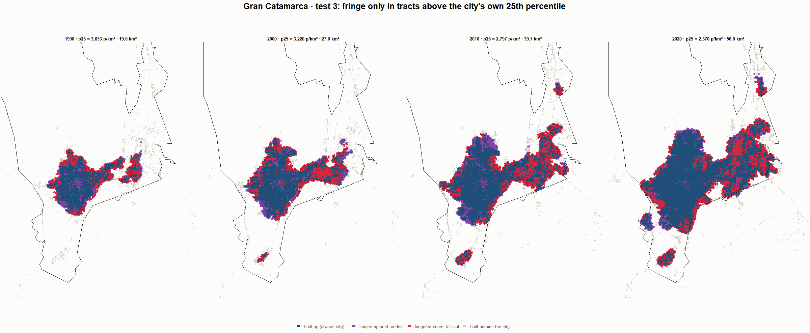

# Gran Catamarca · relative cut (test 3) and the fill rule, 1990-2020

Exploratory. None of these numbers are project figures (they are not in `CIFRAS_CANONICAS.json`). Generated by `Rpipe/scripts/16_reglas.R` from step 11. Run of 2026-11-15. [All agglomerations](../REPORTE.md) · [methods](../../METODOS.md).

## The density of the tracts

Tracts with at least 10 % of their area in the city, and the city's own percentiles of their density on urbanized land.

| Year | Tracts | p10 | p25 | p50 | p75 | p90 |
|---|---|---|---|---|---|---|
| 1990 (census 1991) | 102 | 2,122 | 3,653 | 5,715 | 7,996 | 10,418 |
| 2000 (census 2001) | 147 | 2,182 | 3,220 | 5,351 | 8,091 | 11,316 |
| 2010 (census 2010) | 175 | 1,700 | 2,797 | 4,561 | 7,141 | 9,588 |
| 2020 (census 2022) | 238 | 1,548 | 2,570 | 4,587 | 6,478 | 8,546 |

## Test 3 · fringe only above the city's own percentile

Built-up land is always city. Fringe and captured land join only in tracts at or above percentile p of the city's own tract densities, that census.

| Percentile | 1990 cut p/km² | 2000 cut p/km² | 2010 cut p/km² | 2020 cut p/km² | 1990 km² | 2000 km² | 2010 km² | 2020 km² | 1990-2020 %/yr |
|---|---|---|---|---|---|---|---|---|---|
| none (Angel) | 0 | 0 | 0 | 0 | 26.9 | 37.7 | 55.1 | 76.8 | 3.56 |
| p10 | 2,122 | 2,182 | 1,700 | 1,548 | 22.2 | 31.3 | 45.0 | 62.3 | 3.50 |
| p20 | 2,976 | 2,875 | 2,332 | 2,298 | 19.5 | 28.1 | 40.9 | 57.1 | 3.65 |
| p25 | 3,653 | 3,220 | 2,797 | 2,570 | 19.0 | 27.0 | 39.7 | 56.0 | 3.68 |
| p30 | 4,141 | 3,593 | 3,158 | 2,984 | 18.6 | 26.3 | 38.5 | 55.2 | 3.70 |
| p40 | 4,973 | 4,348 | 3,985 | 3,853 | 17.8 | 25.2 | 37.5 | 53.9 | 3.77 |
| p50 | 5,715 | 5,351 | 4,561 | 4,587 | 17.3 | 24.5 | 36.7 | 53.3 | 3.83 |
| p60 | 6,437 | 6,189 | 5,468 | 5,351 | 16.7 | 23.9 | 36.3 | 53.1 | 3.93 |
| p70 | 7,222 | 7,367 | 6,483 | 5,960 | 16.6 | 23.3 | 35.6 | 52.7 | 3.93 |
| p75 | 7,996 | 8,091 | 7,141 | 6,478 | 16.4 | 23.2 | 35.4 | 52.2 | 3.94 |
| p80 | 8,476 | 8,867 | 7,837 | 7,047 | 16.3 | 23.1 | 35.1 | 52.2 | 3.95 |
| p90 | 10,418 | 11,316 | 9,588 | 8,546 | 16.2 | 23.0 | 35.0 | 52.1 | 3.97 |
| built only | — | — | — | — | 15.9 | 22.7 | 34.7 | 52.0 | 4.02 |

## Fill rule · open land in the centre that is probably built

An open pixel of the city (fringe or captured) farther than D from any land outside the city becomes built-up if it is a narrow gap in the built-up: closing the built-up (dilate, then erode) with a square of radius r covers it. Central rule: r = 60 m, D = 200 m; *dense* = tract at or above 500 p/km². The alternative share rule fills a pixel with at least S of the pixels within 150 m built.

| Year | Open city land km² | Interior (> 200 m) km² | Filled km² | Filled in dense tracts km² | Built-up km² | Built-up + fill km² | Persons / km² built | With fill |
|---|---|---|---|---|---|---|---|---|
| 1990 (census 1991) | 10.9 | 5.0 | 3.6 | 3.6 | 15.9 | 19.5 | 7,439 | 6,083 |
| 2000 (census 2001) | 15.0 | 8.0 | 4.6 | 4.6 | 22.7 | 27.3 | 6,838 | 5,690 |
| 2010 (census 2010) | 20.4 | 11.0 | 6.2 | 5.7 | 34.7 | 40.5 | 5,494 | 4,715 |
| 2020 (census 2022) | 24.8 | 14.1 | 7.7 | 6.9 | 52.0 | 59.0 | 4,377 | 3,862 |

**Sensitivity: km² filled by each rule** (in brackets, % of the interior open land):

| Year | Farther than | gap 30 m | gap 60 m | gap 90 m | share 60 % | share 70 % | share 80 % | share 90 % |
|---|---|---|---|---|---|---|---|---|
| 1990 | 100 m | 2.7 (39) | 4.7 (67) | 5.7 (83) | 1.7 (24) | 1.1 (15) | 0.6 (8) | 0.2 (3) |
| 1990 | 200 m | 2.2 (44) | 3.6 (72) | 4.3 (87) | 1.6 (33) | 1.0 (21) | 0.6 (12) | 0.2 (4) |
| 1990 | 400 m | 1.4 (57) | 2.1 (85) | 2.2 (91) | 1.2 (51) | 0.8 (35) | 0.5 (21) | 0.2 (7) |
| 2000 | 100 m | 3.4 (34) | 5.8 (58) | 7.3 (73) | 2.1 (21) | 1.3 (13) | 0.7 (7) | 0.2 (2) |
| 2000 | 200 m | 2.8 (36) | 4.6 (58) | 5.7 (71) | 2.0 (25) | 1.3 (16) | 0.7 (9) | 0.2 (3) |
| 2000 | 400 m | 1.9 (40) | 2.9 (60) | 3.3 (69) | 1.5 (32) | 1.1 (22) | 0.6 (13) | 0.2 (4) |
| 2010 | 100 m | 4.0 (29) | 7.6 (55) | 10.5 (76) | 2.6 (19) | 1.4 (10) | 0.8 (6) | 0.3 (2) |
| 2010 | 200 m | 3.4 (31) | 6.2 (56) | 8.5 (77) | 2.5 (22) | 1.4 (13) | 0.8 (7) | 0.3 (3) |
| 2010 | 400 m | 2.4 (35) | 3.9 (59) | 5.3 (80) | 1.9 (28) | 1.2 (17) | 0.7 (11) | 0.3 (4) |
| 2020 | 100 m | 5.2 (30) | 9.5 (55) | 12.1 (70) | 3.3 (19) | 2.1 (12) | 1.1 (7) | 0.4 (2) |
| 2020 | 200 m | 4.4 (31) | 7.7 (55) | 9.8 (70) | 3.2 (23) | 2.0 (14) | 1.1 (8) | 0.4 (3) |
| 2020 | 400 m | 3.1 (32) | 5.2 (54) | 6.5 (68) | 2.4 (25) | 1.6 (17) | 1.0 (10) | 0.4 (4) |

**Test 3 at p25 plus the central fill, without asking for a dense tract** (the fill keeps interior gaps of sparse tracts that test 3 drops):

| Year | Angel km² | Test 3 p25 km² | Test 3 + fill km² |
|---|---|---|---|
| 1990 | 26.9 | 19.0 | 20.9 |
| 2000 | 37.7 | 27.0 | 29.8 |
| 2010 | 55.1 | 39.7 | 43.7 |
| 2020 | 76.8 | 56.0 | 62.2 |

## Maps

### Edge ring, interior and fill

### Test 3 at p25

