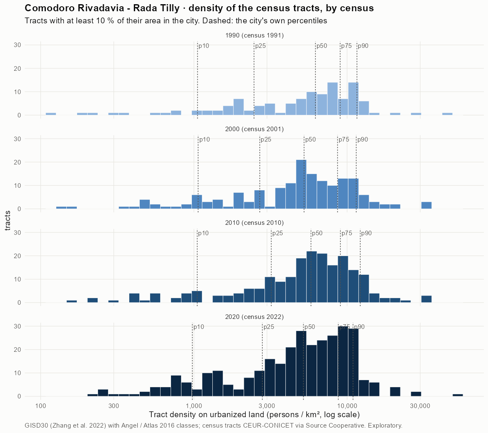
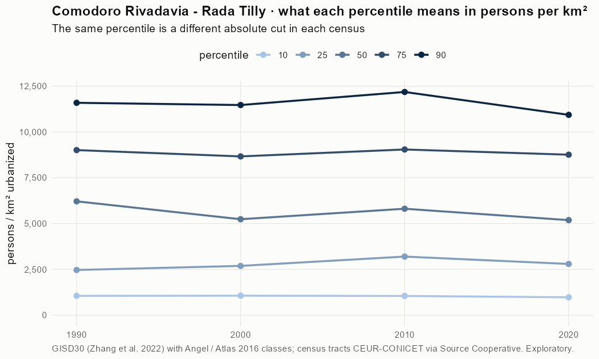
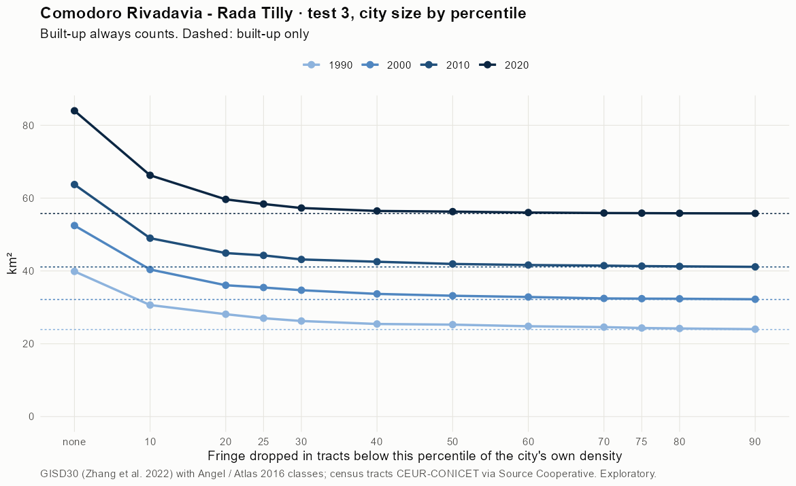
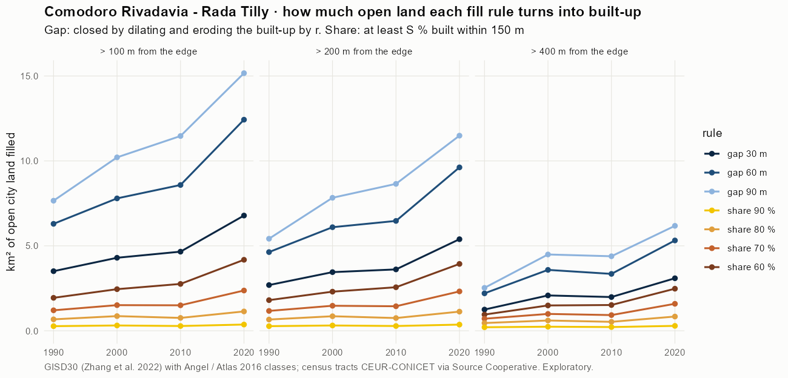
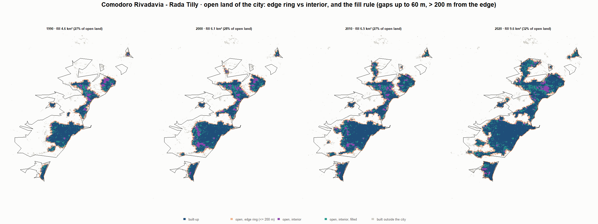
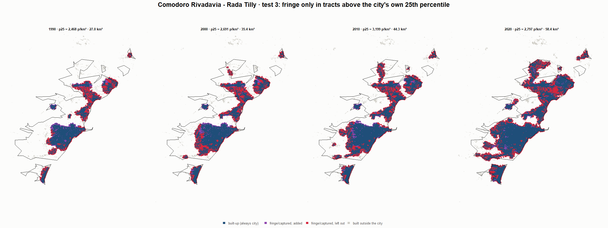

# Comodoro Rivadavia - Rada Tilly · relative cut (test 3) and the fill rule, 1990-2020

Exploratory. None of these numbers are project figures (they are not in `CIFRAS_CANONICAS.json`). Generated by `Rpipe/scripts/16_reglas.R` from step 11. Run of 2026-11-15. [All agglomerations](../REPORTE.md) · [methods](../../METODOS.md).

## The density of the tracts

Tracts with at least 10 % of their area in the city, and the city's own percentiles of their density on urbanized land.

| Year | Tracts | p10 | p25 | p50 | p75 | p90 |
|---|---|---|---|---|---|---|
| 1990 (census 1991) | 115 | 1,056 | 2,468 | 6,214 | 9,010 | 11,591 |
| 2000 (census 2001) | 167 | 1,065 | 2,691 | 5,238 | 8,666 | 11,469 |
| 2010 (census 2010) | 213 | 1,051 | 3,199 | 5,810 | 9,044 | 12,182 |
| 2020 (census 2022) | 313 | 977 | 2,797 | 5,188 | 8,759 | 10,933 |

## Test 3 · fringe only above the city's own percentile

Built-up land is always city. Fringe and captured land join only in tracts at or above percentile p of the city's own tract densities, that census.

| Percentile | 1990 cut p/km² | 2000 cut p/km² | 2010 cut p/km² | 2020 cut p/km² | 1990 km² | 2000 km² | 2010 km² | 2020 km² | 1990-2020 %/yr |
|---|---|---|---|---|---|---|---|---|---|
| none (Angel) | 0 | 0 | 0 | 0 | 39.9 | 52.5 | 63.7 | 84.0 | 2.51 |
| p10 | 1,056 | 1,065 | 1,051 | 977 | 30.6 | 40.4 | 49.0 | 66.3 | 2.61 |
| p20 | 1,921 | 2,059 | 2,547 | 2,002 | 28.1 | 36.1 | 44.9 | 59.7 | 2.54 |
| p25 | 2,468 | 2,691 | 3,199 | 2,797 | 27.0 | 35.4 | 44.3 | 58.4 | 2.60 |
| p30 | 3,115 | 3,528 | 3,815 | 3,245 | 26.2 | 34.7 | 43.2 | 57.3 | 2.64 |
| p40 | 5,035 | 4,645 | 4,910 | 4,391 | 25.4 | 33.7 | 42.5 | 56.5 | 2.70 |
| p50 | 6,214 | 5,238 | 5,810 | 5,188 | 25.2 | 33.2 | 41.9 | 56.3 | 2.71 |
| p60 | 7,196 | 6,104 | 6,790 | 6,494 | 24.8 | 32.8 | 41.6 | 56.0 | 2.75 |
| p70 | 8,208 | 7,525 | 8,272 | 7,763 | 24.6 | 32.4 | 41.5 | 55.9 | 2.78 |
| p75 | 9,010 | 8,666 | 9,044 | 8,759 | 24.3 | 32.4 | 41.3 | 55.9 | 2.81 |
| p80 | 10,257 | 9,712 | 9,586 | 9,713 | 24.2 | 32.4 | 41.3 | 55.8 | 2.83 |
| p90 | 11,591 | 11,469 | 12,182 | 10,933 | 24.0 | 32.2 | 41.1 | 55.8 | 2.85 |
| built only | — | — | — | — | 23.9 | 32.2 | 41.1 | 55.8 | 2.86 |

## Fill rule · open land in the centre that is probably built

An open pixel of the city (fringe or captured) farther than D from any land outside the city becomes built-up if it is a narrow gap in the built-up: closing the built-up (dilate, then erode) with a square of radius r covers it. Central rule: r = 60 m, D = 200 m; *dense* = tract at or above 500 p/km². The alternative share rule fills a pixel with at least S of the pixels within 150 m built.

| Year | Open city land km² | Interior (> 200 m) km² | Filled km² | Filled in dense tracts km² | Built-up km² | Built-up + fill km² | Persons / km² built | With fill |
|---|---|---|---|---|---|---|---|---|
| 1990 (census 1991) | 17.0 | 7.1 | 4.6 | 3.0 | 23.9 | 26.9 | 5,260 | 4,683 |
| 2000 (census 2001) | 21.6 | 10.4 | 6.1 | 3.5 | 32.2 | 35.7 | 4,384 | 3,949 |
| 2010 (census 2010) | 24.1 | 10.1 | 6.5 | 4.2 | 41.1 | 45.3 | 4,463 | 4,048 |
| 2020 (census 2022) | 30.0 | 13.2 | 9.6 | 6.8 | 55.8 | 62.5 | 3,787 | 3,376 |

**Sensitivity: km² filled by each rule** (in brackets, % of the interior open land):

| Year | Farther than | gap 30 m | gap 60 m | gap 90 m | share 60 % | share 70 % | share 80 % | share 90 % |
|---|---|---|---|---|---|---|---|---|
| 1990 | 100 m | 3.5 (36) | 6.3 (64) | 7.7 (78) | 1.9 (20) | 1.2 (12) | 0.7 (7) | 0.3 (3) |
| 1990 | 200 m | 2.7 (38) | 4.6 (66) | 5.4 (77) | 1.8 (26) | 1.2 (17) | 0.7 (9) | 0.3 (4) |
| 1990 | 400 m | 1.2 (36) | 2.2 (64) | 2.5 (73) | 1.0 (28) | 0.7 (21) | 0.5 (13) | 0.2 (6) |
| 2000 | 100 m | 4.3 (32) | 7.8 (58) | 10.2 (76) | 2.4 (18) | 1.5 (11) | 0.9 (6) | 0.3 (2) |
| 2000 | 200 m | 3.5 (33) | 6.1 (58) | 7.8 (75) | 2.3 (22) | 1.5 (14) | 0.9 (8) | 0.3 (3) |
| 2000 | 400 m | 2.1 (32) | 3.6 (56) | 4.5 (70) | 1.5 (23) | 1.0 (15) | 0.6 (9) | 0.2 (4) |
| 2010 | 100 m | 4.7 (34) | 8.6 (63) | 11.5 (84) | 2.8 (20) | 1.5 (11) | 0.8 (6) | 0.3 (2) |
| 2010 | 200 m | 3.6 (36) | 6.5 (64) | 8.6 (85) | 2.6 (25) | 1.4 (14) | 0.7 (7) | 0.3 (3) |
| 2010 | 400 m | 2.0 (37) | 3.3 (62) | 4.4 (81) | 1.5 (28) | 0.9 (17) | 0.5 (10) | 0.2 (4) |
| 2020 | 100 m | 6.8 (39) | 12.4 (71) | 15.2 (86) | 4.2 (24) | 2.4 (14) | 1.1 (6) | 0.4 (2) |
| 2020 | 200 m | 5.4 (41) | 9.6 (73) | 11.5 (87) | 3.9 (30) | 2.3 (18) | 1.1 (9) | 0.4 (3) |
| 2020 | 400 m | 3.1 (42) | 5.3 (73) | 6.2 (84) | 2.5 (34) | 1.6 (22) | 0.8 (11) | 0.3 (4) |

**Test 3 at p25 plus the central fill, without asking for a dense tract** (the fill keeps interior gaps of sparse tracts that test 3 drops):

| Year | Angel km² | Test 3 p25 km² | Test 3 + fill km² |
|---|---|---|---|
| 1990 | 39.9 | 27.0 | 30.7 |
| 2000 | 52.5 | 35.4 | 40.4 |
| 2010 | 63.7 | 44.3 | 49.8 |
| 2020 | 84.0 | 58.4 | 66.7 |

## Maps

### Edge ring, interior and fill

### Test 3 at p25

