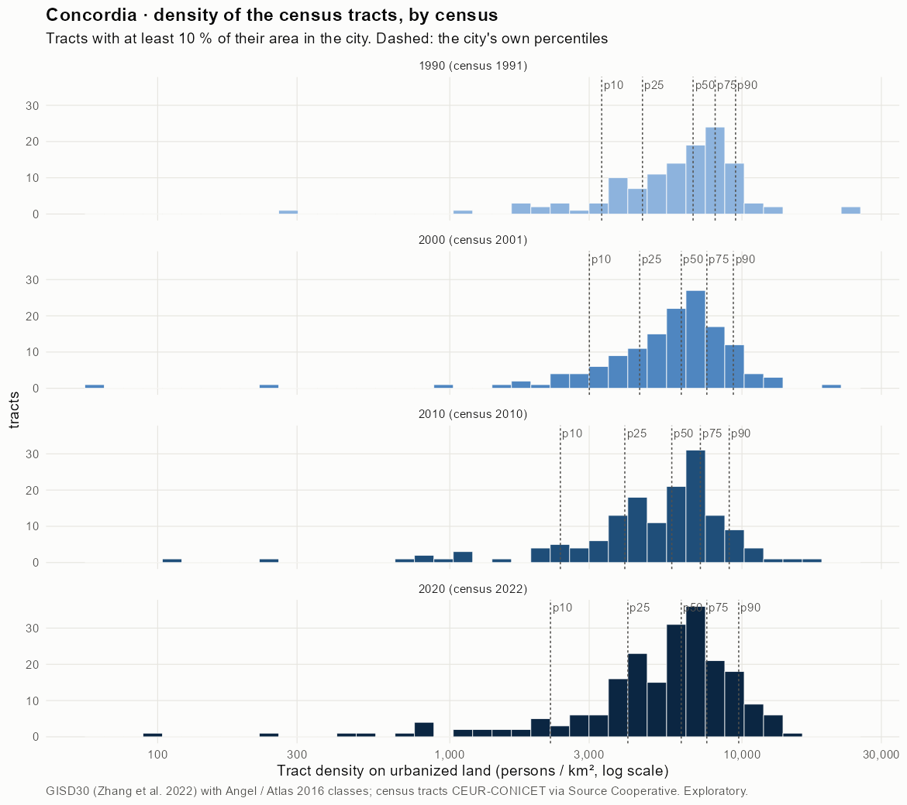
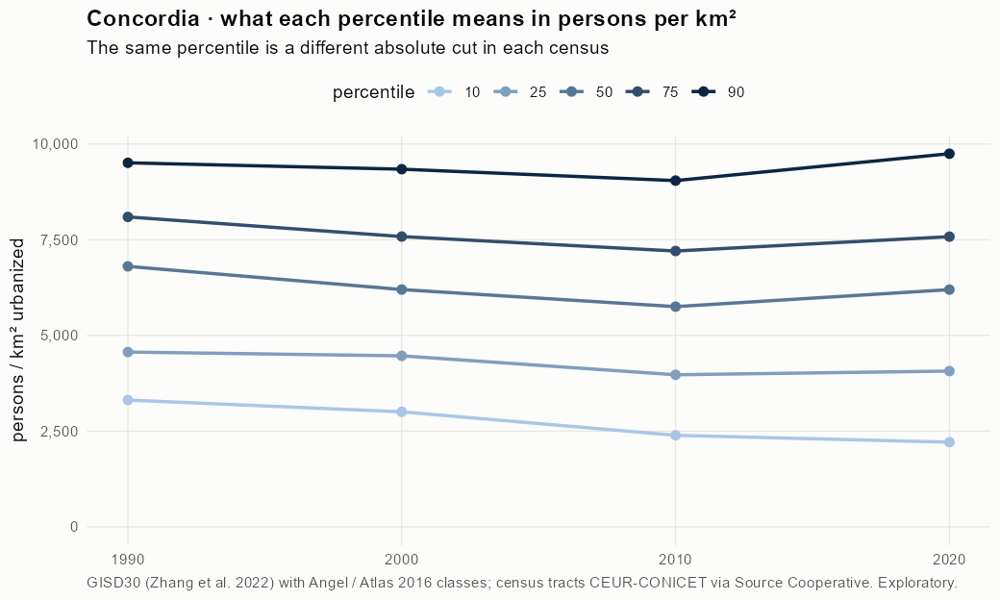
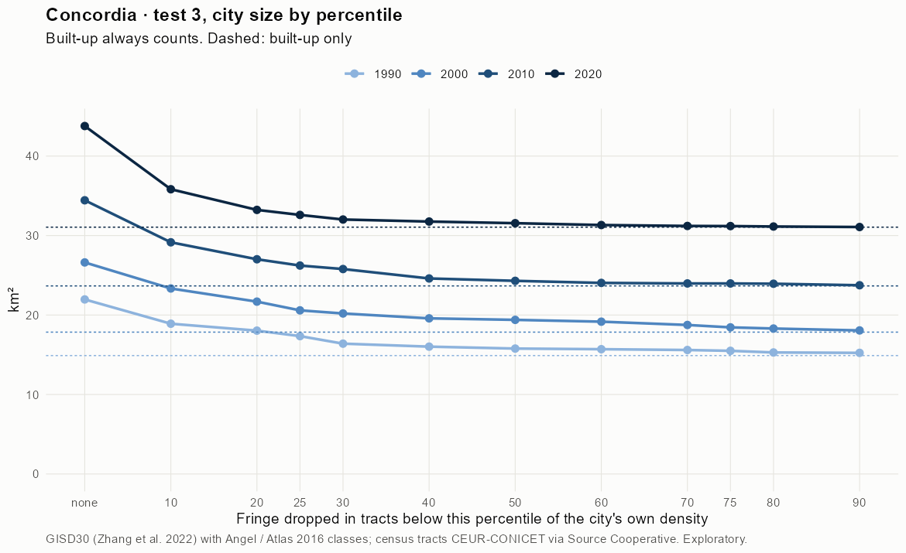
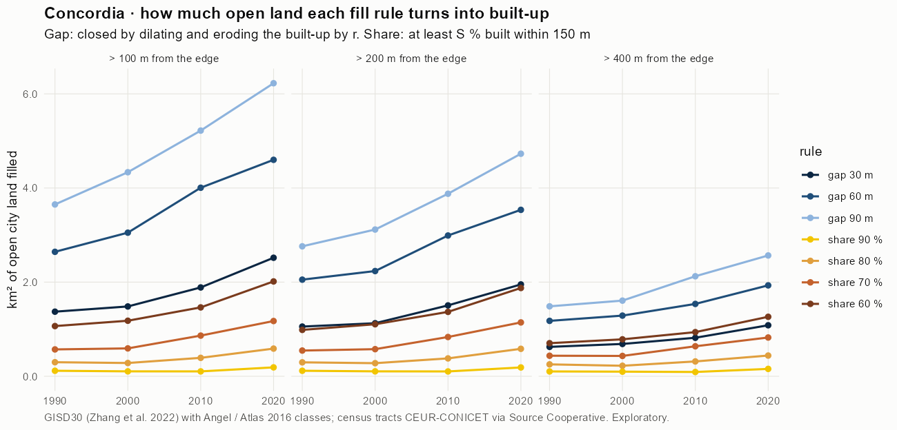
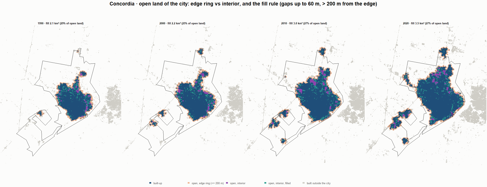
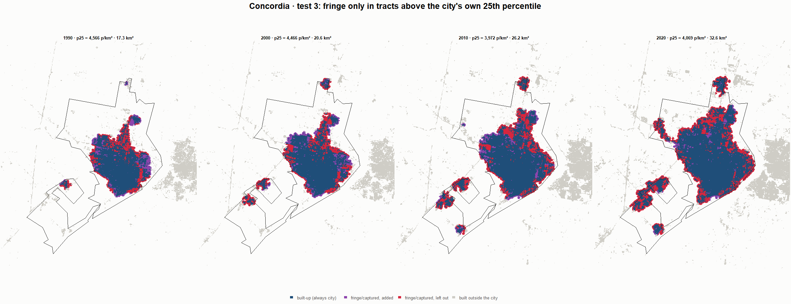

# Concordia · relative cut (test 3) and the fill rule, 1990-2020

Exploratory. None of these numbers are project figures (they are not in `CIFRAS_CANONICAS.json`). Generated by `Rpipe/scripts/16_reglas.R` from step 11. Run of 2026-11-15. [All agglomerations](../REPORTE.md) · [methods](../../METODOS.md).

## The density of the tracts

Tracts with at least 10 % of their area in the city, and the city's own percentiles of their density on urbanized land.

| Year | Tracts | p10 | p25 | p50 | p75 | p90 |
|---|---|---|---|---|---|---|
| 1990 (census 1991) | 120 | 3,311 | 4,566 | 6,804 | 8,096 | 9,509 |
| 2000 (census 2001) | 142 | 3,004 | 4,466 | 6,198 | 7,583 | 9,343 |
| 2010 (census 2010) | 152 | 2,390 | 3,972 | 5,752 | 7,205 | 9,044 |
| 2020 (census 2022) | 213 | 2,211 | 4,069 | 6,196 | 7,580 | 9,747 |

## Test 3 · fringe only above the city's own percentile

Built-up land is always city. Fringe and captured land join only in tracts at or above percentile p of the city's own tract densities, that census.

| Percentile | 1990 cut p/km² | 2000 cut p/km² | 2010 cut p/km² | 2020 cut p/km² | 1990 km² | 2000 km² | 2010 km² | 2020 km² | 1990-2020 %/yr |
|---|---|---|---|---|---|---|---|---|---|
| none (Angel) | 0 | 0 | 0 | 0 | 22.0 | 26.6 | 34.4 | 43.8 | 2.33 |
| p10 | 3,311 | 3,004 | 2,390 | 2,211 | 18.9 | 23.3 | 29.2 | 35.8 | 2.15 |
| p20 | 4,083 | 4,052 | 3,647 | 3,730 | 18.0 | 21.7 | 27.0 | 33.2 | 2.06 |
| p25 | 4,566 | 4,466 | 3,972 | 4,069 | 17.3 | 20.6 | 26.2 | 32.6 | 2.12 |
| p30 | 5,208 | 4,834 | 4,231 | 4,356 | 16.4 | 20.2 | 25.8 | 32.0 | 2.26 |
| p40 | 6,004 | 5,536 | 4,830 | 5,209 | 16.0 | 19.6 | 24.6 | 31.8 | 2.31 |
| p50 | 6,804 | 6,198 | 5,752 | 6,196 | 15.8 | 19.4 | 24.3 | 31.6 | 2.34 |
| p60 | 7,224 | 6,661 | 6,375 | 6,715 | 15.7 | 19.2 | 24.0 | 31.3 | 2.33 |
| p70 | 7,894 | 7,213 | 6,925 | 7,336 | 15.6 | 18.7 | 24.0 | 31.2 | 2.34 |
| p75 | 8,096 | 7,583 | 7,205 | 7,580 | 15.5 | 18.4 | 24.0 | 31.2 | 2.36 |
| p80 | 8,333 | 7,857 | 7,450 | 8,115 | 15.3 | 18.3 | 23.9 | 31.1 | 2.40 |
| p90 | 9,509 | 9,343 | 9,044 | 9,747 | 15.2 | 18.1 | 23.7 | 31.1 | 2.40 |
| built only | — | — | — | — | 14.9 | 17.8 | 23.7 | 31.1 | 2.48 |

## Fill rule · open land in the centre that is probably built

An open pixel of the city (fringe or captured) farther than D from any land outside the city becomes built-up if it is a narrow gap in the built-up: closing the built-up (dilate, then erode) with a square of radius r covers it. Central rule: r = 60 m, D = 200 m; *dense* = tract at or above 500 p/km². The alternative share rule fills a pixel with at least S of the pixels within 150 m built.

| Year | Open city land km² | Interior (> 200 m) km² | Filled km² | Filled in dense tracts km² | Built-up km² | Built-up + fill km² | Persons / km² built | With fill |
|---|---|---|---|---|---|---|---|---|
| 1990 (census 1991) | 7.1 | 3.1 | 2.1 | 2.0 | 14.9 | 16.9 | 7,951 | 6,998 |
| 2000 (census 2001) | 8.8 | 3.7 | 2.2 | 2.2 | 17.8 | 20.0 | 7,798 | 6,945 |
| 2010 (census 2010) | 10.9 | 4.9 | 3.0 | 2.8 | 23.7 | 26.5 | 6,368 | 5,695 |
| 2020 (census 2022) | 13.0 | 5.5 | 3.5 | 3.1 | 31.1 | 34.2 | 5,743 | 5,216 |

**Sensitivity: km² filled by each rule** (in brackets, % of the interior open land):

| Year | Farther than | gap 30 m | gap 60 m | gap 90 m | share 60 % | share 70 % | share 80 % | share 90 % |
|---|---|---|---|---|---|---|---|---|
| 1990 | 100 m | 1.4 (32) | 2.6 (63) | 3.7 (86) | 1.1 (25) | 0.6 (14) | 0.3 (7) | 0.1 (3) |
| 1990 | 200 m | 1.1 (34) | 2.1 (66) | 2.8 (88) | 1.0 (31) | 0.5 (17) | 0.3 (9) | 0.1 (4) |
| 1990 | 400 m | 0.6 (39) | 1.2 (73) | 1.5 (92) | 0.7 (43) | 0.4 (27) | 0.3 (16) | 0.1 (6) |
| 2000 | 100 m | 1.5 (29) | 3.1 (60) | 4.3 (85) | 1.2 (23) | 0.6 (12) | 0.3 (6) | 0.1 (2) |
| 2000 | 200 m | 1.1 (31) | 2.2 (61) | 3.1 (85) | 1.1 (30) | 0.6 (16) | 0.3 (8) | 0.1 (3) |
| 2000 | 400 m | 0.7 (39) | 1.3 (72) | 1.6 (90) | 0.8 (44) | 0.4 (24) | 0.2 (13) | 0.1 (6) |
| 2010 | 100 m | 1.9 (29) | 4.0 (62) | 5.2 (81) | 1.5 (23) | 0.9 (13) | 0.4 (6) | 0.1 (2) |
| 2010 | 200 m | 1.5 (30) | 3.0 (61) | 3.9 (79) | 1.4 (28) | 0.8 (17) | 0.4 (8) | 0.1 (2) |
| 2010 | 400 m | 0.8 (28) | 1.5 (53) | 2.1 (74) | 0.9 (33) | 0.6 (22) | 0.3 (11) | 0.1 (3) |
| 2020 | 100 m | 2.5 (34) | 4.6 (62) | 6.2 (84) | 2.0 (27) | 1.2 (16) | 0.6 (8) | 0.2 (3) |
| 2020 | 200 m | 2.0 (35) | 3.5 (64) | 4.7 (86) | 1.9 (34) | 1.1 (21) | 0.6 (11) | 0.2 (3) |
| 2020 | 400 m | 1.1 (36) | 1.9 (64) | 2.6 (85) | 1.3 (42) | 0.8 (27) | 0.4 (15) | 0.2 (5) |

**Test 3 at p25 plus the central fill, without asking for a dense tract** (the fill keeps interior gaps of sparse tracts that test 3 drops):

| Year | Angel km² | Test 3 p25 km² | Test 3 + fill km² |
|---|---|---|---|
| 1990 | 22.0 | 17.3 | 18.5 |
| 2000 | 26.6 | 20.6 | 21.9 |
| 2010 | 34.4 | 26.2 | 28.1 |
| 2020 | 43.8 | 32.6 | 35.3 |

## Maps

### Edge ring, interior and fill

### Test 3 at p25

