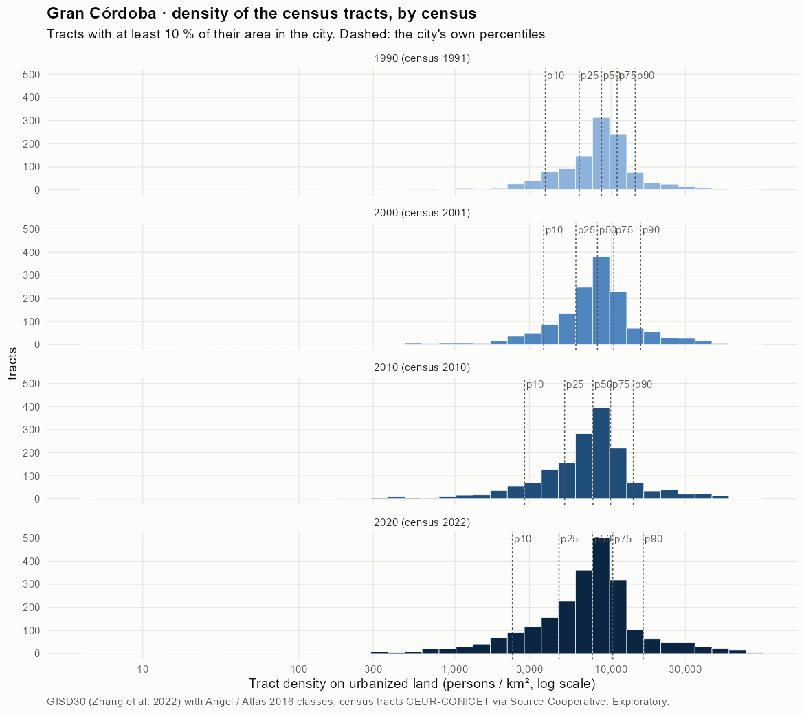
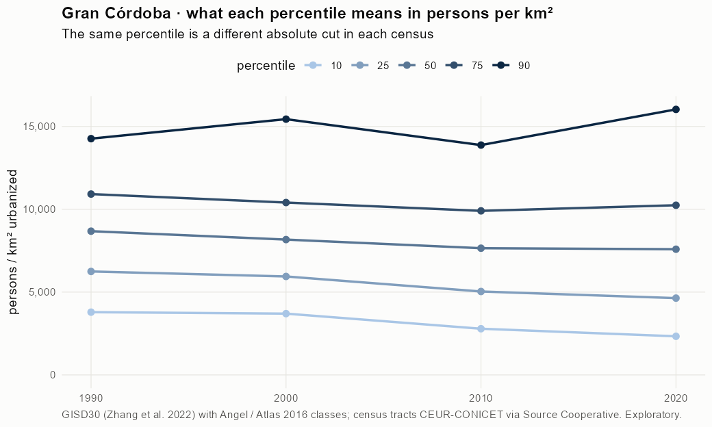
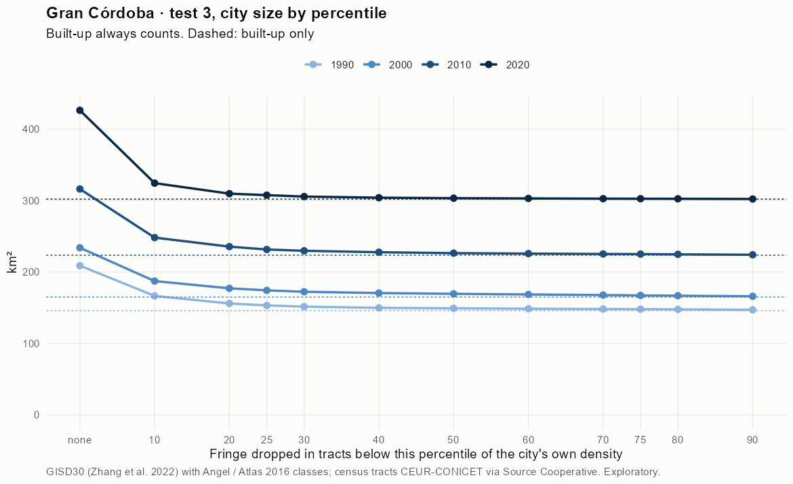
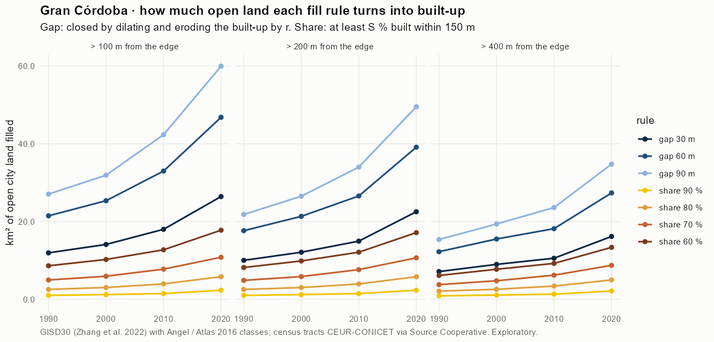
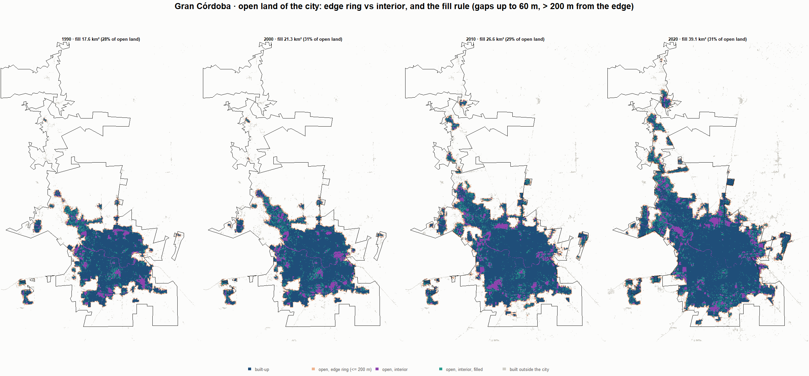
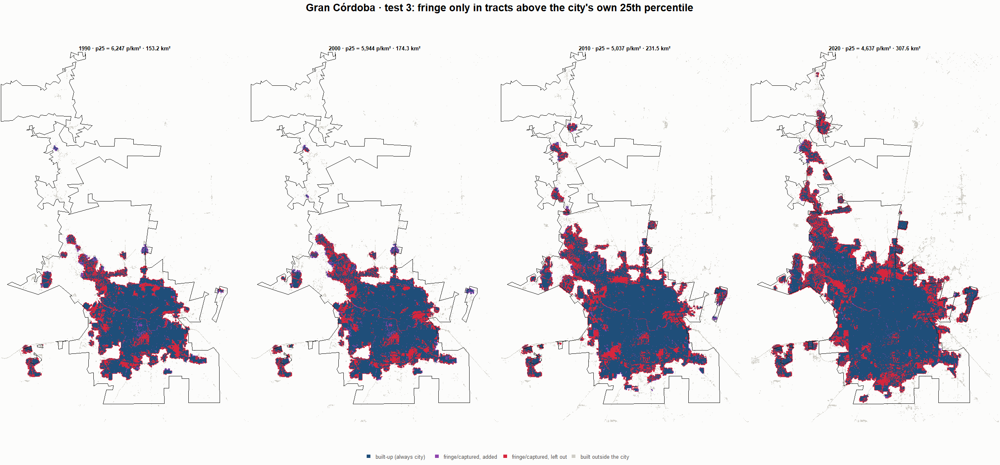

# Gran Córdoba · relative cut (test 3) and the fill rule, 1990-2020

Exploratory. None of these numbers are project figures (they are not in `CIFRAS_CANONICAS.json`). Generated by `Rpipe/scripts/16_reglas.R` from step 11. Run of 2026-11-15. [All agglomerations](../REPORTE.md) · [methods](../../METODOS.md).

## The density of the tracts

Tracts with at least 10 % of their area in the city, and the city's own percentiles of their density on urbanized land.

| Year | Tracts | p10 | p25 | p50 | p75 | p90 |
|---|---|---|---|---|---|---|
| 1990 (census 1991) | 1,131 | 3,789 | 6,247 | 8,679 | 10,919 | 14,265 |
| 2000 (census 2001) | 1,400 | 3,700 | 5,944 | 8,171 | 10,407 | 15,443 |
| 2010 (census 2010) | 1,615 | 2,789 | 5,037 | 7,651 | 9,905 | 13,877 |
| 2020 (census 2022) | 2,304 | 2,332 | 4,637 | 7,589 | 10,245 | 16,032 |

## Test 3 · fringe only above the city's own percentile

Built-up land is always city. Fringe and captured land join only in tracts at or above percentile p of the city's own tract densities, that census.

| Percentile | 1990 cut p/km² | 2000 cut p/km² | 2010 cut p/km² | 2020 cut p/km² | 1990 km² | 2000 km² | 2010 km² | 2020 km² | 1990-2020 %/yr |
|---|---|---|---|---|---|---|---|---|---|
| none (Angel) | 0 | 0 | 0 | 0 | 208.9 | 233.9 | 316.2 | 426.4 | 2.41 |
| p10 | 3,789 | 3,700 | 2,789 | 2,332 | 166.5 | 187.3 | 248.2 | 324.4 | 2.25 |
| p20 | 5,445 | 5,347 | 4,408 | 3,974 | 155.9 | 177.2 | 235.5 | 309.7 | 2.31 |
| p25 | 6,247 | 5,944 | 5,037 | 4,637 | 153.2 | 174.3 | 231.5 | 307.6 | 2.35 |
| p30 | 6,803 | 6,634 | 5,652 | 5,357 | 151.5 | 172.3 | 229.7 | 305.6 | 2.37 |
| p40 | 7,858 | 7,474 | 6,786 | 6,497 | 149.8 | 170.6 | 227.7 | 304.0 | 2.39 |
| p50 | 8,679 | 8,171 | 7,651 | 7,589 | 149.1 | 169.4 | 226.4 | 303.4 | 2.40 |
| p60 | 9,464 | 8,952 | 8,409 | 8,507 | 148.6 | 168.6 | 225.7 | 303.0 | 2.40 |
| p70 | 10,420 | 9,816 | 9,396 | 9,514 | 148.1 | 167.7 | 225.3 | 302.7 | 2.41 |
| p75 | 10,919 | 10,407 | 9,905 | 10,245 | 148.0 | 167.2 | 225.1 | 302.6 | 2.41 |
| p80 | 11,520 | 11,210 | 10,579 | 11,015 | 147.7 | 166.8 | 224.7 | 302.5 | 2.42 |
| p90 | 14,265 | 15,443 | 13,877 | 16,032 | 147.0 | 166.0 | 224.1 | 302.3 | 2.43 |
| built only | — | — | — | — | 145.9 | 164.9 | 223.5 | 302.0 | 2.46 |

## Fill rule · open land in the centre that is probably built

An open pixel of the city (fringe or captured) farther than D from any land outside the city becomes built-up if it is a narrow gap in the built-up: closing the built-up (dilate, then erode) with a square of radius r covers it. Central rule: r = 60 m, D = 200 m; *dense* = tract at or above 500 p/km². The alternative share rule fills a pixel with at least S of the pixels within 150 m built.

| Year | Open city land km² | Interior (> 200 m) km² | Filled km² | Filled in dense tracts km² | Built-up km² | Built-up + fill km² | Persons / km² built | With fill |
|---|---|---|---|---|---|---|---|---|
| 1990 (census 1991) | 63.0 | 35.5 | 17.6 | 16.5 | 145.9 | 162.4 | 8,410 | 7,556 |
| 2000 (census 2001) | 69.1 | 42.3 | 21.3 | 19.9 | 164.9 | 184.8 | 8,153 | 7,277 |
| 2010 (census 2010) | 92.7 | 53.2 | 26.6 | 22.0 | 223.5 | 245.5 | 6,604 | 6,014 |
| 2020 (census 2022) | 124.4 | 76.7 | 39.1 | 30.2 | 302.0 | 332.2 | 5,668 | 5,153 |

**Sensitivity: km² filled by each rule** (in brackets, % of the interior open land):

| Year | Farther than | gap 30 m | gap 60 m | gap 90 m | share 60 % | share 70 % | share 80 % | share 90 % |
|---|---|---|---|---|---|---|---|---|
| 1990 | 100 m | 11.9 (28) | 21.5 (51) | 27.1 (64) | 8.6 (20) | 5.0 (12) | 2.5 (6) | 1.0 (2) |
| 1990 | 200 m | 10.0 (28) | 17.6 (50) | 21.8 (62) | 8.2 (23) | 4.9 (14) | 2.5 (7) | 1.0 (3) |
| 1990 | 400 m | 7.1 (27) | 12.2 (47) | 15.4 (59) | 6.1 (23) | 3.8 (14) | 2.1 (8) | 0.9 (3) |
| 2000 | 100 m | 14.1 (29) | 25.4 (52) | 31.9 (65) | 10.2 (21) | 5.9 (12) | 3.0 (6) | 1.2 (2) |
| 2000 | 200 m | 12.1 (29) | 21.3 (50) | 26.5 (63) | 9.9 (23) | 5.8 (14) | 3.0 (7) | 1.2 (3) |
| 2000 | 400 m | 9.0 (27) | 15.5 (47) | 19.4 (59) | 7.7 (24) | 4.8 (15) | 2.6 (8) | 1.1 (3) |
| 2010 | 100 m | 18.0 (28) | 33.0 (52) | 42.3 (67) | 12.7 (20) | 7.7 (12) | 4.0 (6) | 1.5 (2) |
| 2010 | 200 m | 15.0 (28) | 26.6 (50) | 34.0 (64) | 12.1 (23) | 7.6 (14) | 3.9 (7) | 1.5 (3) |
| 2010 | 400 m | 10.6 (27) | 18.2 (46) | 23.6 (60) | 9.2 (23) | 6.2 (16) | 3.4 (9) | 1.3 (3) |
| 2020 | 100 m | 26.4 (29) | 46.8 (52) | 60.0 (67) | 17.8 (20) | 10.8 (12) | 5.8 (6) | 2.3 (3) |
| 2020 | 200 m | 22.5 (29) | 39.1 (51) | 49.5 (65) | 17.1 (22) | 10.7 (14) | 5.8 (8) | 2.3 (3) |
| 2020 | 400 m | 16.2 (29) | 27.4 (48) | 34.8 (61) | 13.4 (24) | 8.7 (15) | 5.0 (9) | 2.1 (4) |

**Test 3 at p25 plus the central fill, without asking for a dense tract** (the fill keeps interior gaps of sparse tracts that test 3 drops):

| Year | Angel km² | Test 3 p25 km² | Test 3 + fill km² |
|---|---|---|---|
| 1990 | 208.9 | 153.2 | 167.8 |
| 2000 | 233.9 | 174.3 | 191.6 |
| 2010 | 316.2 | 231.5 | 254.9 |
| 2020 | 426.4 | 307.6 | 343.7 |

## Maps

### Edge ring, interior and fill

### Test 3 at p25

