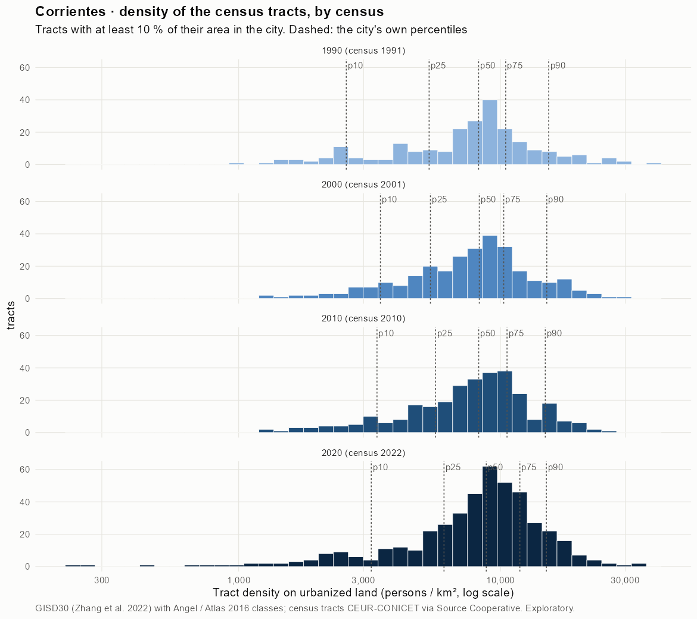
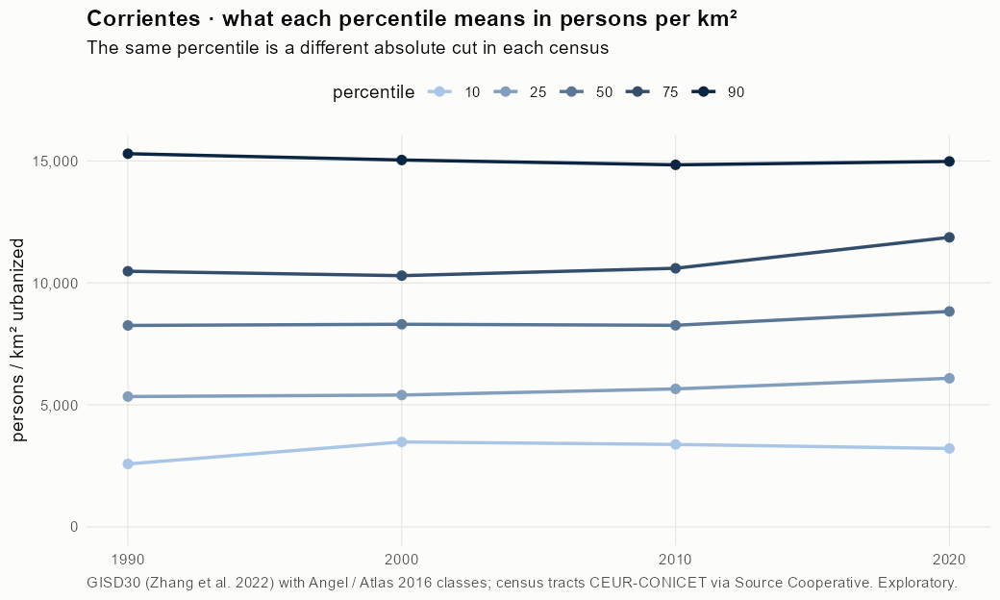
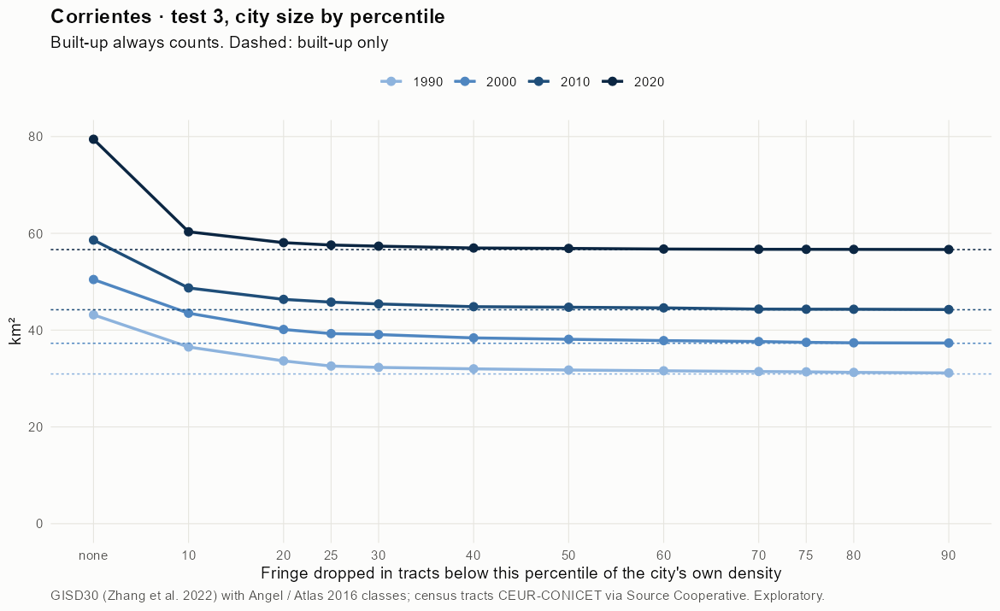
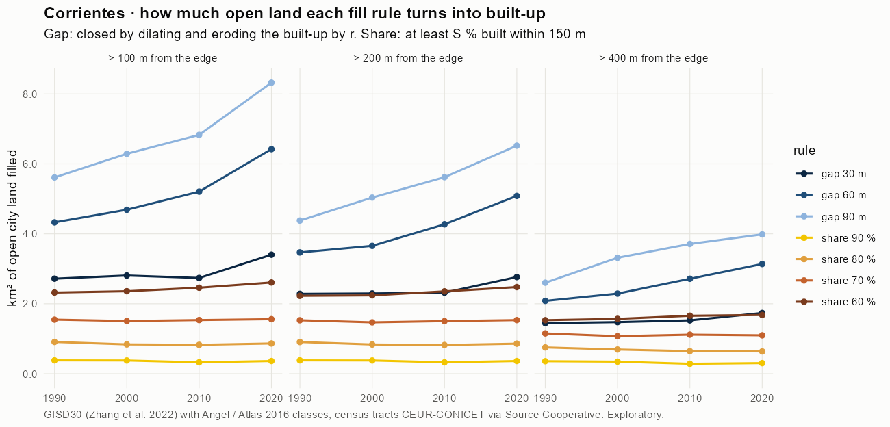
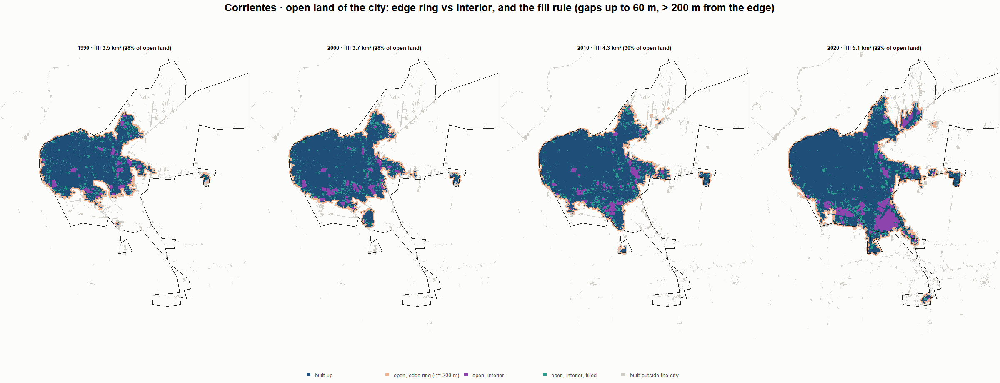
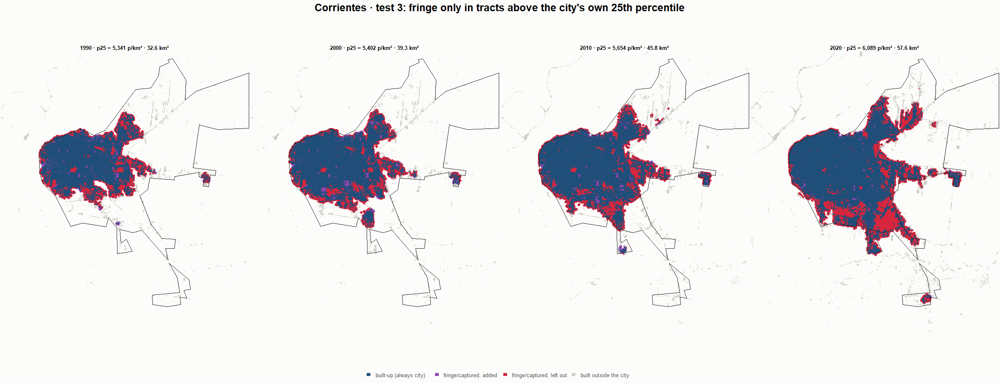

# Corrientes · relative cut (test 3) and the fill rule, 1990-2020

Exploratory. None of these numbers are project figures (they are not in `CIFRAS_CANONICAS.json`). Generated by `Rpipe/scripts/16_reglas.R` from step 11. Run of 2026-11-15. [All agglomerations](../REPORTE.md) · [methods](../../METODOS.md).

## The density of the tracts

Tracts with at least 10 % of their area in the city, and the city's own percentiles of their density on urbanized land.

| Year | Tracts | p10 | p25 | p50 | p75 | p90 |
|---|---|---|---|---|---|---|
| 1990 (census 1991) | 234 | 2,577 | 5,341 | 8,256 | 10,477 | 15,296 |
| 2000 (census 2001) | 284 | 3,479 | 5,402 | 8,303 | 10,296 | 15,038 |
| 2010 (census 2010) | 301 | 3,376 | 5,654 | 8,261 | 10,599 | 14,840 |
| 2020 (census 2022) | 447 | 3,210 | 6,089 | 8,830 | 11,867 | 14,980 |

## Test 3 · fringe only above the city's own percentile

Built-up land is always city. Fringe and captured land join only in tracts at or above percentile p of the city's own tract densities, that census.

| Percentile | 1990 cut p/km² | 2000 cut p/km² | 2010 cut p/km² | 2020 cut p/km² | 1990 km² | 2000 km² | 2010 km² | 2020 km² | 1990-2020 %/yr |
|---|---|---|---|---|---|---|---|---|---|
| none (Angel) | 0 | 0 | 0 | 0 | 43.2 | 50.5 | 58.6 | 79.4 | 2.05 |
| p10 | 2,577 | 3,479 | 3,376 | 3,210 | 36.5 | 43.5 | 48.7 | 60.3 | 1.69 |
| p20 | 4,394 | 4,888 | 4,974 | 5,416 | 33.6 | 40.1 | 46.4 | 58.1 | 1.84 |
| p25 | 5,341 | 5,402 | 5,654 | 6,089 | 32.6 | 39.3 | 45.8 | 57.6 | 1.92 |
| p30 | 6,372 | 5,922 | 6,220 | 6,724 | 32.3 | 39.1 | 45.4 | 57.3 | 1.93 |
| p40 | 7,384 | 7,182 | 7,274 | 8,049 | 32.0 | 38.4 | 44.8 | 57.0 | 1.94 |
| p50 | 8,256 | 8,303 | 8,261 | 8,830 | 31.8 | 38.1 | 44.7 | 56.9 | 1.96 |
| p60 | 8,947 | 9,109 | 9,254 | 9,745 | 31.6 | 37.8 | 44.6 | 56.8 | 1.97 |
| p70 | 9,864 | 9,804 | 10,163 | 10,872 | 31.4 | 37.6 | 44.3 | 56.7 | 1.98 |
| p75 | 10,477 | 10,296 | 10,599 | 11,867 | 31.4 | 37.5 | 44.3 | 56.7 | 1.99 |
| p80 | 11,338 | 11,229 | 11,477 | 12,396 | 31.3 | 37.4 | 44.3 | 56.7 | 2.00 |
| p90 | 15,296 | 15,038 | 14,840 | 14,980 | 31.2 | 37.3 | 44.3 | 56.7 | 2.01 |
| built only | — | — | — | — | 30.9 | 37.3 | 44.2 | 56.6 | 2.04 |

## Fill rule · open land in the centre that is probably built

An open pixel of the city (fringe or captured) farther than D from any land outside the city becomes built-up if it is a narrow gap in the built-up: closing the built-up (dilate, then erode) with a square of radius r covers it. Central rule: r = 60 m, D = 200 m; *dense* = tract at or above 500 p/km². The alternative share rule fills a pixel with at least S of the pixels within 150 m built.

| Year | Open city land km² | Interior (> 200 m) km² | Filled km² | Filled in dense tracts km² | Built-up km² | Built-up + fill km² | Persons / km² built | With fill |
|---|---|---|---|---|---|---|---|---|
| 1990 (census 1991) | 12.2 | 5.8 | 3.5 | 3.5 | 30.9 | 34.4 | 8,458 | 7,606 |
| 2000 (census 2001) | 13.2 | 6.6 | 3.7 | 3.7 | 37.3 | 40.9 | 8,594 | 7,826 |
| 2010 (census 2010) | 14.4 | 7.3 | 4.3 | 4.3 | 44.2 | 48.5 | 7,898 | 7,202 |
| 2020 (census 2022) | 22.8 | 12.2 | 5.1 | 4.7 | 56.6 | 61.3 | 7,636 | 7,054 |

**Sensitivity: km² filled by each rule** (in brackets, % of the interior open land):

| Year | Farther than | gap 30 m | gap 60 m | gap 90 m | share 60 % | share 70 % | share 80 % | share 90 % |
|---|---|---|---|---|---|---|---|---|
| 1990 | 100 m | 2.7 (37) | 4.3 (59) | 5.6 (76) | 2.3 (32) | 1.5 (21) | 0.9 (12) | 0.4 (5) |
| 1990 | 200 m | 2.3 (40) | 3.5 (60) | 4.4 (76) | 2.2 (39) | 1.5 (27) | 0.9 (16) | 0.4 (7) |
| 1990 | 400 m | 1.4 (43) | 2.1 (62) | 2.6 (77) | 1.5 (45) | 1.2 (34) | 0.8 (22) | 0.4 (11) |
| 2000 | 100 m | 2.8 (34) | 4.7 (58) | 6.3 (77) | 2.4 (29) | 1.5 (18) | 0.8 (10) | 0.4 (5) |
| 2000 | 200 m | 2.3 (35) | 3.7 (56) | 5.0 (77) | 2.2 (34) | 1.5 (22) | 0.8 (13) | 0.4 (6) |
| 2000 | 400 m | 1.5 (34) | 2.3 (53) | 3.3 (76) | 1.6 (36) | 1.1 (25) | 0.7 (16) | 0.3 (8) |
| 2010 | 100 m | 2.7 (31) | 5.2 (58) | 6.8 (76) | 2.5 (27) | 1.5 (17) | 0.8 (9) | 0.3 (4) |
| 2010 | 200 m | 2.3 (32) | 4.3 (59) | 5.6 (77) | 2.4 (32) | 1.5 (21) | 0.8 (11) | 0.3 (4) |
| 2010 | 400 m | 1.5 (30) | 2.7 (54) | 3.7 (74) | 1.7 (33) | 1.1 (22) | 0.6 (13) | 0.3 (6) |
| 2020 | 100 m | 3.4 (23) | 6.4 (43) | 8.3 (56) | 2.6 (18) | 1.6 (11) | 0.9 (6) | 0.4 (2) |
| 2020 | 200 m | 2.8 (23) | 5.1 (42) | 6.5 (53) | 2.5 (20) | 1.5 (13) | 0.9 (7) | 0.4 (3) |
| 2020 | 400 m | 1.7 (21) | 3.1 (38) | 4.0 (48) | 1.7 (20) | 1.1 (13) | 0.6 (8) | 0.3 (4) |

**Test 3 at p25 plus the central fill, without asking for a dense tract** (the fill keeps interior gaps of sparse tracts that test 3 drops):

| Year | Angel km² | Test 3 p25 km² | Test 3 + fill km² |
|---|---|---|---|
| 1990 | 43.2 | 32.6 | 35.1 |
| 2000 | 50.5 | 39.3 | 41.9 |
| 2010 | 58.6 | 45.8 | 49.1 |
| 2020 | 79.4 | 57.6 | 62.1 |

## Maps

### Edge ring, interior and fill

### Test 3 at p25

