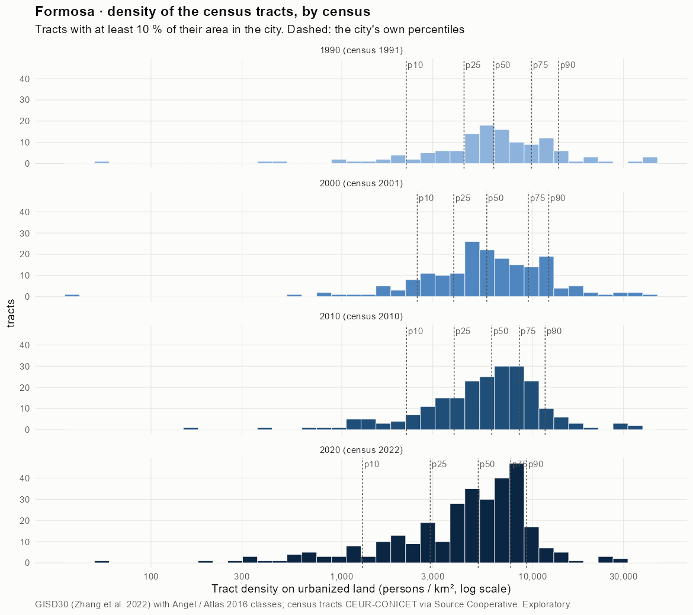
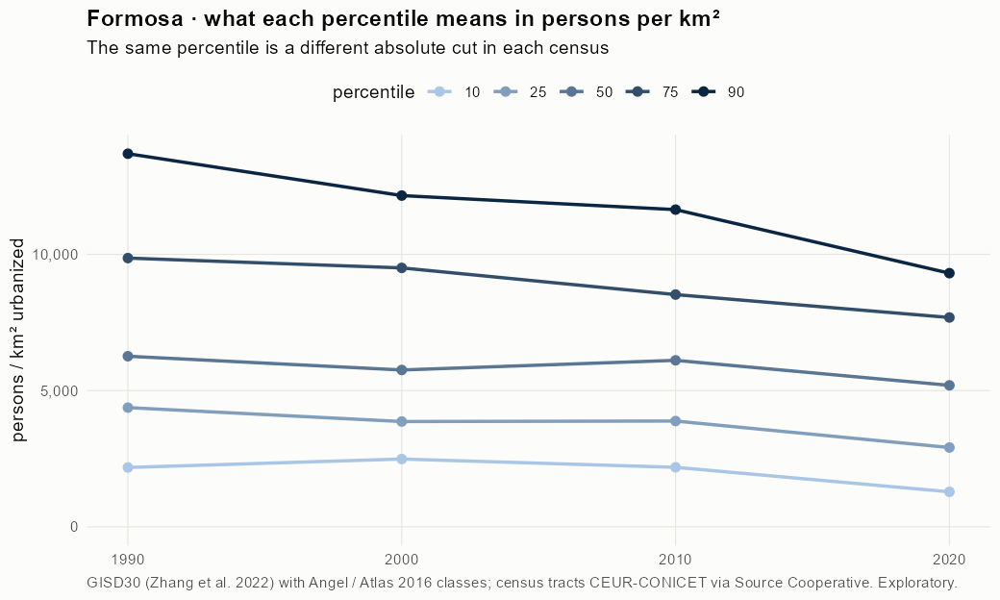
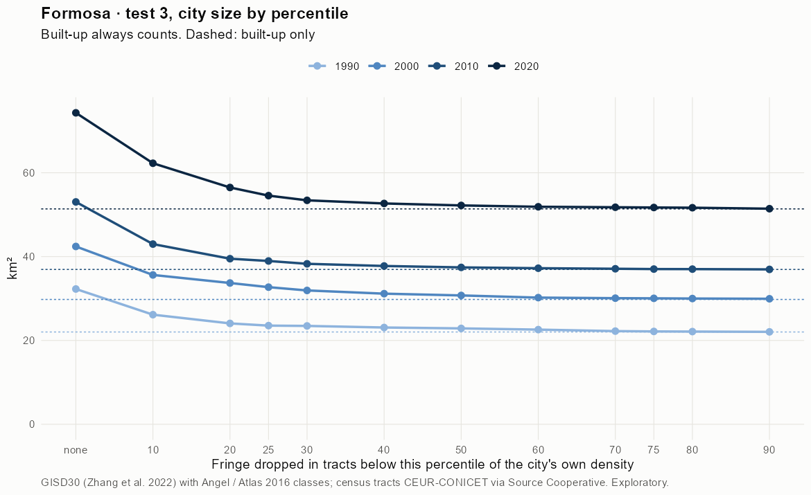
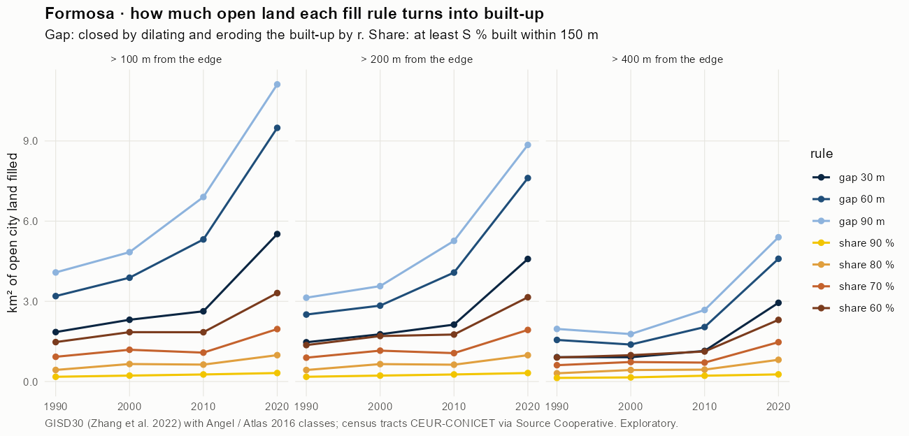
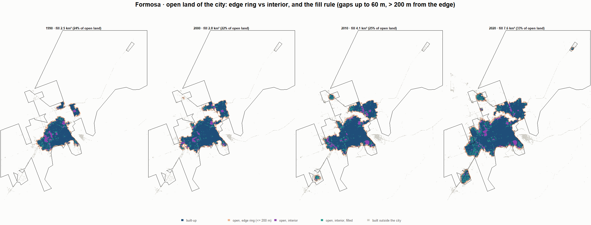
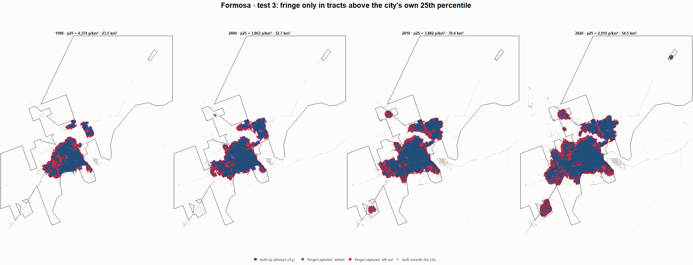

# Formosa · relative cut (test 3) and the fill rule, 1990-2020

Exploratory. None of these numbers are project figures (they are not in `CIFRAS_CANONICAS.json`). Generated by `Rpipe/scripts/16_reglas.R` from step 11. Run of 2026-11-15. [All agglomerations](../REPORTE.md) · [methods](../../METODOS.md).

## The density of the tracts

Tracts with at least 10 % of their area in the city, and the city's own percentiles of their density on urbanized land.

| Year | Tracts | p10 | p25 | p50 | p75 | p90 |
|---|---|---|---|---|---|---|
| 1990 (census 1991) | 126 | 2,177 | 4,374 | 6,259 | 9,861 | 13,692 |
| 2000 (census 2001) | 186 | 2,487 | 3,863 | 5,755 | 9,502 | 12,155 |
| 2010 (census 2010) | 226 | 2,183 | 3,882 | 6,109 | 8,522 | 11,640 |
| 2020 (census 2022) | 310 | 1,284 | 2,910 | 5,192 | 7,682 | 9,308 |

## Test 3 · fringe only above the city's own percentile

Built-up land is always city. Fringe and captured land join only in tracts at or above percentile p of the city's own tract densities, that census.

| Percentile | 1990 cut p/km² | 2000 cut p/km² | 2010 cut p/km² | 2020 cut p/km² | 1990 km² | 2000 km² | 2010 km² | 2020 km² | 1990-2020 %/yr |
|---|---|---|---|---|---|---|---|---|---|
| none (Angel) | 0 | 0 | 0 | 0 | 32.3 | 42.4 | 53.0 | 74.3 | 2.82 |
| p10 | 2,177 | 2,487 | 2,183 | 1,284 | 26.1 | 35.6 | 43.0 | 62.3 | 2.93 |
| p20 | 3,573 | 3,402 | 3,297 | 2,451 | 24.1 | 33.7 | 39.5 | 56.5 | 2.89 |
| p25 | 4,374 | 3,863 | 3,882 | 2,910 | 23.5 | 32.7 | 39.0 | 54.5 | 2.84 |
| p30 | 4,791 | 4,455 | 4,287 | 3,637 | 23.5 | 31.9 | 38.3 | 53.4 | 2.78 |
| p40 | 5,533 | 4,913 | 5,185 | 4,427 | 23.1 | 31.2 | 37.8 | 52.7 | 2.79 |
| p50 | 6,259 | 5,755 | 6,109 | 5,192 | 22.9 | 30.7 | 37.4 | 52.2 | 2.79 |
| p60 | 7,068 | 6,735 | 6,974 | 6,235 | 22.6 | 30.2 | 37.2 | 51.9 | 2.81 |
| p70 | 8,514 | 8,428 | 7,836 | 7,037 | 22.2 | 30.1 | 37.1 | 51.8 | 2.86 |
| p75 | 9,861 | 9,502 | 8,522 | 7,682 | 22.1 | 30.0 | 37.0 | 51.7 | 2.87 |
| p80 | 10,955 | 10,580 | 9,211 | 7,953 | 22.1 | 30.0 | 37.0 | 51.7 | 2.87 |
| p90 | 13,692 | 12,155 | 11,640 | 9,308 | 22.0 | 29.9 | 36.9 | 51.4 | 2.86 |
| built only | — | — | — | — | 22.0 | 29.8 | 36.9 | 51.4 | 2.87 |

## Fill rule · open land in the centre that is probably built

An open pixel of the city (fringe or captured) farther than D from any land outside the city becomes built-up if it is a narrow gap in the built-up: closing the built-up (dilate, then erode) with a square of radius r covers it. Central rule: r = 60 m, D = 200 m; *dense* = tract at or above 500 p/km². The alternative share rule fills a pixel with at least S of the pixels within 150 m built.

| Year | Open city land km² | Interior (> 200 m) km² | Filled km² | Filled in dense tracts km² | Built-up km² | Built-up + fill km² | Persons / km² built | With fill |
|---|---|---|---|---|---|---|---|---|
| 1990 (census 1991) | 10.4 | 5.0 | 2.5 | 2.2 | 22.0 | 24.2 | 6,792 | 6,184 |
| 2000 (census 2001) | 12.9 | 5.2 | 2.8 | 2.8 | 29.8 | 32.6 | 6,699 | 6,127 |
| 2010 (census 2010) | 16.4 | 7.6 | 4.1 | 3.9 | 36.9 | 40.8 | 6,095 | 5,517 |
| 2020 (census 2022) | 23.2 | 11.9 | 7.6 | 6.1 | 51.4 | 57.5 | 5,091 | 4,548 |

**Sensitivity: km² filled by each rule** (in brackets, % of the interior open land):

| Year | Farther than | gap 30 m | gap 60 m | gap 90 m | share 60 % | share 70 % | share 80 % | share 90 % |
|---|---|---|---|---|---|---|---|---|
| 1990 | 100 m | 1.8 (30) | 3.2 (52) | 4.1 (66) | 1.5 (24) | 0.9 (15) | 0.4 (7) | 0.2 (3) |
| 1990 | 200 m | 1.5 (30) | 2.5 (50) | 3.1 (63) | 1.4 (27) | 0.9 (18) | 0.4 (9) | 0.2 (4) |
| 1990 | 400 m | 0.9 (27) | 1.6 (46) | 2.0 (59) | 0.9 (27) | 0.6 (18) | 0.3 (9) | 0.1 (4) |
| 2000 | 100 m | 2.3 (33) | 3.9 (56) | 4.8 (69) | 1.8 (27) | 1.2 (17) | 0.7 (9) | 0.2 (3) |
| 2000 | 200 m | 1.8 (34) | 2.8 (55) | 3.6 (69) | 1.7 (33) | 1.2 (22) | 0.7 (13) | 0.2 (4) |
| 2000 | 400 m | 0.9 (34) | 1.4 (52) | 1.8 (67) | 1.0 (37) | 0.7 (28) | 0.4 (16) | 0.2 (6) |
| 2010 | 100 m | 2.6 (26) | 5.3 (53) | 6.9 (69) | 1.8 (19) | 1.1 (11) | 0.6 (6) | 0.3 (3) |
| 2010 | 200 m | 2.1 (28) | 4.1 (53) | 5.3 (69) | 1.8 (23) | 1.1 (14) | 0.6 (8) | 0.3 (3) |
| 2010 | 400 m | 1.1 (27) | 2.0 (48) | 2.7 (63) | 1.1 (27) | 0.7 (17) | 0.4 (11) | 0.2 (5) |
| 2020 | 100 m | 5.5 (37) | 9.5 (63) | 11.1 (74) | 3.3 (22) | 2.0 (13) | 1.0 (7) | 0.3 (2) |
| 2020 | 200 m | 4.6 (38) | 7.6 (64) | 8.9 (74) | 3.2 (26) | 1.9 (16) | 1.0 (8) | 0.3 (3) |
| 2020 | 400 m | 2.9 (40) | 4.6 (63) | 5.4 (74) | 2.3 (31) | 1.5 (20) | 0.8 (11) | 0.3 (4) |

**Test 3 at p25 plus the central fill, without asking for a dense tract** (the fill keeps interior gaps of sparse tracts that test 3 drops):

| Year | Angel km² | Test 3 p25 km² | Test 3 + fill km² |
|---|---|---|---|
| 1990 | 32.3 | 23.5 | 25.6 |
| 2000 | 42.4 | 32.7 | 34.7 |
| 2010 | 53.0 | 39.0 | 42.3 |
| 2020 | 74.3 | 54.5 | 60.6 |

## Maps

### Edge ring, interior and fill

### Test 3 at p25

