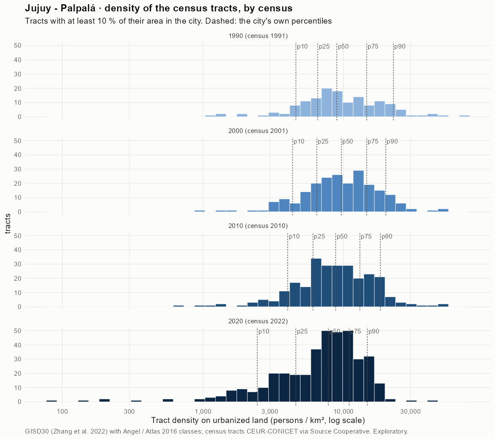
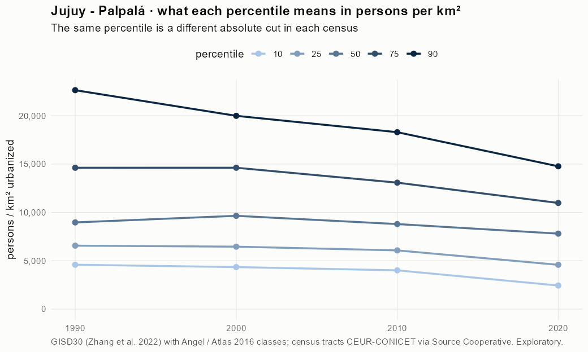
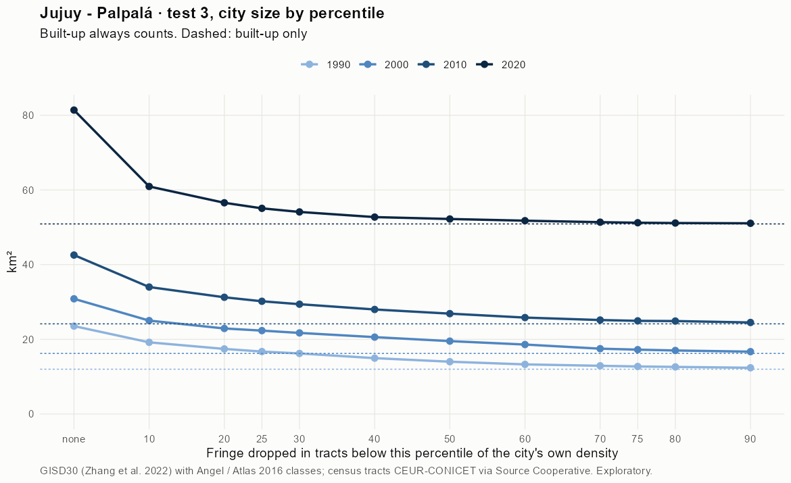
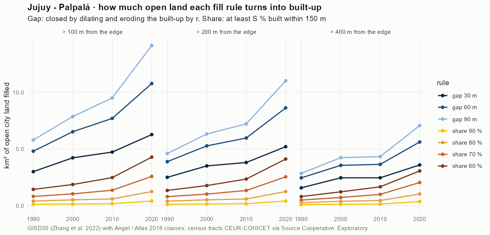
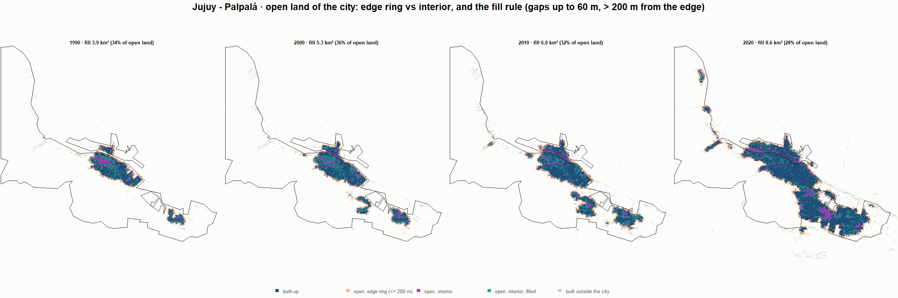
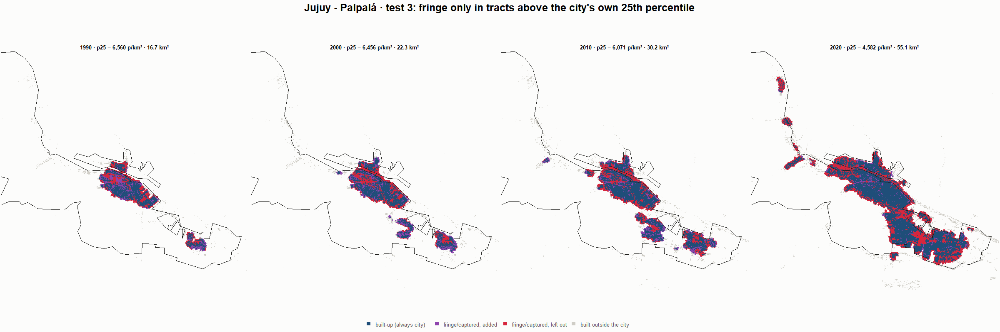

# Jujuy - Palpalá · relative cut (test 3) and the fill rule, 1990-2020

Exploratory. None of these numbers are project figures (they are not in `CIFRAS_CANONICAS.json`). Generated by `Rpipe/scripts/16_reglas.R` from step 11. Run of 2026-11-15. [All agglomerations](../REPORTE.md) · [methods](../../METODOS.md).

## The density of the tracts

Tracts with at least 10 % of their area in the city, and the city's own percentiles of their density on urbanized land.

| Year | Tracts | p10 | p25 | p50 | p75 | p90 |
|---|---|---|---|---|---|---|
| 1990 (census 1991) | 144 | 4,586 | 6,560 | 8,965 | 14,621 | 22,648 |
| 2000 (census 2001) | 217 | 4,343 | 6,456 | 9,648 | 14,623 | 19,994 |
| 2010 (census 2010) | 261 | 4,008 | 6,071 | 8,794 | 13,080 | 18,302 |
| 2020 (census 2022) | 393 | 2,436 | 4,582 | 7,805 | 10,980 | 14,771 |

## Test 3 · fringe only above the city's own percentile

Built-up land is always city. Fringe and captured land join only in tracts at or above percentile p of the city's own tract densities, that census.

| Percentile | 1990 cut p/km² | 2000 cut p/km² | 2010 cut p/km² | 2020 cut p/km² | 1990 km² | 2000 km² | 2010 km² | 2020 km² | 1990-2020 %/yr |
|---|---|---|---|---|---|---|---|---|---|
| none (Angel) | 0 | 0 | 0 | 0 | 23.5 | 30.8 | 42.6 | 81.4 | 4.22 |
| p10 | 4,586 | 4,343 | 4,008 | 2,436 | 19.2 | 25.0 | 34.0 | 60.9 | 3.93 |
| p20 | 5,714 | 6,041 | 5,129 | 3,796 | 17.4 | 22.9 | 31.3 | 56.6 | 4.00 |
| p25 | 6,560 | 6,456 | 6,071 | 4,582 | 16.7 | 22.3 | 30.2 | 55.1 | 4.05 |
| p30 | 7,048 | 7,126 | 6,608 | 5,351 | 16.2 | 21.7 | 29.4 | 54.1 | 4.10 |
| p40 | 7,933 | 8,396 | 7,392 | 6,807 | 15.0 | 20.6 | 28.0 | 52.7 | 4.29 |
| p50 | 8,965 | 9,648 | 8,794 | 7,805 | 14.0 | 19.5 | 26.9 | 52.2 | 4.49 |
| p60 | 10,814 | 11,658 | 10,083 | 9,013 | 13.3 | 18.6 | 25.8 | 51.8 | 4.64 |
| p70 | 13,723 | 13,343 | 11,839 | 10,216 | 12.9 | 17.5 | 25.2 | 51.4 | 4.71 |
| p75 | 14,621 | 14,623 | 13,080 | 10,980 | 12.7 | 17.2 | 24.9 | 51.2 | 4.75 |
| p80 | 17,069 | 16,059 | 14,685 | 11,737 | 12.6 | 17.0 | 24.9 | 51.1 | 4.78 |
| p90 | 22,648 | 19,994 | 18,302 | 14,771 | 12.4 | 16.7 | 24.5 | 51.1 | 4.84 |
| built only | — | — | — | — | 12.0 | 16.2 | 24.1 | 50.9 | 4.94 |

## Fill rule · open land in the centre that is probably built

An open pixel of the city (fringe or captured) farther than D from any land outside the city becomes built-up if it is a narrow gap in the built-up: closing the built-up (dilate, then erode) with a square of radius r covers it. Central rule: r = 60 m, D = 200 m; *dense* = tract at or above 500 p/km². The alternative share rule fills a pixel with at least S of the pixels within 150 m built.

| Year | Open city land km² | Interior (> 200 m) km² | Filled km² | Filled in dense tracts km² | Built-up km² | Built-up + fill km² | Persons / km² built | With fill |
|---|---|---|---|---|---|---|---|---|
| 1990 (census 1991) | 11.5 | 6.4 | 3.9 | 3.9 | 12.0 | 15.9 | 16,221 | 12,256 |
| 2000 (census 2001) | 14.6 | 8.2 | 5.3 | 5.2 | 16.2 | 21.4 | 15,594 | 11,800 |
| 2010 (census 2010) | 18.4 | 9.5 | 6.0 | 5.9 | 24.1 | 30.0 | 12,261 | 9,867 |
| 2020 (census 2022) | 30.5 | 16.4 | 8.6 | 7.2 | 50.9 | 58.1 | 7,497 | 6,568 |

**Sensitivity: km² filled by each rule** (in brackets, % of the interior open land):

| Year | Farther than | gap 30 m | gap 60 m | gap 90 m | share 60 % | share 70 % | share 80 % | share 90 % |
|---|---|---|---|---|---|---|---|---|
| 1990 | 100 m | 3.0 (38) | 4.8 (61) | 5.8 (73) | 1.4 (18) | 0.8 (10) | 0.4 (5) | 0.1 (1) |
| 1990 | 200 m | 2.5 (39) | 3.9 (61) | 4.6 (72) | 1.3 (21) | 0.8 (12) | 0.4 (6) | 0.1 (2) |
| 1990 | 400 m | 1.6 (38) | 2.5 (59) | 2.8 (68) | 0.8 (19) | 0.5 (12) | 0.3 (6) | 0.1 (2) |
| 2000 | 100 m | 4.2 (42) | 6.5 (65) | 7.9 (78) | 1.9 (18) | 1.0 (10) | 0.5 (5) | 0.1 (1) |
| 2000 | 200 m | 3.5 (43) | 5.3 (64) | 6.3 (77) | 1.8 (22) | 1.0 (12) | 0.5 (6) | 0.1 (2) |
| 2000 | 400 m | 2.5 (44) | 3.6 (64) | 4.2 (76) | 1.2 (22) | 0.7 (13) | 0.4 (7) | 0.1 (2) |
| 2010 | 100 m | 4.7 (38) | 7.7 (63) | 9.5 (77) | 2.5 (20) | 1.4 (11) | 0.6 (5) | 0.2 (1) |
| 2010 | 200 m | 3.8 (40) | 6.0 (63) | 7.2 (76) | 2.3 (25) | 1.3 (14) | 0.6 (6) | 0.2 (2) |
| 2010 | 400 m | 2.5 (41) | 3.6 (61) | 4.3 (73) | 1.7 (28) | 1.0 (17) | 0.5 (8) | 0.1 (2) |
| 2020 | 100 m | 6.3 (31) | 10.8 (53) | 14.1 (69) | 4.3 (21) | 2.6 (13) | 1.2 (6) | 0.4 (2) |
| 2020 | 200 m | 5.2 (32) | 8.6 (53) | 11.0 (67) | 4.1 (25) | 2.5 (15) | 1.2 (8) | 0.4 (2) |
| 2020 | 400 m | 3.6 (32) | 5.6 (49) | 7.1 (62) | 3.1 (27) | 2.0 (18) | 1.0 (9) | 0.4 (3) |

**Test 3 at p25 plus the central fill, without asking for a dense tract** (the fill keeps interior gaps of sparse tracts that test 3 drops):

| Year | Angel km² | Test 3 p25 km² | Test 3 + fill km² |
|---|---|---|---|
| 1990 | 23.5 | 16.7 | 18.2 |
| 2000 | 30.8 | 22.3 | 24.7 |
| 2010 | 42.6 | 30.2 | 33.4 |
| 2020 | 81.4 | 55.1 | 61.4 |

## Maps

### Edge ring, interior and fill

### Test 3 at p25

