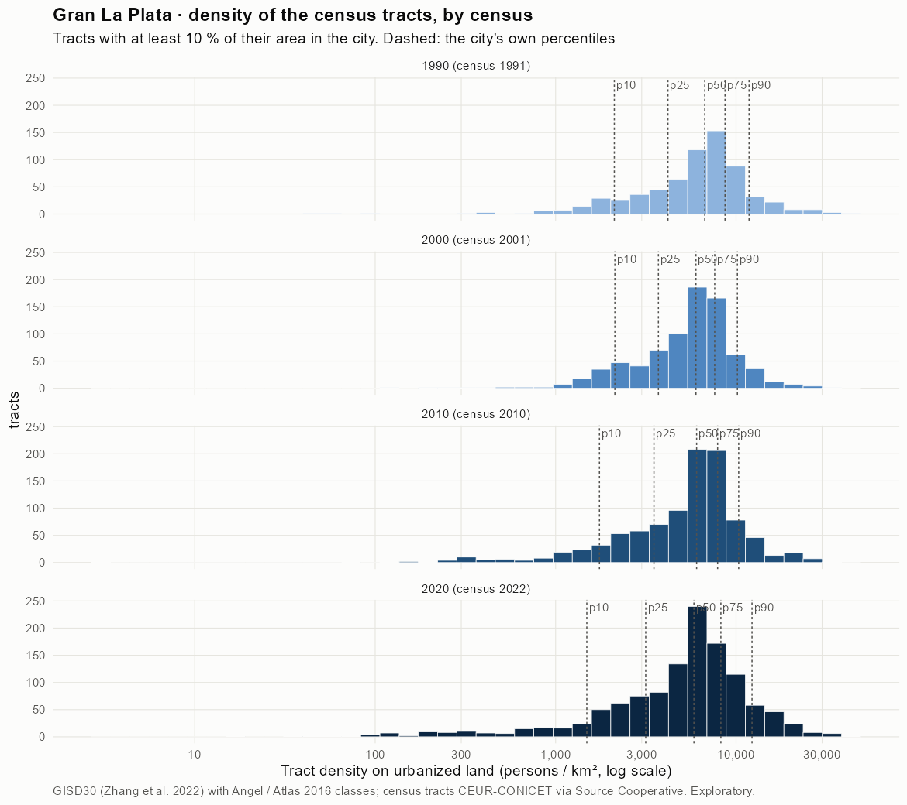
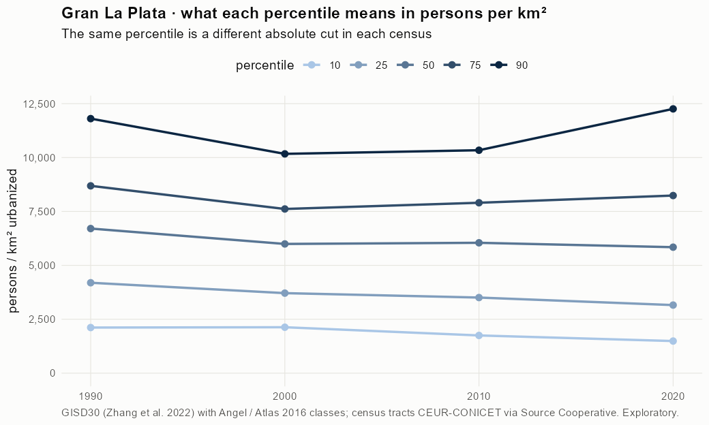
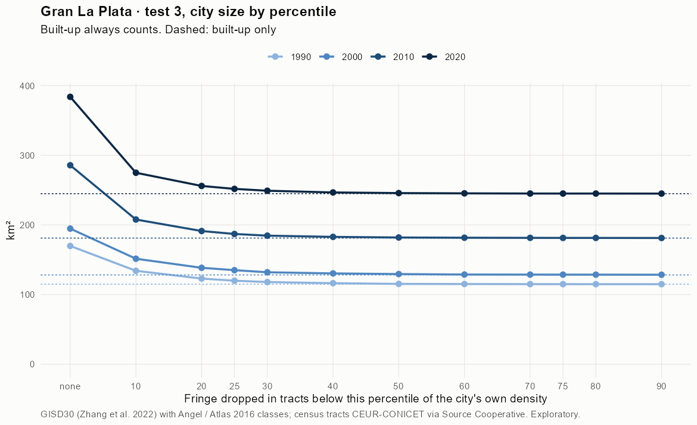
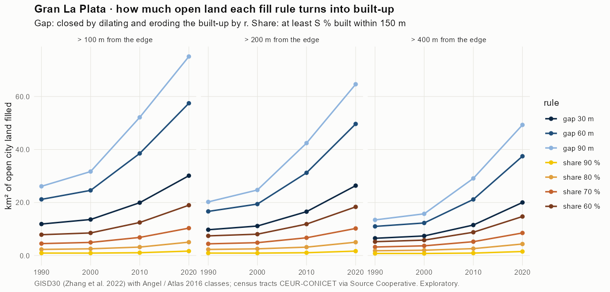
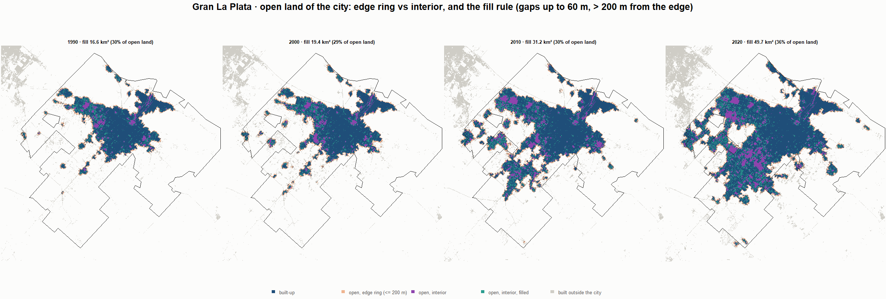
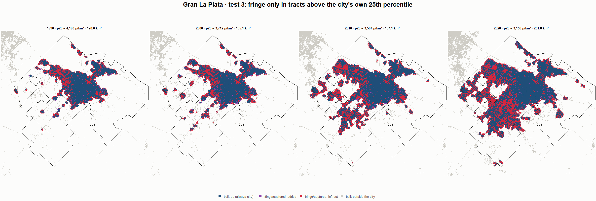

# Gran La Plata · relative cut (test 3) and the fill rule, 1990-2020

Exploratory. None of these numbers are project figures (they are not in `CIFRAS_CANONICAS.json`). Generated by `Rpipe/scripts/16_reglas.R` from step 11. Run of 2026-11-15. [All agglomerations](../REPORTE.md) · [methods](../../METODOS.md).

## The density of the tracts

Tracts with at least 10 % of their area in the city, and the city's own percentiles of their density on urbanized land.

| Year | Tracts | p10 | p25 | p50 | p75 | p90 |
|---|---|---|---|---|---|---|
| 1990 (census 1991) | 666 | 2,115 | 4,193 | 6,707 | 8,688 | 11,806 |
| 2000 (census 2001) | 804 | 2,130 | 3,712 | 5,994 | 7,615 | 10,171 |
| 2010 (census 2010) | 971 | 1,749 | 3,507 | 6,046 | 7,903 | 10,340 |
| 2020 (census 2022) | 1,203 | 1,489 | 3,158 | 5,843 | 8,238 | 12,258 |

## Test 3 · fringe only above the city's own percentile

Built-up land is always city. Fringe and captured land join only in tracts at or above percentile p of the city's own tract densities, that census.

| Percentile | 1990 cut p/km² | 2000 cut p/km² | 2010 cut p/km² | 2020 cut p/km² | 1990 km² | 2000 km² | 2010 km² | 2020 km² | 1990-2020 %/yr |
|---|---|---|---|---|---|---|---|---|---|
| none (Angel) | 0 | 0 | 0 | 0 | 169.9 | 194.8 | 285.7 | 383.9 | 2.75 |
| p10 | 2,115 | 2,130 | 1,749 | 1,489 | 134.2 | 151.5 | 207.8 | 275.0 | 2.42 |
| p20 | 3,431 | 3,316 | 2,884 | 2,573 | 123.0 | 138.5 | 191.3 | 256.0 | 2.47 |
| p25 | 4,193 | 3,712 | 3,507 | 3,158 | 120.0 | 135.1 | 187.1 | 251.8 | 2.50 |
| p30 | 4,819 | 4,352 | 4,131 | 3,791 | 118.0 | 132.1 | 184.7 | 249.2 | 2.52 |
| p40 | 5,978 | 5,274 | 5,343 | 4,962 | 116.4 | 130.4 | 182.9 | 246.7 | 2.54 |
| p50 | 6,707 | 5,994 | 6,046 | 5,843 | 115.4 | 129.5 | 182.0 | 245.8 | 2.55 |
| p60 | 7,490 | 6,583 | 6,771 | 6,582 | 115.2 | 128.9 | 181.7 | 245.4 | 2.55 |
| p70 | 8,240 | 7,257 | 7,438 | 7,530 | 115.1 | 128.7 | 181.5 | 245.1 | 2.55 |
| p75 | 8,688 | 7,615 | 7,903 | 8,238 | 115.0 | 128.7 | 181.4 | 245.1 | 2.55 |
| p80 | 9,453 | 8,087 | 8,354 | 9,063 | 115.0 | 128.7 | 181.4 | 245.1 | 2.55 |
| p90 | 11,806 | 10,171 | 10,340 | 12,258 | 115.0 | 128.5 | 181.3 | 245.0 | 2.55 |
| built only | — | — | — | — | 114.9 | 128.3 | 181.2 | 244.9 | 2.56 |

## Fill rule · open land in the centre that is probably built

An open pixel of the city (fringe or captured) farther than D from any land outside the city becomes built-up if it is a narrow gap in the built-up: closing the built-up (dilate, then erode) with a square of radius r covers it. Central rule: r = 60 m, D = 200 m; *dense* = tract at or above 500 p/km². The alternative share rule fills a pixel with at least S of the pixels within 150 m built.

| Year | Open city land km² | Interior (> 200 m) km² | Filled km² | Filled in dense tracts km² | Built-up km² | Built-up + fill km² | Persons / km² built | With fill |
|---|---|---|---|---|---|---|---|---|
| 1990 (census 1991) | 55.1 | 29.1 | 16.6 | 15.7 | 114.9 | 130.6 | 5,704 | 5,019 |
| 2000 (census 2001) | 66.7 | 35.2 | 19.4 | 17.8 | 128.3 | 146.1 | 5,448 | 4,784 |
| 2010 (census 2010) | 104.8 | 61.5 | 31.2 | 19.7 | 181.2 | 200.8 | 4,428 | 3,994 |
| 2020 (census 2022) | 139.5 | 93.4 | 49.7 | 25.6 | 244.9 | 270.5 | 3,765 | 3,409 |

**Sensitivity: km² filled by each rule** (in brackets, % of the interior open land):

| Year | Farther than | gap 30 m | gap 60 m | gap 90 m | share 60 % | share 70 % | share 80 % | share 90 % |
|---|---|---|---|---|---|---|---|---|
| 1990 | 100 m | 11.9 (33) | 21.2 (59) | 26.1 (73) | 7.8 (22) | 4.5 (13) | 2.3 (6) | 0.9 (3) |
| 1990 | 200 m | 9.7 (33) | 16.6 (57) | 20.2 (70) | 7.4 (25) | 4.4 (15) | 2.3 (8) | 0.9 (3) |
| 1990 | 400 m | 6.5 (31) | 11.0 (52) | 13.4 (64) | 5.2 (25) | 3.2 (15) | 1.8 (9) | 0.8 (4) |
| 2000 | 100 m | 13.6 (31) | 24.6 (56) | 31.7 (73) | 8.5 (20) | 4.9 (11) | 2.5 (6) | 0.9 (2) |
| 2000 | 200 m | 11.1 (32) | 19.4 (55) | 24.7 (70) | 8.0 (23) | 4.8 (14) | 2.5 (7) | 0.9 (3) |
| 2000 | 400 m | 7.4 (30) | 12.3 (50) | 15.7 (64) | 5.8 (24) | 3.7 (15) | 2.0 (8) | 0.8 (3) |
| 2010 | 100 m | 19.9 (27) | 38.5 (53) | 52.1 (71) | 12.5 (17) | 6.8 (9) | 3.2 (4) | 1.1 (1) |
| 2010 | 200 m | 16.5 (27) | 31.2 (51) | 42.4 (69) | 11.9 (19) | 6.7 (11) | 3.2 (5) | 1.1 (2) |
| 2010 | 400 m | 11.5 (26) | 21.2 (47) | 29.1 (65) | 8.8 (20) | 5.2 (12) | 2.6 (6) | 0.9 (2) |
| 2020 | 100 m | 30.1 (28) | 57.5 (54) | 75.1 (71) | 19.0 (18) | 10.3 (10) | 5.0 (5) | 1.7 (2) |
| 2020 | 200 m | 26.4 (28) | 49.7 (53) | 64.6 (69) | 18.4 (20) | 10.2 (11) | 5.0 (5) | 1.7 (2) |
| 2020 | 400 m | 20.0 (27) | 37.5 (51) | 49.3 (67) | 14.7 (20) | 8.5 (11) | 4.3 (6) | 1.5 (2) |

**Test 3 at p25 plus the central fill, without asking for a dense tract** (the fill keeps interior gaps of sparse tracts that test 3 drops):

| Year | Angel km² | Test 3 p25 km² | Test 3 + fill km² |
|---|---|---|---|
| 1990 | 169.9 | 120.0 | 134.4 |
| 2000 | 194.8 | 135.1 | 151.5 |
| 2010 | 285.7 | 187.1 | 214.8 |
| 2020 | 383.9 | 251.8 | 296.6 |

## Maps

### Edge ring, interior and fill

### Test 3 at p25

