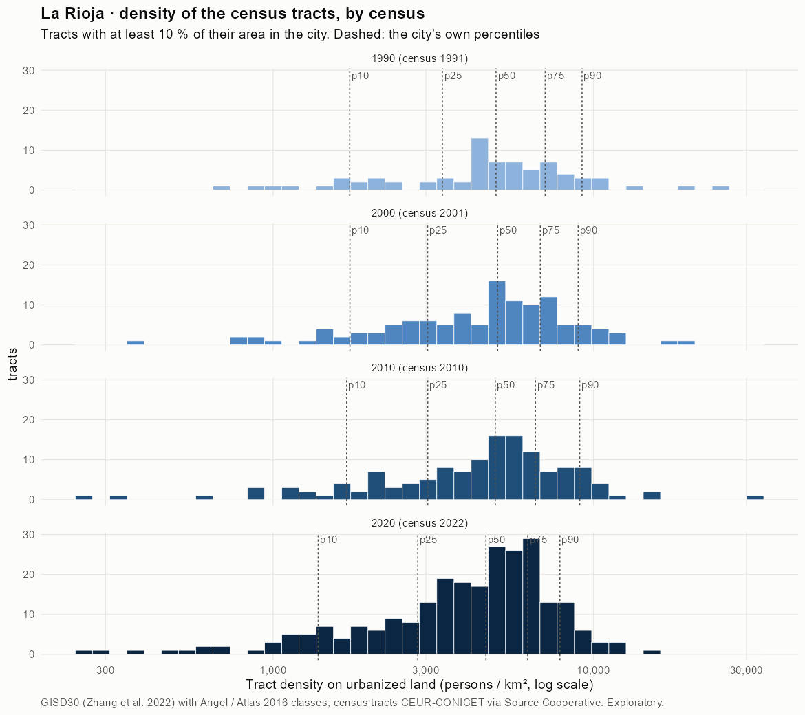
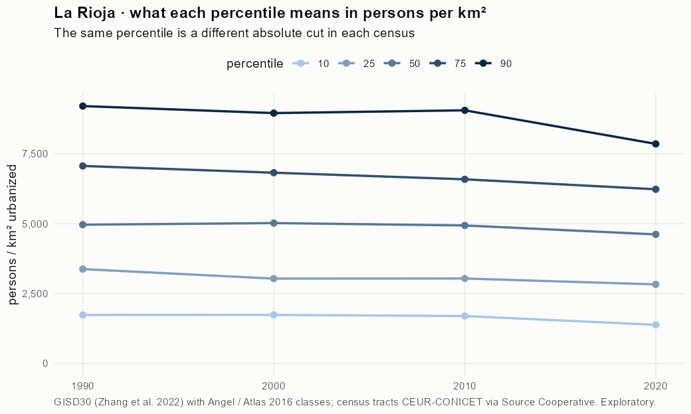
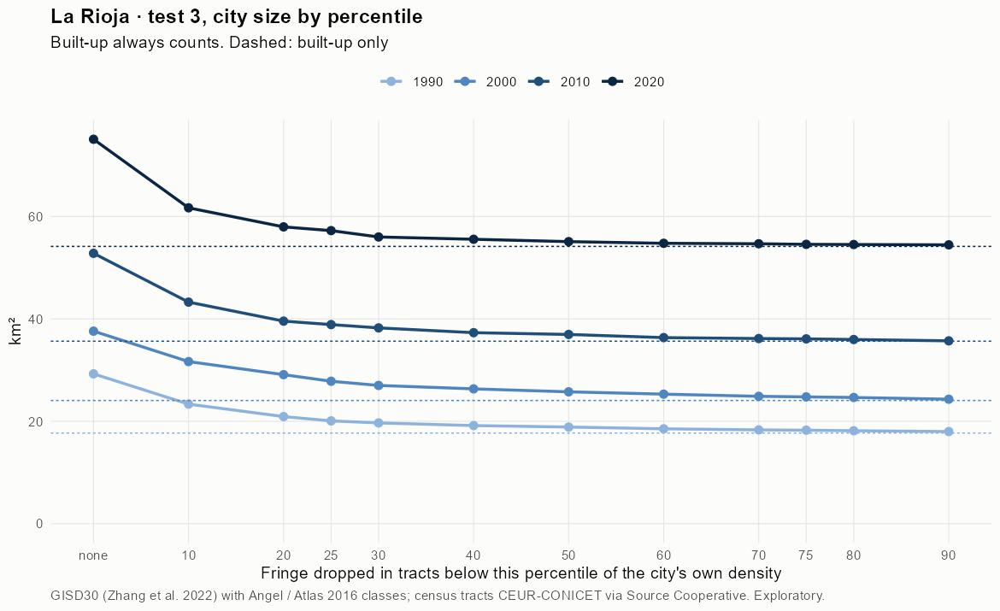
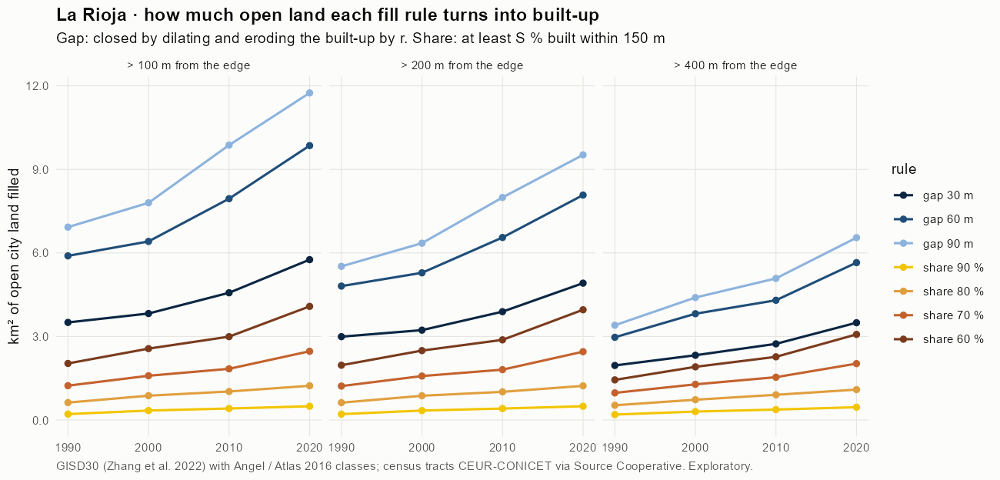
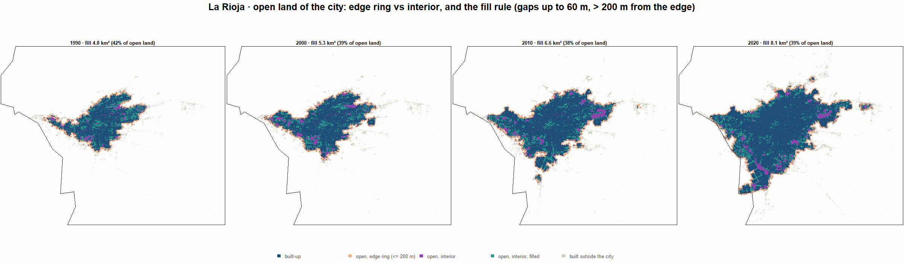
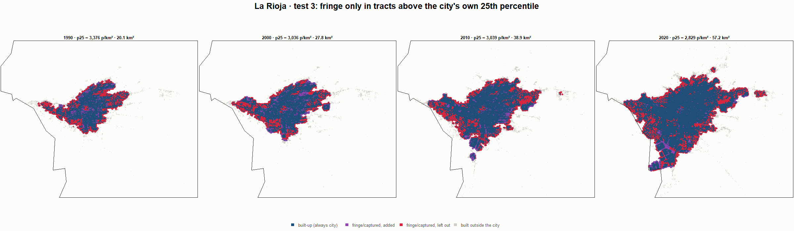

# La Rioja · relative cut (test 3) and the fill rule, 1990-2020

Exploratory. None of these numbers are project figures (they are not in `CIFRAS_CANONICAS.json`). Generated by `Rpipe/scripts/16_reglas.R` from step 11. Run of 2026-11-15. [All agglomerations](../REPORTE.md) · [methods](../../METODOS.md).

## The density of the tracts

Tracts with at least 10 % of their area in the city, and the city's own percentiles of their density on urbanized land.

| Year | Tracts | p10 | p25 | p50 | p75 | p90 |
|---|---|---|---|---|---|---|
| 1990 (census 1991) | 74 | 1,735 | 3,376 | 4,964 | 7,064 | 9,206 |
| 2000 (census 2001) | 122 | 1,737 | 3,036 | 5,021 | 6,823 | 8,955 |
| 2010 (census 2010) | 137 | 1,697 | 3,039 | 4,937 | 6,587 | 9,054 |
| 2020 (census 2022) | 252 | 1,383 | 2,829 | 4,617 | 6,231 | 7,854 |

## Test 3 · fringe only above the city's own percentile

Built-up land is always city. Fringe and captured land join only in tracts at or above percentile p of the city's own tract densities, that census.

| Percentile | 1990 cut p/km² | 2000 cut p/km² | 2010 cut p/km² | 2020 cut p/km² | 1990 km² | 2000 km² | 2010 km² | 2020 km² | 1990-2020 %/yr |
|---|---|---|---|---|---|---|---|---|---|
| none (Angel) | 0 | 0 | 0 | 0 | 29.3 | 37.6 | 52.8 | 75.1 | 3.19 |
| p10 | 1,735 | 1,737 | 1,697 | 1,383 | 23.4 | 31.7 | 43.3 | 61.7 | 3.29 |
| p20 | 2,696 | 2,677 | 2,506 | 2,392 | 20.9 | 29.1 | 39.6 | 58.0 | 3.46 |
| p25 | 3,376 | 3,036 | 3,039 | 2,829 | 20.1 | 27.8 | 38.9 | 57.2 | 3.55 |
| p30 | 4,158 | 3,368 | 3,531 | 3,198 | 19.7 | 27.0 | 38.2 | 56.0 | 3.55 |
| p40 | 4,616 | 4,109 | 4,270 | 3,854 | 19.2 | 26.3 | 37.3 | 55.6 | 3.61 |
| p50 | 4,964 | 5,021 | 4,937 | 4,617 | 18.9 | 25.8 | 37.0 | 55.1 | 3.63 |
| p60 | 5,706 | 5,522 | 5,486 | 5,088 | 18.5 | 25.3 | 36.3 | 54.8 | 3.68 |
| p70 | 6,313 | 6,355 | 6,072 | 5,754 | 18.3 | 24.9 | 36.2 | 54.7 | 3.71 |
| p75 | 7,064 | 6,823 | 6,587 | 6,231 | 18.3 | 24.8 | 36.1 | 54.6 | 3.72 |
| p80 | 7,296 | 7,122 | 7,291 | 6,493 | 18.2 | 24.7 | 36.0 | 54.5 | 3.73 |
| p90 | 9,206 | 8,955 | 9,054 | 7,854 | 18.0 | 24.3 | 35.7 | 54.5 | 3.76 |
| built only | — | — | — | — | 17.7 | 24.1 | 35.6 | 54.2 | 3.80 |

## Fill rule · open land in the centre that is probably built

An open pixel of the city (fringe or captured) farther than D from any land outside the city becomes built-up if it is a narrow gap in the built-up: closing the built-up (dilate, then erode) with a square of radius r covers it. Central rule: r = 60 m, D = 200 m; *dense* = tract at or above 500 p/km². The alternative share rule fills a pixel with at least S of the pixels within 150 m built.

| Year | Open city land km² | Interior (> 200 m) km² | Filled km² | Filled in dense tracts km² | Built-up km² | Built-up + fill km² | Persons / km² built | With fill |
|---|---|---|---|---|---|---|---|---|
| 1990 (census 1991) | 11.6 | 6.2 | 4.8 | 4.7 | 17.7 | 22.5 | 5,855 | 4,617 |
| 2000 (census 2001) | 13.5 | 7.7 | 5.3 | 5.1 | 24.1 | 29.2 | 5,891 | 4,854 |
| 2010 (census 2010) | 17.2 | 9.4 | 6.6 | 5.9 | 35.6 | 41.6 | 4,909 | 4,207 |
| 2020 (census 2022) | 20.9 | 11.9 | 8.1 | 6.2 | 54.2 | 60.4 | 3,871 | 3,472 |

**Sensitivity: km² filled by each rule** (in brackets, % of the interior open land):

| Year | Farther than | gap 30 m | gap 60 m | gap 90 m | share 60 % | share 70 % | share 80 % | share 90 % |
|---|---|---|---|---|---|---|---|---|
| 1990 | 100 m | 3.5 (44) | 5.9 (74) | 6.9 (87) | 2.0 (26) | 1.2 (16) | 0.6 (8) | 0.2 (3) |
| 1990 | 200 m | 3.0 (48) | 4.8 (77) | 5.5 (88) | 2.0 (32) | 1.2 (20) | 0.6 (10) | 0.2 (3) |
| 1990 | 400 m | 2.0 (53) | 3.0 (80) | 3.4 (92) | 1.4 (39) | 1.0 (26) | 0.5 (14) | 0.2 (5) |
| 2000 | 100 m | 3.8 (40) | 6.4 (68) | 7.8 (82) | 2.6 (27) | 1.6 (17) | 0.9 (9) | 0.3 (4) |
| 2000 | 200 m | 3.2 (42) | 5.3 (69) | 6.3 (82) | 2.5 (32) | 1.6 (21) | 0.9 (11) | 0.3 (4) |
| 2000 | 400 m | 2.3 (44) | 3.8 (73) | 4.4 (84) | 1.9 (36) | 1.3 (24) | 0.7 (14) | 0.3 (6) |
| 2010 | 100 m | 4.6 (39) | 7.9 (69) | 9.9 (85) | 3.0 (26) | 1.8 (16) | 1.0 (9) | 0.4 (4) |
| 2010 | 200 m | 3.9 (41) | 6.6 (70) | 8.0 (85) | 2.9 (31) | 1.8 (19) | 1.0 (11) | 0.4 (4) |
| 2010 | 400 m | 2.7 (44) | 4.3 (69) | 5.1 (82) | 2.3 (36) | 1.5 (25) | 0.9 (15) | 0.4 (6) |
| 2020 | 100 m | 5.8 (40) | 9.9 (68) | 11.7 (81) | 4.1 (28) | 2.5 (17) | 1.2 (9) | 0.5 (3) |
| 2020 | 200 m | 4.9 (41) | 8.1 (68) | 9.5 (80) | 4.0 (33) | 2.5 (21) | 1.2 (10) | 0.5 (4) |
| 2020 | 400 m | 3.5 (41) | 5.7 (66) | 6.5 (77) | 3.1 (36) | 2.0 (24) | 1.1 (13) | 0.5 (5) |

**Test 3 at p25 plus the central fill, without asking for a dense tract** (the fill keeps interior gaps of sparse tracts that test 3 drops):

| Year | Angel km² | Test 3 p25 km² | Test 3 + fill km² |
|---|---|---|---|
| 1990 | 29.3 | 20.1 | 23.0 |
| 2000 | 37.6 | 27.8 | 30.8 |
| 2010 | 52.8 | 38.9 | 43.5 |
| 2020 | 75.1 | 57.2 | 64.0 |

## Maps

### Edge ring, interior and fill

### Test 3 at p25

