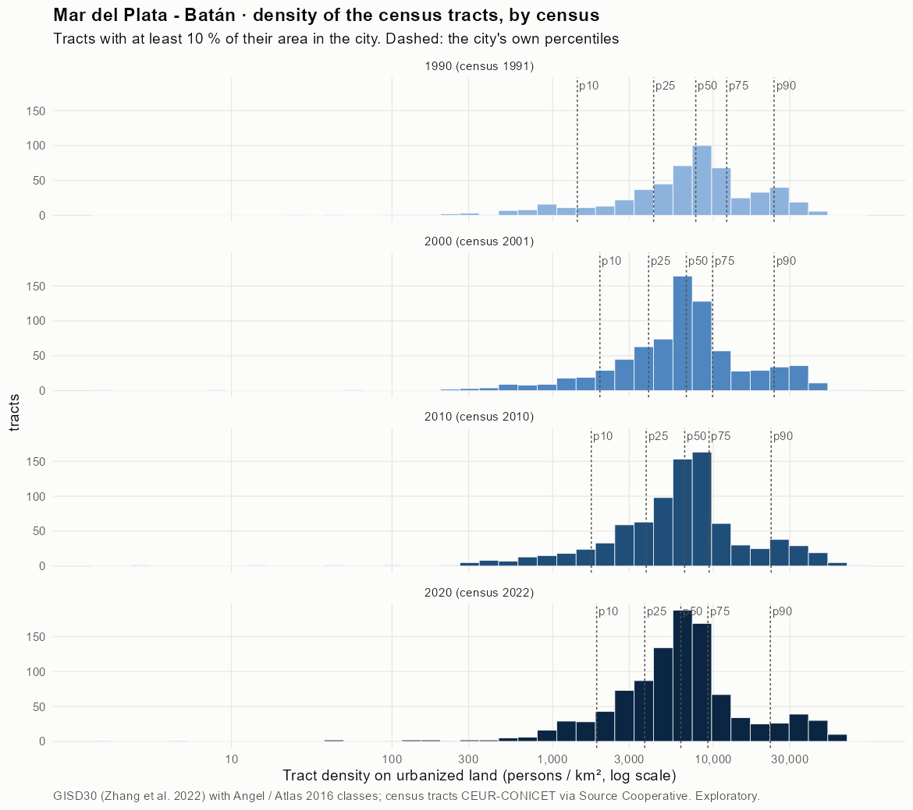
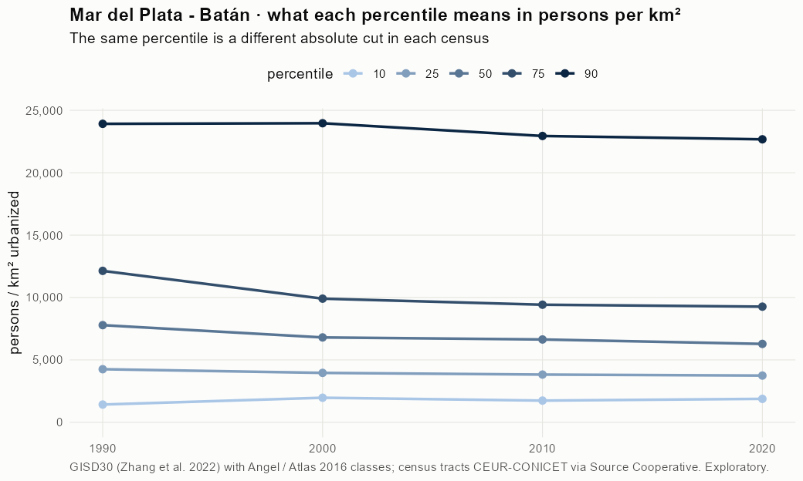
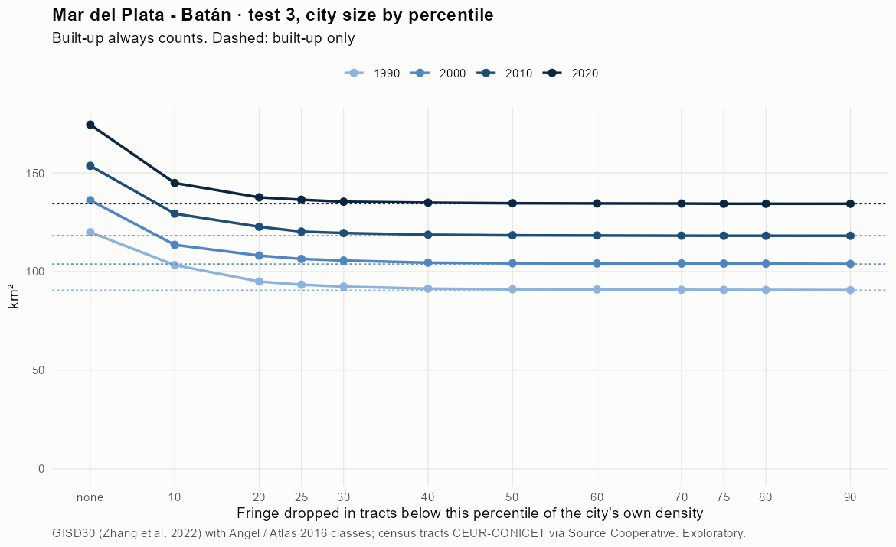
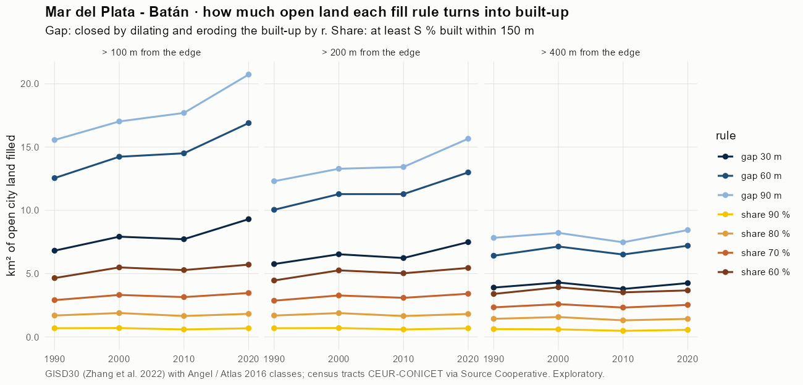
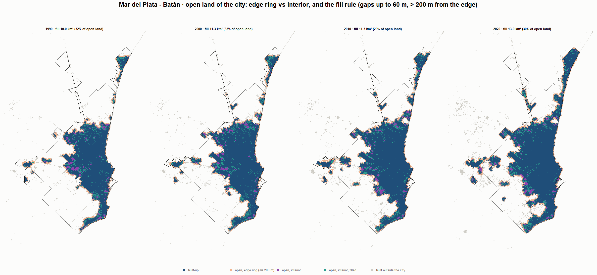
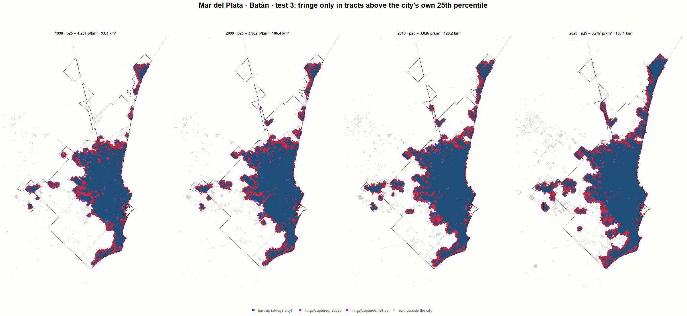

# Mar del Plata - Batán · relative cut (test 3) and the fill rule, 1990-2020

Exploratory. None of these numbers are project figures (they are not in `CIFRAS_CANONICAS.json`). Generated by `Rpipe/scripts/16_reglas.R` from step 11. Run of 2026-11-15. [All agglomerations](../REPORTE.md) · [methods](../../METODOS.md).

## The density of the tracts

Tracts with at least 10 % of their area in the city, and the city's own percentiles of their density on urbanized land.

| Year | Tracts | p10 | p25 | p50 | p75 | p90 |
|---|---|---|---|---|---|---|
| 1990 (census 1991) | 543 | 1,424 | 4,257 | 7,787 | 12,136 | 23,917 |
| 2000 (census 2001) | 775 | 1,970 | 3,962 | 6,802 | 9,910 | 23,966 |
| 2010 (census 2010) | 872 | 1,741 | 3,826 | 6,639 | 9,424 | 22,944 |
| 2020 (census 2022) | 1,023 | 1,881 | 3,747 | 6,283 | 9,269 | 22,677 |

## Test 3 · fringe only above the city's own percentile

Built-up land is always city. Fringe and captured land join only in tracts at or above percentile p of the city's own tract densities, that census.

| Percentile | 1990 cut p/km² | 2000 cut p/km² | 2010 cut p/km² | 2020 cut p/km² | 1990 km² | 2000 km² | 2010 km² | 2020 km² | 1990-2020 %/yr |
|---|---|---|---|---|---|---|---|---|---|
| none (Angel) | 0 | 0 | 0 | 0 | 119.9 | 136.1 | 153.6 | 174.4 | 1.26 |
| p10 | 1,424 | 1,970 | 1,741 | 1,881 | 103.3 | 113.5 | 129.4 | 144.8 | 1.13 |
| p20 | 3,512 | 3,350 | 3,068 | 3,117 | 94.9 | 108.1 | 122.7 | 137.6 | 1.24 |
| p25 | 4,257 | 3,962 | 3,826 | 3,747 | 93.3 | 106.4 | 120.2 | 136.4 | 1.27 |
| p30 | 5,086 | 4,534 | 4,417 | 4,326 | 92.4 | 105.6 | 119.5 | 135.4 | 1.28 |
| p40 | 6,759 | 5,878 | 5,632 | 5,323 | 91.3 | 104.5 | 118.7 | 134.9 | 1.31 |
| p50 | 7,787 | 6,802 | 6,639 | 6,283 | 91.0 | 104.2 | 118.3 | 134.6 | 1.31 |
| p60 | 9,177 | 7,659 | 7,758 | 7,284 | 90.9 | 104.1 | 118.3 | 134.5 | 1.32 |
| p70 | 10,609 | 8,843 | 8,781 | 8,444 | 90.8 | 104.1 | 118.2 | 134.5 | 1.32 |
| p75 | 12,136 | 9,910 | 9,424 | 9,269 | 90.7 | 104.0 | 118.1 | 134.4 | 1.32 |
| p80 | 14,251 | 11,479 | 10,883 | 10,656 | 90.7 | 104.0 | 118.1 | 134.4 | 1.32 |
| p90 | 23,917 | 23,966 | 22,944 | 22,677 | 90.6 | 103.9 | 118.1 | 134.4 | 1.32 |
| built only | — | — | — | — | 90.6 | 103.8 | 118.1 | 134.4 | 1.32 |

## Fill rule · open land in the centre that is probably built

An open pixel of the city (fringe or captured) farther than D from any land outside the city becomes built-up if it is a narrow gap in the built-up: closing the built-up (dilate, then erode) with a square of radius r covers it. Central rule: r = 60 m, D = 200 m; *dense* = tract at or above 500 p/km². The alternative share rule fills a pixel with at least S of the pixels within 150 m built.

| Year | Open city land km² | Interior (> 200 m) km² | Filled km² | Filled in dense tracts km² | Built-up km² | Built-up + fill km² | Persons / km² built | With fill |
|---|---|---|---|---|---|---|---|---|
| 1990 (census 1991) | 31.6 | 15.2 | 10.0 | 9.1 | 90.6 | 99.7 | 5,773 | 5,247 |
| 2000 (census 2001) | 35.3 | 16.3 | 11.3 | 10.0 | 103.8 | 113.9 | 5,371 | 4,897 |
| 2010 (census 2010) | 38.7 | 16.9 | 11.3 | 9.0 | 118.1 | 127.1 | 5,175 | 4,809 |
| 2020 (census 2022) | 43.6 | 18.9 | 13.0 | 10.3 | 134.4 | 144.7 | 4,897 | 4,547 |

**Sensitivity: km² filled by each rule** (in brackets, % of the interior open land):

| Year | Farther than | gap 30 m | gap 60 m | gap 90 m | share 60 % | share 70 % | share 80 % | share 90 % |
|---|---|---|---|---|---|---|---|---|
| 1990 | 100 m | 6.8 (35) | 12.5 (64) | 15.6 (80) | 4.6 (24) | 2.9 (15) | 1.7 (9) | 0.7 (4) |
| 1990 | 200 m | 5.8 (38) | 10.0 (66) | 12.3 (81) | 4.5 (29) | 2.9 (19) | 1.7 (11) | 0.7 (4) |
| 1990 | 400 m | 3.9 (40) | 6.4 (65) | 7.8 (79) | 3.4 (34) | 2.3 (24) | 1.4 (14) | 0.6 (6) |
| 2000 | 100 m | 7.9 (38) | 14.2 (68) | 17.0 (81) | 5.5 (26) | 3.3 (16) | 1.9 (9) | 0.7 (3) |
| 2000 | 200 m | 6.5 (40) | 11.3 (69) | 13.3 (82) | 5.3 (32) | 3.3 (20) | 1.9 (12) | 0.7 (4) |
| 2000 | 400 m | 4.3 (42) | 7.1 (70) | 8.2 (81) | 3.9 (39) | 2.6 (25) | 1.6 (15) | 0.6 (6) |
| 2010 | 100 m | 7.7 (34) | 14.5 (65) | 17.7 (79) | 5.3 (24) | 3.1 (14) | 1.7 (7) | 0.6 (3) |
| 2010 | 200 m | 6.2 (37) | 11.3 (67) | 13.4 (79) | 5.0 (30) | 3.1 (18) | 1.6 (10) | 0.6 (3) |
| 2010 | 400 m | 3.8 (39) | 6.5 (68) | 7.5 (78) | 3.5 (37) | 2.3 (24) | 1.3 (14) | 0.5 (5) |
| 2020 | 100 m | 9.3 (37) | 16.9 (67) | 20.7 (82) | 5.7 (23) | 3.5 (14) | 1.8 (7) | 0.7 (3) |
| 2020 | 200 m | 7.5 (40) | 13.0 (69) | 15.7 (83) | 5.4 (29) | 3.4 (18) | 1.8 (10) | 0.7 (4) |
| 2020 | 400 m | 4.2 (42) | 7.2 (71) | 8.4 (84) | 3.7 (36) | 2.5 (25) | 1.4 (14) | 0.6 (6) |

**Test 3 at p25 plus the central fill, without asking for a dense tract** (the fill keeps interior gaps of sparse tracts that test 3 drops):

| Year | Angel km² | Test 3 p25 km² | Test 3 + fill km² |
|---|---|---|---|
| 1990 | 119.9 | 93.3 | 101.9 |
| 2000 | 136.1 | 106.4 | 116.3 |
| 2010 | 153.6 | 120.2 | 130.3 |
| 2020 | 174.4 | 136.4 | 148.3 |

## Maps

### Edge ring, interior and fill

### Test 3 at p25

