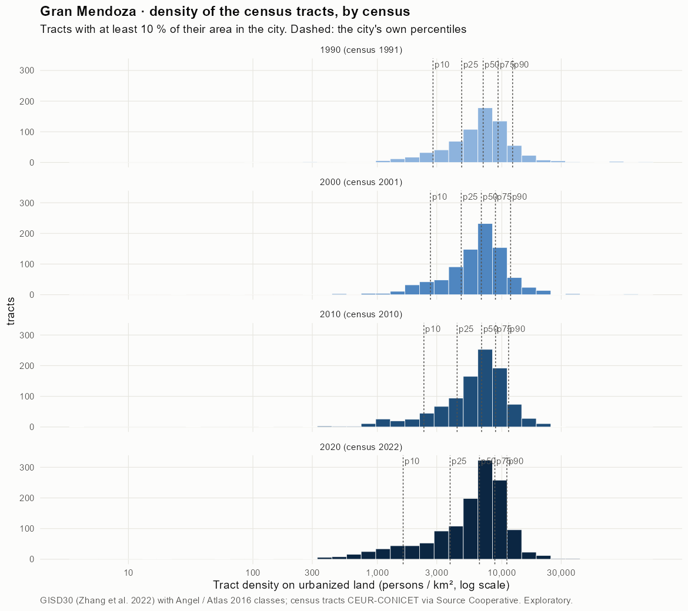
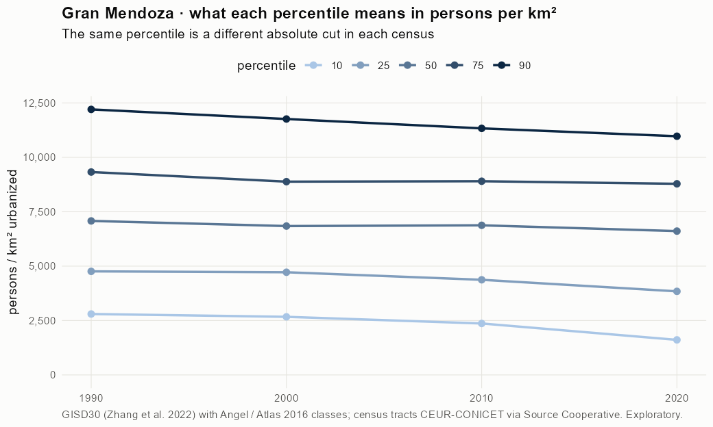
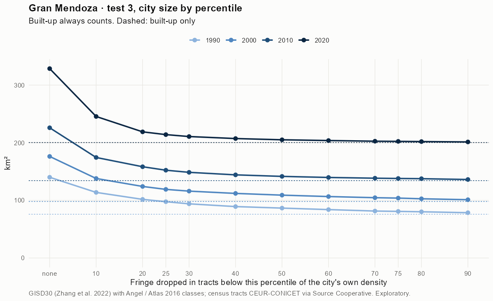
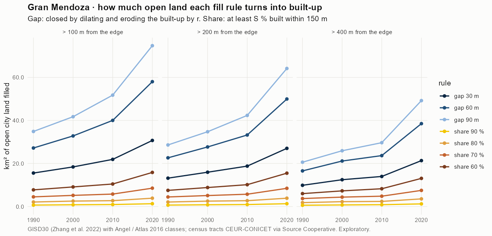
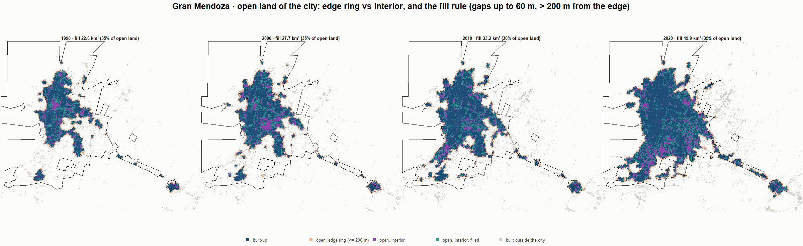
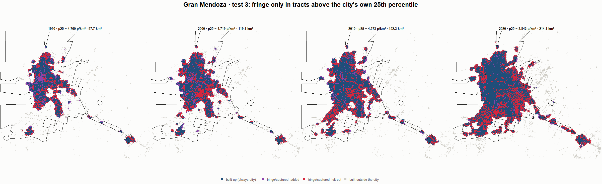

# Gran Mendoza · relative cut (test 3) and the fill rule, 1990-2020

Exploratory. None of these numbers are project figures (they are not in `CIFRAS_CANONICAS.json`). Generated by `Rpipe/scripts/16_reglas.R` from step 11. Run of 2026-11-15. [All agglomerations](../REPORTE.md) · [methods](../../METODOS.md).

## The density of the tracts

Tracts with at least 10 % of their area in the city, and the city's own percentiles of their density on urbanized land.

| Year | Tracts | p10 | p25 | p50 | p75 | p90 |
|---|---|---|---|---|---|---|
| 1990 (census 1991) | 702 | 2,800 | 4,760 | 7,078 | 9,326 | 12,205 |
| 2000 (census 2001) | 874 | 2,670 | 4,719 | 6,842 | 8,883 | 11,763 |
| 2010 (census 2010) | 1,024 | 2,365 | 4,373 | 6,877 | 8,903 | 11,333 |
| 2020 (census 2022) | 1,350 | 1,611 | 3,842 | 6,611 | 8,785 | 10,972 |

## Test 3 · fringe only above the city's own percentile

Built-up land is always city. Fringe and captured land join only in tracts at or above percentile p of the city's own tract densities, that census.

| Percentile | 1990 cut p/km² | 2000 cut p/km² | 2010 cut p/km² | 2020 cut p/km² | 1990 km² | 2000 km² | 2010 km² | 2020 km² | 1990-2020 %/yr |
|---|---|---|---|---|---|---|---|---|---|
| none (Angel) | 0 | 0 | 0 | 0 | 140.1 | 176.2 | 226.0 | 328.6 | 2.88 |
| p10 | 2,800 | 2,670 | 2,365 | 1,611 | 113.8 | 138.0 | 174.4 | 245.6 | 2.60 |
| p20 | 4,297 | 4,165 | 3,737 | 3,186 | 101.7 | 124.1 | 158.4 | 218.9 | 2.59 |
| p25 | 4,760 | 4,719 | 4,373 | 3,842 | 97.7 | 119.1 | 152.3 | 214.1 | 2.65 |
| p30 | 5,273 | 5,171 | 5,025 | 4,515 | 94.0 | 116.0 | 148.6 | 210.7 | 2.73 |
| p40 | 6,275 | 6,143 | 5,943 | 5,805 | 89.2 | 112.1 | 144.2 | 207.3 | 2.85 |
| p50 | 7,078 | 6,842 | 6,877 | 6,611 | 86.6 | 109.0 | 141.6 | 205.1 | 2.92 |
| p60 | 7,879 | 7,537 | 7,516 | 7,369 | 84.0 | 106.6 | 139.7 | 203.8 | 3.00 |
| p70 | 8,749 | 8,350 | 8,382 | 8,277 | 81.5 | 104.6 | 138.5 | 202.6 | 3.08 |
| p75 | 9,326 | 8,883 | 8,903 | 8,785 | 80.8 | 103.9 | 138.0 | 202.3 | 3.11 |
| p80 | 9,927 | 9,538 | 9,447 | 9,427 | 80.2 | 102.8 | 137.6 | 202.0 | 3.13 |
| p90 | 12,205 | 11,763 | 11,333 | 10,972 | 78.6 | 101.1 | 136.2 | 201.4 | 3.19 |
| built only | — | — | — | — | 75.9 | 98.1 | 134.2 | 200.3 | 3.29 |

## Fill rule · open land in the centre that is probably built

An open pixel of the city (fringe or captured) farther than D from any land outside the city becomes built-up if it is a narrow gap in the built-up: closing the built-up (dilate, then erode) with a square of radius r covers it. Central rule: r = 60 m, D = 200 m; *dense* = tract at or above 500 p/km². The alternative share rule fills a pixel with at least S of the pixels within 150 m built.

| Year | Open city land km² | Interior (> 200 m) km² | Filled km² | Filled in dense tracts km² | Built-up km² | Built-up + fill km² | Persons / km² built | With fill |
|---|---|---|---|---|---|---|---|---|
| 1990 (census 1991) | 64.2 | 39.5 | 22.6 | 22.4 | 75.9 | 98.3 | 10,489 | 8,100 |
| 2000 (census 2001) | 78.1 | 50.5 | 27.7 | 26.8 | 98.1 | 124.9 | 9,202 | 7,227 |
| 2010 (census 2010) | 91.7 | 56.6 | 33.2 | 30.0 | 134.2 | 164.2 | 7,514 | 6,141 |
| 2020 (census 2022) | 128.3 | 88.5 | 49.9 | 43.4 | 200.3 | 243.7 | 5,912 | 4,860 |

**Sensitivity: km² filled by each rule** (in brackets, % of the interior open land):

| Year | Farther than | gap 30 m | gap 60 m | gap 90 m | share 60 % | share 70 % | share 80 % | share 90 % |
|---|---|---|---|---|---|---|---|---|
| 1990 | 100 m | 15.6 (33) | 27.2 (58) | 34.9 (75) | 7.7 (17) | 4.5 (10) | 2.1 (4) | 0.7 (1) |
| 1990 | 200 m | 13.2 (33) | 22.6 (57) | 28.6 (72) | 7.5 (19) | 4.4 (11) | 2.1 (5) | 0.7 (2) |
| 1990 | 400 m | 9.9 (34) | 16.5 (57) | 20.6 (70) | 6.0 (20) | 3.7 (13) | 1.8 (6) | 0.6 (2) |
| 2000 | 100 m | 18.4 (31) | 32.8 (56) | 41.7 (71) | 9.1 (15) | 5.2 (9) | 2.5 (4) | 0.8 (1) |
| 2000 | 200 m | 15.9 (32) | 27.7 (55) | 34.7 (69) | 8.8 (17) | 5.1 (10) | 2.5 (5) | 0.8 (2) |
| 2000 | 400 m | 12.5 (32) | 21.1 (54) | 25.9 (66) | 7.3 (19) | 4.4 (11) | 2.2 (6) | 0.7 (2) |
| 2010 | 100 m | 21.9 (32) | 40.0 (59) | 51.7 (77) | 10.5 (15) | 5.8 (9) | 2.7 (4) | 0.9 (1) |
| 2010 | 200 m | 18.8 (33) | 33.2 (59) | 42.3 (75) | 10.1 (18) | 5.7 (10) | 2.7 (5) | 0.9 (2) |
| 2010 | 400 m | 14.0 (34) | 23.7 (58) | 29.7 (72) | 8.3 (20) | 4.8 (12) | 2.4 (6) | 0.8 (2) |
| 2020 | 100 m | 30.7 (30) | 58.0 (57) | 74.7 (74) | 15.8 (16) | 8.5 (8) | 3.9 (4) | 1.3 (1) |
| 2020 | 200 m | 27.0 (31) | 49.9 (56) | 64.1 (72) | 15.5 (17) | 8.5 (10) | 3.9 (4) | 1.3 (1) |
| 2020 | 400 m | 21.3 (31) | 38.5 (55) | 49.2 (71) | 13.1 (19) | 7.5 (11) | 3.5 (5) | 1.2 (2) |

**Test 3 at p25 plus the central fill, without asking for a dense tract** (the fill keeps interior gaps of sparse tracts that test 3 drops):

| Year | Angel km² | Test 3 p25 km² | Test 3 + fill km² |
|---|---|---|---|
| 1990 | 140.1 | 97.7 | 109.7 |
| 2000 | 176.2 | 119.1 | 136.5 |
| 2010 | 226.0 | 152.3 | 176.8 |
| 2020 | 328.6 | 214.1 | 255.7 |

## Maps

### Edge ring, interior and fill

### Test 3 at p25

