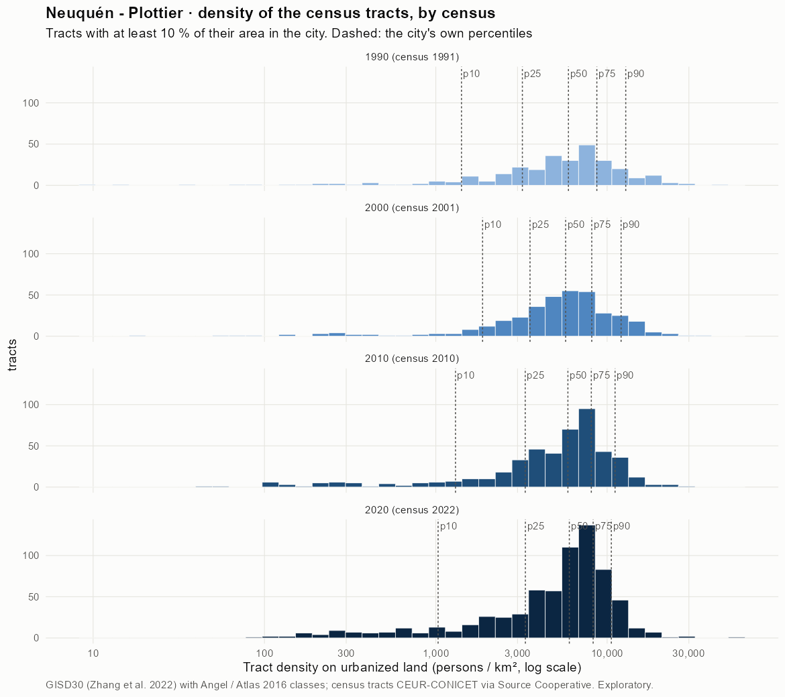
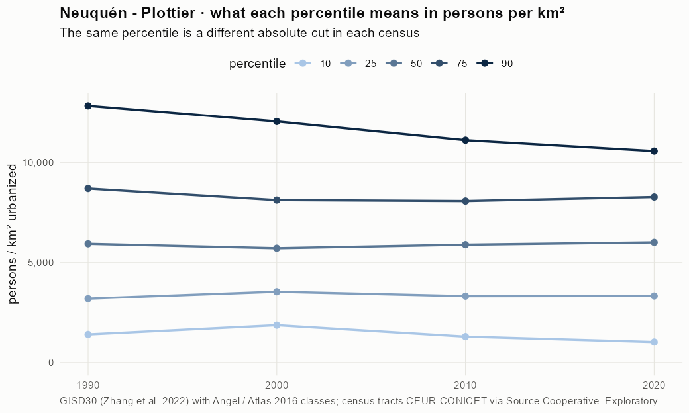
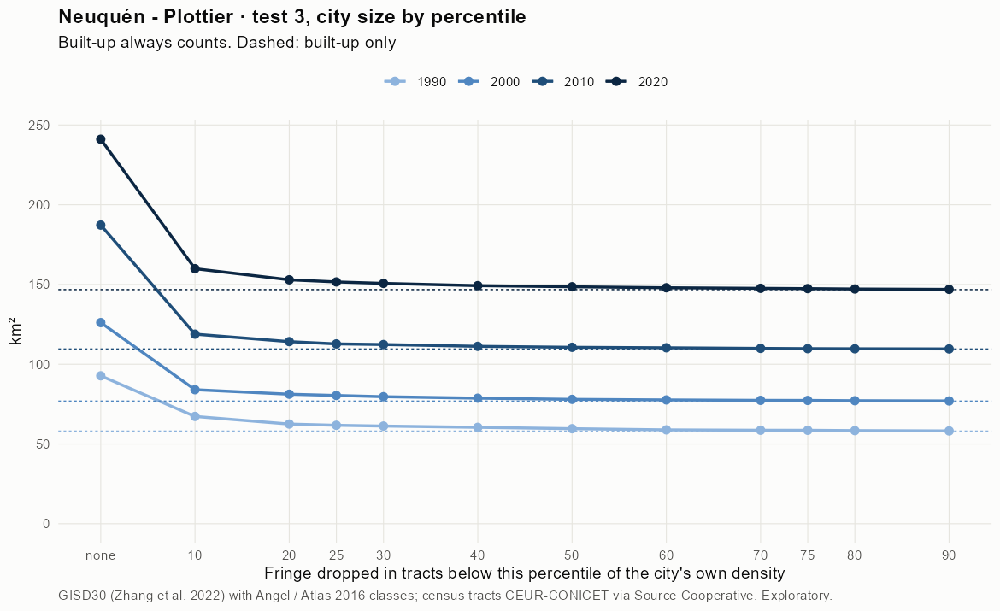
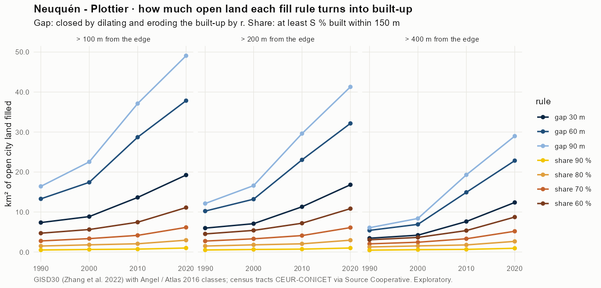
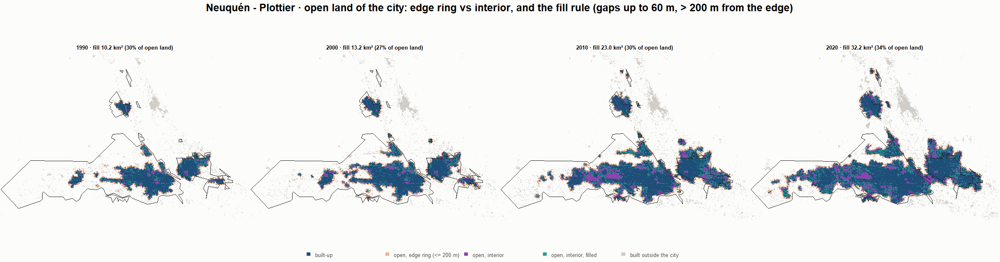
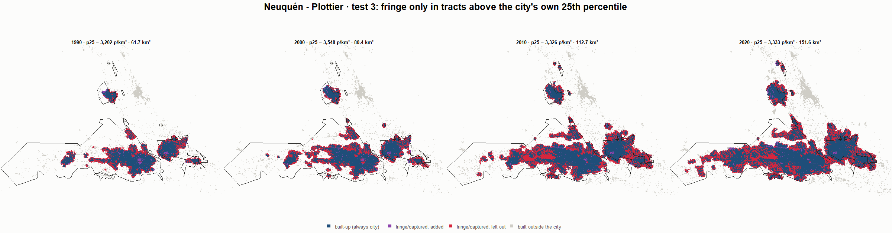

# Neuquén - Plottier · relative cut (test 3) and the fill rule, 1990-2020

Exploratory. None of these numbers are project figures (they are not in `CIFRAS_CANONICAS.json`). Generated by `Rpipe/scripts/16_reglas.R` from step 11. Run of 2026-11-15. [All agglomerations](../REPORTE.md) · [methods](../../METODOS.md).

## The density of the tracts

Tracts with at least 10 % of their area in the city, and the city's own percentiles of their density on urbanized land.

| Year | Tracts | p10 | p25 | p50 | p75 | p90 |
|---|---|---|---|---|---|---|
| 1990 (census 1991) | 293 | 1,412 | 3,202 | 5,946 | 8,710 | 12,844 |
| 2000 (census 2001) | 363 | 1,876 | 3,548 | 5,726 | 8,134 | 12,064 |
| 2010 (census 2010) | 474 | 1,303 | 3,326 | 5,903 | 8,085 | 11,125 |
| 2020 (census 2022) | 693 | 1,031 | 3,333 | 6,018 | 8,287 | 10,582 |

## Test 3 · fringe only above the city's own percentile

Built-up land is always city. Fringe and captured land join only in tracts at or above percentile p of the city's own tract densities, that census.

| Percentile | 1990 cut p/km² | 2000 cut p/km² | 2010 cut p/km² | 2020 cut p/km² | 1990 km² | 2000 km² | 2010 km² | 2020 km² | 1990-2020 %/yr |
|---|---|---|---|---|---|---|---|---|---|
| none (Angel) | 0 | 0 | 0 | 0 | 92.7 | 126.1 | 187.2 | 241.1 | 3.24 |
| p10 | 1,412 | 1,876 | 1,303 | 1,031 | 67.3 | 84.0 | 118.9 | 159.9 | 2.93 |
| p20 | 2,716 | 3,023 | 2,960 | 2,602 | 62.5 | 81.2 | 114.2 | 152.9 | 3.03 |
| p25 | 3,202 | 3,548 | 3,326 | 3,333 | 61.7 | 80.4 | 112.7 | 151.6 | 3.04 |
| p30 | 3,986 | 4,024 | 3,808 | 3,995 | 61.2 | 79.6 | 112.4 | 150.7 | 3.05 |
| p40 | 4,966 | 4,761 | 4,873 | 5,156 | 60.4 | 78.7 | 111.2 | 149.3 | 3.06 |
| p50 | 5,946 | 5,726 | 5,903 | 6,018 | 59.6 | 78.0 | 110.6 | 148.6 | 3.09 |
| p60 | 7,008 | 6,574 | 6,848 | 7,059 | 58.9 | 77.6 | 110.3 | 148.0 | 3.12 |
| p70 | 8,100 | 7,751 | 7,677 | 7,757 | 58.6 | 77.4 | 109.9 | 147.6 | 3.13 |
| p75 | 8,710 | 8,134 | 8,085 | 8,287 | 58.6 | 77.3 | 109.8 | 147.4 | 3.12 |
| p80 | 9,192 | 9,008 | 8,576 | 8,822 | 58.4 | 77.1 | 109.7 | 147.2 | 3.13 |
| p90 | 12,844 | 12,064 | 11,125 | 10,582 | 58.2 | 77.0 | 109.6 | 146.9 | 3.14 |
| built only | — | — | — | — | 58.1 | 76.9 | 109.5 | 146.8 | 3.14 |

## Fill rule · open land in the centre that is probably built

An open pixel of the city (fringe or captured) farther than D from any land outside the city becomes built-up if it is a narrow gap in the built-up: closing the built-up (dilate, then erode) with a square of radius r covers it. Central rule: r = 60 m, D = 200 m; *dense* = tract at or above 500 p/km². The alternative share rule fills a pixel with at least S of the pixels within 150 m built.

| Year | Open city land km² | Interior (> 200 m) km² | Filled km² | Filled in dense tracts km² | Built-up km² | Built-up + fill km² | Persons / km² built | With fill |
|---|---|---|---|---|---|---|---|---|
| 1990 (census 1991) | 34.7 | 15.6 | 10.2 | 5.6 | 58.1 | 63.7 | 4,807 | 4,382 |
| 2000 (census 2001) | 49.3 | 22.7 | 13.2 | 6.0 | 76.9 | 82.9 | 4,378 | 4,061 |
| 2010 (census 2010) | 77.7 | 46.2 | 23.0 | 6.4 | 109.5 | 115.9 | 3,643 | 3,442 |
| 2020 (census 2022) | 94.3 | 61.3 | 32.2 | 9.9 | 146.8 | 156.7 | 3,520 | 3,297 |

**Sensitivity: km² filled by each rule** (in brackets, % of the interior open land):

| Year | Farther than | gap 30 m | gap 60 m | gap 90 m | share 60 % | share 70 % | share 80 % | share 90 % |
|---|---|---|---|---|---|---|---|---|
| 1990 | 100 m | 7.4 (35) | 13.3 (62) | 16.4 (77) | 4.7 (22) | 2.8 (13) | 1.5 (7) | 0.5 (2) |
| 1990 | 200 m | 6.0 (38) | 10.2 (65) | 12.1 (78) | 4.5 (29) | 2.7 (18) | 1.5 (10) | 0.5 (3) |
| 1990 | 400 m | 3.4 (42) | 5.4 (67) | 6.1 (75) | 3.1 (38) | 2.0 (25) | 1.3 (15) | 0.5 (6) |
| 2000 | 100 m | 8.9 (29) | 17.4 (56) | 22.5 (73) | 5.6 (18) | 3.3 (11) | 1.8 (6) | 0.6 (2) |
| 2000 | 200 m | 7.1 (31) | 13.2 (58) | 16.6 (73) | 5.4 (24) | 3.3 (15) | 1.8 (8) | 0.6 (3) |
| 2000 | 400 m | 4.2 (36) | 6.9 (60) | 8.4 (72) | 3.6 (31) | 2.4 (21) | 1.5 (13) | 0.6 (5) |
| 2010 | 100 m | 13.6 (24) | 28.7 (51) | 37.1 (66) | 7.5 (13) | 4.2 (7) | 2.1 (4) | 0.7 (1) |
| 2010 | 200 m | 11.3 (24) | 23.0 (50) | 29.6 (64) | 7.2 (16) | 4.1 (9) | 2.1 (4) | 0.7 (2) |
| 2010 | 400 m | 7.6 (24) | 14.9 (47) | 19.3 (61) | 5.4 (17) | 3.3 (10) | 1.8 (6) | 0.7 (2) |
| 2020 | 100 m | 19.2 (27) | 37.8 (53) | 49.1 (68) | 11.1 (15) | 6.2 (9) | 3.0 (4) | 1.0 (1) |
| 2020 | 200 m | 16.8 (27) | 32.2 (52) | 41.3 (67) | 10.8 (18) | 6.1 (10) | 3.0 (5) | 1.0 (2) |
| 2020 | 400 m | 12.4 (28) | 22.9 (52) | 29.0 (66) | 8.7 (20) | 5.2 (12) | 2.7 (6) | 0.9 (2) |

**Test 3 at p25 plus the central fill, without asking for a dense tract** (the fill keeps interior gaps of sparse tracts that test 3 drops):

| Year | Angel km² | Test 3 p25 km² | Test 3 + fill km² |
|---|---|---|---|
| 1990 | 92.7 | 61.7 | 70.2 |
| 2000 | 126.1 | 80.4 | 91.8 |
| 2010 | 187.2 | 112.7 | 134.1 |
| 2020 | 241.1 | 151.6 | 181.5 |

## Maps

### Edge ring, interior and fill

### Test 3 at p25

