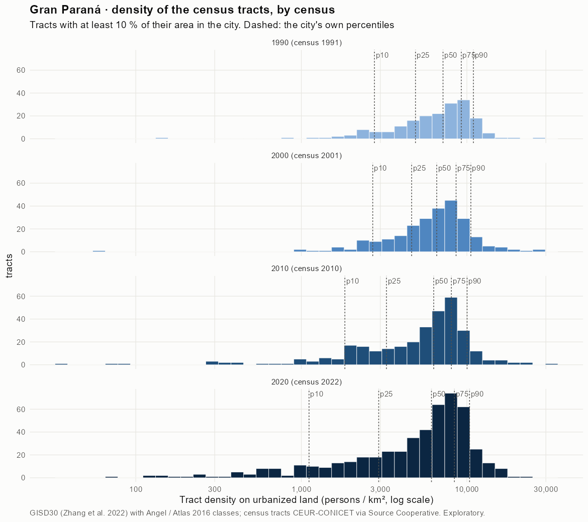
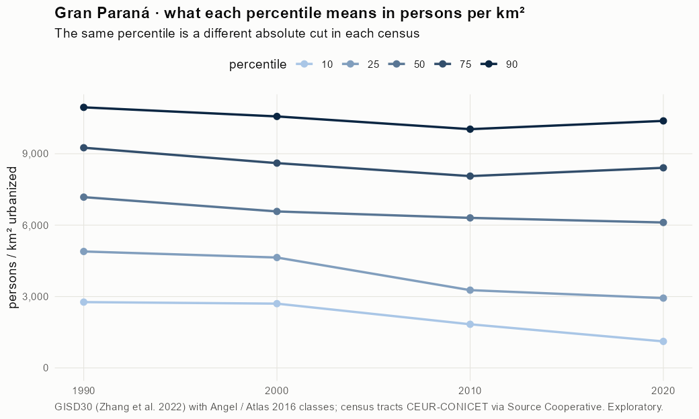
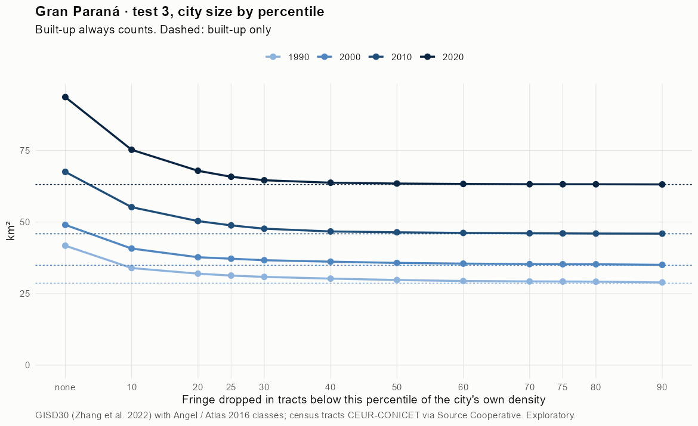
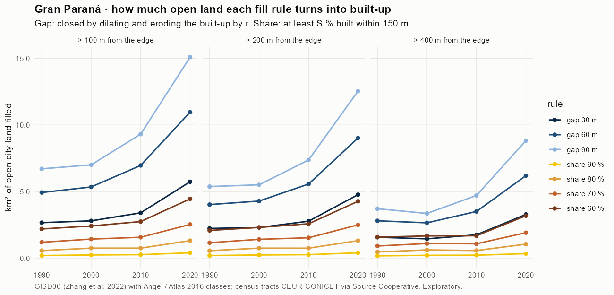
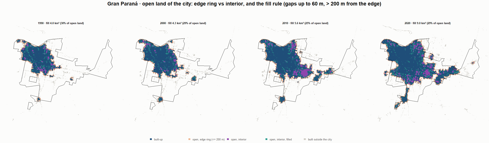
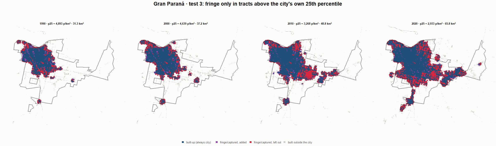

# Gran Paraná · relative cut (test 3) and the fill rule, 1990-2020

Exploratory. None of these numbers are project figures (they are not in `CIFRAS_CANONICAS.json`). Generated by `Rpipe/scripts/16_reglas.R` from step 11. Run of 2026-11-15. [All agglomerations](../REPORTE.md) · [methods](../../METODOS.md).

## The density of the tracts

Tracts with at least 10 % of their area in the city, and the city's own percentiles of their density on urbanized land.

| Year | Tracts | p10 | p25 | p50 | p75 | p90 |
|---|---|---|---|---|---|---|
| 1990 (census 1991) | 189 | 2,765 | 4,893 | 7,177 | 9,253 | 10,950 |
| 2000 (census 2001) | 246 | 2,700 | 4,639 | 6,575 | 8,606 | 10,569 |
| 2010 (census 2010) | 321 | 1,833 | 3,268 | 6,305 | 8,060 | 10,033 |
| 2020 (census 2022) | 502 | 1,113 | 2,933 | 6,111 | 8,409 | 10,381 |

## Test 3 · fringe only above the city's own percentile

Built-up land is always city. Fringe and captured land join only in tracts at or above percentile p of the city's own tract densities, that census.

| Percentile | 1990 cut p/km² | 2000 cut p/km² | 2010 cut p/km² | 2020 cut p/km² | 1990 km² | 2000 km² | 2010 km² | 2020 km² | 1990-2020 %/yr |
|---|---|---|---|---|---|---|---|---|---|
| none (Angel) | 0 | 0 | 0 | 0 | 41.7 | 49.0 | 67.5 | 93.7 | 2.73 |
| p10 | 2,765 | 2,700 | 1,833 | 1,113 | 33.9 | 40.7 | 55.2 | 75.3 | 2.69 |
| p20 | 4,190 | 4,031 | 2,543 | 2,286 | 32.0 | 37.7 | 50.3 | 67.9 | 2.54 |
| p25 | 4,893 | 4,639 | 3,268 | 2,933 | 31.3 | 37.2 | 48.8 | 65.8 | 2.51 |
| p30 | 5,254 | 4,987 | 3,858 | 3,541 | 30.8 | 36.7 | 47.7 | 64.6 | 2.50 |
| p40 | 6,187 | 5,704 | 5,231 | 4,883 | 30.2 | 36.2 | 46.7 | 63.8 | 2.52 |
| p50 | 7,177 | 6,575 | 6,305 | 6,111 | 29.7 | 35.7 | 46.4 | 63.5 | 2.56 |
| p60 | 8,092 | 7,396 | 7,091 | 7,151 | 29.4 | 35.5 | 46.2 | 63.3 | 2.59 |
| p70 | 8,844 | 7,924 | 7,639 | 7,891 | 29.3 | 35.3 | 46.1 | 63.2 | 2.60 |
| p75 | 9,253 | 8,606 | 8,060 | 8,409 | 29.2 | 35.3 | 46.0 | 63.2 | 2.61 |
| p80 | 9,513 | 9,157 | 8,502 | 8,922 | 29.2 | 35.3 | 46.0 | 63.2 | 2.61 |
| p90 | 10,950 | 10,569 | 10,033 | 10,381 | 28.9 | 35.0 | 45.9 | 63.2 | 2.64 |
| built only | — | — | — | — | 28.6 | 34.9 | 45.9 | 63.1 | 2.67 |

## Fill rule · open land in the centre that is probably built

An open pixel of the city (fringe or captured) farther than D from any land outside the city becomes built-up if it is a narrow gap in the built-up: closing the built-up (dilate, then erode) with a square of radius r covers it. Central rule: r = 60 m, D = 200 m; *dense* = tract at or above 500 p/km². The alternative share rule fills a pixel with at least S of the pixels within 150 m built.

| Year | Open city land km² | Interior (> 200 m) km² | Filled km² | Filled in dense tracts km² | Built-up km² | Built-up + fill km² | Persons / km² built | With fill |
|---|---|---|---|---|---|---|---|---|
| 1990 (census 1991) | 13.6 | 7.1 | 4.0 | 3.9 | 28.6 | 32.5 | 7,409 | 6,520 |
| 2000 (census 2001) | 14.7 | 7.0 | 4.3 | 4.1 | 34.9 | 39.0 | 7,025 | 6,278 |
| 2010 (census 2010) | 22.4 | 12.4 | 5.6 | 4.7 | 45.9 | 50.6 | 5,737 | 5,204 |
| 2020 (census 2022) | 31.4 | 18.1 | 9.0 | 7.1 | 63.1 | 70.3 | 4,807 | 4,320 |

**Sensitivity: km² filled by each rule** (in brackets, % of the interior open land):

| Year | Farther than | gap 30 m | gap 60 m | gap 90 m | share 60 % | share 70 % | share 80 % | share 90 % |
|---|---|---|---|---|---|---|---|---|
| 1990 | 100 m | 2.7 (31) | 4.9 (57) | 6.7 (77) | 2.2 (25) | 1.2 (14) | 0.6 (6) | 0.2 (2) |
| 1990 | 200 m | 2.2 (31) | 4.0 (57) | 5.4 (76) | 2.1 (29) | 1.2 (16) | 0.6 (8) | 0.2 (3) |
| 1990 | 400 m | 1.6 (32) | 2.8 (58) | 3.7 (77) | 1.6 (33) | 0.9 (19) | 0.5 (10) | 0.2 (4) |
| 2000 | 100 m | 2.8 (31) | 5.3 (60) | 7.0 (78) | 2.4 (27) | 1.4 (16) | 0.7 (8) | 0.2 (3) |
| 2000 | 200 m | 2.3 (33) | 4.3 (62) | 5.5 (79) | 2.3 (33) | 1.4 (20) | 0.7 (11) | 0.2 (3) |
| 2000 | 400 m | 1.4 (35) | 2.6 (64) | 3.4 (81) | 1.7 (40) | 1.1 (27) | 0.6 (15) | 0.2 (5) |
| 2010 | 100 m | 3.4 (23) | 7.0 (47) | 9.3 (63) | 2.7 (19) | 1.6 (11) | 0.7 (5) | 0.3 (2) |
| 2010 | 200 m | 2.8 (22) | 5.6 (45) | 7.4 (60) | 2.6 (21) | 1.5 (12) | 0.7 (6) | 0.3 (2) |
| 2010 | 400 m | 1.8 (20) | 3.5 (41) | 4.7 (55) | 1.7 (20) | 1.1 (13) | 0.6 (7) | 0.2 (3) |
| 2020 | 100 m | 5.7 (27) | 11.0 (51) | 15.1 (70) | 4.4 (21) | 2.5 (12) | 1.3 (6) | 0.4 (2) |
| 2020 | 200 m | 4.8 (26) | 9.0 (50) | 12.5 (69) | 4.3 (24) | 2.5 (14) | 1.3 (7) | 0.4 (2) |
| 2020 | 400 m | 3.3 (25) | 6.2 (47) | 8.8 (67) | 3.2 (24) | 1.9 (15) | 1.0 (8) | 0.3 (3) |

**Test 3 at p25 plus the central fill, without asking for a dense tract** (the fill keeps interior gaps of sparse tracts that test 3 drops):

| Year | Angel km² | Test 3 p25 km² | Test 3 + fill km² |
|---|---|---|---|
| 1990 | 41.7 | 31.3 | 33.8 |
| 2000 | 49.0 | 37.2 | 40.3 |
| 2010 | 67.5 | 48.8 | 53.0 |
| 2020 | 93.7 | 65.8 | 73.2 |

## Maps

### Edge ring, interior and fill

### Test 3 at p25

