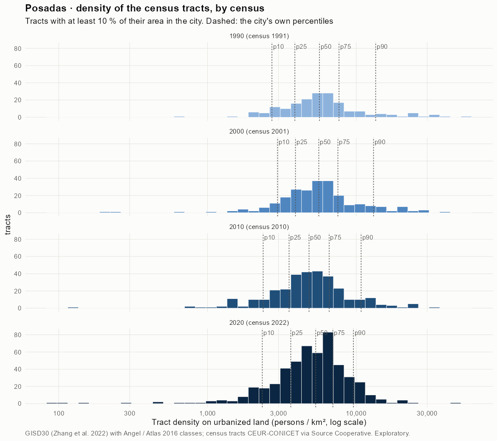
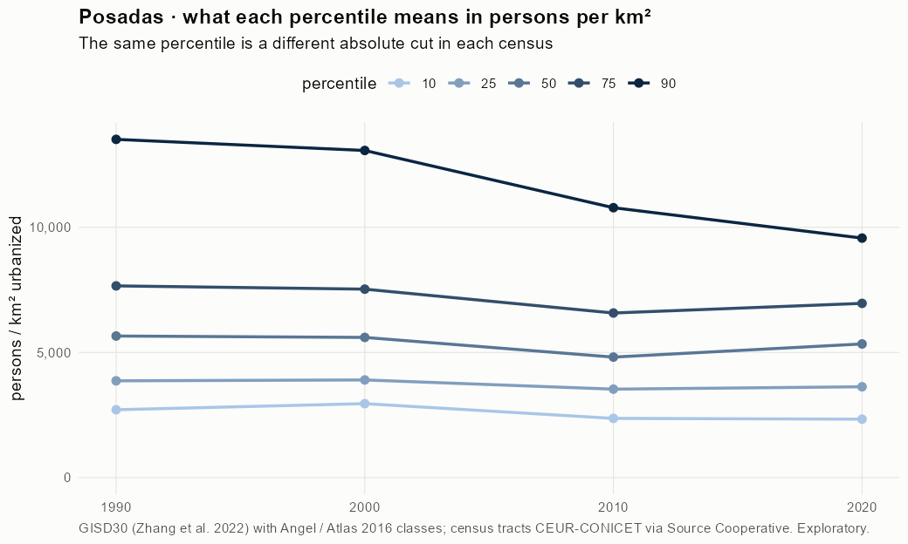
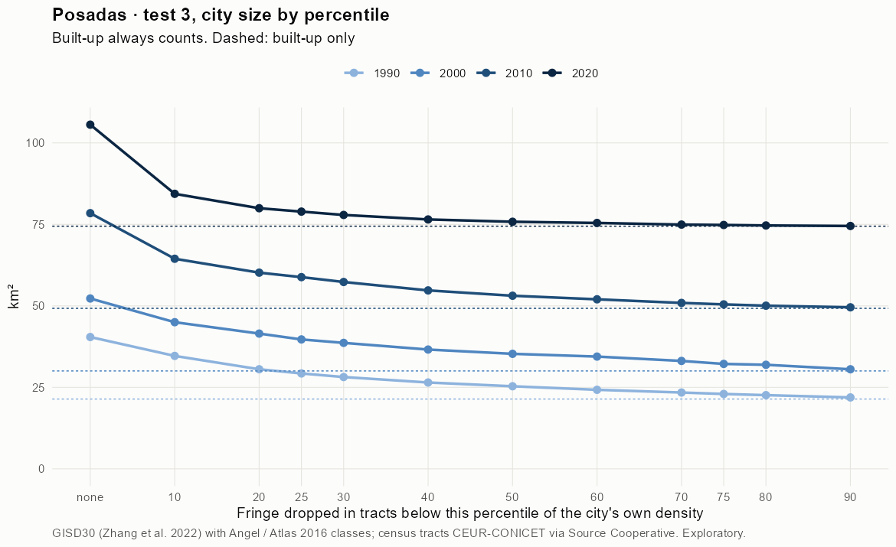
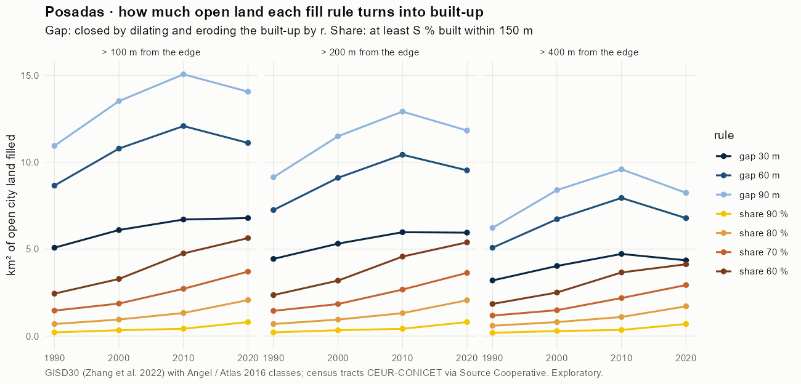
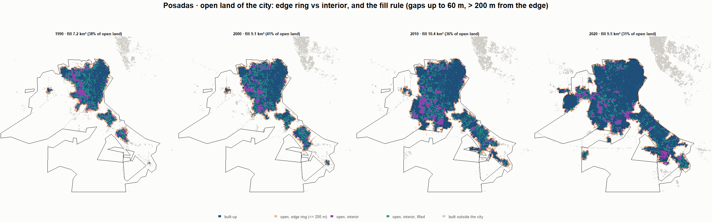
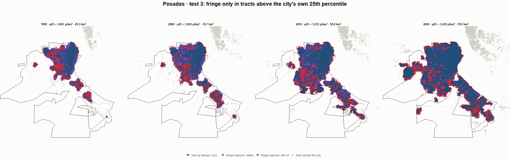

# Posadas · relative cut (test 3) and the fill rule, 1990-2020

Exploratory. None of these numbers are project figures (they are not in `CIFRAS_CANONICAS.json`). Generated by `Rpipe/scripts/16_reglas.R` from step 11. Run of 2026-11-15. [All agglomerations](../REPORTE.md) · [methods](../../METODOS.md).

## The density of the tracts

Tracts with at least 10 % of their area in the city, and the city's own percentiles of their density on urbanized land.

| Year | Tracts | p10 | p25 | p50 | p75 | p90 |
|---|---|---|---|---|---|---|
| 1990 (census 1991) | 184 | 2,712 | 3,867 | 5,657 | 7,660 | 13,512 |
| 2000 (census 2001) | 243 | 2,956 | 3,903 | 5,601 | 7,530 | 13,069 |
| 2010 (census 2010) | 313 | 2,367 | 3,535 | 4,815 | 6,576 | 10,783 |
| 2020 (census 2022) | 509 | 2,335 | 3,630 | 5,341 | 6,961 | 9,569 |

## Test 3 · fringe only above the city's own percentile

Built-up land is always city. Fringe and captured land join only in tracts at or above percentile p of the city's own tract densities, that census.

| Percentile | 1990 cut p/km² | 2000 cut p/km² | 2010 cut p/km² | 2020 cut p/km² | 1990 km² | 2000 km² | 2010 km² | 2020 km² | 1990-2020 %/yr |
|---|---|---|---|---|---|---|---|---|---|
| none (Angel) | 0 | 0 | 0 | 0 | 40.4 | 52.3 | 78.4 | 105.6 | 3.25 |
| p10 | 2,712 | 2,956 | 2,367 | 2,335 | 34.6 | 45.0 | 64.5 | 84.4 | 3.01 |
| p20 | 3,578 | 3,665 | 3,145 | 3,313 | 30.6 | 41.5 | 60.2 | 80.0 | 3.26 |
| p25 | 3,867 | 3,903 | 3,535 | 3,630 | 29.3 | 39.7 | 58.8 | 78.9 | 3.36 |
| p30 | 4,363 | 4,230 | 3,793 | 3,930 | 28.2 | 38.6 | 57.3 | 77.9 | 3.45 |
| p40 | 5,023 | 4,980 | 4,306 | 4,579 | 26.5 | 36.6 | 54.7 | 76.5 | 3.60 |
| p50 | 5,657 | 5,601 | 4,815 | 5,341 | 25.3 | 35.3 | 53.1 | 75.8 | 3.72 |
| p60 | 6,115 | 6,121 | 5,531 | 5,974 | 24.3 | 34.4 | 52.0 | 75.4 | 3.86 |
| p70 | 6,890 | 6,856 | 6,171 | 6,531 | 23.4 | 33.1 | 50.9 | 74.9 | 3.95 |
| p75 | 7,660 | 7,530 | 6,576 | 6,961 | 23.0 | 32.2 | 50.5 | 74.8 | 4.01 |
| p80 | 8,227 | 8,228 | 7,186 | 7,588 | 22.6 | 31.9 | 50.1 | 74.7 | 4.06 |
| p90 | 13,512 | 13,069 | 10,783 | 9,569 | 21.9 | 30.5 | 49.6 | 74.5 | 4.16 |
| built only | — | — | — | — | 21.4 | 30.0 | 49.2 | 74.4 | 4.24 |

## Fill rule · open land in the centre that is probably built

An open pixel of the city (fringe or captured) farther than D from any land outside the city becomes built-up if it is a narrow gap in the built-up: closing the built-up (dilate, then erode) with a square of radius r covers it. Central rule: r = 60 m, D = 200 m; *dense* = tract at or above 500 p/km². The alternative share rule fills a pixel with at least S of the pixels within 150 m built.

| Year | Open city land km² | Interior (> 200 m) km² | Filled km² | Filled in dense tracts km² | Built-up km² | Built-up + fill km² | Persons / km² built | With fill |
|---|---|---|---|---|---|---|---|---|
| 1990 (census 1991) | 19.0 | 11.8 | 7.2 | 7.1 | 21.4 | 28.5 | 9,862 | 7,406 |
| 2000 (census 2001) | 22.2 | 13.8 | 9.1 | 9.1 | 30.0 | 39.1 | 8,917 | 6,844 |
| 2010 (census 2010) | 29.2 | 17.6 | 10.4 | 10.3 | 49.2 | 59.6 | 6,507 | 5,379 |
| 2020 (census 2022) | 31.1 | 17.5 | 9.5 | 8.4 | 74.4 | 82.9 | 5,200 | 4,670 |

**Sensitivity: km² filled by each rule** (in brackets, % of the interior open land):

| Year | Farther than | gap 30 m | gap 60 m | gap 90 m | share 60 % | share 70 % | share 80 % | share 90 % |
|---|---|---|---|---|---|---|---|---|
| 1990 | 100 m | 5.1 (36) | 8.7 (62) | 10.9 (78) | 2.4 (17) | 1.5 (10) | 0.7 (5) | 0.2 (1) |
| 1990 | 200 m | 4.4 (37) | 7.2 (61) | 9.1 (77) | 2.4 (20) | 1.4 (12) | 0.7 (6) | 0.2 (2) |
| 1990 | 400 m | 3.2 (39) | 5.1 (62) | 6.2 (76) | 1.8 (23) | 1.2 (14) | 0.6 (7) | 0.2 (2) |
| 2000 | 100 m | 6.1 (38) | 10.8 (67) | 13.5 (83) | 3.3 (20) | 1.9 (12) | 0.9 (6) | 0.3 (2) |
| 2000 | 200 m | 5.3 (39) | 9.1 (66) | 11.5 (83) | 3.2 (23) | 1.8 (13) | 0.9 (7) | 0.3 (2) |
| 2000 | 400 m | 4.0 (39) | 6.7 (66) | 8.4 (82) | 2.5 (24) | 1.5 (14) | 0.8 (8) | 0.3 (3) |
| 2010 | 100 m | 6.7 (33) | 12.1 (59) | 15.1 (74) | 4.8 (23) | 2.7 (13) | 1.3 (7) | 0.4 (2) |
| 2010 | 200 m | 6.0 (34) | 10.4 (59) | 12.9 (73) | 4.6 (26) | 2.7 (15) | 1.3 (7) | 0.4 (2) |
| 2010 | 400 m | 4.7 (35) | 7.9 (58) | 9.6 (70) | 3.7 (27) | 2.2 (16) | 1.1 (8) | 0.3 (3) |
| 2020 | 100 m | 6.8 (33) | 11.1 (54) | 14.1 (68) | 5.6 (27) | 3.7 (18) | 2.1 (10) | 0.8 (4) |
| 2020 | 200 m | 5.9 (34) | 9.5 (55) | 11.8 (68) | 5.4 (31) | 3.6 (21) | 2.1 (12) | 0.8 (5) |
| 2020 | 400 m | 4.4 (34) | 6.8 (53) | 8.2 (65) | 4.1 (32) | 2.9 (23) | 1.7 (13) | 0.7 (5) |

**Test 3 at p25 plus the central fill, without asking for a dense tract** (the fill keeps interior gaps of sparse tracts that test 3 drops):

| Year | Angel km² | Test 3 p25 km² | Test 3 + fill km² |
|---|---|---|---|
| 1990 | 40.4 | 29.3 | 32.9 |
| 2000 | 52.3 | 39.7 | 44.4 |
| 2010 | 78.4 | 58.8 | 63.9 |
| 2020 | 105.6 | 78.9 | 85.5 |

## Maps

### Edge ring, interior and fill

### Test 3 at p25

