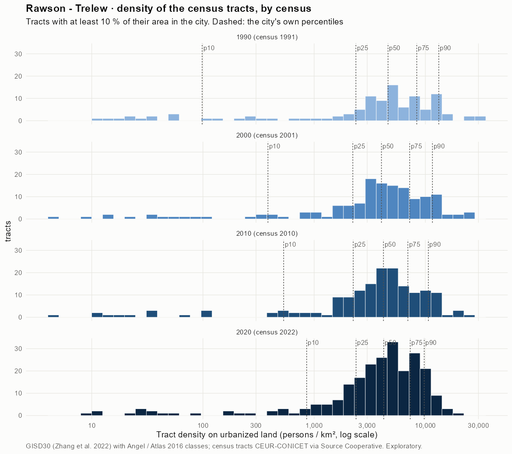
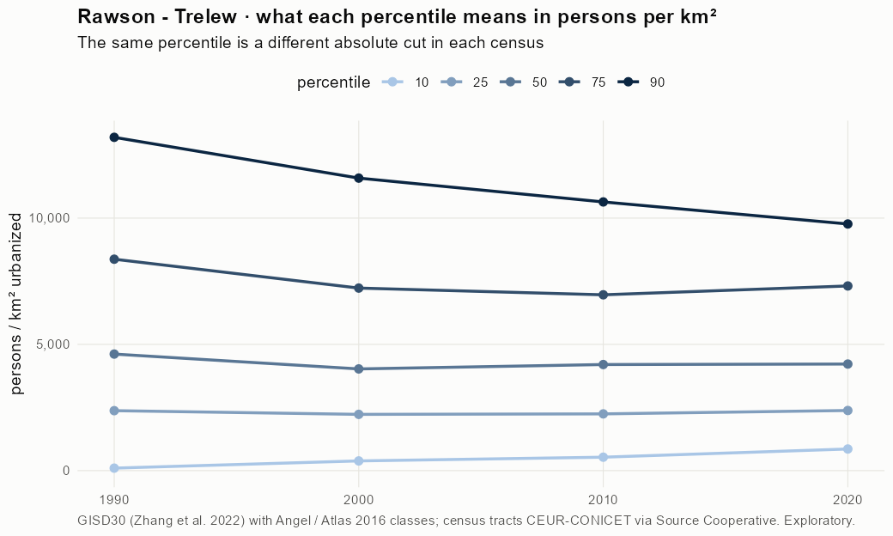
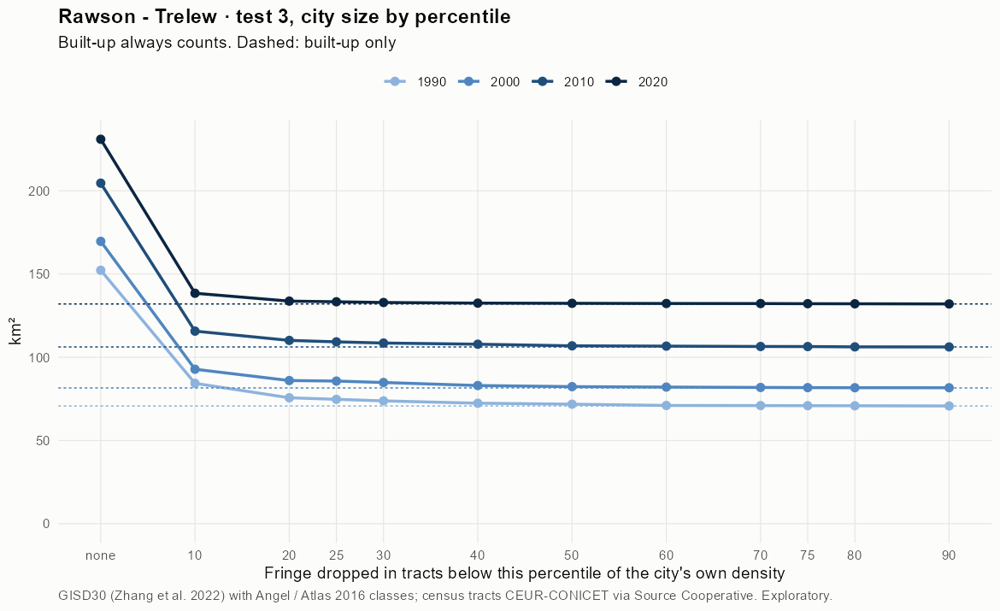
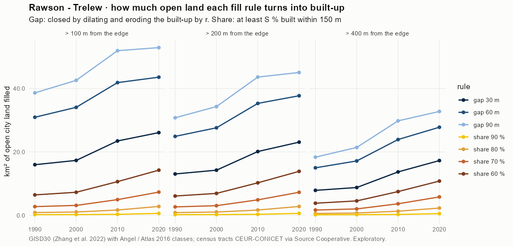
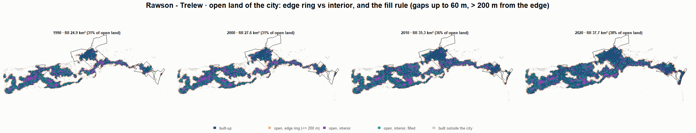
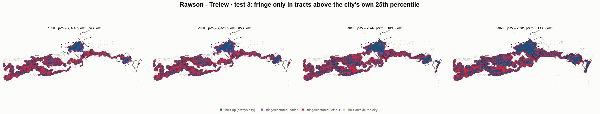

# Rawson - Trelew · relative cut (test 3) and the fill rule, 1990-2020

Exploratory. None of these numbers are project figures (they are not in `CIFRAS_CANONICAS.json`). Generated by `Rpipe/scripts/16_reglas.R` from step 11. Run of 2026-11-15. [All agglomerations](../REPORTE.md) · [methods](../../METODOS.md).

## The density of the tracts

Tracts with at least 10 % of their area in the city, and the city's own percentiles of their density on urbanized land.

| Year | Tracts | p10 | p25 | p50 | p75 | p90 |
|---|---|---|---|---|---|---|
| 1990 (census 1991) | 109 | 98 | 2,374 | 4,616 | 8,373 | 13,199 |
| 2000 (census 2001) | 144 | 384 | 2,228 | 4,027 | 7,229 | 11,584 |
| 2010 (census 2010) | 167 | 532 | 2,247 | 4,201 | 6,963 | 10,640 |
| 2020 (census 2022) | 237 | 856 | 2,381 | 4,220 | 7,313 | 9,767 |

## Test 3 · fringe only above the city's own percentile

Built-up land is always city. Fringe and captured land join only in tracts at or above percentile p of the city's own tract densities, that census.

| Percentile | 1990 cut p/km² | 2000 cut p/km² | 2010 cut p/km² | 2020 cut p/km² | 1990 km² | 2000 km² | 2010 km² | 2020 km² | 1990-2020 %/yr |
|---|---|---|---|---|---|---|---|---|---|
| none (Angel) | 0 | 0 | 0 | 0 | 152.3 | 169.6 | 204.6 | 231.0 | 1.40 |
| p10 | 98 | 384 | 532 | 856 | 84.3 | 92.8 | 115.7 | 138.5 | 1.67 |
| p20 | 1,493 | 1,758 | 1,833 | 1,913 | 75.6 | 86.0 | 110.1 | 133.7 | 1.92 |
| p25 | 2,374 | 2,228 | 2,247 | 2,381 | 74.7 | 85.7 | 109.3 | 133.3 | 1.95 |
| p30 | 3,143 | 2,821 | 2,679 | 2,796 | 73.8 | 84.8 | 108.5 | 132.9 | 1.98 |
| p40 | 3,627 | 3,493 | 3,424 | 3,567 | 72.4 | 83.0 | 107.8 | 132.5 | 2.04 |
| p50 | 4,616 | 4,027 | 4,201 | 4,220 | 71.8 | 82.3 | 106.9 | 132.4 | 2.06 |
| p60 | 5,254 | 4,989 | 4,777 | 5,212 | 71.0 | 82.1 | 106.7 | 132.3 | 2.09 |
| p70 | 7,542 | 6,561 | 6,505 | 6,551 | 71.0 | 81.9 | 106.5 | 132.3 | 2.10 |
| p75 | 8,373 | 7,229 | 6,963 | 7,313 | 70.9 | 81.8 | 106.4 | 132.2 | 2.10 |
| p80 | 9,573 | 8,889 | 8,185 | 8,136 | 70.9 | 81.7 | 106.2 | 132.1 | 2.10 |
| p90 | 13,199 | 11,584 | 10,640 | 9,767 | 70.7 | 81.7 | 106.2 | 132.0 | 2.10 |
| built only | — | — | — | — | 70.7 | 81.6 | 106.2 | 132.0 | 2.10 |

## Fill rule · open land in the centre that is probably built

An open pixel of the city (fringe or captured) farther than D from any land outside the city becomes built-up if it is a narrow gap in the built-up: closing the built-up (dilate, then erode) with a square of radius r covers it. Central rule: r = 60 m, D = 200 m; *dense* = tract at or above 500 p/km². The alternative share rule fills a pixel with at least S of the pixels within 150 m built.

| Year | Open city land km² | Interior (> 200 m) km² | Filled km² | Filled in dense tracts km² | Built-up km² | Built-up + fill km² | Persons / km² built | With fill |
|---|---|---|---|---|---|---|---|---|
| 1990 (census 1991) | 81.6 | 49.1 | 24.9 | 1.7 | 70.7 | 72.5 | 1,479 | 1,444 |
| 2000 (census 2001) | 88.1 | 54.3 | 27.6 | 2.4 | 81.6 | 84.0 | 1,482 | 1,440 |
| 2010 (census 2010) | 98.5 | 65.7 | 35.3 | 2.9 | 106.2 | 109.1 | 1,300 | 1,265 |
| 2020 (census 2022) | 99.1 | 68.0 | 37.7 | 3.4 | 132.0 | 135.4 | 1,154 | 1,125 |

**Sensitivity: km² filled by each rule** (in brackets, % of the interior open land):

| Year | Farther than | gap 30 m | gap 60 m | gap 90 m | share 60 % | share 70 % | share 80 % | share 90 % |
|---|---|---|---|---|---|---|---|---|
| 1990 | 100 m | 16.0 (27) | 31.0 (52) | 38.7 (65) | 6.4 (11) | 2.7 (5) | 0.9 (1) | 0.2 (0) |
| 1990 | 200 m | 13.0 (27) | 24.9 (51) | 30.8 (63) | 6.1 (12) | 2.6 (5) | 0.8 (2) | 0.2 (0) |
| 1990 | 400 m | 7.9 (25) | 15.0 (48) | 18.4 (58) | 3.8 (12) | 1.6 (5) | 0.6 (2) | 0.2 (1) |
| 2000 | 100 m | 17.3 (27) | 34.1 (53) | 42.6 (66) | 7.3 (11) | 3.1 (5) | 1.0 (2) | 0.2 (0) |
| 2000 | 200 m | 14.2 (26) | 27.6 (51) | 34.3 (63) | 6.9 (13) | 3.0 (6) | 1.0 (2) | 0.2 (0) |
| 2000 | 400 m | 8.8 (24) | 17.2 (48) | 21.4 (60) | 4.5 (13) | 2.0 (6) | 0.7 (2) | 0.2 (1) |
| 2010 | 100 m | 23.5 (31) | 41.9 (55) | 52.0 (69) | 10.6 (14) | 4.9 (7) | 1.7 (2) | 0.3 (0) |
| 2010 | 200 m | 20.1 (31) | 35.3 (54) | 43.6 (66) | 10.2 (16) | 4.9 (7) | 1.6 (3) | 0.3 (0) |
| 2010 | 400 m | 13.7 (29) | 23.9 (50) | 29.8 (63) | 7.5 (16) | 3.6 (8) | 1.3 (3) | 0.2 (1) |
| 2020 | 100 m | 26.1 (34) | 43.6 (56) | 52.9 (68) | 14.2 (18) | 7.3 (9) | 2.8 (4) | 0.6 (1) |
| 2020 | 200 m | 23.1 (34) | 37.7 (55) | 45.1 (66) | 13.9 (20) | 7.3 (11) | 2.8 (4) | 0.6 (1) |
| 2020 | 400 m | 17.3 (34) | 27.8 (54) | 32.8 (64) | 10.8 (21) | 5.8 (11) | 2.3 (4) | 0.5 (1) |

**Test 3 at p25 plus the central fill, without asking for a dense tract** (the fill keeps interior gaps of sparse tracts that test 3 drops):

| Year | Angel km² | Test 3 p25 km² | Test 3 + fill km² |
|---|---|---|---|
| 1990 | 152.3 | 74.7 | 98.6 |
| 2000 | 169.6 | 85.7 | 111.9 |
| 2010 | 204.6 | 109.3 | 143.4 |
| 2020 | 231.0 | 133.3 | 170.4 |

## Maps

### Edge ring, interior and fill

### Test 3 at p25

