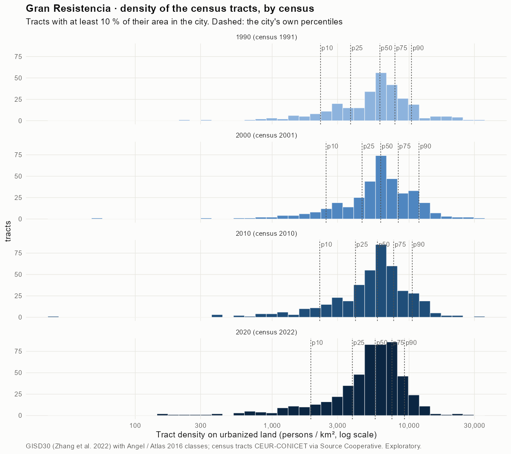
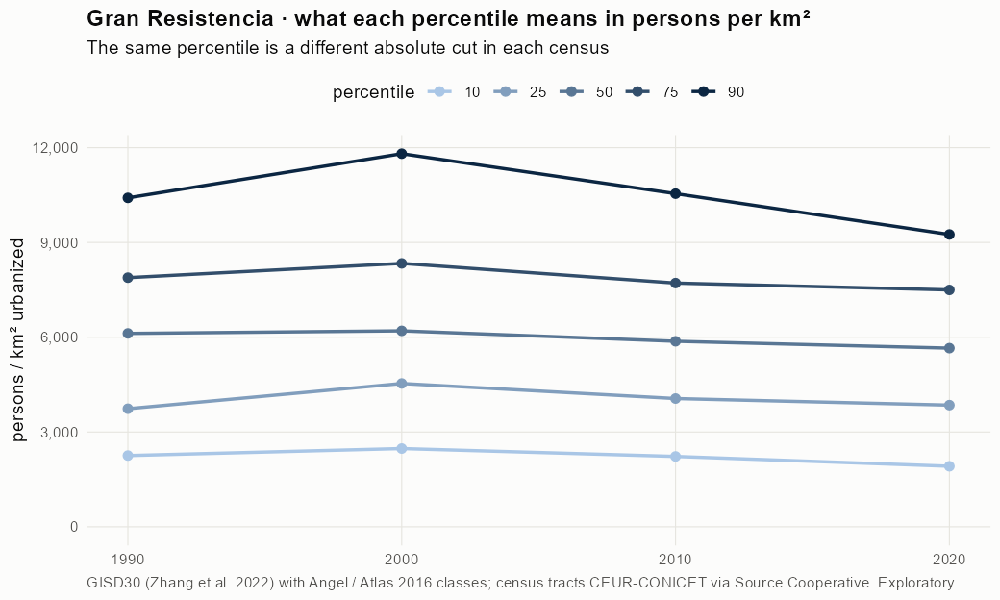
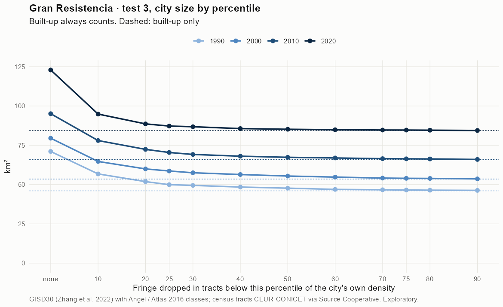
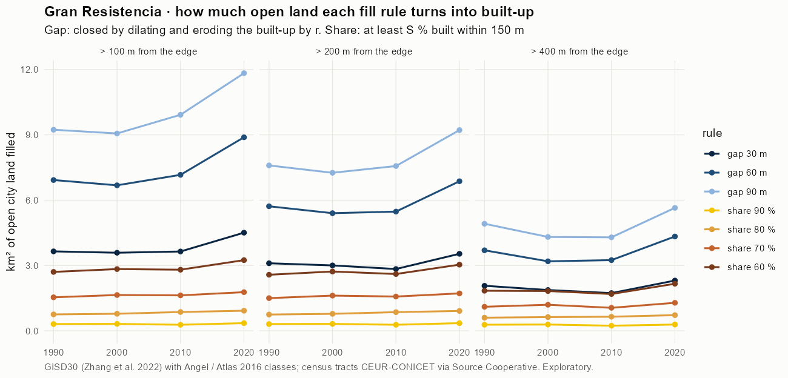
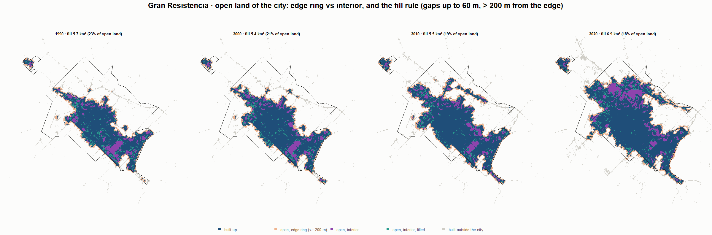
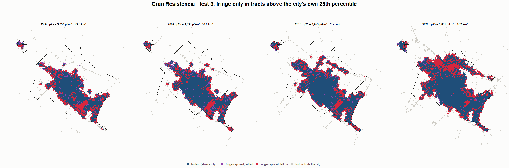

# Gran Resistencia · relative cut (test 3) and the fill rule, 1990-2020

Exploratory. None of these numbers are project figures (they are not in `CIFRAS_CANONICAS.json`). Generated by `Rpipe/scripts/16_reglas.R` from step 11. Run of 2026-11-15. [All agglomerations](../REPORTE.md) · [methods](../../METODOS.md).

## The density of the tracts

Tracts with at least 10 % of their area in the city, and the city's own percentiles of their density on urbanized land.

| Year | Tracts | p10 | p25 | p50 | p75 | p90 |
|---|---|---|---|---|---|---|
| 1990 (census 1991) | 286 | 2,254 | 3,737 | 6,121 | 7,886 | 10,411 |
| 2000 (census 2001) | 362 | 2,476 | 4,536 | 6,202 | 8,337 | 11,808 |
| 2010 (census 2010) | 428 | 2,227 | 4,059 | 5,871 | 7,714 | 10,545 |
| 2020 (census 2022) | 526 | 1,916 | 3,851 | 5,654 | 7,497 | 9,253 |

## Test 3 · fringe only above the city's own percentile

Built-up land is always city. Fringe and captured land join only in tracts at or above percentile p of the city's own tract densities, that census.

| Percentile | 1990 cut p/km² | 2000 cut p/km² | 2010 cut p/km² | 2020 cut p/km² | 1990 km² | 2000 km² | 2010 km² | 2020 km² | 1990-2020 %/yr |
|---|---|---|---|---|---|---|---|---|---|
| none (Angel) | 0 | 0 | 0 | 0 | 71.1 | 79.5 | 95.1 | 122.9 | 1.84 |
| p10 | 2,254 | 2,476 | 2,227 | 1,916 | 56.8 | 64.7 | 78.0 | 94.8 | 1.73 |
| p20 | 3,200 | 3,837 | 3,396 | 3,311 | 51.9 | 60.0 | 72.4 | 88.6 | 1.80 |
| p25 | 3,737 | 4,536 | 4,059 | 3,851 | 49.9 | 58.6 | 70.4 | 87.2 | 1.88 |
| p30 | 4,444 | 5,014 | 4,409 | 4,316 | 49.5 | 57.5 | 69.2 | 86.8 | 1.89 |
| p40 | 5,512 | 5,697 | 5,329 | 5,031 | 48.4 | 56.4 | 68.0 | 85.6 | 1.92 |
| p50 | 6,121 | 6,202 | 5,871 | 5,654 | 47.7 | 55.4 | 67.3 | 85.2 | 1.95 |
| p60 | 6,659 | 6,816 | 6,509 | 6,357 | 46.9 | 54.7 | 66.9 | 84.9 | 2.00 |
| p70 | 7,322 | 7,715 | 7,270 | 7,034 | 46.7 | 54.1 | 66.5 | 84.7 | 2.01 |
| p75 | 7,886 | 8,337 | 7,714 | 7,497 | 46.5 | 54.0 | 66.4 | 84.7 | 2.02 |
| p80 | 8,386 | 9,344 | 8,326 | 7,854 | 46.4 | 53.9 | 66.3 | 84.6 | 2.02 |
| p90 | 10,411 | 11,808 | 10,545 | 9,253 | 46.3 | 53.6 | 66.0 | 84.4 | 2.02 |
| built only | — | — | — | — | 46.0 | 53.5 | 65.9 | 84.4 | 2.04 |

## Fill rule · open land in the centre that is probably built

An open pixel of the city (fringe or captured) farther than D from any land outside the city becomes built-up if it is a narrow gap in the built-up: closing the built-up (dilate, then erode) with a square of radius r covers it. Central rule: r = 60 m, D = 200 m; *dense* = tract at or above 500 p/km². The alternative share rule fills a pixel with at least S of the pixels within 150 m built.

| Year | Open city land km² | Interior (> 200 m) km² | Filled km² | Filled in dense tracts km² | Built-up km² | Built-up + fill km² | Persons / km² built | With fill |
|---|---|---|---|---|---|---|---|---|
| 1990 (census 1991) | 25.1 | 14.9 | 5.7 | 5.1 | 46.0 | 51.1 | 6,542 | 5,883 |
| 2000 (census 2001) | 26.0 | 14.6 | 5.4 | 5.2 | 53.5 | 58.7 | 6,894 | 6,283 |
| 2010 (census 2010) | 29.2 | 15.3 | 5.5 | 5.1 | 65.9 | 71.0 | 6,007 | 5,576 |
| 2020 (census 2022) | 38.5 | 22.1 | 6.9 | 5.6 | 84.4 | 90.0 | 4,980 | 4,671 |

**Sensitivity: km² filled by each rule** (in brackets, % of the interior open land):

| Year | Farther than | gap 30 m | gap 60 m | gap 90 m | share 60 % | share 70 % | share 80 % | share 90 % |
|---|---|---|---|---|---|---|---|---|
| 1990 | 100 m | 3.6 (21) | 6.9 (40) | 9.2 (53) | 2.7 (16) | 1.5 (9) | 0.8 (4) | 0.3 (2) |
| 1990 | 200 m | 3.1 (21) | 5.7 (38) | 7.6 (51) | 2.6 (17) | 1.5 (10) | 0.7 (5) | 0.3 (2) |
| 1990 | 400 m | 2.1 (20) | 3.7 (35) | 4.9 (47) | 1.8 (18) | 1.1 (10) | 0.6 (6) | 0.3 (3) |
| 2000 | 100 m | 3.6 (21) | 6.7 (39) | 9.1 (53) | 2.8 (16) | 1.6 (10) | 0.8 (5) | 0.3 (2) |
| 2000 | 200 m | 3.0 (21) | 5.4 (37) | 7.3 (50) | 2.7 (19) | 1.6 (11) | 0.8 (5) | 0.3 (2) |
| 2000 | 400 m | 1.9 (19) | 3.2 (33) | 4.3 (44) | 1.8 (19) | 1.2 (12) | 0.6 (6) | 0.3 (3) |
| 2010 | 100 m | 3.6 (20) | 7.2 (39) | 9.9 (53) | 2.8 (15) | 1.6 (9) | 0.9 (5) | 0.3 (1) |
| 2010 | 200 m | 2.8 (19) | 5.5 (36) | 7.6 (50) | 2.6 (17) | 1.6 (10) | 0.9 (6) | 0.3 (2) |
| 2010 | 400 m | 1.7 (17) | 3.2 (32) | 4.3 (42) | 1.7 (16) | 1.1 (10) | 0.6 (6) | 0.2 (2) |
| 2020 | 100 m | 4.5 (17) | 8.9 (34) | 11.8 (46) | 3.2 (13) | 1.8 (7) | 0.9 (4) | 0.4 (1) |
| 2020 | 200 m | 3.5 (16) | 6.9 (31) | 9.2 (42) | 3.0 (14) | 1.7 (8) | 0.9 (4) | 0.4 (2) |
| 2020 | 400 m | 2.3 (14) | 4.3 (26) | 5.6 (34) | 2.2 (13) | 1.3 (8) | 0.7 (4) | 0.3 (2) |

**Test 3 at p25 plus the central fill, without asking for a dense tract** (the fill keeps interior gaps of sparse tracts that test 3 drops):

| Year | Angel km² | Test 3 p25 km² | Test 3 + fill km² |
|---|---|---|---|
| 1990 | 71.1 | 49.9 | 54.2 |
| 2000 | 79.5 | 58.6 | 62.5 |
| 2010 | 95.1 | 70.4 | 74.4 |
| 2020 | 122.9 | 87.2 | 93.1 |

## Maps

### Edge ring, interior and fill

### Test 3 at p25

