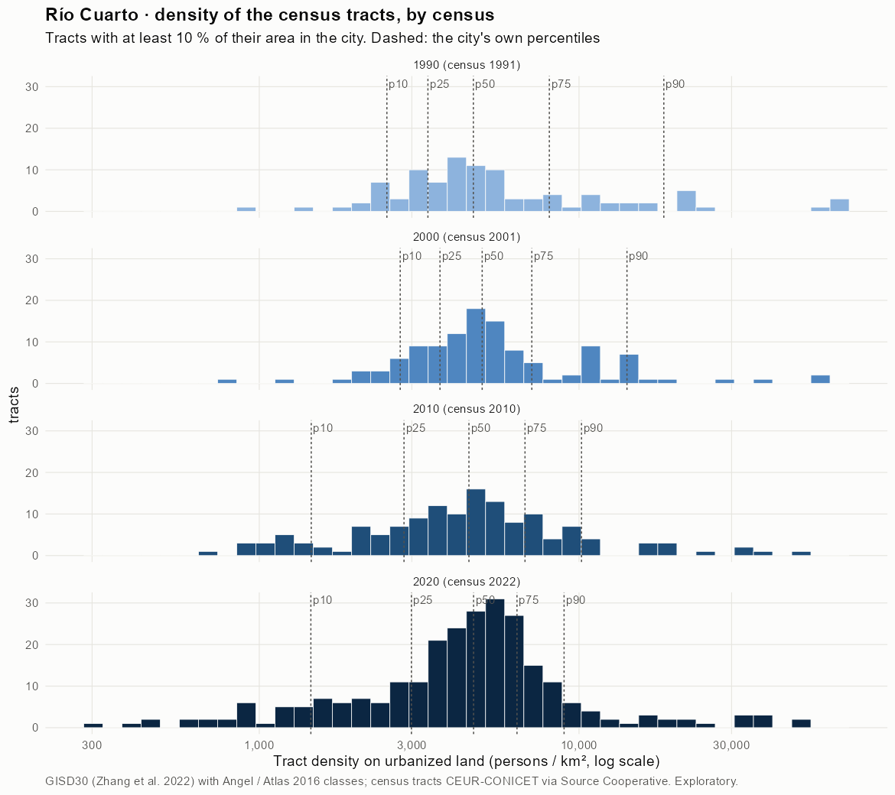
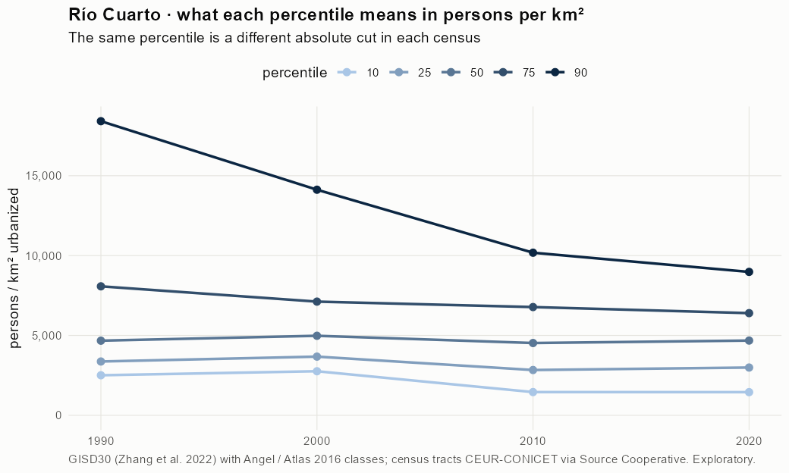
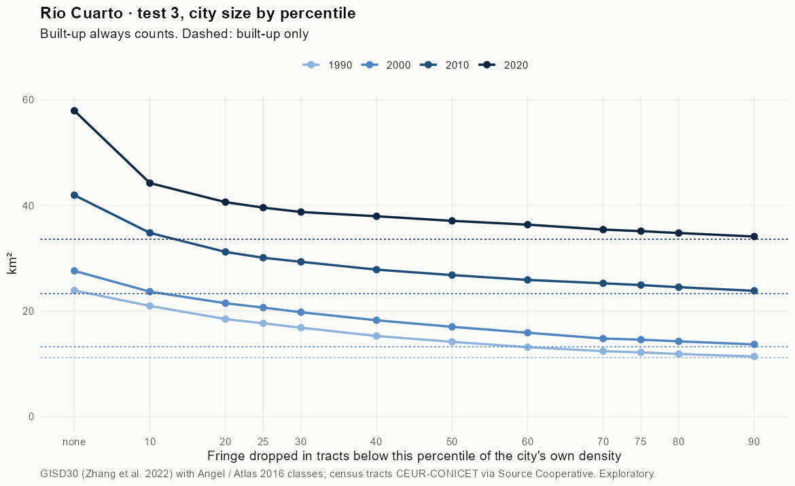
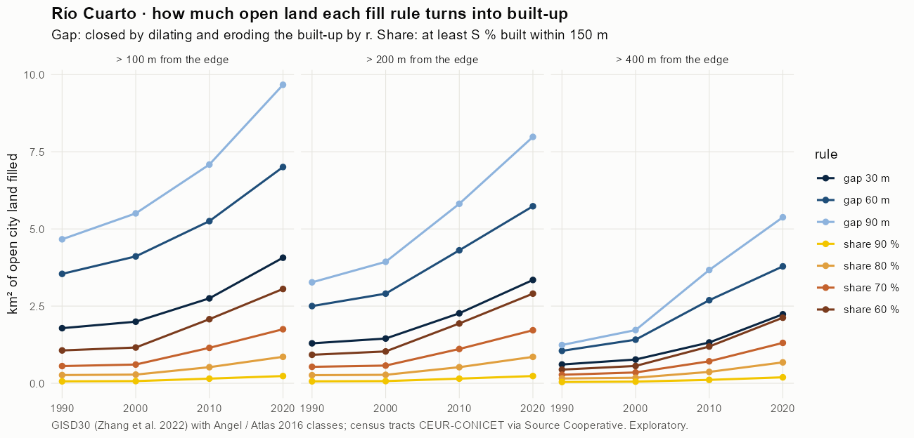
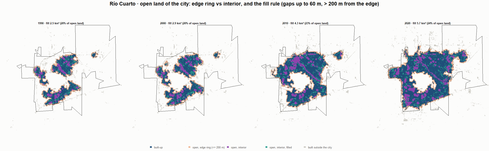
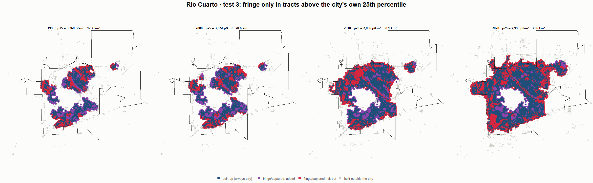

# Río Cuarto · relative cut (test 3) and the fill rule, 1990-2020

Exploratory. None of these numbers are project figures (they are not in `CIFRAS_CANONICAS.json`). Generated by `Rpipe/scripts/16_reglas.R` from step 11. Run of 2026-11-15. [All agglomerations](../REPORTE.md) · [methods](../../METODOS.md).

## The density of the tracts

Tracts with at least 10 % of their area in the city, and the city's own percentiles of their density on urbanized land.

| Year | Tracts | p10 | p25 | p50 | p75 | p90 |
|---|---|---|---|---|---|---|
| 1990 (census 1991) | 97 | 2,507 | 3,368 | 4,672 | 8,075 | 18,416 |
| 2000 (census 2001) | 117 | 2,759 | 3,674 | 4,979 | 7,118 | 14,124 |
| 2010 (census 2010) | 141 | 1,454 | 2,836 | 4,526 | 6,777 | 10,181 |
| 2020 (census 2022) | 261 | 1,450 | 2,990 | 4,680 | 6,397 | 8,979 |

## Test 3 · fringe only above the city's own percentile

Built-up land is always city. Fringe and captured land join only in tracts at or above percentile p of the city's own tract densities, that census.

| Percentile | 1990 cut p/km² | 2000 cut p/km² | 2010 cut p/km² | 2020 cut p/km² | 1990 km² | 2000 km² | 2010 km² | 2020 km² | 1990-2020 %/yr |
|---|---|---|---|---|---|---|---|---|---|
| none (Angel) | 0 | 0 | 0 | 0 | 23.9 | 27.6 | 41.9 | 57.9 | 3.00 |
| p10 | 2,507 | 2,759 | 1,454 | 1,450 | 21.0 | 23.7 | 34.8 | 44.2 | 2.52 |
| p20 | 3,129 | 3,380 | 2,496 | 2,415 | 18.5 | 21.5 | 31.2 | 40.6 | 2.66 |
| p25 | 3,368 | 3,674 | 2,836 | 2,990 | 17.7 | 20.6 | 30.1 | 39.6 | 2.73 |
| p30 | 3,731 | 4,053 | 3,251 | 3,477 | 16.8 | 19.8 | 29.3 | 38.7 | 2.82 |
| p40 | 4,314 | 4,519 | 3,845 | 3,968 | 15.3 | 18.2 | 27.8 | 37.9 | 3.08 |
| p50 | 4,672 | 4,979 | 4,526 | 4,680 | 14.2 | 17.0 | 26.8 | 37.1 | 3.26 |
| p60 | 5,306 | 5,423 | 5,289 | 5,300 | 13.1 | 15.9 | 25.9 | 36.4 | 3.45 |
| p70 | 6,582 | 6,324 | 5,963 | 5,967 | 12.4 | 14.8 | 25.2 | 35.4 | 3.56 |
| p75 | 8,075 | 7,118 | 6,777 | 6,397 | 12.2 | 14.6 | 24.9 | 35.1 | 3.60 |
| p80 | 10,375 | 9,809 | 7,609 | 6,816 | 11.9 | 14.2 | 24.5 | 34.8 | 3.65 |
| p90 | 18,416 | 14,124 | 10,181 | 8,979 | 11.4 | 13.7 | 23.8 | 34.1 | 3.73 |
| built only | — | — | — | — | 11.1 | 13.2 | 23.3 | 33.6 | 3.74 |

## Fill rule · open land in the centre that is probably built

An open pixel of the city (fringe or captured) farther than D from any land outside the city becomes built-up if it is a narrow gap in the built-up: closing the built-up (dilate, then erode) with a square of radius r covers it. Central rule: r = 60 m, D = 200 m; *dense* = tract at or above 500 p/km². The alternative share rule fills a pixel with at least S of the pixels within 150 m built.

| Year | Open city land km² | Interior (> 200 m) km² | Filled km² | Filled in dense tracts km² | Built-up km² | Built-up + fill km² | Persons / km² built | With fill |
|---|---|---|---|---|---|---|---|---|
| 1990 (census 1991) | 12.7 | 6.0 | 2.5 | 2.5 | 11.1 | 13.6 | 9,647 | 7,879 |
| 2000 (census 2001) | 14.4 | 6.9 | 2.9 | 2.9 | 13.2 | 16.1 | 9,509 | 7,796 |
| 2010 (census 2010) | 18.6 | 10.9 | 4.3 | 4.3 | 23.3 | 27.6 | 6,109 | 5,161 |
| 2020 (census 2022) | 24.3 | 15.3 | 5.7 | 4.9 | 33.6 | 38.5 | 4,864 | 4,248 |

**Sensitivity: km² filled by each rule** (in brackets, % of the interior open land):

| Year | Farther than | gap 30 m | gap 60 m | gap 90 m | share 60 % | share 70 % | share 80 % | share 90 % |
|---|---|---|---|---|---|---|---|---|
| 1990 | 100 m | 1.8 (23) | 3.5 (45) | 4.7 (59) | 1.1 (14) | 0.6 (7) | 0.3 (3) | 0.1 (1) |
| 1990 | 200 m | 1.3 (22) | 2.5 (42) | 3.3 (55) | 0.9 (15) | 0.5 (9) | 0.3 (4) | 0.1 (1) |
| 1990 | 400 m | 0.6 (22) | 1.1 (38) | 1.2 (45) | 0.4 (16) | 0.3 (10) | 0.2 (6) | 0.0 (1) |
| 2000 | 100 m | 2.0 (22) | 4.1 (46) | 5.5 (62) | 1.2 (13) | 0.6 (7) | 0.3 (3) | 0.1 (1) |
| 2000 | 200 m | 1.4 (21) | 2.9 (42) | 3.9 (57) | 1.0 (15) | 0.6 (8) | 0.3 (4) | 0.1 (1) |
| 2000 | 400 m | 0.8 (22) | 1.4 (40) | 1.7 (48) | 0.6 (16) | 0.4 (10) | 0.2 (5) | 0.1 (2) |
| 2010 | 100 m | 2.8 (22) | 5.3 (42) | 7.1 (56) | 2.1 (16) | 1.1 (9) | 0.5 (4) | 0.2 (1) |
| 2010 | 200 m | 2.3 (21) | 4.3 (40) | 5.8 (53) | 1.9 (18) | 1.1 (10) | 0.5 (5) | 0.2 (1) |
| 2010 | 400 m | 1.3 (17) | 2.7 (35) | 3.7 (48) | 1.2 (15) | 0.7 (9) | 0.4 (5) | 0.1 (1) |
| 2020 | 100 m | 4.1 (23) | 7.0 (40) | 9.7 (55) | 3.1 (17) | 1.8 (10) | 0.9 (5) | 0.2 (1) |
| 2020 | 200 m | 3.3 (22) | 5.7 (38) | 8.0 (52) | 2.9 (19) | 1.7 (11) | 0.9 (6) | 0.2 (2) |
| 2020 | 400 m | 2.2 (20) | 3.8 (34) | 5.4 (48) | 2.1 (19) | 1.3 (12) | 0.7 (6) | 0.2 (2) |

**Test 3 at p25 plus the central fill, without asking for a dense tract** (the fill keeps interior gaps of sparse tracts that test 3 drops):

| Year | Angel km² | Test 3 p25 km² | Test 3 + fill km² |
|---|---|---|---|
| 1990 | 23.9 | 17.7 | 19.0 |
| 2000 | 27.6 | 20.6 | 22.3 |
| 2010 | 41.9 | 30.1 | 32.5 |
| 2020 | 57.9 | 39.6 | 43.8 |

## Maps

### Edge ring, interior and fill

### Test 3 at p25

