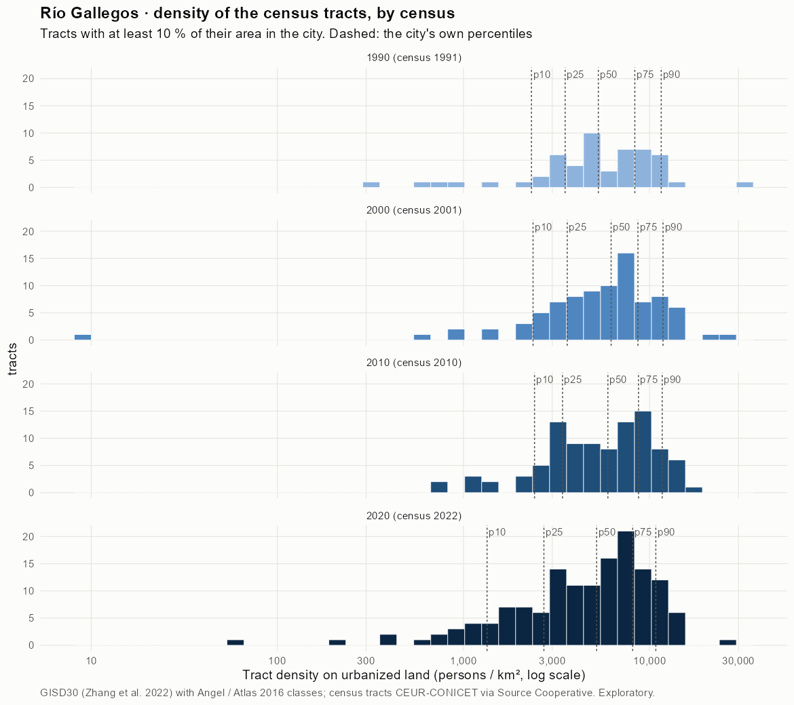
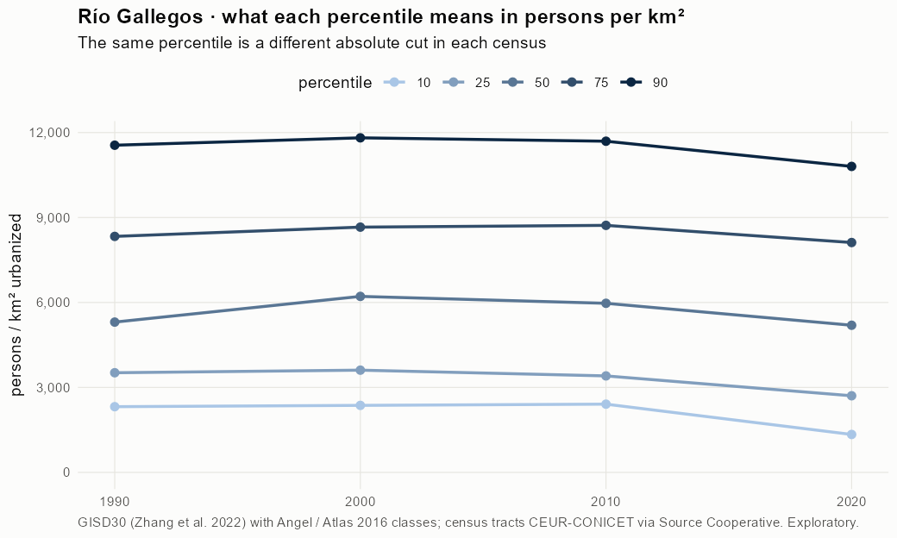
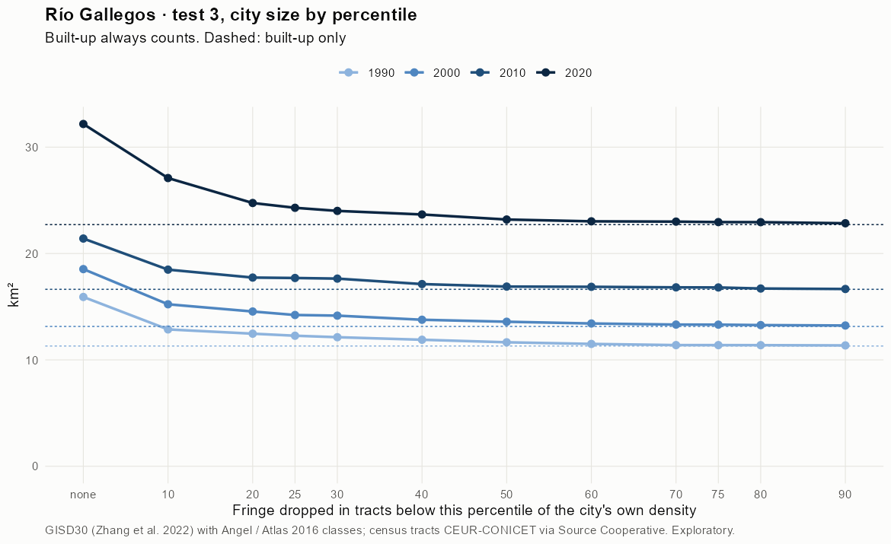
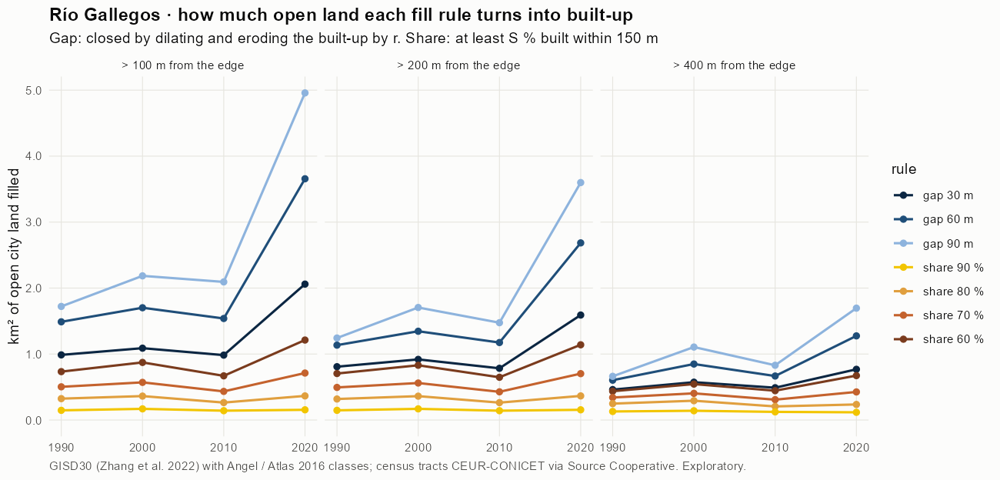
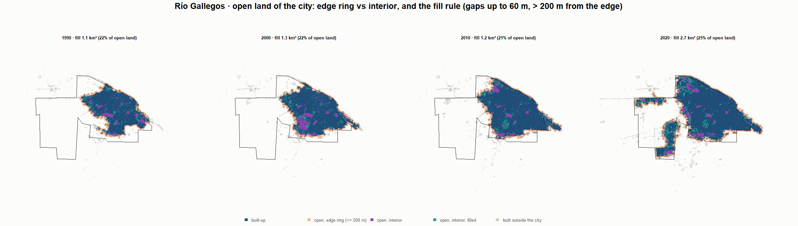
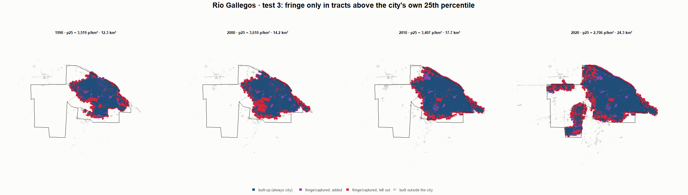

# Río Gallegos · relative cut (test 3) and the fill rule, 1990-2020

Exploratory. None of these numbers are project figures (they are not in `CIFRAS_CANONICAS.json`). Generated by `Rpipe/scripts/16_reglas.R` from step 11. Run of 2026-11-15. [All agglomerations](../REPORTE.md) · [methods](../../METODOS.md).

## The density of the tracts

Tracts with at least 10 % of their area in the city, and the city's own percentiles of their density on urbanized land.

| Year | Tracts | p10 | p25 | p50 | p75 | p90 |
|---|---|---|---|---|---|---|
| 1990 (census 1991) | 53 | 2,320 | 3,519 | 5,307 | 8,333 | 11,554 |
| 2000 (census 2001) | 87 | 2,366 | 3,610 | 6,215 | 8,661 | 11,814 |
| 2010 (census 2010) | 97 | 2,409 | 3,407 | 5,971 | 8,723 | 11,695 |
| 2020 (census 2022) | 144 | 1,339 | 2,706 | 5,195 | 8,117 | 10,805 |

## Test 3 · fringe only above the city's own percentile

Built-up land is always city. Fringe and captured land join only in tracts at or above percentile p of the city's own tract densities, that census.

| Percentile | 1990 cut p/km² | 2000 cut p/km² | 2010 cut p/km² | 2020 cut p/km² | 1990 km² | 2000 km² | 2010 km² | 2020 km² | 1990-2020 %/yr |
|---|---|---|---|---|---|---|---|---|---|
| none (Angel) | 0 | 0 | 0 | 0 | 15.9 | 18.5 | 21.4 | 32.2 | 2.37 |
| p10 | 2,320 | 2,366 | 2,409 | 1,339 | 12.9 | 15.2 | 18.5 | 27.1 | 2.51 |
| p20 | 3,165 | 3,392 | 3,186 | 2,119 | 12.5 | 14.5 | 17.7 | 24.7 | 2.31 |
| p25 | 3,519 | 3,610 | 3,407 | 2,706 | 12.3 | 14.2 | 17.7 | 24.3 | 2.30 |
| p30 | 3,909 | 4,037 | 3,657 | 3,131 | 12.1 | 14.2 | 17.6 | 24.0 | 2.30 |
| p40 | 4,735 | 5,054 | 4,688 | 3,909 | 11.9 | 13.8 | 17.1 | 23.7 | 2.32 |
| p50 | 5,307 | 6,215 | 5,971 | 5,195 | 11.7 | 13.6 | 16.9 | 23.2 | 2.32 |
| p60 | 6,950 | 7,113 | 6,963 | 6,419 | 11.5 | 13.4 | 16.9 | 23.0 | 2.34 |
| p70 | 8,211 | 7,945 | 8,328 | 7,509 | 11.4 | 13.3 | 16.8 | 23.0 | 2.37 |
| p75 | 8,333 | 8,661 | 8,723 | 8,117 | 11.4 | 13.3 | 16.8 | 23.0 | 2.36 |
| p80 | 8,976 | 10,136 | 9,821 | 8,572 | 11.4 | 13.3 | 16.7 | 22.9 | 2.36 |
| p90 | 11,554 | 11,814 | 11,695 | 10,805 | 11.4 | 13.2 | 16.7 | 22.8 | 2.36 |
| built only | — | — | — | — | 11.3 | 13.1 | 16.6 | 22.7 | 2.35 |

## Fill rule · open land in the centre that is probably built

An open pixel of the city (fringe or captured) farther than D from any land outside the city becomes built-up if it is a narrow gap in the built-up: closing the built-up (dilate, then erode) with a square of radius r covers it. Central rule: r = 60 m, D = 200 m; *dense* = tract at or above 500 p/km². The alternative share rule fills a pixel with at least S of the pixels within 150 m built.

| Year | Open city land km² | Interior (> 200 m) km² | Filled km² | Filled in dense tracts km² | Built-up km² | Built-up + fill km² | Persons / km² built | With fill |
|---|---|---|---|---|---|---|---|---|
| 1990 (census 1991) | 5.1 | 2.3 | 1.1 | 1.1 | 11.3 | 12.4 | 5,747 | 5,243 |
| 2000 (census 2001) | 6.1 | 3.1 | 1.3 | 1.1 | 13.1 | 14.3 | 6,071 | 5,587 |
| 2010 (census 2010) | 5.7 | 2.4 | 1.2 | 1.1 | 16.6 | 17.7 | 5,672 | 5,327 |
| 2020 (census 2022) | 10.6 | 4.7 | 2.7 | 2.3 | 22.7 | 25.0 | 5,002 | 4,547 |

**Sensitivity: km² filled by each rule** (in brackets, % of the interior open land):

| Year | Farther than | gap 30 m | gap 60 m | gap 90 m | share 60 % | share 70 % | share 80 % | share 90 % |
|---|---|---|---|---|---|---|---|---|
| 1990 | 100 m | 1.0 (33) | 1.5 (49) | 1.7 (57) | 0.7 (24) | 0.5 (17) | 0.3 (11) | 0.1 (5) |
| 1990 | 200 m | 0.8 (35) | 1.1 (50) | 1.2 (54) | 0.7 (31) | 0.5 (22) | 0.3 (14) | 0.1 (6) |
| 1990 | 400 m | 0.5 (33) | 0.6 (44) | 0.7 (48) | 0.4 (32) | 0.3 (25) | 0.2 (18) | 0.1 (9) |
| 2000 | 100 m | 1.1 (28) | 1.7 (44) | 2.2 (56) | 0.9 (22) | 0.6 (15) | 0.4 (9) | 0.2 (4) |
| 2000 | 200 m | 0.9 (30) | 1.3 (43) | 1.7 (55) | 0.8 (27) | 0.6 (18) | 0.4 (12) | 0.2 (5) |
| 2000 | 400 m | 0.6 (26) | 0.8 (39) | 1.1 (51) | 0.5 (25) | 0.4 (19) | 0.3 (14) | 0.1 (6) |
| 2010 | 100 m | 1.0 (30) | 1.5 (48) | 2.1 (65) | 0.7 (21) | 0.4 (13) | 0.3 (8) | 0.1 (4) |
| 2010 | 200 m | 0.8 (32) | 1.2 (48) | 1.5 (61) | 0.6 (27) | 0.4 (18) | 0.3 (11) | 0.1 (6) |
| 2010 | 400 m | 0.5 (36) | 0.7 (49) | 0.8 (61) | 0.4 (33) | 0.3 (23) | 0.2 (15) | 0.1 (9) |
| 2020 | 100 m | 2.1 (33) | 3.7 (58) | 5.0 (79) | 1.2 (19) | 0.7 (11) | 0.4 (6) | 0.2 (2) |
| 2020 | 200 m | 1.6 (34) | 2.7 (57) | 3.6 (76) | 1.1 (24) | 0.7 (15) | 0.4 (8) | 0.2 (3) |
| 2020 | 400 m | 0.8 (31) | 1.3 (52) | 1.7 (69) | 0.7 (28) | 0.4 (17) | 0.2 (10) | 0.1 (5) |

**Test 3 at p25 plus the central fill, without asking for a dense tract** (the fill keeps interior gaps of sparse tracts that test 3 drops):

| Year | Angel km² | Test 3 p25 km² | Test 3 + fill km² |
|---|---|---|---|
| 1990 | 15.9 | 12.3 | 13.0 |
| 2000 | 18.5 | 14.2 | 15.2 |
| 2010 | 21.4 | 17.7 | 18.4 |
| 2020 | 32.2 | 24.3 | 26.3 |

## Maps

### Edge ring, interior and fill

### Test 3 at p25

