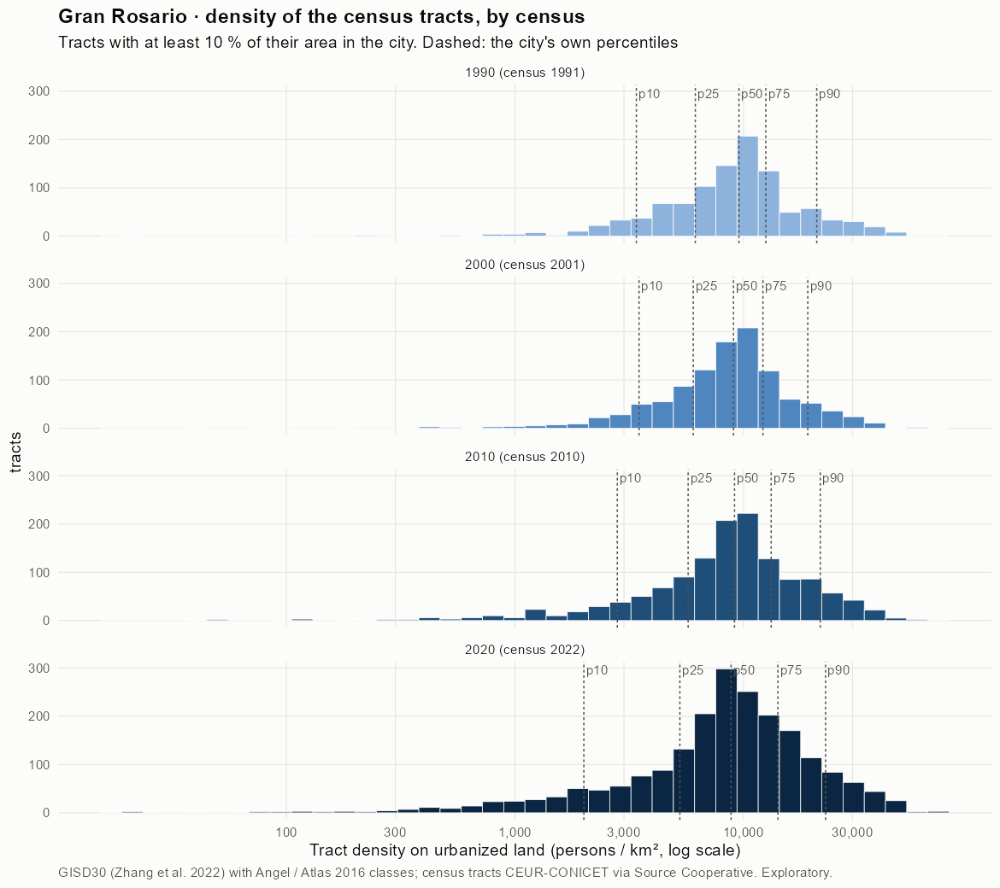
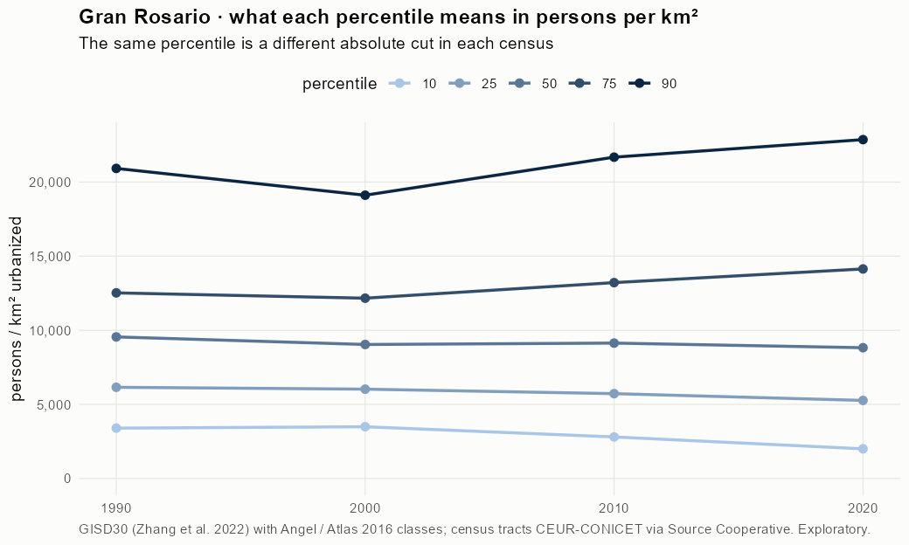
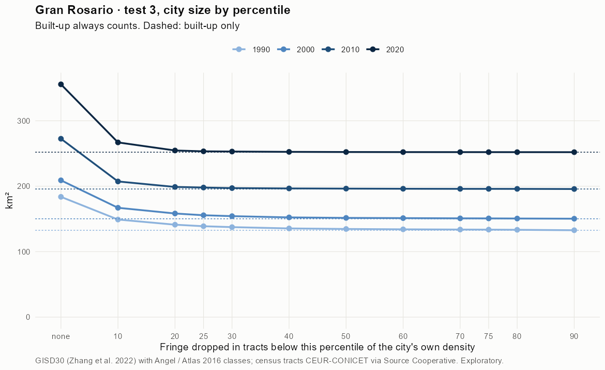
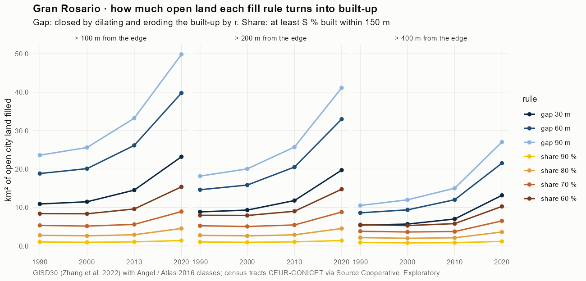
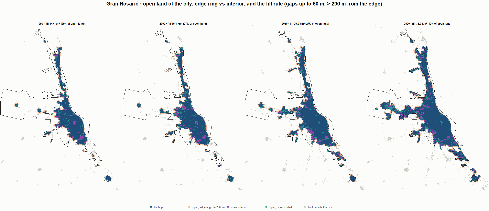
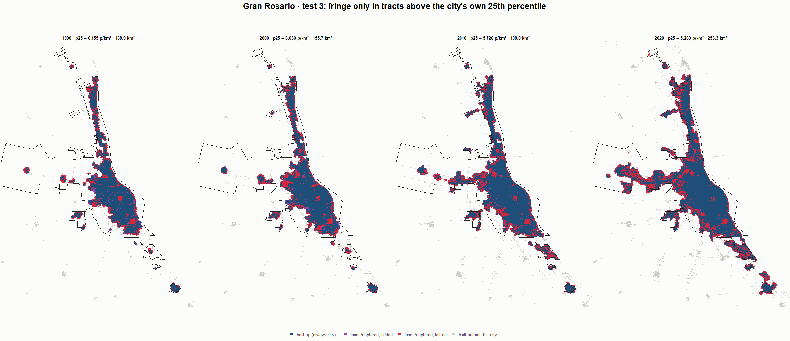

# Gran Rosario · relative cut (test 3) and the fill rule, 1990-2020

Exploratory. None of these numbers are project figures (they are not in `CIFRAS_CANONICAS.json`). Generated by `Rpipe/scripts/16_reglas.R` from step 11. Run of 2026-11-15. [All agglomerations](../REPORTE.md) · [methods](../../METODOS.md).

## The density of the tracts

Tracts with at least 10 % of their area in the city, and the city's own percentiles of their density on urbanized land.

| Year | Tracts | p10 | p25 | p50 | p75 | p90 |
|---|---|---|---|---|---|---|
| 1990 (census 1991) | 1,049 | 3,399 | 6,155 | 9,553 | 12,524 | 20,921 |
| 2000 (census 2001) | 1,097 | 3,493 | 6,030 | 9,042 | 12,166 | 19,112 |
| 2010 (census 2010) | 1,356 | 2,805 | 5,726 | 9,136 | 13,216 | 21,678 |
| 2020 (census 2022) | 2,082 | 2,003 | 5,269 | 8,824 | 14,139 | 22,863 |

## Test 3 · fringe only above the city's own percentile

Built-up land is always city. Fringe and captured land join only in tracts at or above percentile p of the city's own tract densities, that census.

| Percentile | 1990 cut p/km² | 2000 cut p/km² | 2010 cut p/km² | 2020 cut p/km² | 1990 km² | 2000 km² | 2010 km² | 2020 km² | 1990-2020 %/yr |
|---|---|---|---|---|---|---|---|---|---|
| none (Angel) | 0 | 0 | 0 | 0 | 183.8 | 209.0 | 272.6 | 355.7 | 2.23 |
| p10 | 3,399 | 3,493 | 2,805 | 2,003 | 149.1 | 167.1 | 207.3 | 267.0 | 1.96 |
| p20 | 5,241 | 5,211 | 4,838 | 4,137 | 141.2 | 158.4 | 198.9 | 254.6 | 1.98 |
| p25 | 6,155 | 6,030 | 5,726 | 5,269 | 138.9 | 155.7 | 198.0 | 253.3 | 2.02 |
| p30 | 6,939 | 6,733 | 6,531 | 6,124 | 137.5 | 154.3 | 197.2 | 253.0 | 2.05 |
| p40 | 8,212 | 7,968 | 7,991 | 7,614 | 135.5 | 152.4 | 196.6 | 252.5 | 2.10 |
| p50 | 9,553 | 9,042 | 9,136 | 8,824 | 134.7 | 151.6 | 196.4 | 252.3 | 2.11 |
| p60 | 10,611 | 9,967 | 10,214 | 10,421 | 134.2 | 151.3 | 196.1 | 252.2 | 2.13 |
| p70 | 11,913 | 11,254 | 11,782 | 12,573 | 133.8 | 150.9 | 196.0 | 252.1 | 2.13 |
| p75 | 12,524 | 12,166 | 13,216 | 14,139 | 133.7 | 150.8 | 196.0 | 252.1 | 2.14 |
| p80 | 13,878 | 13,268 | 15,333 | 16,139 | 133.4 | 150.7 | 196.0 | 252.1 | 2.14 |
| p90 | 20,921 | 19,112 | 21,678 | 22,863 | 132.8 | 150.4 | 195.8 | 252.0 | 2.16 |
| built only | — | — | — | — | 132.6 | 150.3 | 195.7 | 252.0 | 2.16 |

## Fill rule · open land in the centre that is probably built

An open pixel of the city (fringe or captured) farther than D from any land outside the city becomes built-up if it is a narrow gap in the built-up: closing the built-up (dilate, then erode) with a square of radius r covers it. Central rule: r = 60 m, D = 200 m; *dense* = tract at or above 500 p/km². The alternative share rule fills a pixel with at least S of the pixels within 150 m built.

| Year | Open city land km² | Interior (> 200 m) km² | Filled km² | Filled in dense tracts km² | Built-up km² | Built-up + fill km² | Persons / km² built | With fill |
|---|---|---|---|---|---|---|---|---|
| 1990 (census 1991) | 51.1 | 24.9 | 14.6 | 13.8 | 132.6 | 146.4 | 8,665 | 7,850 |
| 2000 (census 2001) | 58.8 | 30.6 | 15.8 | 14.6 | 150.3 | 164.9 | 7,975 | 7,268 |
| 2010 (census 2010) | 76.8 | 38.7 | 20.5 | 16.0 | 195.7 | 211.7 | 6,574 | 6,077 |
| 2020 (census 2022) | 103.7 | 60.2 | 33.0 | 23.9 | 252.0 | 275.9 | 5,793 | 5,291 |

**Sensitivity: km² filled by each rule** (in brackets, % of the interior open land):

| Year | Farther than | gap 30 m | gap 60 m | gap 90 m | share 60 % | share 70 % | share 80 % | share 90 % |
|---|---|---|---|---|---|---|---|---|
| 1990 | 100 m | 10.9 (34) | 18.8 (59) | 23.6 (74) | 8.4 (26) | 5.3 (17) | 2.8 (9) | 1.0 (3) |
| 1990 | 200 m | 8.9 (36) | 14.6 (59) | 18.2 (73) | 8.0 (32) | 5.2 (21) | 2.7 (11) | 1.0 (4) |
| 1990 | 400 m | 5.4 (35) | 8.6 (55) | 10.5 (68) | 5.5 (35) | 3.8 (24) | 2.2 (14) | 0.9 (6) |
| 2000 | 100 m | 11.5 (30) | 20.1 (53) | 25.6 (68) | 8.4 (22) | 5.2 (14) | 2.6 (7) | 0.9 (2) |
| 2000 | 200 m | 9.3 (30) | 15.8 (52) | 20.0 (65) | 7.9 (26) | 5.1 (17) | 2.6 (9) | 0.9 (3) |
| 2000 | 400 m | 5.7 (27) | 9.4 (45) | 12.0 (58) | 5.3 (26) | 3.6 (18) | 2.0 (10) | 0.8 (4) |
| 2010 | 100 m | 14.5 (30) | 26.2 (54) | 33.2 (69) | 9.6 (20) | 5.6 (12) | 2.9 (6) | 1.0 (2) |
| 2010 | 200 m | 11.8 (31) | 20.5 (53) | 25.7 (67) | 9.0 (23) | 5.4 (14) | 2.9 (7) | 1.0 (3) |
| 2010 | 400 m | 7.0 (28) | 12.0 (49) | 15.0 (61) | 5.8 (23) | 3.7 (15) | 2.1 (9) | 0.8 (3) |
| 2020 | 100 m | 23.2 (33) | 39.8 (56) | 49.8 (70) | 15.4 (22) | 8.9 (13) | 4.5 (6) | 1.4 (2) |
| 2020 | 200 m | 19.7 (33) | 33.0 (55) | 41.1 (68) | 14.7 (25) | 8.8 (15) | 4.5 (8) | 1.4 (2) |
| 2020 | 400 m | 13.2 (31) | 21.5 (51) | 27.0 (64) | 10.3 (24) | 6.5 (15) | 3.6 (9) | 1.2 (3) |

**Test 3 at p25 plus the central fill, without asking for a dense tract** (the fill keeps interior gaps of sparse tracts that test 3 drops):

| Year | Angel km² | Test 3 p25 km² | Test 3 + fill km² |
|---|---|---|---|
| 1990 | 183.8 | 138.9 | 150.3 |
| 2000 | 209.0 | 155.7 | 168.9 |
| 2010 | 272.6 | 198.0 | 217.2 |
| 2020 | 355.7 | 253.3 | 285.4 |

## Maps

### Edge ring, interior and fill

### Test 3 at p25

