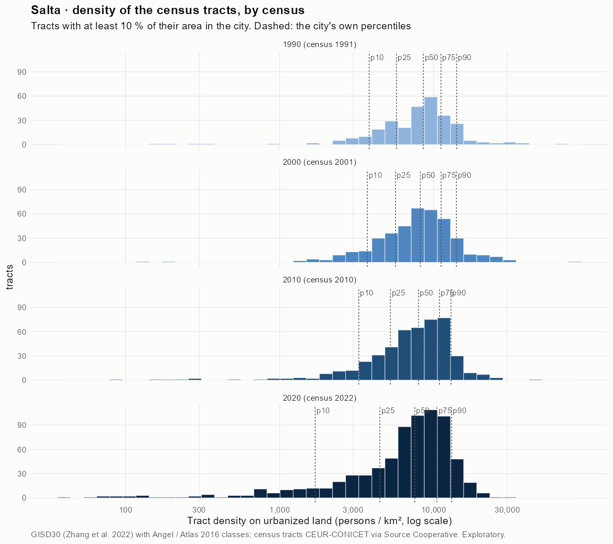
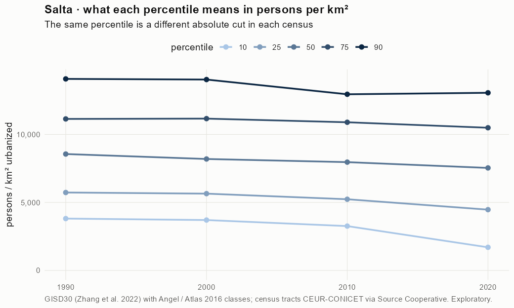
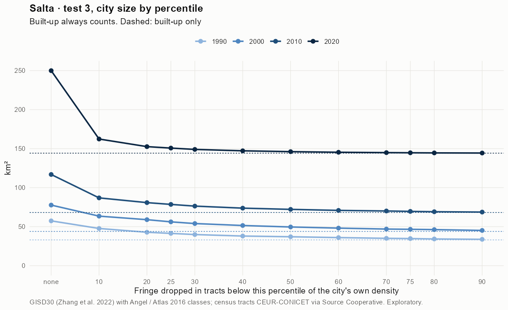
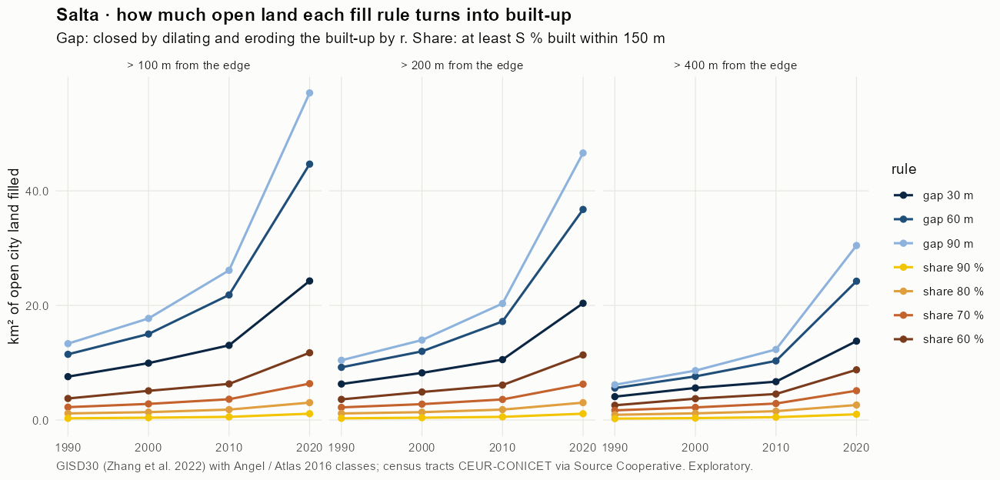
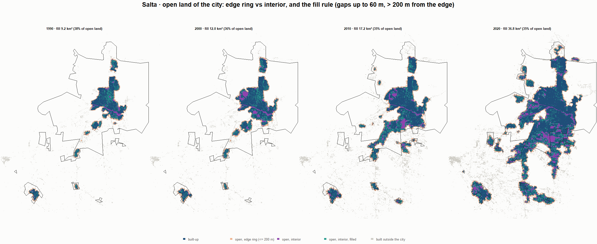
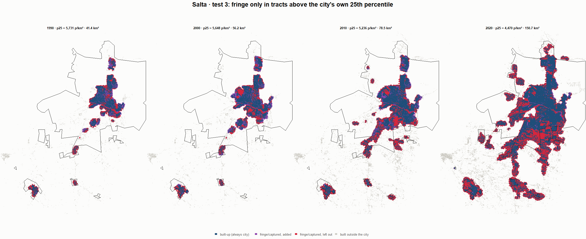

# Salta · relative cut (test 3) and the fill rule, 1990-2020

Exploratory. None of these numbers are project figures (they are not in `CIFRAS_CANONICAS.json`). Generated by `Rpipe/scripts/16_reglas.R` from step 11. Run of 2026-11-15. [All agglomerations](../REPORTE.md) · [methods](../../METODOS.md).

## The density of the tracts

Tracts with at least 10 % of their area in the city, and the city's own percentiles of their density on urbanized land.

| Year | Tracts | p10 | p25 | p50 | p75 | p90 |
|---|---|---|---|---|---|---|
| 1990 (census 1991) | 283 | 3,813 | 5,731 | 8,561 | 11,143 | 14,087 |
| 2000 (census 2001) | 404 | 3,705 | 5,648 | 8,197 | 11,166 | 14,040 |
| 2010 (census 2010) | 472 | 3,261 | 5,236 | 7,966 | 10,898 | 12,957 |
| 2020 (census 2022) | 726 | 1,701 | 4,470 | 7,540 | 10,494 | 13,066 |

## Test 3 · fringe only above the city's own percentile

Built-up land is always city. Fringe and captured land join only in tracts at or above percentile p of the city's own tract densities, that census.

| Percentile | 1990 cut p/km² | 2000 cut p/km² | 2010 cut p/km² | 2020 cut p/km² | 1990 km² | 2000 km² | 2010 km² | 2020 km² | 1990-2020 %/yr |
|---|---|---|---|---|---|---|---|---|---|
| none (Angel) | 0 | 0 | 0 | 0 | 57.5 | 77.7 | 116.9 | 249.9 | 5.02 |
| p10 | 3,813 | 3,705 | 3,261 | 1,701 | 47.7 | 63.5 | 86.9 | 162.3 | 4.17 |
| p20 | 5,316 | 4,854 | 4,562 | 3,428 | 42.9 | 59.0 | 80.8 | 152.6 | 4.32 |
| p25 | 5,731 | 5,648 | 5,236 | 4,470 | 41.4 | 56.2 | 78.5 | 150.7 | 4.40 |
| p30 | 6,392 | 6,172 | 5,859 | 5,218 | 39.9 | 54.0 | 76.4 | 149.0 | 4.49 |
| p40 | 7,786 | 7,201 | 6,715 | 6,460 | 38.0 | 51.5 | 73.8 | 147.2 | 4.62 |
| p50 | 8,561 | 8,197 | 7,966 | 7,540 | 37.1 | 49.6 | 72.2 | 146.1 | 4.68 |
| p60 | 9,265 | 9,158 | 9,021 | 8,527 | 36.0 | 48.2 | 70.9 | 145.4 | 4.76 |
| p70 | 10,234 | 10,266 | 10,109 | 9,989 | 35.1 | 47.0 | 70.1 | 144.9 | 4.84 |
| p75 | 11,143 | 11,166 | 10,898 | 10,494 | 34.8 | 46.6 | 69.6 | 144.7 | 4.87 |
| p80 | 12,053 | 11,777 | 11,295 | 11,258 | 34.3 | 46.2 | 69.2 | 144.5 | 4.91 |
| p90 | 14,087 | 14,040 | 12,957 | 13,066 | 33.8 | 45.2 | 68.7 | 144.4 | 4.96 |
| built only | — | — | — | — | 33.0 | 44.0 | 68.1 | 144.2 | 5.03 |

## Fill rule · open land in the centre that is probably built

An open pixel of the city (fringe or captured) farther than D from any land outside the city becomes built-up if it is a narrow gap in the built-up: closing the built-up (dilate, then erode) with a square of radius r covers it. Central rule: r = 60 m, D = 200 m; *dense* = tract at or above 500 p/km². The alternative share rule fills a pixel with at least S of the pixels within 150 m built.

| Year | Open city land km² | Interior (> 200 m) km² | Filled km² | Filled in dense tracts km² | Built-up km² | Built-up + fill km² | Persons / km² built | With fill |
|---|---|---|---|---|---|---|---|---|
| 1990 (census 1991) | 24.4 | 12.5 | 9.2 | 9.0 | 33.0 | 42.1 | 11,653 | 9,152 |
| 2000 (census 2001) | 33.7 | 19.1 | 12.0 | 11.7 | 44.0 | 55.6 | 11,430 | 9,030 |
| 2010 (census 2010) | 48.8 | 26.9 | 17.2 | 13.8 | 68.1 | 81.9 | 8,574 | 7,129 |
| 2020 (census 2022) | 105.7 | 65.6 | 36.8 | 14.2 | 144.2 | 158.4 | 4,982 | 4,534 |

**Sensitivity: km² filled by each rule** (in brackets, % of the interior open land):

| Year | Farther than | gap 30 m | gap 60 m | gap 90 m | share 60 % | share 70 % | share 80 % | share 90 % |
|---|---|---|---|---|---|---|---|---|
| 1990 | 100 m | 7.6 (48) | 11.5 (72) | 13.3 (84) | 3.8 (24) | 2.2 (14) | 1.2 (7) | 0.3 (2) |
| 1990 | 200 m | 6.3 (50) | 9.2 (74) | 10.4 (83) | 3.6 (29) | 2.2 (18) | 1.1 (9) | 0.3 (2) |
| 1990 | 400 m | 4.1 (53) | 5.6 (73) | 6.2 (80) | 2.6 (34) | 1.7 (22) | 0.9 (12) | 0.2 (3) |
| 2000 | 100 m | 9.9 (42) | 15.0 (64) | 17.7 (75) | 5.1 (22) | 2.8 (12) | 1.4 (6) | 0.4 (2) |
| 2000 | 200 m | 8.2 (43) | 12.0 (63) | 14.0 (73) | 4.9 (26) | 2.8 (14) | 1.4 (7) | 0.4 (2) |
| 2000 | 400 m | 5.6 (44) | 7.6 (60) | 8.6 (68) | 3.7 (29) | 2.2 (17) | 1.2 (9) | 0.3 (3) |
| 2010 | 100 m | 13.0 (39) | 21.8 (65) | 26.1 (78) | 6.3 (19) | 3.6 (11) | 1.8 (5) | 0.6 (2) |
| 2010 | 200 m | 10.5 (39) | 17.2 (64) | 20.3 (76) | 6.1 (23) | 3.6 (13) | 1.8 (7) | 0.6 (2) |
| 2010 | 400 m | 6.7 (39) | 10.3 (61) | 12.3 (72) | 4.5 (27) | 2.9 (17) | 1.5 (9) | 0.5 (3) |
| 2020 | 100 m | 24.3 (31) | 44.7 (57) | 57.1 (73) | 11.7 (15) | 6.3 (8) | 3.0 (4) | 1.1 (1) |
| 2020 | 200 m | 20.4 (31) | 36.8 (56) | 46.6 (71) | 11.4 (17) | 6.3 (10) | 3.0 (5) | 1.1 (2) |
| 2020 | 400 m | 13.8 (30) | 24.2 (54) | 30.5 (67) | 8.8 (19) | 5.1 (11) | 2.6 (6) | 1.0 (2) |

**Test 3 at p25 plus the central fill, without asking for a dense tract** (the fill keeps interior gaps of sparse tracts that test 3 drops):

| Year | Angel km² | Test 3 p25 km² | Test 3 + fill km² |
|---|---|---|---|
| 1990 | 57.5 | 41.4 | 45.9 |
| 2000 | 77.7 | 56.2 | 62.3 |
| 2010 | 116.9 | 78.5 | 90.3 |
| 2020 | 249.9 | 150.7 | 184.3 |

## Maps

### Edge ring, interior and fill

### Test 3 at p25

