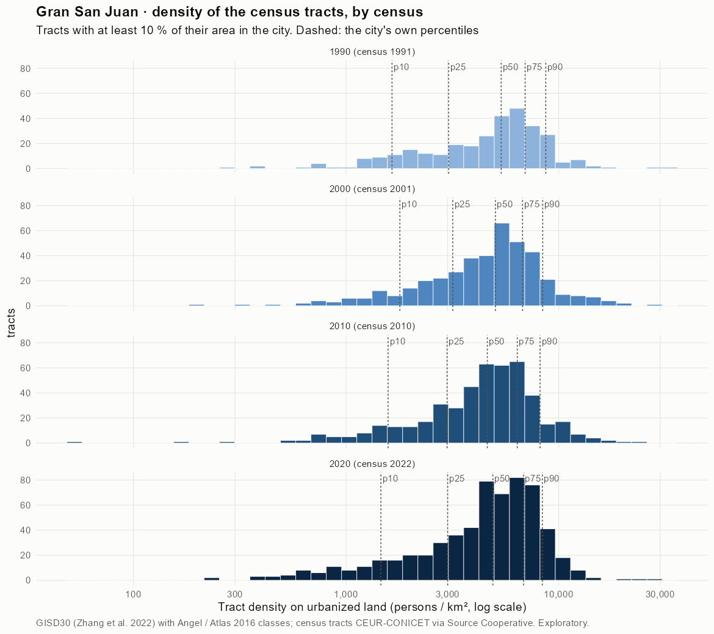
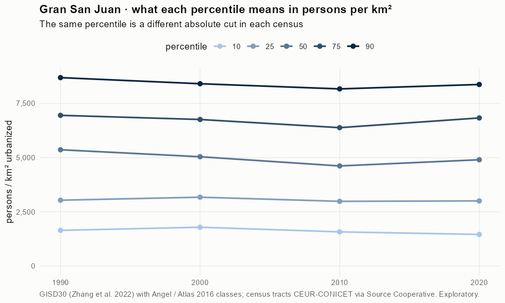
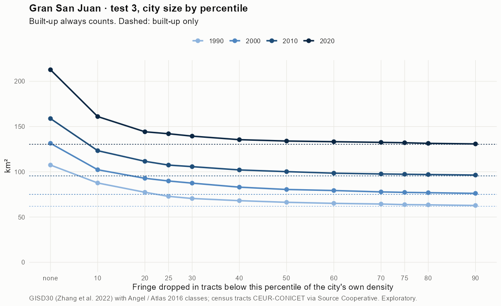
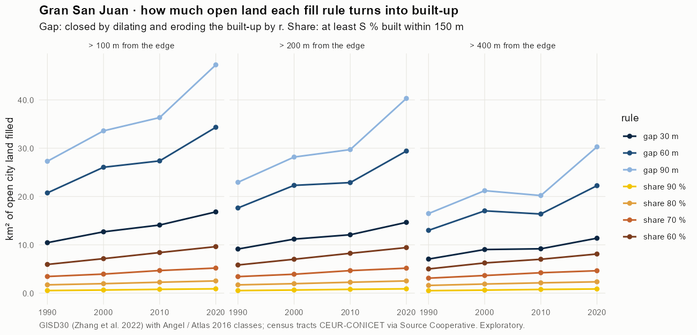
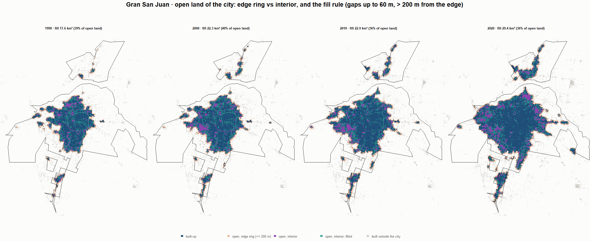
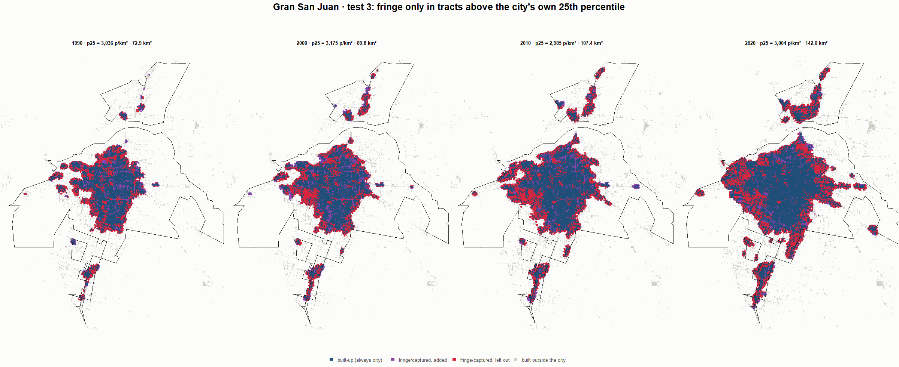

# Gran San Juan · relative cut (test 3) and the fill rule, 1990-2020

Exploratory. None of these numbers are project figures (they are not in `CIFRAS_CANONICAS.json`). Generated by `Rpipe/scripts/16_reglas.R` from step 11. Run of 2026-11-15. [All agglomerations](../REPORTE.md) · [methods](../../METODOS.md).

## The density of the tracts

Tracts with at least 10 % of their area in the city, and the city's own percentiles of their density on urbanized land.

| Year | Tracts | p10 | p25 | p50 | p75 | p90 |
|---|---|---|---|---|---|---|
| 1990 (census 1991) | 307 | 1,644 | 3,036 | 5,364 | 6,950 | 8,690 |
| 2000 (census 2001) | 417 | 1,791 | 3,175 | 5,041 | 6,759 | 8,408 |
| 2010 (census 2010) | 468 | 1,576 | 2,985 | 4,617 | 6,383 | 8,170 |
| 2020 (census 2022) | 614 | 1,458 | 3,004 | 4,902 | 6,830 | 8,374 |

## Test 3 · fringe only above the city's own percentile

Built-up land is always city. Fringe and captured land join only in tracts at or above percentile p of the city's own tract densities, that census.

| Percentile | 1990 cut p/km² | 2000 cut p/km² | 2010 cut p/km² | 2020 cut p/km² | 1990 km² | 2000 km² | 2010 km² | 2020 km² | 1990-2020 %/yr |
|---|---|---|---|---|---|---|---|---|---|
| none (Angel) | 0 | 0 | 0 | 0 | 107.5 | 131.5 | 158.8 | 212.8 | 2.30 |
| p10 | 1,644 | 1,791 | 1,576 | 1,458 | 87.6 | 102.3 | 123.3 | 161.0 | 2.05 |
| p20 | 2,455 | 2,623 | 2,649 | 2,492 | 77.3 | 92.8 | 111.6 | 144.2 | 2.10 |
| p25 | 3,036 | 3,175 | 2,985 | 3,004 | 72.9 | 89.8 | 107.4 | 142.0 | 2.25 |
| p30 | 3,407 | 3,538 | 3,409 | 3,427 | 70.5 | 87.5 | 105.7 | 139.4 | 2.30 |
| p40 | 4,531 | 4,264 | 4,148 | 4,295 | 68.1 | 83.0 | 102.0 | 135.5 | 2.32 |
| p50 | 5,364 | 5,041 | 4,617 | 4,902 | 66.3 | 80.5 | 100.2 | 134.0 | 2.37 |
| p60 | 5,927 | 5,651 | 5,399 | 5,650 | 65.1 | 79.3 | 98.5 | 133.2 | 2.42 |
| p70 | 6,550 | 6,280 | 6,020 | 6,457 | 64.4 | 77.8 | 97.6 | 132.5 | 2.44 |
| p75 | 6,950 | 6,759 | 6,383 | 6,830 | 63.7 | 77.3 | 97.3 | 132.1 | 2.46 |
| p80 | 7,327 | 7,285 | 6,771 | 7,159 | 63.5 | 76.9 | 97.0 | 131.4 | 2.46 |
| p90 | 8,690 | 8,408 | 8,170 | 8,374 | 62.8 | 76.2 | 96.4 | 130.8 | 2.48 |
| built only | — | — | — | — | 61.8 | 75.0 | 95.5 | 130.4 | 2.52 |

## Fill rule · open land in the centre that is probably built

An open pixel of the city (fringe or captured) farther than D from any land outside the city becomes built-up if it is a narrow gap in the built-up: closing the built-up (dilate, then erode) with a square of radius r covers it. Central rule: r = 60 m, D = 200 m; *dense* = tract at or above 500 p/km². The alternative share rule fills a pixel with at least S of the pixels within 150 m built.

| Year | Open city land km² | Interior (> 200 m) km² | Filled km² | Filled in dense tracts km² | Built-up km² | Built-up + fill km² | Persons / km² built | With fill |
|---|---|---|---|---|---|---|---|---|
| 1990 (census 1991) | 45.6 | 28.3 | 17.6 | 16.8 | 61.8 | 78.7 | 6,268 | 4,927 |
| 2000 (census 2001) | 56.5 | 36.2 | 22.3 | 21.1 | 75.0 | 96.1 | 6,175 | 4,817 |
| 2010 (census 2010) | 63.3 | 38.5 | 22.9 | 21.9 | 95.5 | 117.4 | 5,307 | 4,316 |
| 2020 (census 2022) | 82.4 | 55.3 | 29.4 | 25.5 | 130.4 | 155.8 | 4,728 | 3,955 |

**Sensitivity: km² filled by each rule** (in brackets, % of the interior open land):

| Year | Farther than | gap 30 m | gap 60 m | gap 90 m | share 60 % | share 70 % | share 80 % | share 90 % |
|---|---|---|---|---|---|---|---|---|
| 1990 | 100 m | 10.4 (31) | 20.7 (62) | 27.3 (82) | 5.9 (18) | 3.4 (10) | 1.7 (5) | 0.5 (2) |
| 1990 | 200 m | 9.1 (32) | 17.6 (62) | 22.9 (81) | 5.8 (21) | 3.4 (12) | 1.7 (6) | 0.5 (2) |
| 1990 | 400 m | 7.1 (34) | 13.0 (63) | 16.5 (80) | 5.0 (24) | 3.1 (15) | 1.6 (8) | 0.5 (2) |
| 2000 | 100 m | 12.7 (30) | 26.1 (61) | 33.6 (78) | 7.1 (17) | 3.9 (9) | 2.0 (5) | 0.6 (2) |
| 2000 | 200 m | 11.2 (31) | 22.3 (62) | 28.2 (78) | 7.0 (19) | 3.9 (11) | 2.0 (5) | 0.6 (2) |
| 2000 | 400 m | 9.0 (33) | 17.0 (62) | 21.2 (77) | 6.2 (23) | 3.6 (13) | 1.9 (7) | 0.6 (2) |
| 2010 | 100 m | 14.1 (30) | 27.4 (59) | 36.3 (78) | 8.4 (18) | 4.7 (10) | 2.3 (5) | 0.8 (2) |
| 2010 | 200 m | 12.1 (31) | 22.9 (59) | 29.7 (77) | 8.2 (21) | 4.7 (12) | 2.3 (6) | 0.8 (2) |
| 2010 | 400 m | 9.2 (35) | 16.4 (62) | 20.2 (76) | 7.0 (26) | 4.2 (16) | 2.1 (8) | 0.8 (3) |
| 2020 | 100 m | 16.8 (26) | 34.3 (54) | 47.3 (74) | 9.6 (15) | 5.2 (8) | 2.5 (4) | 0.9 (1) |
| 2020 | 200 m | 14.7 (27) | 29.4 (53) | 40.3 (73) | 9.4 (17) | 5.2 (9) | 2.5 (5) | 0.9 (2) |
| 2020 | 400 m | 11.4 (27) | 22.2 (53) | 30.3 (71) | 8.1 (19) | 4.6 (11) | 2.3 (6) | 0.9 (2) |

**Test 3 at p25 plus the central fill, without asking for a dense tract** (the fill keeps interior gaps of sparse tracts that test 3 drops):

| Year | Angel km² | Test 3 p25 km² | Test 3 + fill km² |
|---|---|---|---|
| 1990 | 107.5 | 72.9 | 83.8 |
| 2000 | 131.5 | 89.8 | 103.8 |
| 2010 | 158.8 | 107.4 | 122.9 |
| 2020 | 212.8 | 142.0 | 164.9 |

## Maps

### Edge ring, interior and fill

### Test 3 at p25

