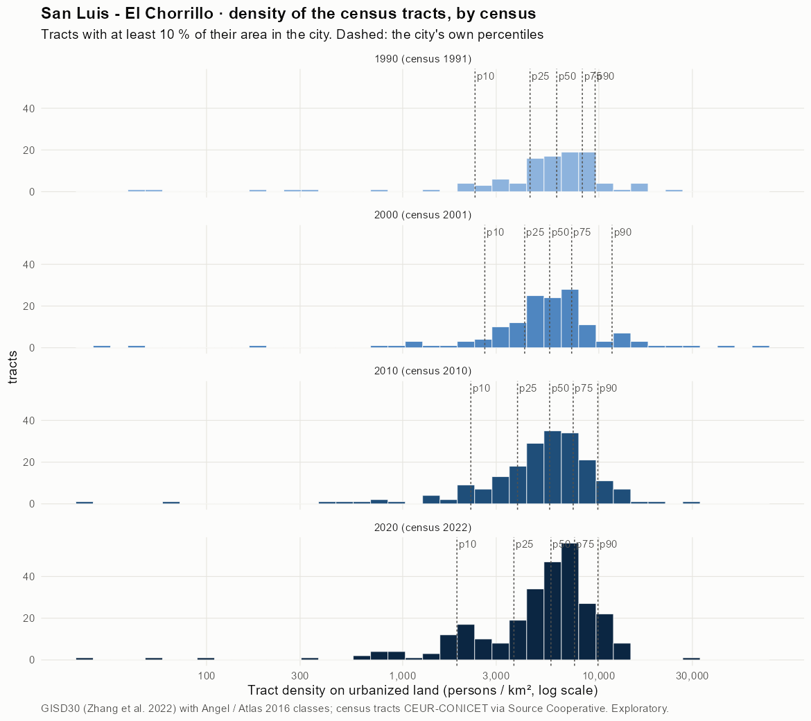
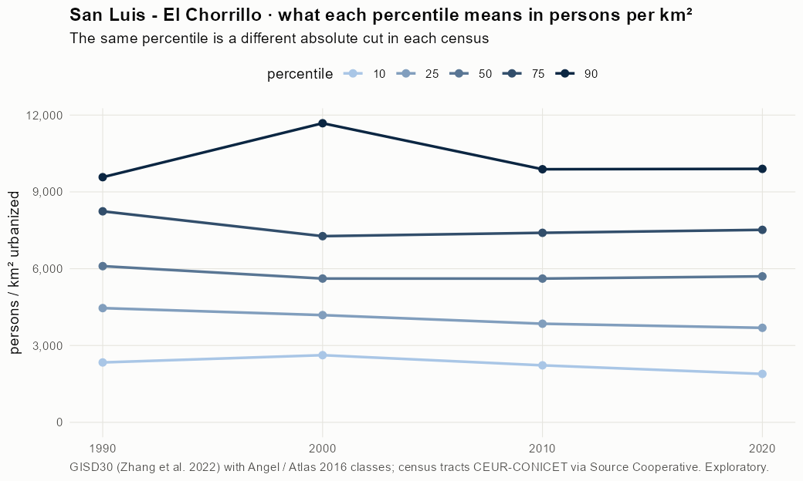
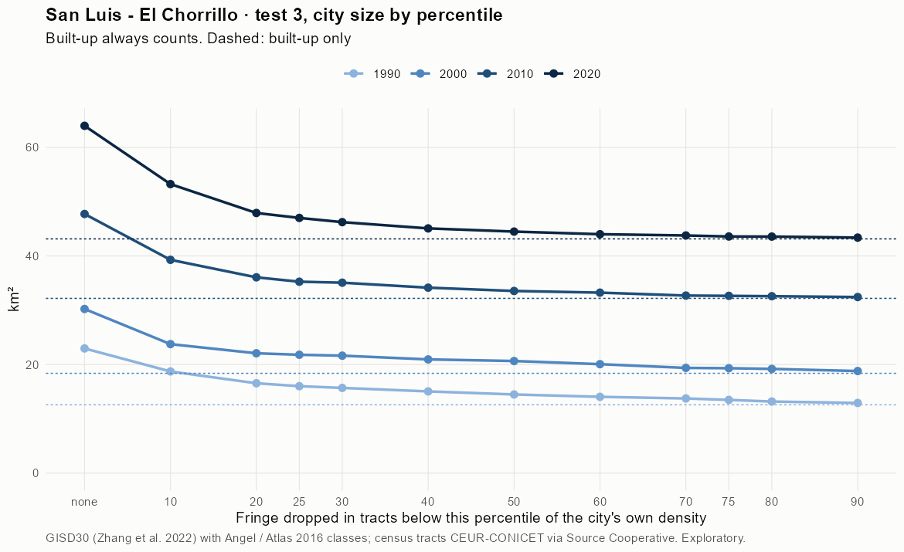
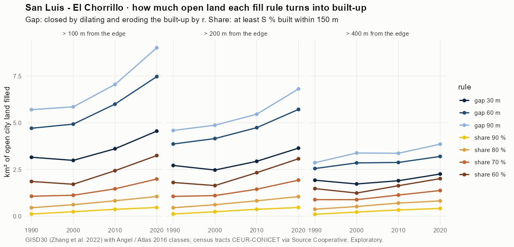
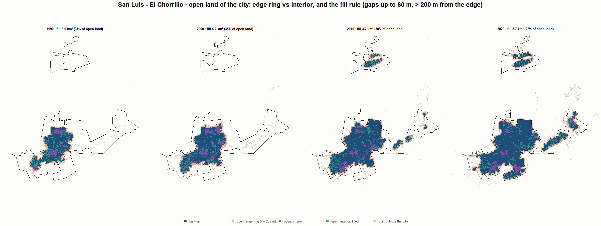
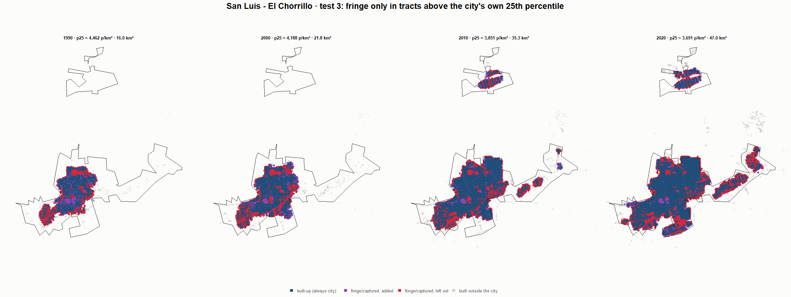

# San Luis - El Chorrillo · relative cut (test 3) and the fill rule, 1990-2020

Exploratory. None of these numbers are project figures (they are not in `CIFRAS_CANONICAS.json`). Generated by `Rpipe/scripts/16_reglas.R` from step 11. Run of 2026-11-15. [All agglomerations](../REPORTE.md) · [methods](../../METODOS.md).

## The density of the tracts

Tracts with at least 10 % of their area in the city, and the city's own percentiles of their density on urbanized land.

| Year | Tracts | p10 | p25 | p50 | p75 | p90 |
|---|---|---|---|---|---|---|
| 1990 (census 1991) | 105 | 2,339 | 4,462 | 6,101 | 8,242 | 9,575 |
| 2000 (census 2001) | 145 | 2,623 | 4,188 | 5,615 | 7,272 | 11,682 |
| 2010 (census 2010) | 202 | 2,226 | 3,851 | 5,614 | 7,402 | 9,885 |
| 2020 (census 2022) | 279 | 1,891 | 3,691 | 5,702 | 7,518 | 9,900 |

## Test 3 · fringe only above the city's own percentile

Built-up land is always city. Fringe and captured land join only in tracts at or above percentile p of the city's own tract densities, that census.

| Percentile | 1990 cut p/km² | 2000 cut p/km² | 2010 cut p/km² | 2020 cut p/km² | 1990 km² | 2000 km² | 2010 km² | 2020 km² | 1990-2020 %/yr |
|---|---|---|---|---|---|---|---|---|---|
| none (Angel) | 0 | 0 | 0 | 0 | 23.0 | 30.2 | 47.7 | 64.0 | 3.47 |
| p10 | 2,339 | 2,623 | 2,226 | 1,891 | 18.7 | 23.8 | 39.3 | 53.2 | 3.54 |
| p20 | 3,871 | 3,635 | 3,457 | 2,815 | 16.6 | 22.1 | 36.1 | 47.9 | 3.61 |
| p25 | 4,462 | 4,188 | 3,851 | 3,691 | 16.0 | 21.8 | 35.3 | 47.0 | 3.65 |
| p30 | 4,705 | 4,422 | 4,248 | 4,289 | 15.7 | 21.6 | 35.1 | 46.2 | 3.67 |
| p40 | 5,364 | 5,050 | 4,994 | 5,107 | 15.1 | 20.9 | 34.2 | 45.1 | 3.72 |
| p50 | 6,101 | 5,615 | 5,614 | 5,702 | 14.5 | 20.6 | 33.5 | 44.5 | 3.81 |
| p60 | 6,841 | 6,247 | 6,247 | 6,556 | 14.1 | 20.1 | 33.2 | 44.0 | 3.88 |
| p70 | 7,736 | 6,989 | 7,041 | 7,153 | 13.8 | 19.4 | 32.7 | 43.8 | 3.93 |
| p75 | 8,242 | 7,272 | 7,402 | 7,518 | 13.5 | 19.3 | 32.7 | 43.6 | 3.99 |
| p80 | 8,485 | 7,895 | 8,074 | 7,998 | 13.2 | 19.2 | 32.6 | 43.6 | 4.06 |
| p90 | 9,575 | 11,682 | 9,885 | 9,900 | 12.9 | 18.8 | 32.4 | 43.4 | 4.12 |
| built only | — | — | — | — | 12.6 | 18.4 | 32.2 | 43.1 | 4.19 |

## Fill rule · open land in the centre that is probably built

An open pixel of the city (fringe or captured) farther than D from any land outside the city becomes built-up if it is a narrow gap in the built-up: closing the built-up (dilate, then erode) with a square of radius r covers it. Central rule: r = 60 m, D = 200 m; *dense* = tract at or above 500 p/km². The alternative share rule fills a pixel with at least S of the pixels within 150 m built.

| Year | Open city land km² | Interior (> 200 m) km² | Filled km² | Filled in dense tracts km² | Built-up km² | Built-up + fill km² | Persons / km² built | With fill |
|---|---|---|---|---|---|---|---|---|
| 1990 (census 1991) | 10.4 | 6.2 | 3.9 | 3.1 | 12.6 | 15.7 | 8,673 | 6,971 |
| 2000 (census 2001) | 11.9 | 7.5 | 4.2 | 3.8 | 18.4 | 22.2 | 7,398 | 6,121 |
| 2010 (census 2010) | 15.5 | 8.0 | 4.7 | 4.4 | 32.2 | 36.6 | 6,009 | 5,289 |
| 2020 (census 2022) | 20.8 | 9.8 | 5.7 | 5.1 | 43.1 | 48.3 | 5,573 | 4,980 |

**Sensitivity: km² filled by each rule** (in brackets, % of the interior open land):

| Year | Farther than | gap 30 m | gap 60 m | gap 90 m | share 60 % | share 70 % | share 80 % | share 90 % |
|---|---|---|---|---|---|---|---|---|
| 1990 | 100 m | 3.2 (42) | 4.7 (63) | 5.7 (76) | 1.9 (25) | 1.1 (14) | 0.4 (6) | 0.1 (2) |
| 1990 | 200 m | 2.7 (44) | 3.9 (62) | 4.6 (74) | 1.8 (29) | 1.1 (17) | 0.4 (7) | 0.1 (2) |
| 1990 | 400 m | 1.9 (45) | 2.5 (60) | 2.9 (67) | 1.5 (35) | 0.9 (21) | 0.4 (9) | 0.1 (2) |
| 2000 | 100 m | 3.0 (34) | 4.9 (56) | 5.8 (67) | 1.7 (19) | 1.1 (13) | 0.6 (7) | 0.2 (3) |
| 2000 | 200 m | 2.5 (33) | 4.2 (55) | 4.9 (65) | 1.6 (22) | 1.1 (15) | 0.6 (8) | 0.2 (3) |
| 2000 | 400 m | 1.7 (32) | 2.8 (52) | 3.4 (62) | 1.2 (23) | 0.9 (16) | 0.5 (9) | 0.2 (4) |
| 2010 | 100 m | 3.6 (37) | 6.0 (61) | 7.0 (72) | 2.4 (25) | 1.5 (15) | 0.8 (8) | 0.4 (4) |
| 2010 | 200 m | 2.9 (37) | 4.7 (59) | 5.5 (68) | 2.3 (29) | 1.4 (18) | 0.8 (10) | 0.4 (5) |
| 2010 | 400 m | 1.9 (34) | 2.9 (52) | 3.4 (61) | 1.6 (30) | 1.1 (21) | 0.7 (13) | 0.3 (6) |
| 2020 | 100 m | 4.6 (36) | 7.5 (59) | 9.0 (72) | 3.2 (26) | 2.0 (16) | 1.1 (8) | 0.5 (4) |
| 2020 | 200 m | 3.6 (37) | 5.7 (59) | 6.8 (70) | 3.1 (31) | 1.9 (20) | 1.0 (11) | 0.5 (5) |
| 2020 | 400 m | 2.3 (38) | 3.2 (53) | 3.9 (64) | 2.0 (33) | 1.4 (23) | 0.8 (14) | 0.4 (7) |

**Test 3 at p25 plus the central fill, without asking for a dense tract** (the fill keeps interior gaps of sparse tracts that test 3 drops):

| Year | Angel km² | Test 3 p25 km² | Test 3 + fill km² |
|---|---|---|---|
| 1990 | 23.0 | 16.0 | 17.9 |
| 2000 | 30.2 | 21.8 | 24.5 |
| 2010 | 47.7 | 35.3 | 38.8 |
| 2020 | 64.0 | 47.0 | 51.4 |

## Maps

### Edge ring, interior and fill

### Test 3 at p25

