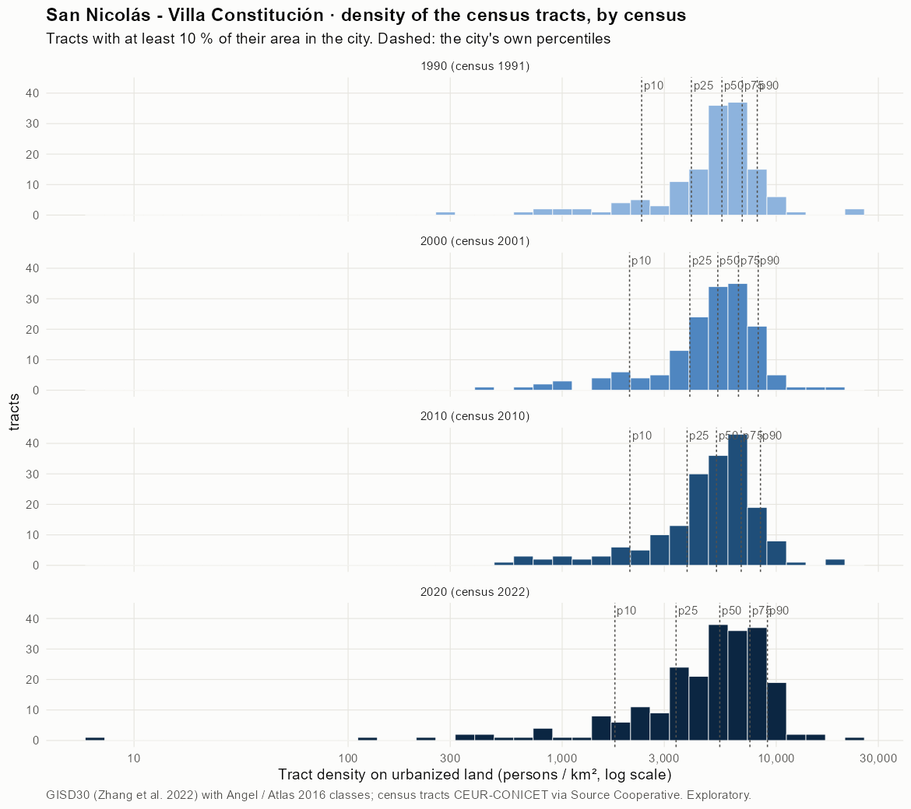
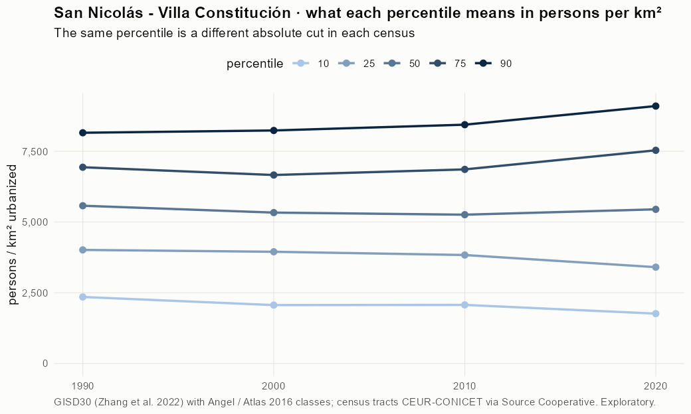
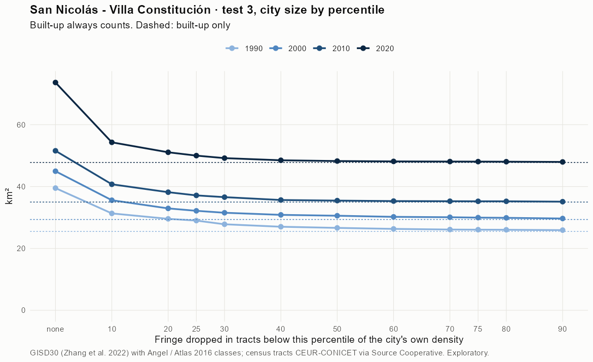
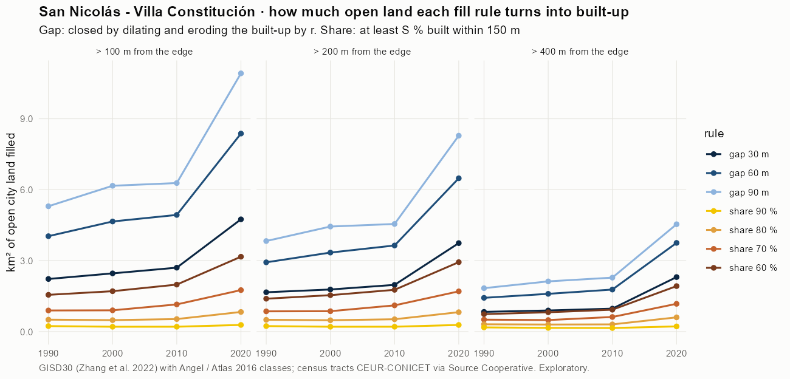
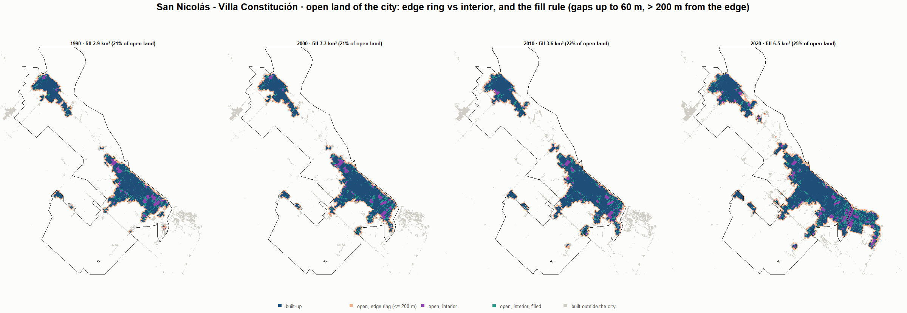
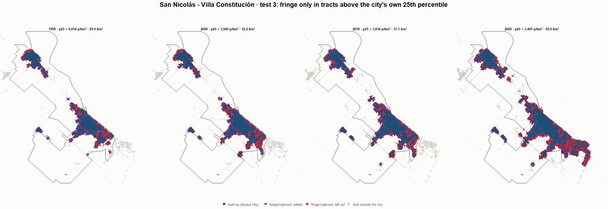

# San Nicolás - Villa Constitución · relative cut (test 3) and the fill rule, 1990-2020

Exploratory. None of these numbers are project figures (they are not in `CIFRAS_CANONICAS.json`). Generated by `Rpipe/scripts/16_reglas.R` from step 11. Run of 2026-11-15. [All agglomerations](../REPORTE.md) · [methods](../../METODOS.md).

## The density of the tracts

Tracts with at least 10 % of their area in the city, and the city's own percentiles of their density on urbanized land.

| Year | Tracts | p10 | p25 | p50 | p75 | p90 |
|---|---|---|---|---|---|---|
| 1990 (census 1991) | 144 | 2,351 | 4,014 | 5,576 | 6,936 | 8,155 |
| 2000 (census 2001) | 161 | 2,065 | 3,949 | 5,333 | 6,662 | 8,236 |
| 2010 (census 2010) | 187 | 2,071 | 3,834 | 5,259 | 6,860 | 8,440 |
| 2020 (census 2022) | 229 | 1,763 | 3,405 | 5,449 | 7,535 | 9,099 |

## Test 3 · fringe only above the city's own percentile

Built-up land is always city. Fringe and captured land join only in tracts at or above percentile p of the city's own tract densities, that census.

| Percentile | 1990 cut p/km² | 2000 cut p/km² | 2010 cut p/km² | 2020 cut p/km² | 1990 km² | 2000 km² | 2010 km² | 2020 km² | 1990-2020 %/yr |
|---|---|---|---|---|---|---|---|---|---|
| none (Angel) | 0 | 0 | 0 | 0 | 39.5 | 45.0 | 51.6 | 73.6 | 2.10 |
| p10 | 2,351 | 2,065 | 2,071 | 1,763 | 31.3 | 35.6 | 40.7 | 54.3 | 1.85 |
| p20 | 3,752 | 3,606 | 3,317 | 2,997 | 29.6 | 32.9 | 38.2 | 51.1 | 1.84 |
| p25 | 4,014 | 3,949 | 3,834 | 3,405 | 29.0 | 32.2 | 37.1 | 50.0 | 1.83 |
| p30 | 4,482 | 4,339 | 4,160 | 3,682 | 27.8 | 31.5 | 36.6 | 49.2 | 1.92 |
| p40 | 5,149 | 4,924 | 4,713 | 4,681 | 27.0 | 30.9 | 35.7 | 48.5 | 1.97 |
| p50 | 5,576 | 5,333 | 5,259 | 5,449 | 26.6 | 30.6 | 35.5 | 48.3 | 2.00 |
| p60 | 6,247 | 5,876 | 5,901 | 6,160 | 26.3 | 30.2 | 35.3 | 48.1 | 2.03 |
| p70 | 6,610 | 6,482 | 6,582 | 6,809 | 26.1 | 30.1 | 35.3 | 48.1 | 2.06 |
| p75 | 6,936 | 6,662 | 6,860 | 7,535 | 26.1 | 30.0 | 35.2 | 48.1 | 2.06 |
| p80 | 7,119 | 7,138 | 7,106 | 7,803 | 26.0 | 29.9 | 35.2 | 48.0 | 2.06 |
| p90 | 8,155 | 8,236 | 8,440 | 9,099 | 25.9 | 29.7 | 35.1 | 48.0 | 2.07 |
| built only | — | — | — | — | 25.5 | 29.4 | 35.0 | 47.8 | 2.12 |

## Fill rule · open land in the centre that is probably built

An open pixel of the city (fringe or captured) farther than D from any land outside the city becomes built-up if it is a narrow gap in the built-up: closing the built-up (dilate, then erode) with a square of radius r covers it. Central rule: r = 60 m, D = 200 m; *dense* = tract at or above 500 p/km². The alternative share rule fills a pixel with at least S of the pixels within 150 m built.

| Year | Open city land km² | Interior (> 200 m) km² | Filled km² | Filled in dense tracts km² | Built-up km² | Built-up + fill km² | Persons / km² built | With fill |
|---|---|---|---|---|---|---|---|---|
| 1990 (census 1991) | 14.0 | 5.5 | 2.9 | 2.9 | 25.5 | 28.4 | 6,444 | 5,790 |
| 2000 (census 2001) | 15.6 | 6.1 | 3.3 | 3.2 | 29.4 | 32.5 | 5,942 | 5,360 |
| 2010 (census 2010) | 16.6 | 6.0 | 3.6 | 3.6 | 35.0 | 38.6 | 5,362 | 4,858 |
| 2020 (census 2022) | 25.9 | 11.6 | 6.5 | 3.8 | 47.8 | 51.6 | 4,478 | 4,147 |

**Sensitivity: km² filled by each rule** (in brackets, % of the interior open land):

| Year | Farther than | gap 30 m | gap 60 m | gap 90 m | share 60 % | share 70 % | share 80 % | share 90 % |
|---|---|---|---|---|---|---|---|---|
| 1990 | 100 m | 2.2 (30) | 4.0 (55) | 5.3 (72) | 1.6 (21) | 0.9 (12) | 0.5 (7) | 0.2 (3) |
| 1990 | 200 m | 1.7 (30) | 2.9 (54) | 3.8 (70) | 1.4 (25) | 0.9 (16) | 0.5 (9) | 0.2 (4) |
| 1990 | 400 m | 0.8 (27) | 1.4 (46) | 1.8 (59) | 0.7 (24) | 0.5 (16) | 0.3 (10) | 0.2 (6) |
| 2000 | 100 m | 2.5 (30) | 4.7 (56) | 6.2 (74) | 1.7 (21) | 0.9 (11) | 0.5 (6) | 0.2 (2) |
| 2000 | 200 m | 1.8 (29) | 3.3 (55) | 4.4 (73) | 1.5 (25) | 0.9 (14) | 0.5 (8) | 0.2 (3) |
| 2000 | 400 m | 0.9 (26) | 1.6 (46) | 2.1 (62) | 0.8 (24) | 0.5 (14) | 0.3 (9) | 0.2 (5) |
| 2010 | 100 m | 2.7 (33) | 4.9 (59) | 6.3 (76) | 2.0 (24) | 1.2 (14) | 0.5 (6) | 0.2 (3) |
| 2010 | 200 m | 2.0 (33) | 3.6 (61) | 4.6 (76) | 1.8 (29) | 1.1 (18) | 0.5 (9) | 0.2 (3) |
| 2010 | 400 m | 1.0 (29) | 1.8 (53) | 2.3 (68) | 0.9 (28) | 0.6 (19) | 0.3 (9) | 0.2 (5) |
| 2020 | 100 m | 4.7 (31) | 8.4 (55) | 10.9 (72) | 3.2 (21) | 1.8 (12) | 0.8 (6) | 0.3 (2) |
| 2020 | 200 m | 3.7 (32) | 6.5 (56) | 8.3 (72) | 2.9 (25) | 1.7 (15) | 0.8 (7) | 0.3 (2) |
| 2020 | 400 m | 2.3 (35) | 3.8 (57) | 4.5 (69) | 1.9 (29) | 1.2 (18) | 0.6 (9) | 0.2 (3) |

**Test 3 at p25 plus the central fill, without asking for a dense tract** (the fill keeps interior gaps of sparse tracts that test 3 drops):

| Year | Angel km² | Test 3 p25 km² | Test 3 + fill km² |
|---|---|---|---|
| 1990 | 39.5 | 29.0 | 30.8 |
| 2000 | 45.0 | 32.2 | 34.6 |
| 2010 | 51.6 | 37.1 | 40.0 |
| 2020 | 73.6 | 50.0 | 55.3 |

## Maps

### Edge ring, interior and fill

### Test 3 at p25

