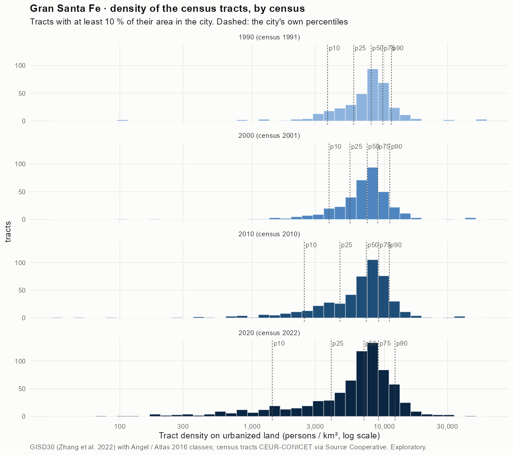
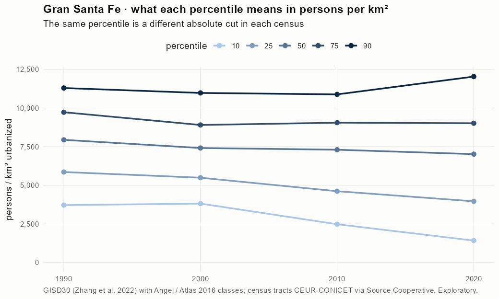
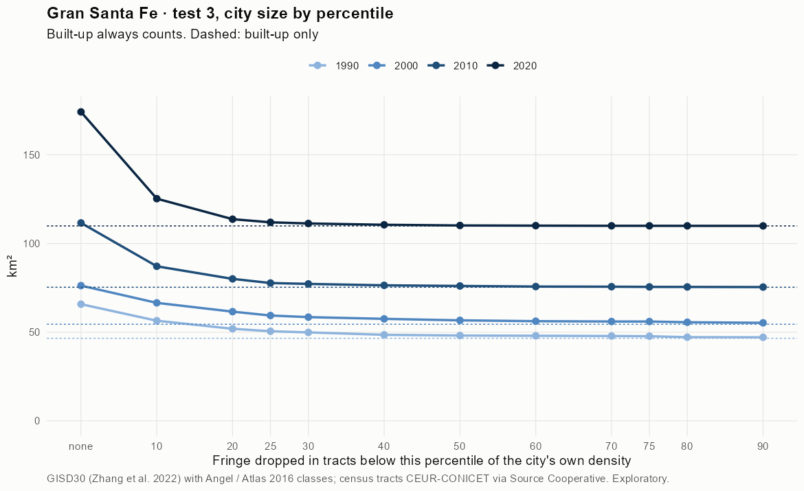
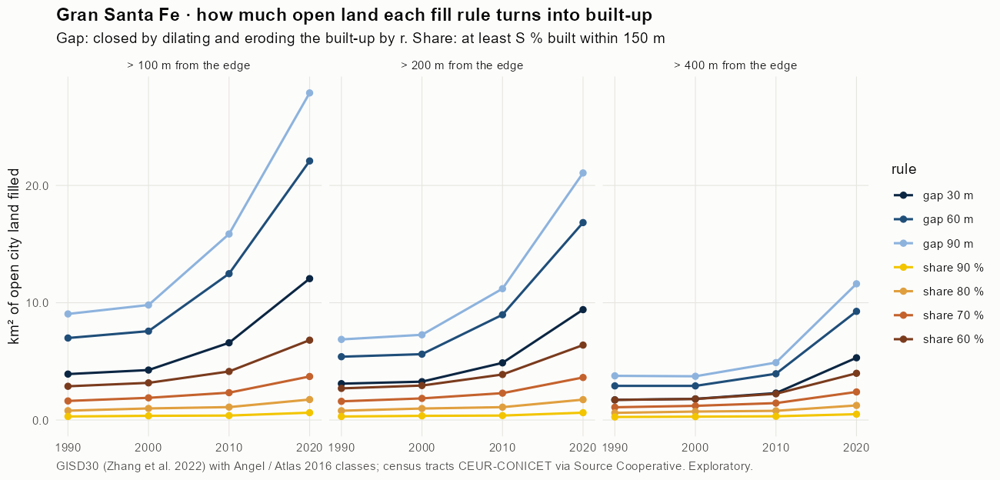
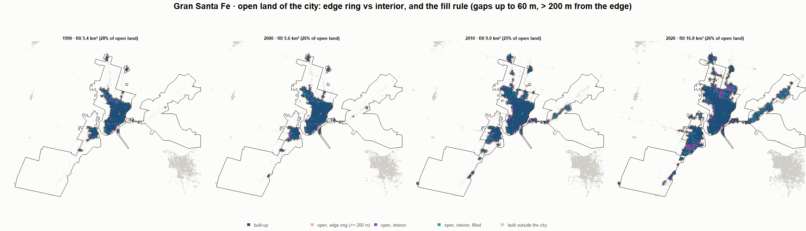
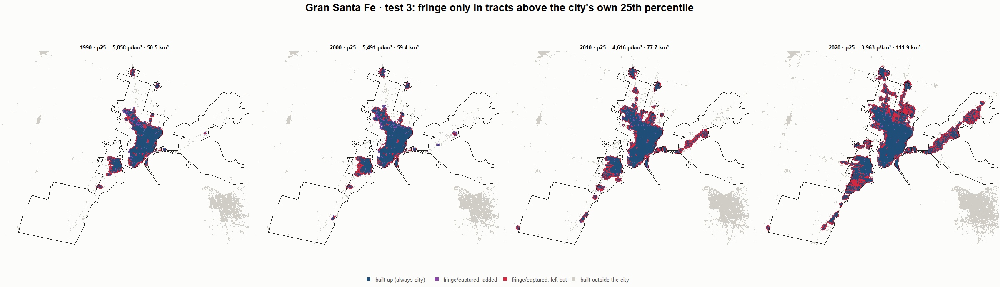

# Gran Santa Fe · relative cut (test 3) and the fill rule, 1990-2020

Exploratory. None of these numbers are project figures (they are not in `CIFRAS_CANONICAS.json`). Generated by `Rpipe/scripts/16_reglas.R` from step 11. Run of 2026-11-15. [All agglomerations](../REPORTE.md) · [methods](../../METODOS.md).

## The density of the tracts

Tracts with at least 10 % of their area in the city, and the city's own percentiles of their density on urbanized land.

| Year | Tracts | p10 | p25 | p50 | p75 | p90 |
|---|---|---|---|---|---|---|
| 1990 (census 1991) | 354 | 3,716 | 5,858 | 7,942 | 9,728 | 11,295 |
| 2000 (census 2001) | 368 | 3,815 | 5,491 | 7,412 | 8,903 | 10,977 |
| 2010 (census 2010) | 482 | 2,480 | 4,616 | 7,301 | 9,052 | 10,882 |
| 2020 (census 2022) | 737 | 1,420 | 3,963 | 7,016 | 9,017 | 12,034 |

## Test 3 · fringe only above the city's own percentile

Built-up land is always city. Fringe and captured land join only in tracts at or above percentile p of the city's own tract densities, that census.

| Percentile | 1990 cut p/km² | 2000 cut p/km² | 2010 cut p/km² | 2020 cut p/km² | 1990 km² | 2000 km² | 2010 km² | 2020 km² | 1990-2020 %/yr |
|---|---|---|---|---|---|---|---|---|---|
| none (Angel) | 0 | 0 | 0 | 0 | 65.8 | 76.3 | 111.6 | 174.2 | 3.30 |
| p10 | 3,716 | 3,815 | 2,480 | 1,420 | 56.5 | 66.5 | 87.1 | 125.3 | 2.69 |
| p20 | 5,162 | 5,130 | 3,879 | 3,266 | 51.9 | 61.6 | 80.0 | 113.7 | 2.65 |
| p25 | 5,858 | 5,491 | 4,616 | 3,963 | 50.5 | 59.4 | 77.7 | 111.9 | 2.69 |
| p30 | 6,414 | 6,029 | 5,363 | 4,895 | 49.9 | 58.5 | 77.2 | 111.3 | 2.71 |
| p40 | 7,276 | 6,712 | 6,406 | 6,075 | 48.5 | 57.5 | 76.4 | 110.5 | 2.78 |
| p50 | 7,942 | 7,412 | 7,301 | 7,016 | 48.1 | 56.7 | 76.0 | 110.2 | 2.80 |
| p60 | 8,449 | 7,926 | 7,950 | 7,686 | 48.0 | 56.2 | 75.7 | 110.1 | 2.81 |
| p70 | 9,263 | 8,618 | 8,671 | 8,512 | 47.8 | 56.0 | 75.6 | 110.0 | 2.81 |
| p75 | 9,728 | 8,903 | 9,052 | 9,017 | 47.7 | 56.0 | 75.5 | 110.0 | 2.82 |
| p80 | 10,180 | 9,255 | 9,507 | 9,719 | 47.2 | 55.6 | 75.5 | 109.9 | 2.86 |
| p90 | 11,295 | 10,977 | 10,882 | 12,034 | 47.1 | 55.3 | 75.4 | 109.9 | 2.87 |
| built only | — | — | — | — | 46.6 | 54.5 | 75.3 | 109.9 | 2.90 |

## Fill rule · open land in the centre that is probably built

An open pixel of the city (fringe or captured) farther than D from any land outside the city becomes built-up if it is a narrow gap in the built-up: closing the built-up (dilate, then erode) with a square of radius r covers it. Central rule: r = 60 m, D = 200 m; *dense* = tract at or above 500 p/km². The alternative share rule fills a pixel with at least S of the pixels within 150 m built.

| Year | Open city land km² | Interior (> 200 m) km² | Filled km² | Filled in dense tracts km² | Built-up km² | Built-up + fill km² | Persons / km² built | With fill |
|---|---|---|---|---|---|---|---|---|
| 1990 (census 1991) | 19.2 | 8.1 | 5.4 | 5.4 | 46.6 | 51.9 | 8,732 | 7,826 |
| 2000 (census 2001) | 21.8 | 8.3 | 5.6 | 5.6 | 54.5 | 60.1 | 8,345 | 7,567 |
| 2010 (census 2010) | 36.3 | 14.2 | 9.0 | 8.5 | 75.3 | 83.9 | 6,578 | 5,908 |
| 2020 (census 2022) | 64.3 | 31.6 | 16.8 | 12.6 | 109.9 | 122.5 | 4,929 | 4,422 |

**Sensitivity: km² filled by each rule** (in brackets, % of the interior open land):

| Year | Farther than | gap 30 m | gap 60 m | gap 90 m | share 60 % | share 70 % | share 80 % | share 90 % |
|---|---|---|---|---|---|---|---|---|
| 1990 | 100 m | 3.9 (36) | 7.0 (65) | 9.0 (84) | 2.9 (27) | 1.6 (15) | 0.8 (7) | 0.3 (3) |
| 1990 | 200 m | 3.1 (38) | 5.4 (67) | 6.9 (85) | 2.7 (33) | 1.6 (20) | 0.8 (10) | 0.3 (4) |
| 1990 | 400 m | 1.7 (39) | 2.9 (66) | 3.8 (85) | 1.7 (39) | 1.1 (25) | 0.6 (14) | 0.3 (6) |
| 2000 | 100 m | 4.3 (37) | 7.6 (66) | 9.8 (86) | 3.2 (28) | 1.9 (17) | 1.0 (9) | 0.4 (3) |
| 2000 | 200 m | 3.3 (39) | 5.6 (68) | 7.3 (87) | 2.9 (35) | 1.8 (22) | 1.0 (12) | 0.4 (4) |
| 2000 | 400 m | 1.8 (41) | 2.9 (67) | 3.7 (86) | 1.8 (41) | 1.2 (28) | 0.7 (17) | 0.3 (7) |
| 2010 | 100 m | 6.6 (33) | 12.5 (63) | 15.9 (80) | 4.1 (21) | 2.3 (12) | 1.1 (6) | 0.4 (2) |
| 2010 | 200 m | 4.9 (34) | 9.0 (63) | 11.2 (79) | 3.9 (27) | 2.3 (16) | 1.1 (8) | 0.4 (3) |
| 2010 | 400 m | 2.3 (37) | 3.9 (64) | 4.9 (79) | 2.2 (36) | 1.4 (23) | 0.8 (13) | 0.3 (5) |
| 2020 | 100 m | 12.1 (30) | 22.1 (55) | 27.9 (69) | 6.8 (17) | 3.7 (9) | 1.7 (4) | 0.6 (2) |
| 2020 | 200 m | 9.4 (30) | 16.8 (53) | 21.1 (67) | 6.4 (20) | 3.6 (11) | 1.7 (5) | 0.6 (2) |
| 2020 | 400 m | 5.3 (27) | 9.3 (48) | 11.6 (60) | 4.0 (21) | 2.4 (12) | 1.2 (6) | 0.5 (3) |

**Test 3 at p25 plus the central fill, without asking for a dense tract** (the fill keeps interior gaps of sparse tracts that test 3 drops):

| Year | Angel km² | Test 3 p25 km² | Test 3 + fill km² |
|---|---|---|---|
| 1990 | 65.8 | 50.5 | 54.2 |
| 2000 | 76.3 | 59.4 | 63.1 |
| 2010 | 111.6 | 77.7 | 85.2 |
| 2020 | 174.2 | 111.9 | 127.3 |

## Maps

### Edge ring, interior and fill

### Test 3 at p25

