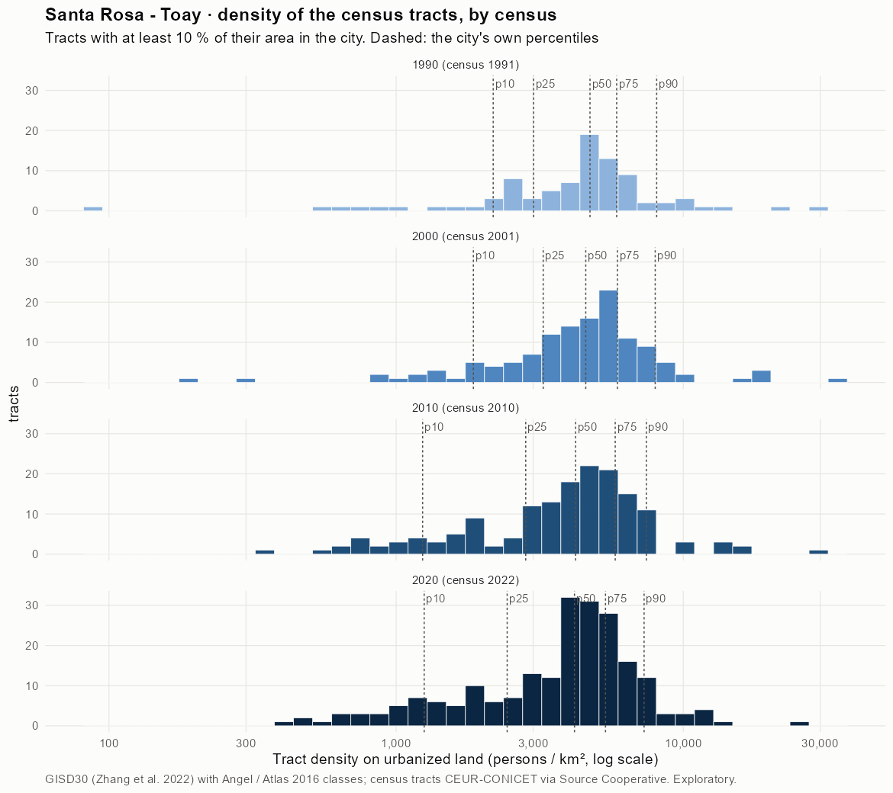
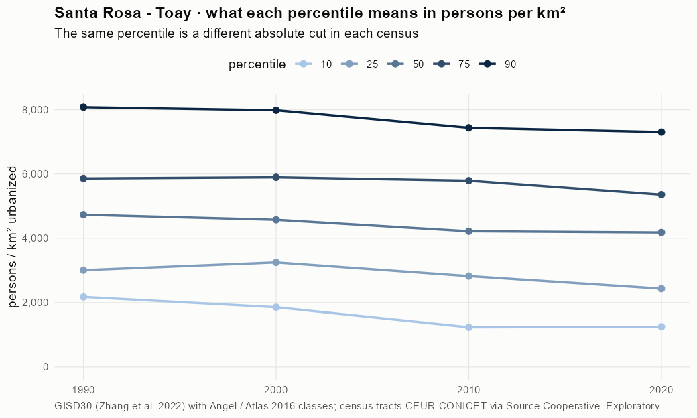
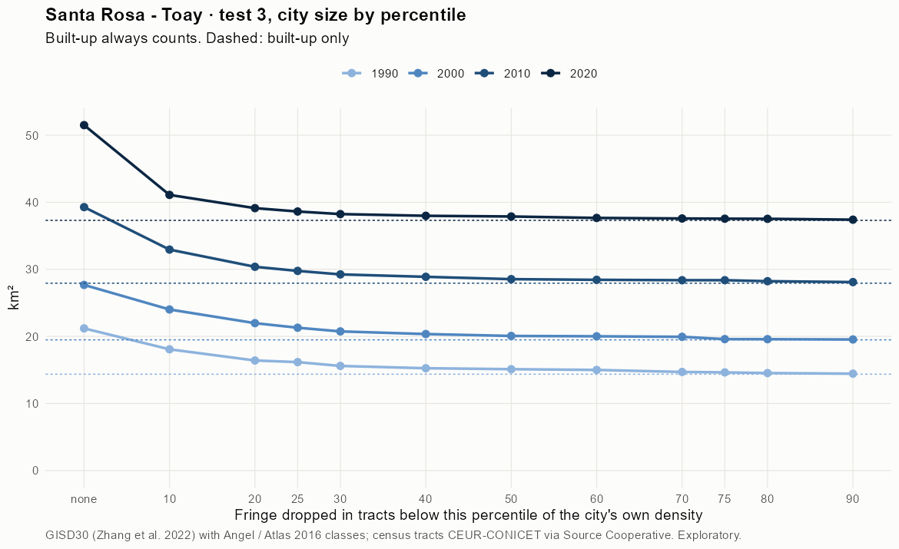
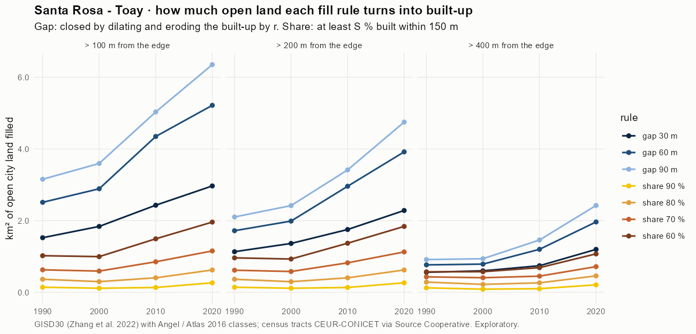
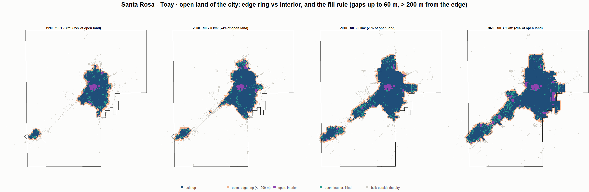
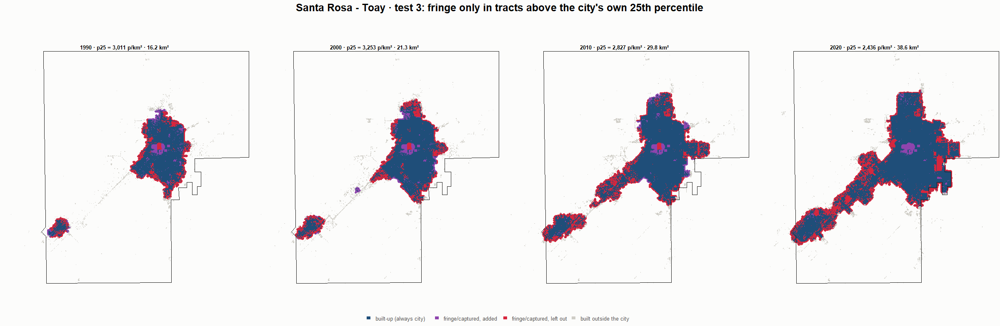

# Santa Rosa - Toay · relative cut (test 3) and the fill rule, 1990-2020

Exploratory. None of these numbers are project figures (they are not in `CIFRAS_CANONICAS.json`). Generated by `Rpipe/scripts/16_reglas.R` from step 11. Run of 2026-11-15. [All agglomerations](../REPORTE.md) · [methods](../../METODOS.md).

## The density of the tracts

Tracts with at least 10 % of their area in the city, and the city's own percentiles of their density on urbanized land.

| Year | Tracts | p10 | p25 | p50 | p75 | p90 |
|---|---|---|---|---|---|---|
| 1990 (census 1991) | 87 | 2,178 | 3,011 | 4,734 | 5,863 | 8,080 |
| 2000 (census 2001) | 129 | 1,858 | 3,253 | 4,575 | 5,898 | 7,985 |
| 2010 (census 2010) | 161 | 1,237 | 2,827 | 4,218 | 5,795 | 7,438 |
| 2020 (census 2022) | 215 | 1,252 | 2,436 | 4,180 | 5,360 | 7,304 |

## Test 3 · fringe only above the city's own percentile

Built-up land is always city. Fringe and captured land join only in tracts at or above percentile p of the city's own tract densities, that census.

| Percentile | 1990 cut p/km² | 2000 cut p/km² | 2010 cut p/km² | 2020 cut p/km² | 1990 km² | 2000 km² | 2010 km² | 2020 km² | 1990-2020 %/yr |
|---|---|---|---|---|---|---|---|---|---|
| none (Angel) | 0 | 0 | 0 | 0 | 21.2 | 27.7 | 39.3 | 51.5 | 3.00 |
| p10 | 2,178 | 1,858 | 1,237 | 1,252 | 18.1 | 24.0 | 32.9 | 41.1 | 2.78 |
| p20 | 2,672 | 2,831 | 1,992 | 1,853 | 16.4 | 22.0 | 30.4 | 39.1 | 2.94 |
| p25 | 3,011 | 3,253 | 2,827 | 2,436 | 16.2 | 21.3 | 29.8 | 38.6 | 2.94 |
| p30 | 3,675 | 3,490 | 3,145 | 2,928 | 15.6 | 20.7 | 29.2 | 38.2 | 3.03 |
| p40 | 4,354 | 4,055 | 3,732 | 3,781 | 15.3 | 20.4 | 28.9 | 38.0 | 3.09 |
| p50 | 4,734 | 4,575 | 4,218 | 4,180 | 15.1 | 20.1 | 28.5 | 37.9 | 3.11 |
| p60 | 4,959 | 5,181 | 4,875 | 4,621 | 15.0 | 20.0 | 28.4 | 37.7 | 3.12 |
| p70 | 5,557 | 5,523 | 5,253 | 5,160 | 14.7 | 19.9 | 28.4 | 37.6 | 3.18 |
| p75 | 5,863 | 5,898 | 5,795 | 5,360 | 14.6 | 19.6 | 28.4 | 37.5 | 3.19 |
| p80 | 6,150 | 6,587 | 6,102 | 5,662 | 14.5 | 19.6 | 28.2 | 37.5 | 3.21 |
| p90 | 8,080 | 7,985 | 7,438 | 7,304 | 14.4 | 19.5 | 28.1 | 37.4 | 3.22 |
| built only | — | — | — | — | 14.4 | 19.5 | 27.9 | 37.3 | 3.23 |

## Fill rule · open land in the centre that is probably built

An open pixel of the city (fringe or captured) farther than D from any land outside the city becomes built-up if it is a narrow gap in the built-up: closing the built-up (dilate, then erode) with a square of radius r covers it. Central rule: r = 60 m, D = 200 m; *dense* = tract at or above 500 p/km². The alternative share rule fills a pixel with at least S of the pixels within 150 m built.

| Year | Open city land km² | Interior (> 200 m) km² | Filled km² | Filled in dense tracts km² | Built-up km² | Built-up + fill km² | Persons / km² built | With fill |
|---|---|---|---|---|---|---|---|---|
| 1990 (census 1991) | 6.8 | 2.8 | 1.7 | 1.7 | 14.4 | 16.1 | 5,573 | 4,978 |
| 2000 (census 2001) | 8.2 | 3.3 | 2.0 | 2.0 | 19.5 | 21.4 | 5,230 | 4,754 |
| 2010 (census 2010) | 11.3 | 4.3 | 3.0 | 2.8 | 27.9 | 30.7 | 4,110 | 3,738 |
| 2020 (census 2022) | 14.2 | 6.8 | 3.9 | 3.4 | 37.3 | 40.7 | 3,574 | 3,273 |

**Sensitivity: km² filled by each rule** (in brackets, % of the interior open land):

| Year | Farther than | gap 30 m | gap 60 m | gap 90 m | share 60 % | share 70 % | share 80 % | share 90 % |
|---|---|---|---|---|---|---|---|---|
| 1990 | 100 m | 1.5 (38) | 2.5 (63) | 3.2 (79) | 1.0 (25) | 0.6 (16) | 0.4 (9) | 0.1 (4) |
| 1990 | 200 m | 1.1 (40) | 1.7 (61) | 2.1 (74) | 1.0 (34) | 0.6 (22) | 0.4 (13) | 0.1 (5) |
| 1990 | 400 m | 0.6 (36) | 0.8 (49) | 0.9 (58) | 0.6 (36) | 0.4 (27) | 0.3 (18) | 0.1 (8) |
| 2000 | 100 m | 1.8 (39) | 2.9 (62) | 3.6 (77) | 1.0 (21) | 0.6 (13) | 0.3 (6) | 0.1 (2) |
| 2000 | 200 m | 1.4 (41) | 2.0 (60) | 2.4 (73) | 0.9 (28) | 0.6 (18) | 0.3 (9) | 0.1 (3) |
| 2000 | 400 m | 0.6 (37) | 0.8 (48) | 0.9 (57) | 0.6 (35) | 0.4 (25) | 0.2 (13) | 0.1 (5) |
| 2010 | 100 m | 2.4 (39) | 4.3 (70) | 5.0 (82) | 1.5 (24) | 0.9 (14) | 0.4 (7) | 0.1 (2) |
| 2010 | 200 m | 1.8 (40) | 3.0 (68) | 3.4 (79) | 1.4 (32) | 0.8 (19) | 0.4 (9) | 0.1 (3) |
| 2010 | 400 m | 0.7 (34) | 1.2 (55) | 1.5 (67) | 0.7 (32) | 0.4 (21) | 0.3 (12) | 0.1 (5) |
| 2020 | 100 m | 3.0 (34) | 5.2 (59) | 6.4 (72) | 2.0 (22) | 1.2 (13) | 0.6 (7) | 0.3 (3) |
| 2020 | 200 m | 2.3 (33) | 3.9 (57) | 4.8 (70) | 1.8 (27) | 1.1 (17) | 0.6 (9) | 0.3 (4) |
| 2020 | 400 m | 1.2 (31) | 2.0 (50) | 2.4 (62) | 1.1 (28) | 0.7 (18) | 0.5 (12) | 0.2 (5) |

**Test 3 at p25 plus the central fill, without asking for a dense tract** (the fill keeps interior gaps of sparse tracts that test 3 drops):

| Year | Angel km² | Test 3 p25 km² | Test 3 + fill km² |
|---|---|---|---|
| 1990 | 21.2 | 16.2 | 17.2 |
| 2000 | 27.7 | 21.3 | 22.8 |
| 2010 | 39.3 | 29.8 | 32.4 |
| 2020 | 51.5 | 38.6 | 42.1 |

## Maps

### Edge ring, interior and fill

### Test 3 at p25

